# 豆豆龙英语 · 第 52 集课件（EP052 草稿）

- 来源：`052_Journey to the West 52_An Ocean from a Vase.pptx`（主课件，15 页）
- OCR：`blocked`（no local OCR provider importable (pytesseract missing): No module named 'pytesseract'）
- 分类：待人工审核（unknown）
- 审核状态：`unreviewed`

## Slide 001

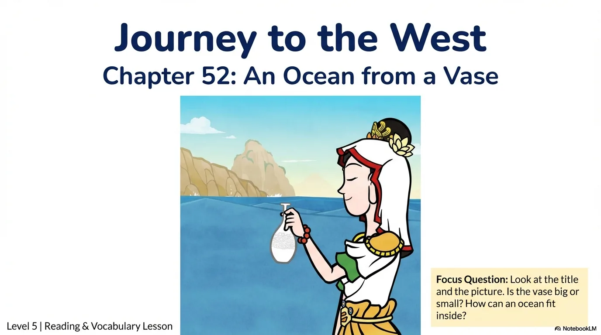

- 来源：`ppt/media/image1.png`（relationship `rId2`）
- 尺寸：1376×768
- 源 SHA-256：`908ae68199762f5d3e8994b10b0fb0748090726255ae5dfa3662ba9def56ec01`
- 输出 SHA-256：`f485cb4056e7b3d72c587d951955953a82360866eb8898970d1080f0ba4de753`
- 分类：unknown ｜ OCR：blocked ｜ 审核：unreviewed

## Slide 002

- 来源：`ppt/media/image3.png`（relationship `rId2`）
- 尺寸：1376×768
- 源 SHA-256：`d047992c5685170ca708102fc12bc113aeeba47d09bed65262c87931115a3102`
- 输出 SHA-256：`2757c29ac0823497e3cd1f1698f3faf63df2bb7138d5b79058f2f46f5261ed23`
- 分类：unknown ｜ OCR：blocked ｜ 审核：unreviewed

## Slide 003

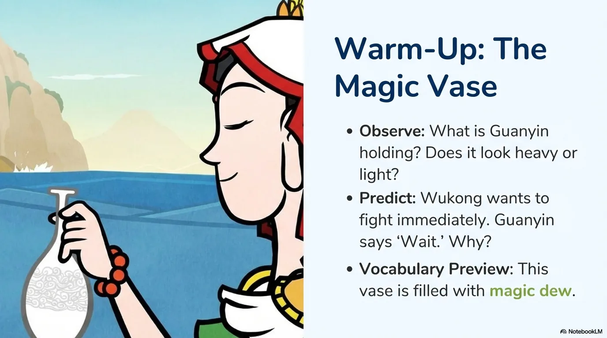

- 来源：`ppt/media/image4.png`（relationship `rId2`）
- 尺寸：1376×768
- 源 SHA-256：`5f91ae760add634b6f45d3ea6fe4540b8198db30e9372fe4716c670e99bb1b7f`
- 输出 SHA-256：`da583ec06ef9a27d225d7533ce007927a926c3640603f89ac59eddcd609e5eae`
- 分类：unknown ｜ OCR：blocked ｜ 审核：unreviewed

## Slide 004

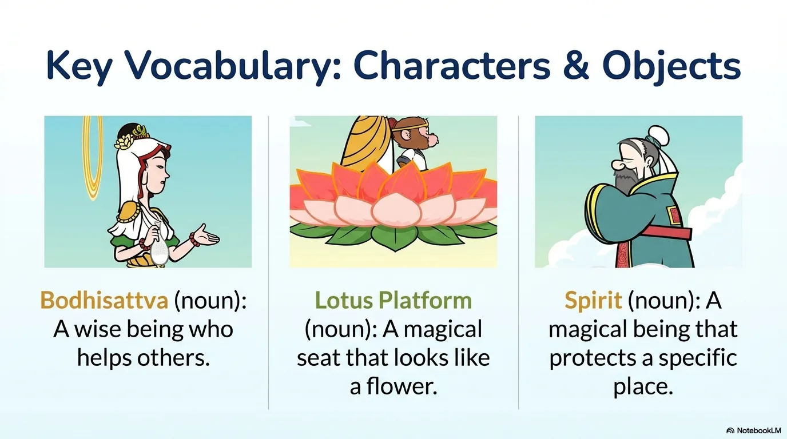

- 来源：`ppt/media/image5.png`（relationship `rId2`）
- 尺寸：1376×768
- 源 SHA-256：`9c65840a9c3954d4a0c5172e6b267ae4086f35c6eac596f603fb373ea51e30dd`
- 输出 SHA-256：`11521bea60b3617eb47667969b79ccd31fea7b5437b0a9d5dcd89d2e7d51d0f4`
- 分类：unknown ｜ OCR：blocked ｜ 审核：unreviewed

## Slide 005

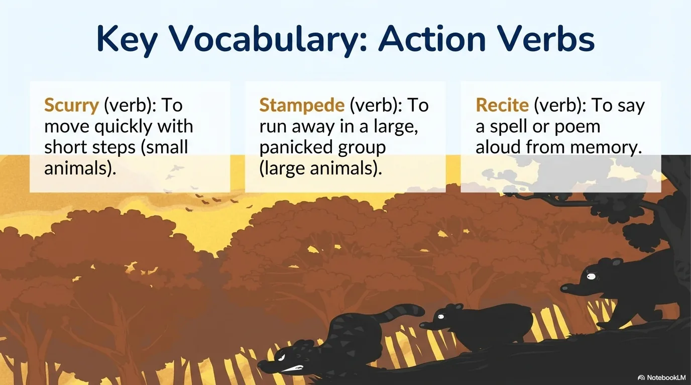

- 来源：`ppt/media/image6.png`（relationship `rId2`）
- 尺寸：1376×768
- 源 SHA-256：`72a6bf4151a0c181d9eb1ec23dd45a7bdd648f57291bcd3dcd118c5b6fa7ea56`
- 输出 SHA-256：`b67e5743ff7c5c2dbdeadd25aa20e3933ff9465175045e004272708af34a2d96`
- 分类：unknown ｜ OCR：blocked ｜ 审核：unreviewed

## Slide 006

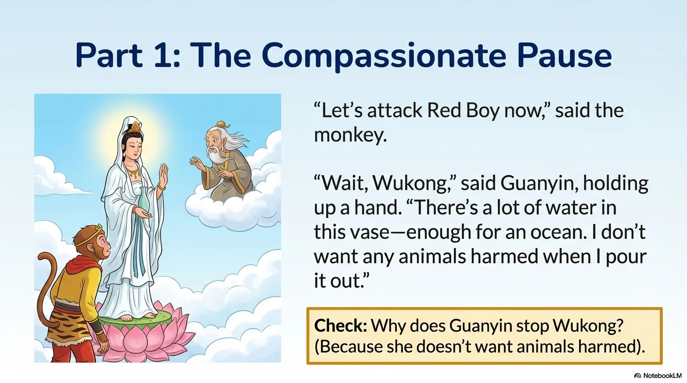

- 来源：`ppt/media/image7.png`（relationship `rId2`）
- 尺寸：1376×768
- 源 SHA-256：`16e67cc00fc9b23b1ed8662cdfb8358afc8937a242be08c14396a0f5bd34df81`
- 输出 SHA-256：`cac8d675cb5234e957a9bf73c6faeec49b70ac23912c91ae5d1c30060c9e6230`
- 分类：unknown ｜ OCR：blocked ｜ 审核：unreviewed

## Slide 007

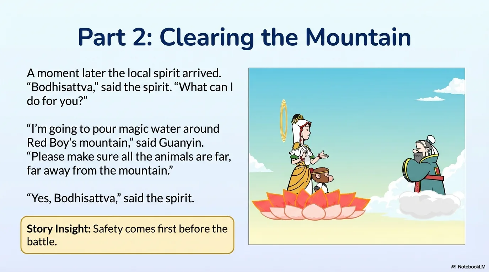

- 来源：`ppt/media/image8.png`（relationship `rId2`）
- 尺寸：1376×768
- 源 SHA-256：`7dbf2d0b71001c615982e56ac3af86da4189182d9a95b3b59188b414c166e633`
- 输出 SHA-256：`5b8584d0c40672f0443ab1528ada9cd0180a1e9a1b68659faa53dade0c6986f4`
- 分类：unknown ｜ OCR：blocked ｜ 审核：unreviewed

## Slide 008

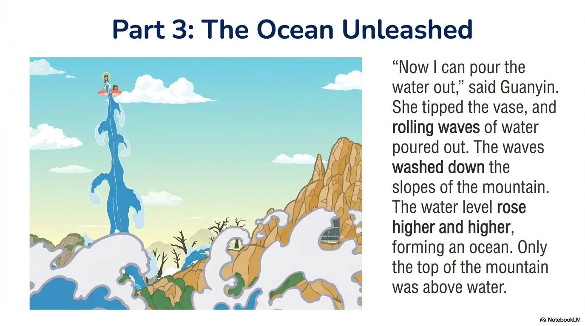

- 来源：`ppt/media/image9.png`（relationship `rId2`）
- 尺寸：1376×768
- 源 SHA-256：`6cbc48f551251a53565c1c8f923b8fd70c599a60c31bb39e585cd80b150f2fc1`
- 输出 SHA-256：`85cee855ca4471236686c0c46ac8559308d3ec37683a31e9e1433ca8f302aef6`
- 分类：unknown ｜ OCR：blocked ｜ 审核：unreviewed

## Slide 009

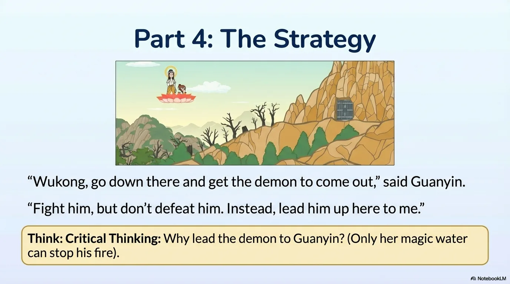

- 来源：`ppt/media/image10.png`（relationship `rId2`）
- 尺寸：1376×768
- 源 SHA-256：`fcd7371af51597985199243b5c4ed38e26596c05427f55d5a15b80544ee58cb3`
- 输出 SHA-256：`f1c72f9b9f0e76ffaec09b22aa97e08afd5c4c4eabce275d4fc41548b2a465a9`
- 分类：unknown ｜ OCR：blocked ｜ 审核：unreviewed

## Slide 010

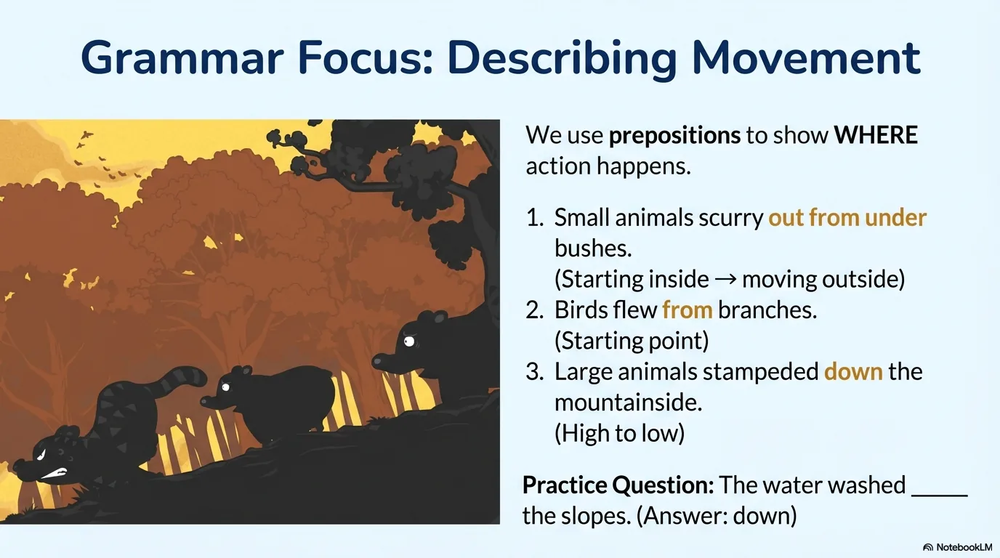

- 来源：`ppt/media/image11.png`（relationship `rId2`）
- 尺寸：1376×768
- 源 SHA-256：`8dea46c19cfb9daffc7237b9870ff4c0dece9381fcc3315ba7c38ee8bc633cd1`
- 输出 SHA-256：`1911a2742f74985992f9b6b3a9c2d05714f9999cb4eb1d6074341aeb8cd041b1`
- 分类：unknown ｜ OCR：blocked ｜ 审核：unreviewed

## Slide 011

- 来源：`ppt/media/image12.png`（relationship `rId2`）
- 尺寸：1376×768
- 源 SHA-256：`4c97643e22530bee886af3b9bd932fe62e5fae471a09cb9f77e71d432e169884`
- 输出 SHA-256：`a54487243cb36ef8104c672587c3ca5ab77e514fcdaf4521e83a5e7b33d22935`
- 分类：unknown ｜ OCR：blocked ｜ 审核：unreviewed

## Slide 012

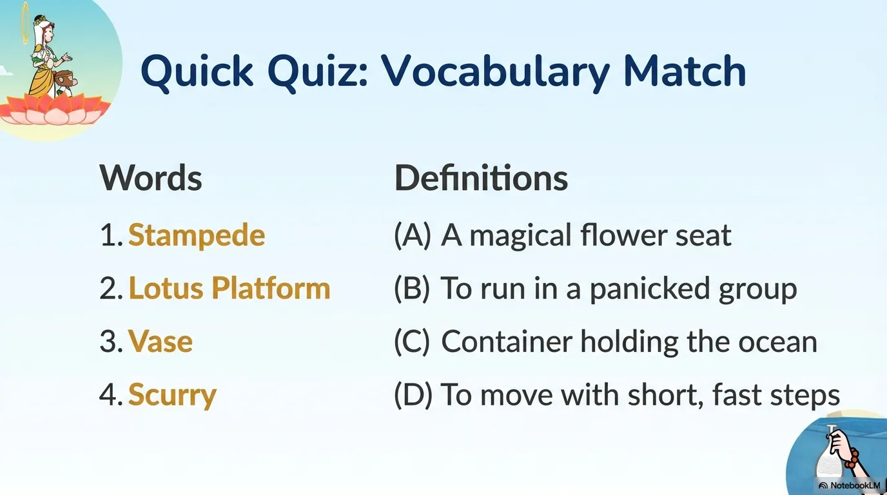

- 来源：`ppt/media/image13.png`（relationship `rId2`）
- 尺寸：1376×768
- 源 SHA-256：`437b5656745f3a31027398b7ca006156ef3eea9e704cbedc4791a907a88a6a4a`
- 输出 SHA-256：`05efcac40b2796e750e5c5e657fa9fa17d5b8553c126ba88a34d3abec1f63376`
- 分类：unknown ｜ OCR：blocked ｜ 审核：unreviewed

## Slide 013

- 来源：`ppt/media/image14.png`（relationship `rId2`）
- 尺寸：1376×768
- 源 SHA-256：`c08e2578c31eac63f97538b1c9e1f0aad2cbeee6cfe015949fafadab93ce8a13`
- 输出 SHA-256：`232960e49ac1a06eb3cf87e26558884e9907f684f1ec4f067192751321504a8a`
- 分类：unknown ｜ OCR：blocked ｜ 审核：unreviewed

## Slide 014

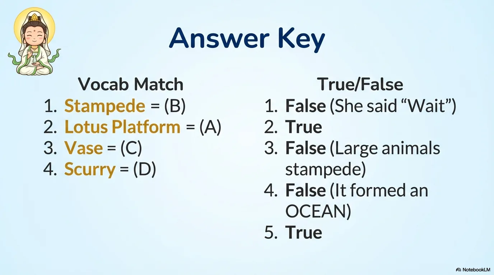

- 来源：`ppt/media/image15.png`（relationship `rId2`）
- 尺寸：1376×768
- 源 SHA-256：`ddc453c0f56b440d83bd08ff2c747a7d0c56224fadd21d1db471e59309e7fe98`
- 输出 SHA-256：`cb1f63a80b823dc8d1328b9f0bd591d2963e7099764507ab589bb0c2ceb5835d`
- 分类：unknown ｜ OCR：blocked ｜ 审核：unreviewed

## Slide 015

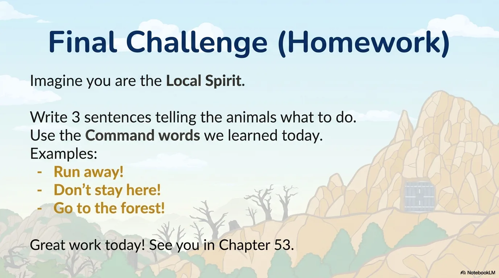

- 来源：`ppt/media/image16.png`（relationship `rId2`）
- 尺寸：1376×768
- 源 SHA-256：`dcbf0b58c949f21917f899469f96a48e7d49a4e90560fde17c5de29b8a16e21e`
- 输出 SHA-256：`c7a5723d8c9d782e60092a0e065b3ee60a07bc7de843255dfba26b6dd5d77673`
- 分类：unknown ｜ OCR：blocked ｜ 审核：unreviewed
