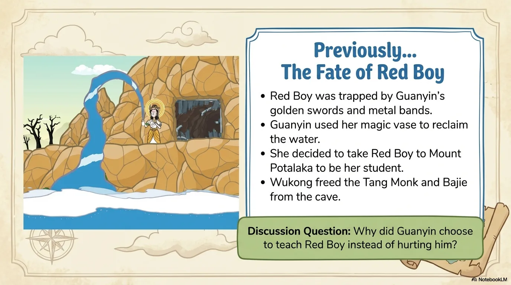
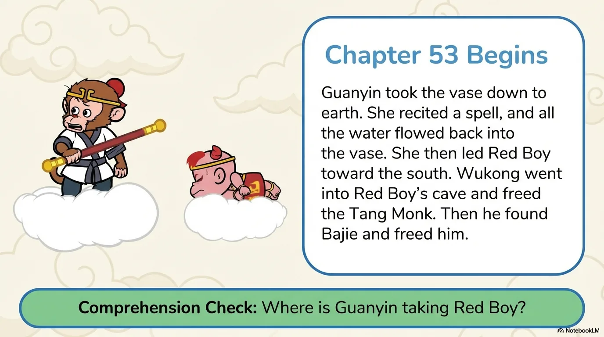
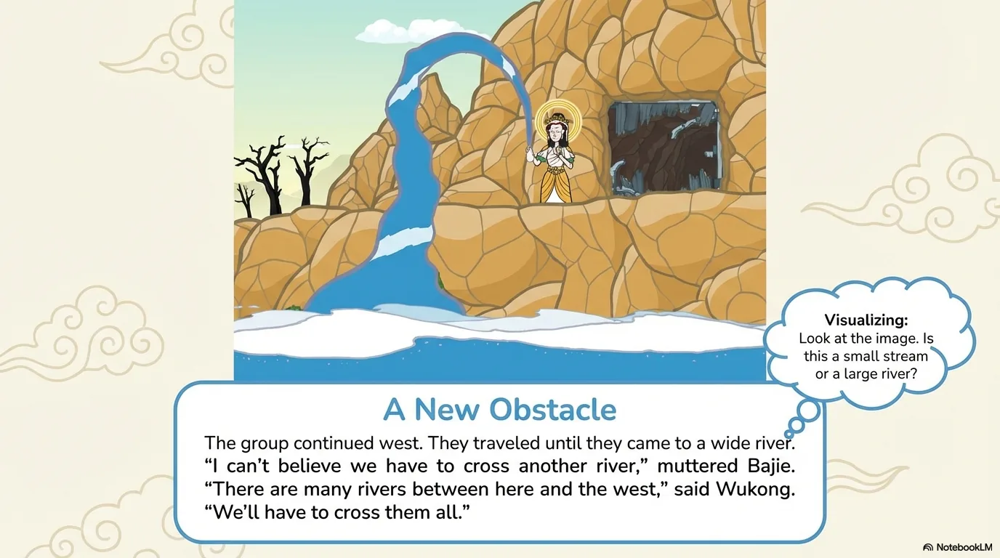
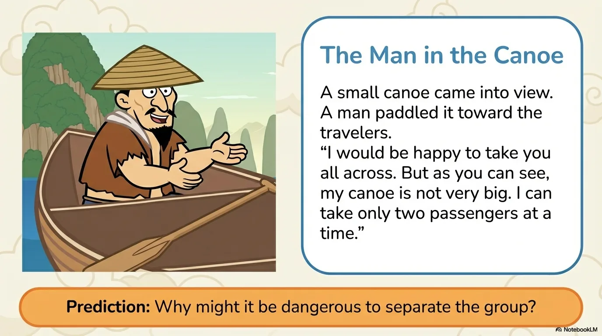
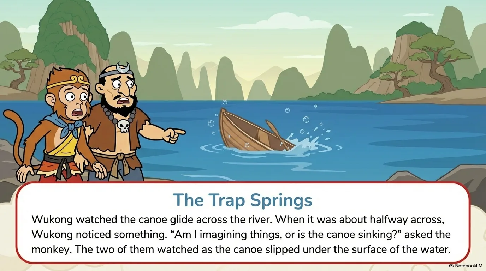
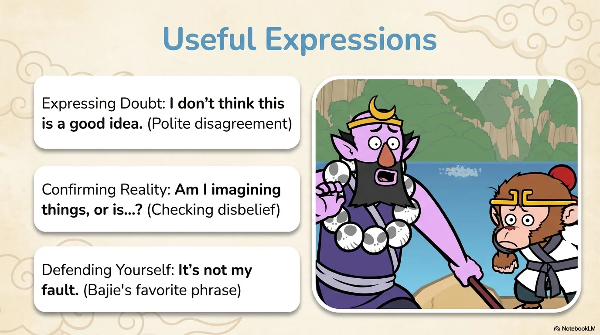
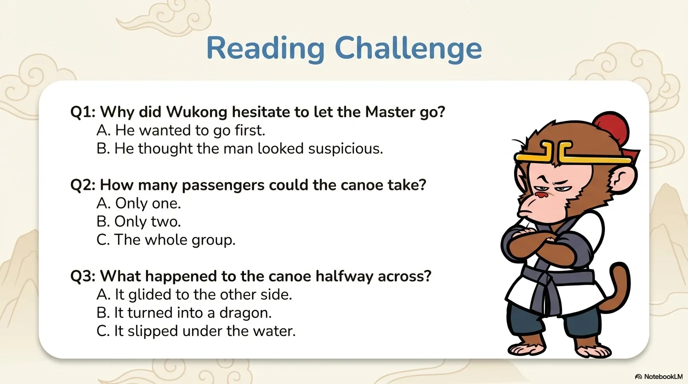
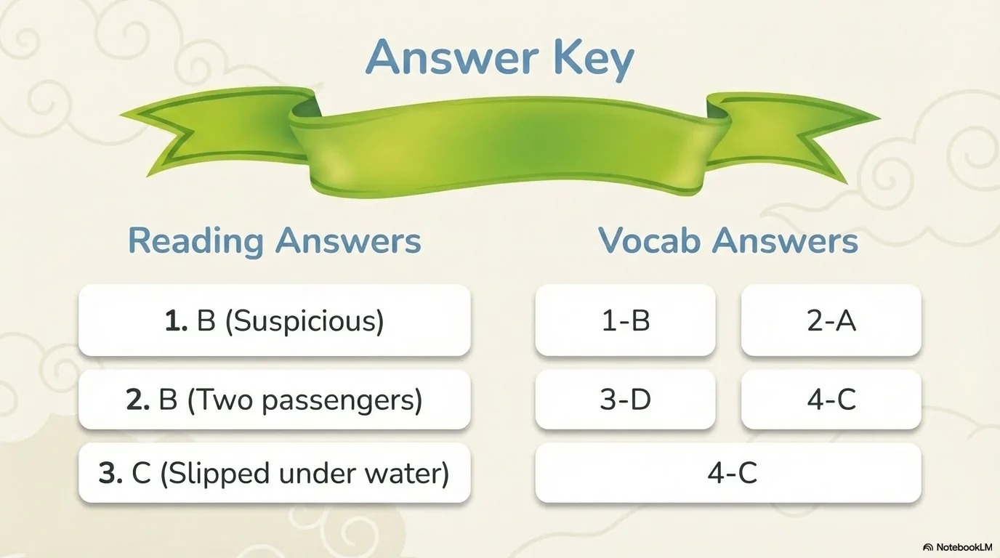

# 豆豆龙英语 · 第 53 集课件（EP053 草稿）

- 来源：`053_Journey to the West 53_The Man in the Canoe.pptx`（主课件，20 页）
- OCR：`blocked`（no local OCR provider importable (pytesseract missing): No module named 'pytesseract'）
- 分类：待人工审核（unknown）
- 审核状态：`unreviewed`

## Slide 001

- 来源：`ppt/media/image1.png`（relationship `rId2`）
- 尺寸：1376×768
- 源 SHA-256：`627eb3380d85e7f181c095bd5793f8f8a153ee460149df5808bc858bf741a6c6`
- 输出 SHA-256：`7c9264331e91a6d1eb167292043031ee50c5d1e390549dbb3b1f046632e4f21a`
- 分类：unknown ｜ OCR：blocked ｜ 审核：unreviewed

## Slide 002

- 来源：`ppt/media/image3.png`（relationship `rId2`）
- 尺寸：1376×768
- 源 SHA-256：`6bb1cb10e7f8c3d4528ac7f57b3ab9fb82516997f1e861a28168458efa0380f6`
- 输出 SHA-256：`849d052d1af7afc8b6db7b41bf262de39632e53c583f359d9b3394ed818a4d95`
- 分类：unknown ｜ OCR：blocked ｜ 审核：unreviewed

## Slide 003

- 来源：`ppt/media/image4.png`（relationship `rId2`）
- 尺寸：1376×768
- 源 SHA-256：`392407beb00faeb2b5f600b1e7e63ff866e9a93ee6753a8438ae89c83f9b7230`
- 输出 SHA-256：`9ca490d793603cee33687b7b7155e8f05c6ab89ae96186d65ce3ec6616ecced4`
- 分类：unknown ｜ OCR：blocked ｜ 审核：unreviewed

## Slide 004

- 来源：`ppt/media/image5.png`（relationship `rId2`）
- 尺寸：1376×768
- 源 SHA-256：`254b6afe336cc91c04efb4a9dcf2c0bf78c3e5bbe48e1c55ab854394e4c063c6`
- 输出 SHA-256：`443a32964e10be61a4e53679453b2b91c009d73690f8b6d2c676fa3bdc330310`
- 分类：unknown ｜ OCR：blocked ｜ 审核：unreviewed

## Slide 005

- 来源：`ppt/media/image6.png`（relationship `rId2`）
- 尺寸：1376×768
- 源 SHA-256：`b55efe4d5ab120412d2f2d4d99b822e843340ce0d52407433e776aa05b98fa2e`
- 输出 SHA-256：`24df923a3194637b18008b9d60aceaaefcd756b7a66ffd90558eaf1b5c8f85f5`
- 分类：unknown ｜ OCR：blocked ｜ 审核：unreviewed

## Slide 006

- 来源：`ppt/media/image7.png`（relationship `rId2`）
- 尺寸：1376×768
- 源 SHA-256：`b4e6d3ef5647bc305641236015a809e4788d7cbb8cbb3a8f213b89f598a96961`
- 输出 SHA-256：`37b523f4e362c0947748278a7f92d40aa505be7f6a0ad762e31b5dcf2386f6fa`
- 分类：unknown ｜ OCR：blocked ｜ 审核：unreviewed

## Slide 007

- 来源：`ppt/media/image8.png`（relationship `rId2`）
- 尺寸：1376×768
- 源 SHA-256：`2fd2d195225edd1cafdd2e727a7fe3bed315a9a003227a49383e75f03aae93ef`
- 输出 SHA-256：`18fe26c3665c84a852481a381bbb20e22a1b77636c66a9ee091302446071e602`
- 分类：unknown ｜ OCR：blocked ｜ 审核：unreviewed

## Slide 008

- 来源：`ppt/media/image9.png`（relationship `rId2`）
- 尺寸：1376×768
- 源 SHA-256：`86ccc870a0b6120edfa284ac1b75768726e1774599da39d7fdb2f67c9e60d521`
- 输出 SHA-256：`a5541ee82ac4ee1838414a01361f950c3a19d13a4c880917afb3698a8cf7ad1e`
- 分类：unknown ｜ OCR：blocked ｜ 审核：unreviewed

## Slide 009

- 来源：`ppt/media/image10.png`（relationship `rId2`）
- 尺寸：1376×768
- 源 SHA-256：`ce6d104e4cf224d4e7358ff0582b3e0ca8d69f988d93887993e7104b0c5b9eac`
- 输出 SHA-256：`0c55a5d69aefc10db79ceecb6a43ba5637c4b2390dda3b6221cfec9f6e5ef024`
- 分类：unknown ｜ OCR：blocked ｜ 审核：unreviewed

## Slide 010

- 来源：`ppt/media/image11.png`（relationship `rId2`）
- 尺寸：1376×768
- 源 SHA-256：`41c39aee9dc62dccc3b2a714ee121bb9726cd5715b84c0c11be6baf94de8aaf2`
- 输出 SHA-256：`e11d0ad050fca59a43ecd5b149025a0fe91d6d0352bfda7a0af30b4c1fb1bb45`
- 分类：unknown ｜ OCR：blocked ｜ 审核：unreviewed

## Slide 011

- 来源：`ppt/media/image12.png`（relationship `rId2`）
- 尺寸：1376×768
- 源 SHA-256：`22605f15ca79f5aab95ce98254ddcded38b1c3fdca3a2965ce5af2c81c371a7c`
- 输出 SHA-256：`17b3e9d922d7934b60b6e944bfcd1812bec644a595601330bea2ee67cffa109f`
- 分类：unknown ｜ OCR：blocked ｜ 审核：unreviewed

## Slide 012

- 来源：`ppt/media/image13.png`（relationship `rId2`）
- 尺寸：1376×768
- 源 SHA-256：`5c5effae7b464b55d65d098bb92be93031c3e7878f57f4ee5f5b739282d56e10`
- 输出 SHA-256：`1fadcb3f403a6a4e5a5e363f049156e84e923bbc5b843050cb89057a5fd43e1a`
- 分类：unknown ｜ OCR：blocked ｜ 审核：unreviewed

## Slide 013

- 来源：`ppt/media/image14.png`（relationship `rId2`）
- 尺寸：1376×768
- 源 SHA-256：`0a83786f9eac6e3d59f78ab44dc7de632977d4b091f2c338c772df4c90ee1fc7`
- 输出 SHA-256：`97be0692bec8caab1fd0b53c14d7ff195b8ba47267a60b1f1f707c1d1bd719b1`
- 分类：unknown ｜ OCR：blocked ｜ 审核：unreviewed

## Slide 014

- 来源：`ppt/media/image15.png`（relationship `rId2`）
- 尺寸：1376×768
- 源 SHA-256：`8d17ce4ddadef5aaa299957f7b2d1e7ac566beeecdc275f5adb43ca607cd28b2`
- 输出 SHA-256：`aa387d884fd4c0f66c4726ad3bdb8b044af28a964b46e10d92d5c5ad0522e777`
- 分类：unknown ｜ OCR：blocked ｜ 审核：unreviewed

## Slide 015

- 来源：`ppt/media/image16.png`（relationship `rId2`）
- 尺寸：1376×768
- 源 SHA-256：`d9ac6be6e1271e455fd0d23c21e29783b3f151a0a9375fa99ff3ee537daab644`
- 输出 SHA-256：`df38c027296de27ea0b7278e4eda5f431acbabe2eb0755aca2436c649678f629`
- 分类：unknown ｜ OCR：blocked ｜ 审核：unreviewed

## Slide 016

- 来源：`ppt/media/image17.png`（relationship `rId2`）
- 尺寸：1376×768
- 源 SHA-256：`f7004d02cf35dc1a1e47fb29654c96c8d6ca5f392c59a9520fdb2fabb3754a0c`
- 输出 SHA-256：`0b5972146d39676f5f1a017d7874f68b236cc4da5293d8f635d36a58cf6a6dfb`
- 分类：unknown ｜ OCR：blocked ｜ 审核：unreviewed

## Slide 017

- 来源：`ppt/media/image18.png`（relationship `rId2`）
- 尺寸：1376×768
- 源 SHA-256：`f2ba7583351fade8f49faeb13c9c778b050b7cba545a846f2ce71a20a4e0ae50`
- 输出 SHA-256：`c7448c8b81debafc5625153fa586be4eb42906bdb6b0bdbbb43e0aa900658c10`
- 分类：unknown ｜ OCR：blocked ｜ 审核：unreviewed

## Slide 018

- 来源：`ppt/media/image19.png`（relationship `rId2`）
- 尺寸：1376×768
- 源 SHA-256：`ee617203887fb8289d3d8ba8d749935cf28d29896a576b86c75fd70e9ad6c58f`
- 输出 SHA-256：`d169ffd7fe88dfc185bcd6f1a913947f28cb638b33fd69ab0bb36bcf0a07ae65`
- 分类：unknown ｜ OCR：blocked ｜ 审核：unreviewed

## Slide 019

- 来源：`ppt/media/image20.png`（relationship `rId2`）
- 尺寸：1376×768
- 源 SHA-256：`bc79b8e5ccf7019737c3f72a078219b5c13fe7e5354cb11cf940795b21091790`
- 输出 SHA-256：`91e2629d08b581acf3f260202ede788384118d96aeec88833aa6a7a616e24e49`
- 分类：unknown ｜ OCR：blocked ｜ 审核：unreviewed

## Slide 020

- 来源：`ppt/media/image21.png`（relationship `rId2`）
- 尺寸：1376×768
- 源 SHA-256：`d10f1429d7756c887ac90c5fc33e6d5e18f7bf4608cd7a891e366012f2554afa`
- 输出 SHA-256：`796c7098f05bfd189b1e08c5da7dba8dc0004730b4c5b041ba1edcfb70891a1a`
- 分类：unknown ｜ OCR：blocked ｜ 审核：unreviewed
