# 豆豆龙英语 · 第 54 集课件（EP054 草稿）

- 来源：`054_Journey to the West 54_The River God.pptx`（主课件，20 页）
- OCR：`blocked`（no local OCR provider importable (pytesseract missing): No module named 'pytesseract'）
- 分类：待人工审核（unknown）
- 审核状态：`unreviewed`

## Slide 001

- 来源：`ppt/media/image1.png`（relationship `rId2`）
- 尺寸：1376×768
- 源 SHA-256：`1ceda2f6ff0672b6ecde84eb21f85673da9001cb7df1a052e66b0b6e42db6f4b`
- 输出 SHA-256：`e09e539b2f7fa2144468e2ee51f3883c2b8026376466a28839b4fe09ff63aa23`
- 分类：unknown ｜ OCR：blocked ｜ 审核：unreviewed

## Slide 002

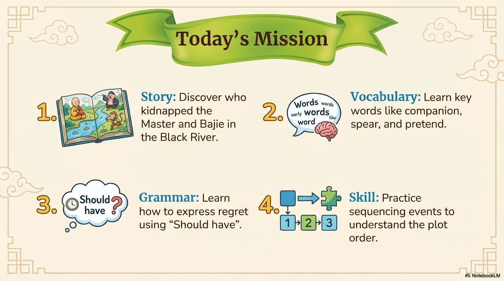

- 来源：`ppt/media/image3.png`（relationship `rId2`）
- 尺寸：1376×768
- 源 SHA-256：`7698088271d99c86d61497dc3f8cd4fd0e6fb02026097921e09692b592be7b00`
- 输出 SHA-256：`8634be759aa4dec22c452b20abace62640fa2657831cf478f7083da77bcc9727`
- 分类：unknown ｜ OCR：blocked ｜ 审核：unreviewed

## Slide 003

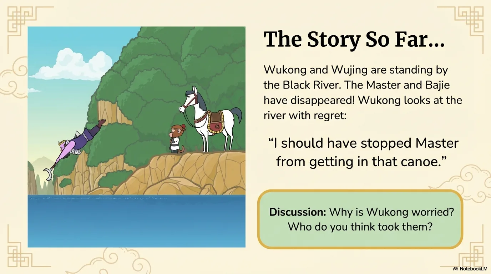

- 来源：`ppt/media/image4.png`（relationship `rId2`）
- 尺寸：1376×768
- 源 SHA-256：`7381056da397daad55ea7be8df63842fcb578f828afee871d8c4f83ee8ef8430`
- 输出 SHA-256：`e6da559ed504cfeb8476f8e46e7aa9984eccab2a2e8067242d4997d4e626f15e`
- 分类：unknown ｜ OCR：blocked ｜ 审核：unreviewed

## Slide 004

- 来源：`ppt/media/image5.png`（relationship `rId2`）
- 尺寸：1376×768
- 源 SHA-256：`cdcd79051db9b712289ed3be5d5dc4420853d803f2ca40ae24da12f565b1c32f`
- 输出 SHA-256：`fa1162f3381e5687ba3a7a5461c6db5b6b26e931baf79f6a875c65e605caf8ff`
- 分类：unknown ｜ OCR：blocked ｜ 审核：unreviewed

## Slide 005

- 来源：`ppt/media/image6.png`（relationship `rId2`）
- 尺寸：1376×768
- 源 SHA-256：`a0ea23145fc4a7040a02001a0adaf941b12f460d8b8f78e3f387508bcc5e3ff6`
- 输出 SHA-256：`6a7c7895221acd6806996ce6f2e3ffa30dc80174284b0b32f08a6f5ec8bccbbe`
- 分类：unknown ｜ OCR：blocked ｜ 审核：unreviewed

## Slide 006

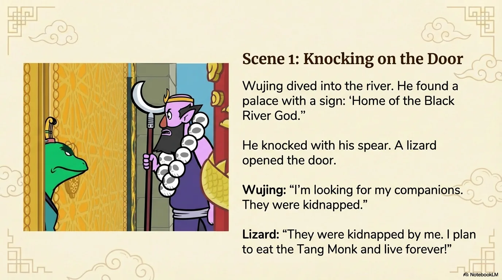

- 来源：`ppt/media/image7.png`（relationship `rId2`）
- 尺寸：1376×768
- 源 SHA-256：`9bf84f0c66aab9abbd5bacdf128de24bee88bbaa74e4d88b8842703ca3b14941`
- 输出 SHA-256：`082524c395648a3e2346d26a3b397a866473e67bcaee7e8b1d347a61560c9270`
- 分类：unknown ｜ OCR：blocked ｜ 审核：unreviewed

## Slide 007

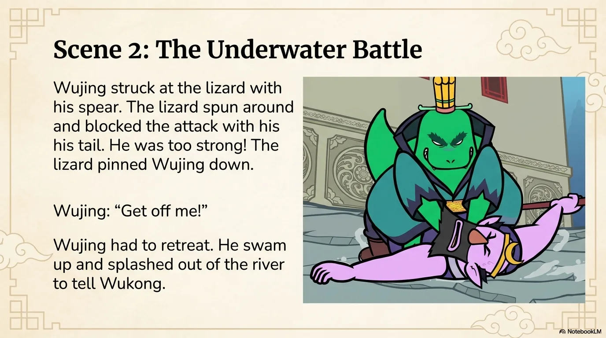

- 来源：`ppt/media/image8.png`（relationship `rId2`）
- 尺寸：1376×768
- 源 SHA-256：`b1c137a1aed102d048bb0ce4f1b7360bf3595abe61f3b739f2569c69fe5e8c53`
- 输出 SHA-256：`3b1d0a0bbb120fe781e47bd2ae80485467d44eacdc0b45226ed6c2644c2b2e82`
- 分类：unknown ｜ OCR：blocked ｜ 审核：unreviewed

## Slide 008

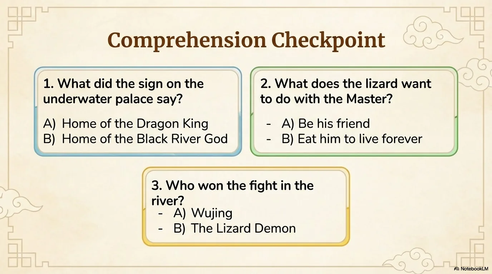

- 来源：`ppt/media/image9.png`（relationship `rId2`）
- 尺寸：1376×768
- 源 SHA-256：`53a99b53d05290b21408f3f8e71e9017a2a09ac4091d14d7a1e604b55ea979bc`
- 输出 SHA-256：`6145e39f91f8a77ae42dae518ff6eac62e301aa044a2c68fa2a2d42f00483790`
- 分类：unknown ｜ OCR：blocked ｜ 审核：unreviewed

## Slide 009

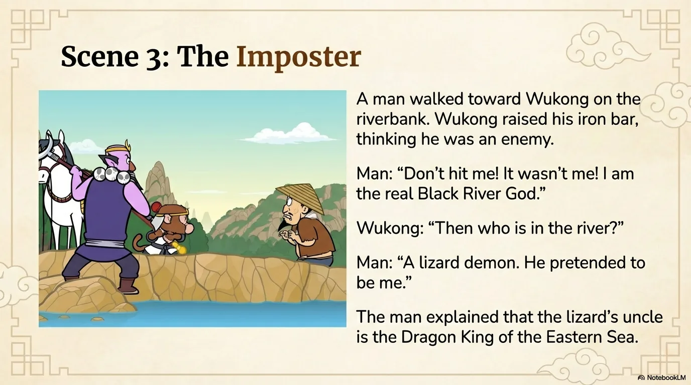

- 来源：`ppt/media/image10.png`（relationship `rId2`）
- 尺寸：1376×768
- 源 SHA-256：`179cd06659ad03ffd4c5afce0c004b57800680b01530d23329d01d1942a5fadf`
- 输出 SHA-256：`0ec537dba3ef0a8d49905fff52f96ec4c57455df84648c440098d2ad2ca0e4a3`
- 分类：unknown ｜ OCR：blocked ｜ 审核：unreviewed

## Slide 010

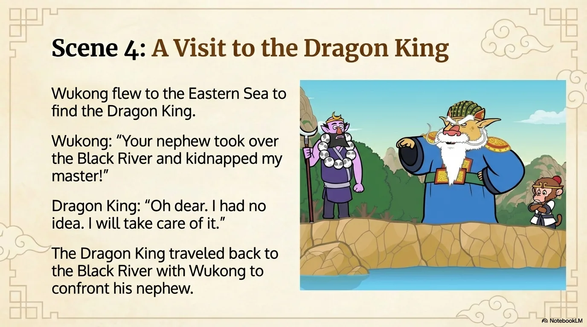

- 来源：`ppt/media/image11.png`（relationship `rId2`）
- 尺寸：1376×768
- 源 SHA-256：`791e09895f83a526a6ab10ba885eb95df00313405cf51dd8ee8f0d885b6283e9`
- 输出 SHA-256：`bd23371853d66559565c54f222acf5437e1260c1c28fbdab66d12b44780b38bf`
- 分类：unknown ｜ OCR：blocked ｜ 审核：unreviewed

## Slide 011

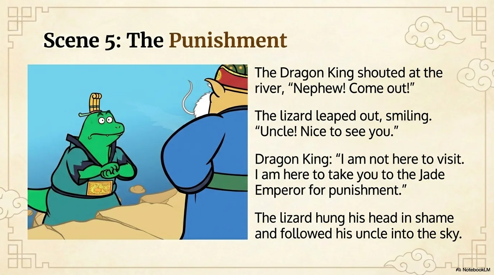

- 来源：`ppt/media/image12.png`（relationship `rId2`）
- 尺寸：1376×768
- 源 SHA-256：`bb5b1060b95bd8580f6fb27cde59322334c1c44e1d0ca304a56c4b955f866962`
- 输出 SHA-256：`ff80d9a36f884252a115e5f950d8a60821f450239df75cb37e3db588be18d65b`
- 分类：unknown ｜ OCR：blocked ｜ 审核：unreviewed

## Slide 012

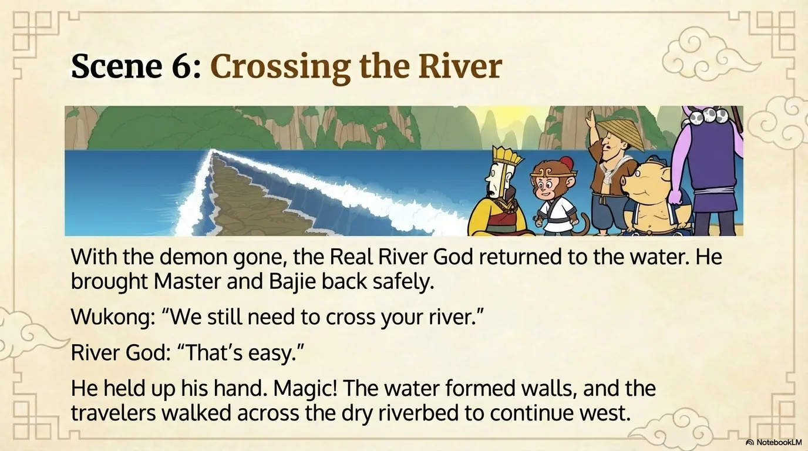

- 来源：`ppt/media/image13.png`（relationship `rId2`）
- 尺寸：1376×768
- 源 SHA-256：`bb1aac477a52d2bc1cb9a1586bd5ae06e0baf41a6f64b2ac6e5b863b4892578b`
- 输出 SHA-256：`0392505c5cca37536279b9f0288c5066b2e824f8434902e56ffae03ef6e678d2`
- 分类：unknown ｜ OCR：blocked ｜ 审核：unreviewed

## Slide 013

- 来源：`ppt/media/image14.png`（relationship `rId2`）
- 尺寸：1376×768
- 源 SHA-256：`33afd97fe1d9dcb08ec3c4b3f553ba3e85bf3b42335f41479ab782db8d1f6c80`
- 输出 SHA-256：`b6e263b92d8fb86a9e6d6a92e45a5f979bbda19c7e4a6a5248b0919c100717e8`
- 分类：unknown ｜ OCR：blocked ｜ 审核：unreviewed

## Slide 014

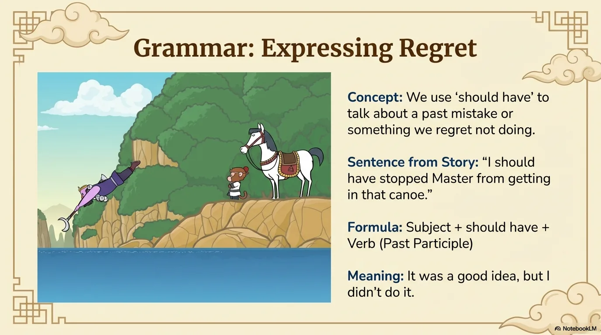

- 来源：`ppt/media/image15.png`（relationship `rId2`）
- 尺寸：1376×768
- 源 SHA-256：`f640550919caaea1ea7b56d7fcaa76252612b2033acacccb7d35afdbd27c2c2e`
- 输出 SHA-256：`9063ad6de3dea59cc16d6084236ac55ece853dca568716be3426fd08ab9621fd`
- 分类：unknown ｜ OCR：blocked ｜ 审核：unreviewed

## Slide 015

- 来源：`ppt/media/image16.png`（relationship `rId2`）
- 尺寸：1376×768
- 源 SHA-256：`08bf9c875e73caa9dbacb01373ee4b3932e8cc1fb73a3b231103ba00be21dc68`
- 输出 SHA-256：`3b83a041be61e78cd35fb1fc8154e9eb2b3182408648cb328b5f7373984466ec`
- 分类：unknown ｜ OCR：blocked ｜ 审核：unreviewed

## Slide 016

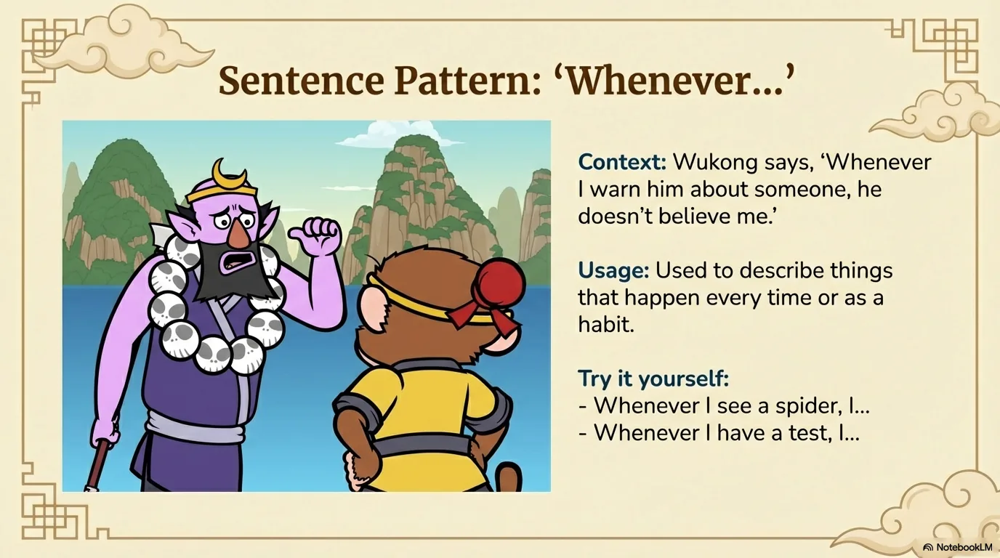

- 来源：`ppt/media/image17.png`（relationship `rId2`）
- 尺寸：1376×768
- 源 SHA-256：`954ea495202e850efaa5c89c1059fcb872de2d9a99f0004ebbc39450256c863f`
- 输出 SHA-256：`6b3397e5084b4555635702bb4c1241c740f566b1ee8af7393892d61933488552`
- 分类：unknown ｜ OCR：blocked ｜ 审核：unreviewed

## Slide 017

- 来源：`ppt/media/image18.png`（relationship `rId2`）
- 尺寸：1376×768
- 源 SHA-256：`c02ab3d9eff9e867f9d883909a67814cb08aa4af90677b084a56a2015d74e940`
- 输出 SHA-256：`a44e03161e13940e5f314012ec69df44203c5d7fa68649eba274d6d1069ee0c6`
- 分类：unknown ｜ OCR：blocked ｜ 审核：unreviewed

## Slide 018

- 来源：`ppt/media/image19.png`（relationship `rId2`）
- 尺寸：1376×768
- 源 SHA-256：`d1e40d6b05859acb66663dc1b224135baf7b88971781006a3a1d456c3fe918ef`
- 输出 SHA-256：`27f29a58ecd5247f9f3fddaf3522eac8caff3188f68158e8edaecc68fcc159c7`
- 分类：unknown ｜ OCR：blocked ｜ 审核：unreviewed

## Slide 019

- 来源：`ppt/media/image20.png`（relationship `rId2`）
- 尺寸：1376×768
- 源 SHA-256：`7b6c5a1be69f92bd33e249b51dfa0bfcf02f4eb14db4cb12c41812107248c2be`
- 输出 SHA-256：`c042afa5b81ad666c10aab38fded3a4c9f66e4e811468718f1ef93f50c7117f4`
- 分类：unknown ｜ OCR：blocked ｜ 审核：unreviewed

## Slide 020

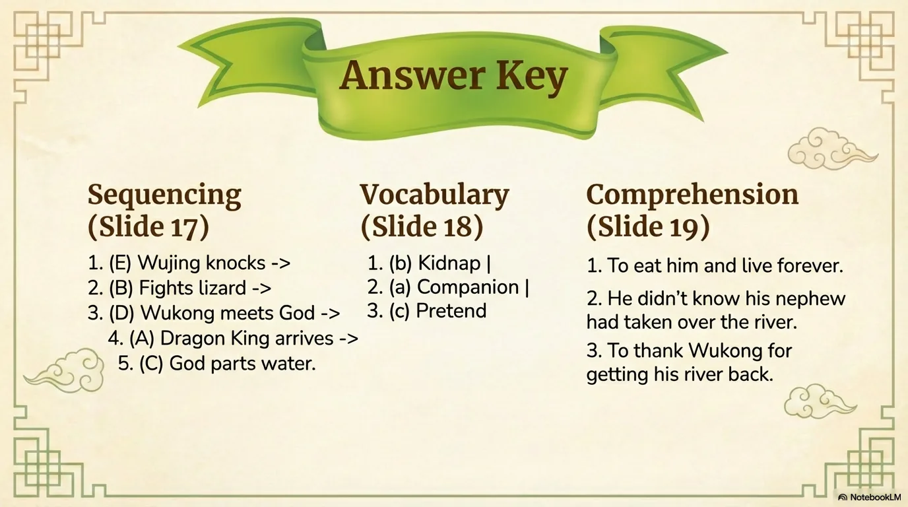

- 来源：`ppt/media/image21.png`（relationship `rId2`）
- 尺寸：1376×768
- 源 SHA-256：`52c458949f3418fe448f741101f30f712f13635e36ffb38939f85868fecbc434`
- 输出 SHA-256：`305551b0c912f0211159f78ef65e7ddf1be86ffcf779d71a2e10a19a02efff01`
- 分类：unknown ｜ OCR：blocked ｜ 审核：unreviewed
