# 豆豆龙英语 · 第 55 集课件（EP055 草稿）

- 来源：`055_Journey to the West 55_The Monks and the Cart.pptx`（主课件，20 页）
- OCR：`blocked`（no local OCR provider importable (pytesseract missing): No module named 'pytesseract'）
- 分类：待人工审核（unknown）
- 审核状态：`unreviewed`

## Slide 001

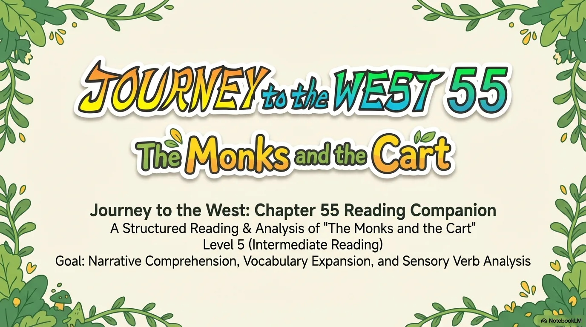

- 来源：`ppt/media/image1.png`（relationship `rId2`）
- 尺寸：1376×768
- 源 SHA-256：`30bb683973818c37123eb8ad27f377f47111b6894b7b6966a41ff37316873c17`
- 输出 SHA-256：`7227aaa73e84aee9389b035be50063df11215d6f291ecf471c3d2549127f28ea`
- 分类：unknown ｜ OCR：blocked ｜ 审核：unreviewed

## Slide 002

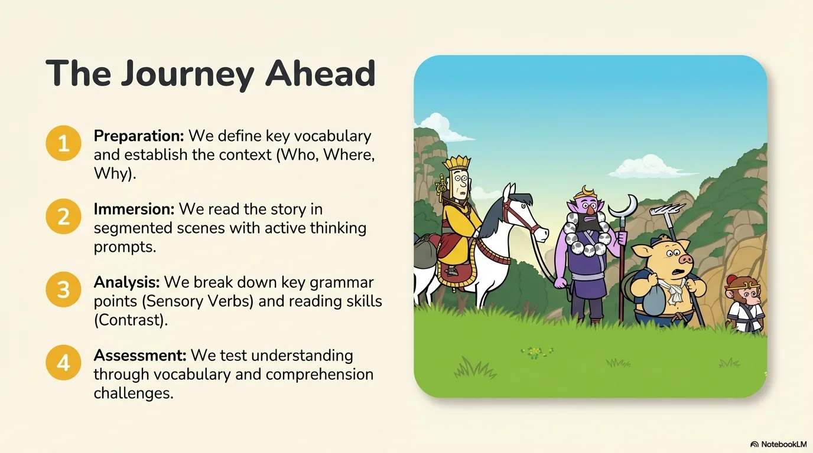

- 来源：`ppt/media/image3.png`（relationship `rId2`）
- 尺寸：1376×768
- 源 SHA-256：`01bac535f9828db302971da1bba15a9b74501980f88666eac628ab79c1bca2cb`
- 输出 SHA-256：`270554abc976d0d85317fef6b864bf2a8aa509912f5a07fa18a6c6bd9758f0aa`
- 分类：unknown ｜ OCR：blocked ｜ 审核：unreviewed

## Slide 003

- 来源：`ppt/media/image4.png`（relationship `rId2`）
- 尺寸：1376×768
- 源 SHA-256：`aab21bb37ce9bd8e34d7967aca9d80953a1cc39b8c12d17eb55ccac7e4b42e78`
- 输出 SHA-256：`6c3ab7f73f39f220eafbf57825a438c7d6bd83cc73bc72d78bcd9e633084e002`
- 分类：unknown ｜ OCR：blocked ｜ 审核：unreviewed

## Slide 004

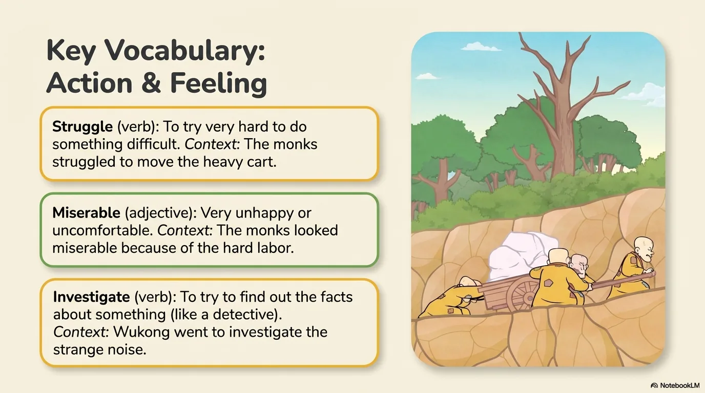

- 来源：`ppt/media/image5.png`（relationship `rId2`）
- 尺寸：1376×768
- 源 SHA-256：`13aa6131ea7333f322b6e2828a17a2535acc50ccf94e16c97729d7e919ae4194`
- 输出 SHA-256：`5fc6a0017861d2602dcb137edb725aeadc31984b2eeed23b7137af3937e10c11`
- 分类：unknown ｜ OCR：blocked ｜ 审核：unreviewed

## Slide 005

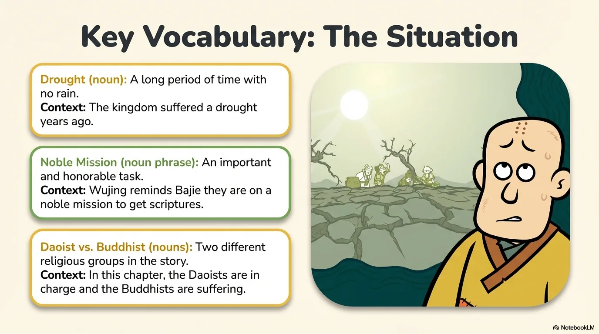

- 来源：`ppt/media/image6.png`（relationship `rId2`）
- 尺寸：1376×768
- 源 SHA-256：`4ef52a5d553df6b399dd27d8b94b3acd577727090506625bc7c6d74b9922a0e7`
- 输出 SHA-256：`0e3a8b0bdf7018652ff73fdc6af57ad7f40d9b5df59172ca872a57c19f346924`
- 分类：unknown ｜ OCR：blocked ｜ 审核：unreviewed

## Slide 006

- 来源：`ppt/media/image7.png`（relationship `rId2`）
- 尺寸：1376×768
- 源 SHA-256：`11052261efb71eb644f829d9887e99064ddd10294a81d407086cacad4eb4bf1a`
- 输出 SHA-256：`c9eb9e21bc368cd5f84a7655cdd55c33e576afd518286effb567b66b9aad8c37`
- 分类：unknown ｜ OCR：blocked ｜ 审核：unreviewed

## Slide 007

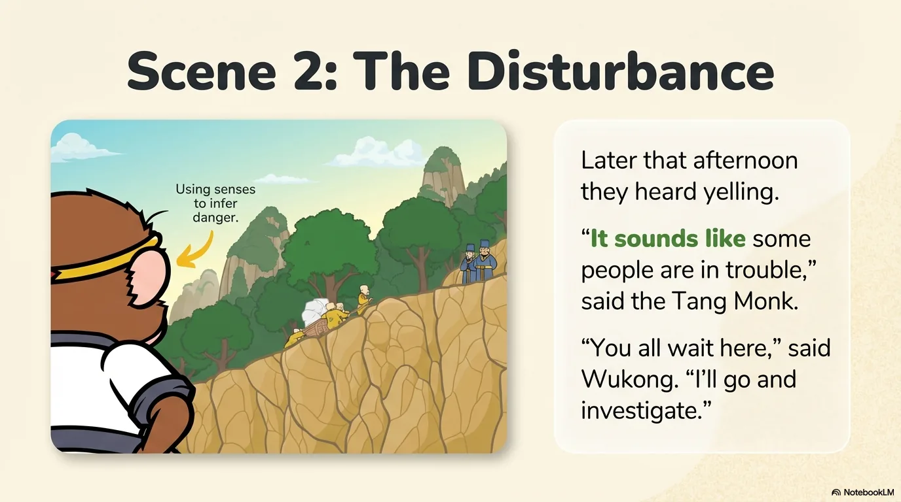

- 来源：`ppt/media/image8.png`（relationship `rId2`）
- 尺寸：1376×768
- 源 SHA-256：`a0908ee04172f91de1ac24d9d4a03be64d6833a1488ca4d97648f83615acebe5`
- 输出 SHA-256：`ce0c854dbf6183e78102d7c35926402093b42b22e0ee7ac1c8ed1b8cf118c020`
- 分类：unknown ｜ OCR：blocked ｜ 审核：unreviewed

## Slide 008

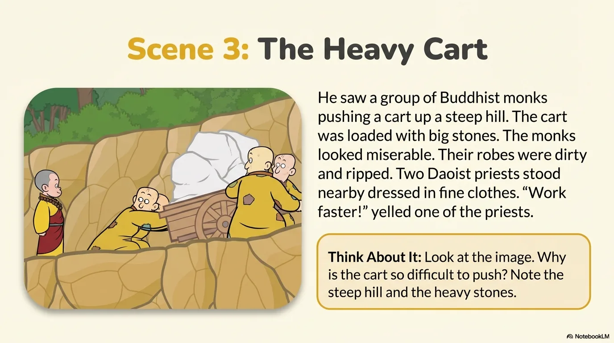

- 来源：`ppt/media/image9.png`（relationship `rId2`）
- 尺寸：1376×768
- 源 SHA-256：`0a02ba9d4c67845946159bd1be0d5f85ab38b415913829b24382f4cbde80070f`
- 输出 SHA-256：`864075549b5d3277eed0d283b7292eb40aac7a7b0bf41e86fa15671ee07bbb27`
- 分类：unknown ｜ OCR：blocked ｜ 审核：unreviewed

## Slide 009

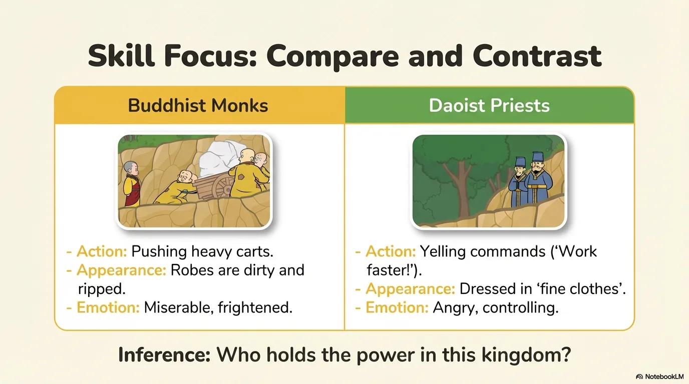

- 来源：`ppt/media/image10.png`（relationship `rId2`）
- 尺寸：1376×768
- 源 SHA-256：`cf2ef3017ab72ca0bc54e410f086012bd03e7a132b4a8d795c565c1d2415d971`
- 输出 SHA-256：`167169ae54c778fea3ca4d0d4892931f3f3af595ec78d6eeef00fc4a22c1f80b`
- 分类：unknown ｜ OCR：blocked ｜ 审核：unreviewed

## Slide 010

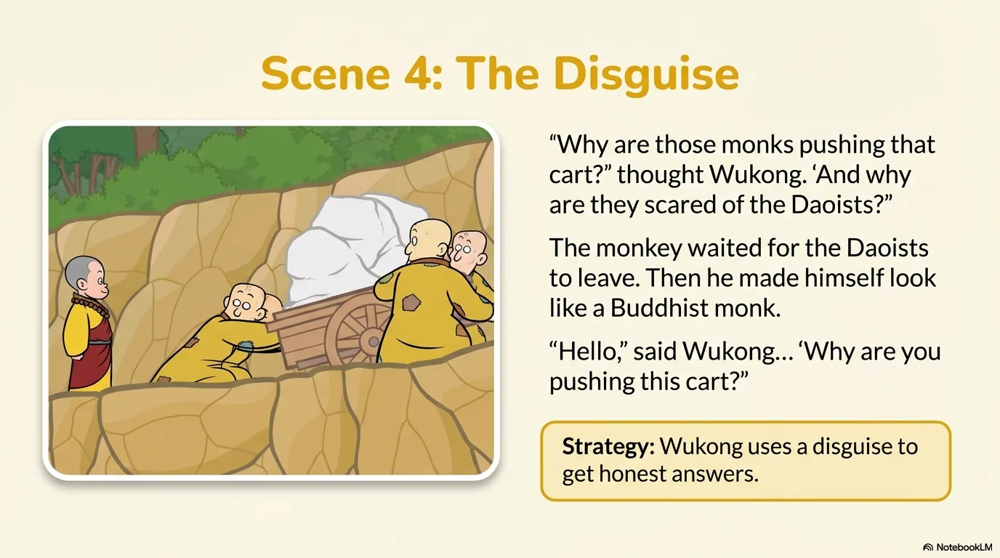

- 来源：`ppt/media/image11.png`（relationship `rId2`）
- 尺寸：1376×768
- 源 SHA-256：`e7ffee220923b51bfe4228e009485d2bcab69d62f607b4513082972f18a698c2`
- 输出 SHA-256：`0a0bea8999603d7a3a9e306f4a0a710f7a99dbb732cb177b2fef291951202040`
- 分类：unknown ｜ OCR：blocked ｜ 审核：unreviewed

## Slide 011

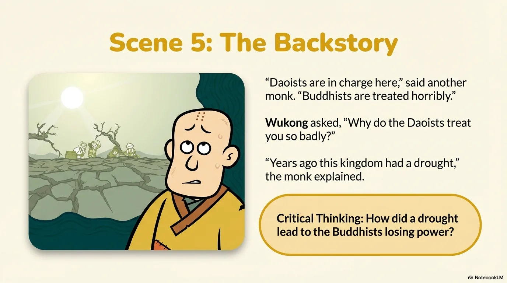

- 来源：`ppt/media/image12.png`（relationship `rId2`）
- 尺寸：1376×768
- 源 SHA-256：`a824323696b95b8d678e9a8bd5dc7fbbc49a3cfd3aecff3f80cc74afeae1e18a`
- 输出 SHA-256：`298070b71f0253f1a4c2b76542c79ee5cd2bdaf9cce4763a8c1aa191f5909e8d`
- 分类：unknown ｜ OCR：blocked ｜ 审核：unreviewed

## Slide 012

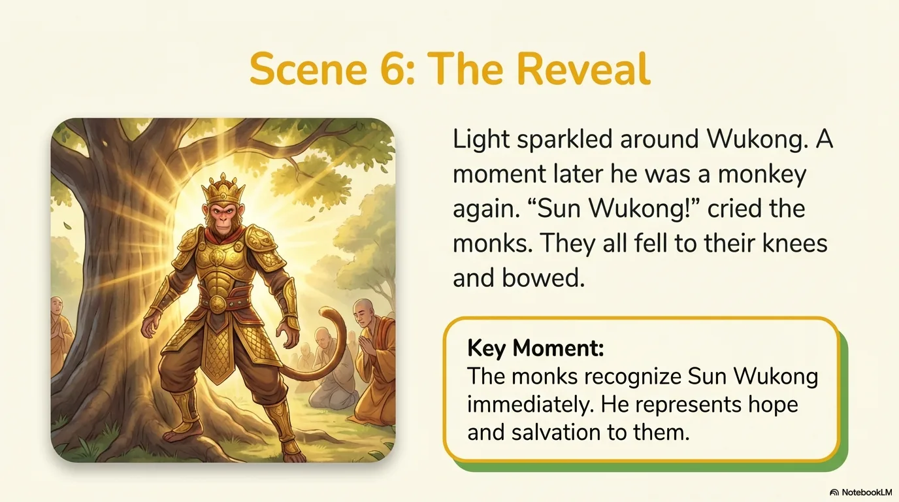

- 来源：`ppt/media/image13.png`（relationship `rId2`）
- 尺寸：1376×768
- 源 SHA-256：`6bf054a46a76cb0f04bb0d513577b4899c95db1f77cda092fe4afb77c48cc2ed`
- 输出 SHA-256：`7ce6f78c777dfa923c40a994c25cfa3eb8f2335f0c8d1180d573f6b98e001bd8`
- 分类：unknown ｜ OCR：blocked ｜ 审核：unreviewed

## Slide 013

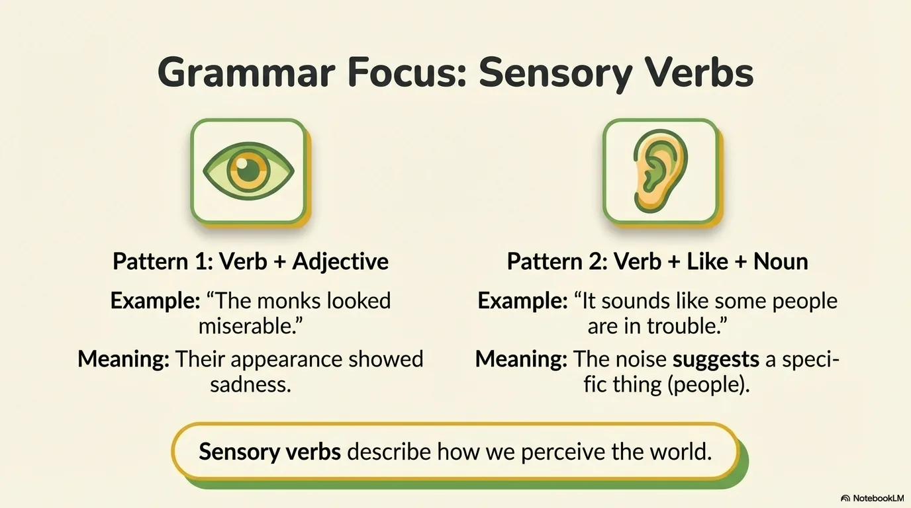

- 来源：`ppt/media/image14.png`（relationship `rId2`）
- 尺寸：1376×768
- 源 SHA-256：`af3c5c106f0594819a9a7d880f7d57b15c275516df7189f5395a5f7520ca784d`
- 输出 SHA-256：`1643c59451ac50cd31e35dd9a0f7c51bfacbe8ece509d11f05a241687672b8ff`
- 分类：unknown ｜ OCR：blocked ｜ 审核：unreviewed

## Slide 014

- 来源：`ppt/media/image15.png`（relationship `rId2`）
- 尺寸：1376×768
- 源 SHA-256：`643e8e207ee6cc6a8fbae512f83707ae0295d78a01b46b0b705bc75ffb004244`
- 输出 SHA-256：`66abaaeb72f2f1cd6b1843d8462b8f307ffe01f68ab9f1ff6d9c2f5714ba0e12`
- 分类：unknown ｜ OCR：blocked ｜ 审核：unreviewed

## Slide 015

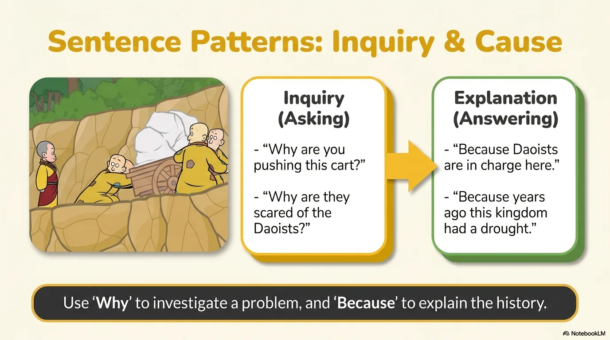

- 来源：`ppt/media/image16.png`（relationship `rId2`）
- 尺寸：1376×768
- 源 SHA-256：`bf548a2b888dc379bbe16ef5ed62a87fd6f14182e383357ab861b2c440d4cb18`
- 输出 SHA-256：`b42e84c8c8a9e6143a3a7dce0810afbda07ccd36d1c434ae429187df4fff478f`
- 分类：unknown ｜ OCR：blocked ｜ 审核：unreviewed

## Slide 016

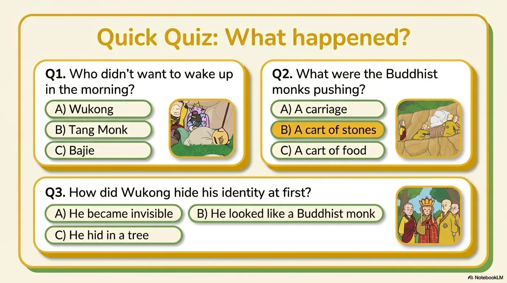

- 来源：`ppt/media/image17.png`（relationship `rId2`）
- 尺寸：1376×768
- 源 SHA-256：`ecf39f529639c23d18828f97e62e2e07280bf369dfd61df73ee1ea6e4e74aef5`
- 输出 SHA-256：`58f73f2dc083e7e877d0850f3c4b209ed3cf88fb6e0157b67cc25d17592aad8a`
- 分类：unknown ｜ OCR：blocked ｜ 审核：unreviewed

## Slide 017

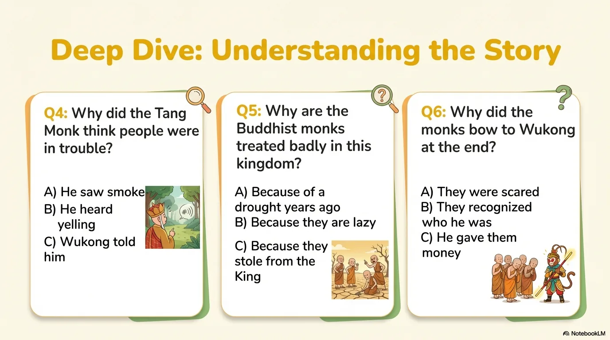

- 来源：`ppt/media/image18.png`（relationship `rId2`）
- 尺寸：1376×768
- 源 SHA-256：`13c7b2e93e111d377c4569aa845673127c8549c7cb34235910b17e3d7402be1e`
- 输出 SHA-256：`fc8d797ebdfd10582d865703f4176436a0ec2aa0af51c31973c753b8fbebb7d8`
- 分类：unknown ｜ OCR：blocked ｜ 审核：unreviewed

## Slide 018

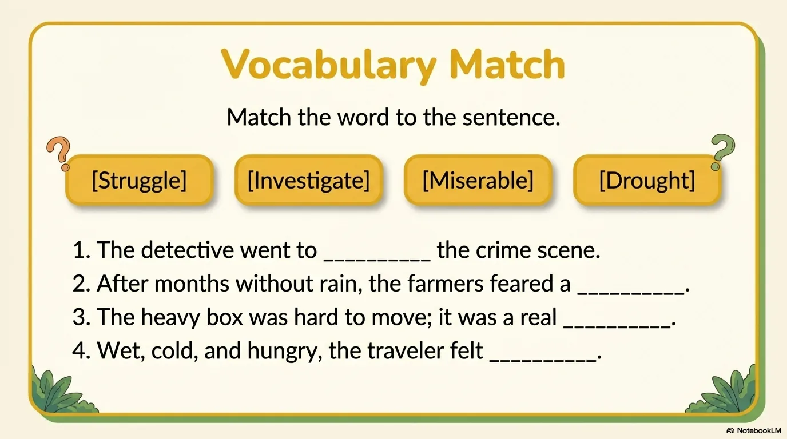

- 来源：`ppt/media/image19.png`（relationship `rId2`）
- 尺寸：1376×768
- 源 SHA-256：`d715ecbc1367e9fdad63fe354bee9fcef803ef3aa4e1cd1a9024d89a12792340`
- 输出 SHA-256：`0f5388dd80a7b6f254f234672cb70b2d3d56ccb701609331a6559b9586e2481b`
- 分类：unknown ｜ OCR：blocked ｜ 审核：unreviewed

## Slide 019

- 来源：`ppt/media/image20.png`（relationship `rId2`）
- 尺寸：1376×768
- 源 SHA-256：`09ae896fb2f219158b9506fe65458f590969dd15a458999e48f36dea0ab32e1e`
- 输出 SHA-256：`faa619835de14887a75793dd4af345269bf9fd4b2339d26ccb45fca8ba5b464e`
- 分类：unknown ｜ OCR：blocked ｜ 审核：unreviewed

## Slide 020

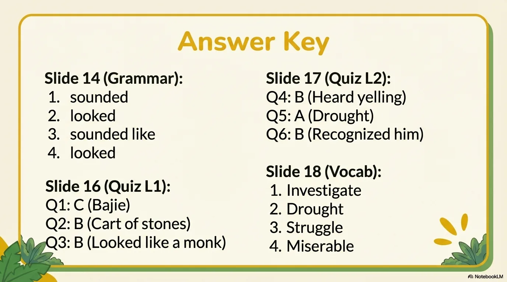

- 来源：`ppt/media/image21.png`（relationship `rId2`）
- 尺寸：1376×768
- 源 SHA-256：`8ba29142ca7af4abdd240217137cf4493deaba516e7fc43a6ca0bfde2cf126e7`
- 输出 SHA-256：`091dea98b67c8b8c97b37ec33b0bb9f436b39b93c026fc197af25c43885b60a4`
- 分类：unknown ｜ OCR：blocked ｜ 审核：unreviewed
