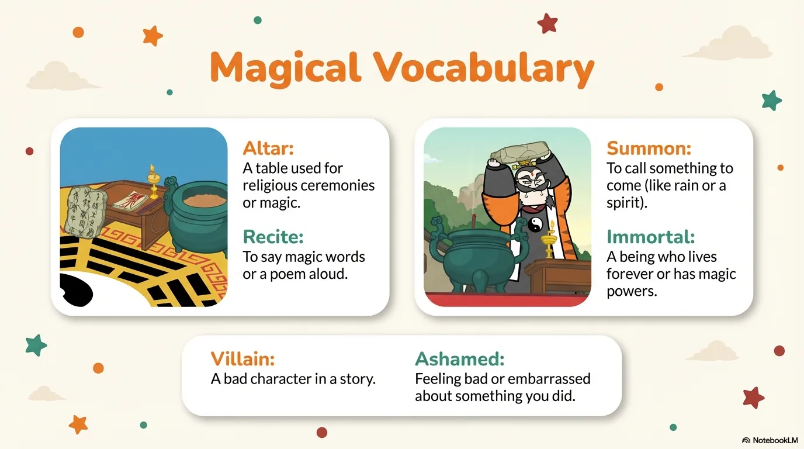
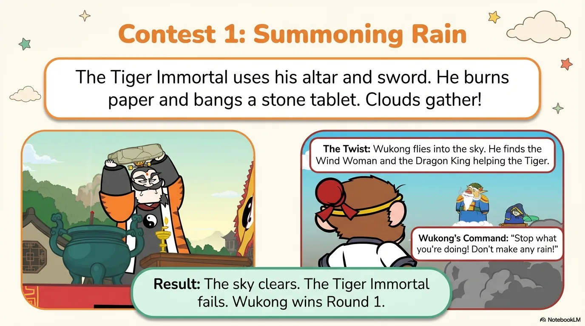
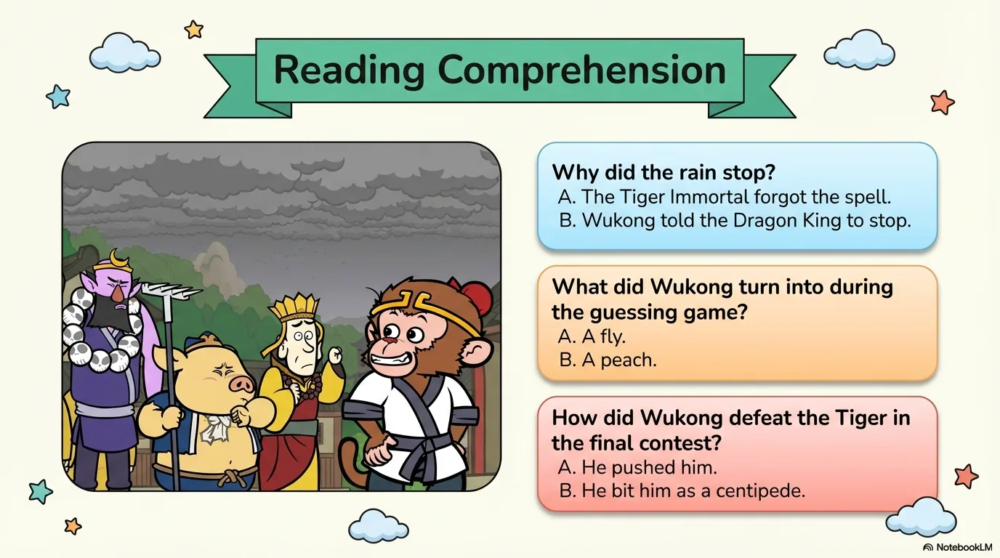

# 豆豆龙英语 · 第 56 集课件（EP056 草稿）

- 来源：`056_Journey to the West 56_The Tiger Immortal.pptx`（主课件，15 页）
- OCR：`blocked`（no local OCR provider importable (pytesseract missing): No module named 'pytesseract'）
- 分类：待人工审核（unknown）
- 审核状态：`unreviewed`

## Slide 001

- 来源：`ppt/media/image1.png`（relationship `rId2`）
- 尺寸：1376×768
- 源 SHA-256：`48b7411afacd6c9d805554bd00292f12ff4dd0b3e804d1e41bd53d21fdaffb46`
- 输出 SHA-256：`29387281b48f6c5cea722a84ea8dabe6f75b97f38d792a898edc8d45f431a84c`
- 分类：unknown ｜ OCR：blocked ｜ 审核：unreviewed

## Slide 002

- 来源：`ppt/media/image3.png`（relationship `rId2`）
- 尺寸：1376×768
- 源 SHA-256：`55d4e84cccbdd171e0b0b352e6e0276cc81cff06c0c83173acec93f9bc0fdc13`
- 输出 SHA-256：`2b94308762b6effea30fd0d594a11289ab8ab47f8de7e5ee921cbe2836d4b7db`
- 分类：unknown ｜ OCR：blocked ｜ 审核：unreviewed

## Slide 003

- 来源：`ppt/media/image4.png`（relationship `rId2`）
- 尺寸：1376×768
- 源 SHA-256：`c36945ab8c026e411464c5e1fb486d7958501bda764a483fe32b2ae37f6f3c08`
- 输出 SHA-256：`40b9946fce4b9bfbc17a3219dc5d7ca2e97dcec4c8ecf18ae2a85f4b15c7fe4c`
- 分类：unknown ｜ OCR：blocked ｜ 审核：unreviewed

## Slide 004

- 来源：`ppt/media/image5.png`（relationship `rId2`）
- 尺寸：1376×768
- 源 SHA-256：`813d120431e06ce00cf8c1a875c5da1e33235dcdb6f00a261672cbe6d004520d`
- 输出 SHA-256：`4f92261751ac86b02b0c1b392a05716e835f7378fc4387e5556b62c524ffec5c`
- 分类：unknown ｜ OCR：blocked ｜ 审核：unreviewed

## Slide 005

- 来源：`ppt/media/image6.png`（relationship `rId2`）
- 尺寸：1376×768
- 源 SHA-256：`3b1e77520d3b4400c52e2afa17ff8d9bbf7a9cf79905d19ab837eddcefb02eca`
- 输出 SHA-256：`be8551ab393773fe62bf999e77a1118f48636bad5769f541b9aa7092693c58c0`
- 分类：unknown ｜ OCR：blocked ｜ 审核：unreviewed

## Slide 006

- 来源：`ppt/media/image7.png`（relationship `rId2`）
- 尺寸：1376×768
- 源 SHA-256：`b9b41b05679f35eb15e28cfe92b968f3d5dca0cb0a087249641377c2f07542a3`
- 输出 SHA-256：`35a410302035b9605d75f9b21c966ffed6c0c026f3c0b517adbe7a4e04fe3186`
- 分类：unknown ｜ OCR：blocked ｜ 审核：unreviewed

## Slide 007

- 来源：`ppt/media/image8.png`（relationship `rId2`）
- 尺寸：1376×768
- 源 SHA-256：`595a08972a907475d9aaca908ecc6565ba7bf26235dc47d1095210dc665d7d68`
- 输出 SHA-256：`37435959304858e610b93b092b2442626492f0a0caa8587c9a5bc282fb9dce46`
- 分类：unknown ｜ OCR：blocked ｜ 审核：unreviewed

## Slide 008

- 来源：`ppt/media/image9.png`（relationship `rId2`）
- 尺寸：1376×768
- 源 SHA-256：`e9d3cc4ded300acc96192534a3a8c55d07f6bc0e3599b5fa349a4b8bc8ccd6ef`
- 输出 SHA-256：`4b147321f517befa3b1564901043a9d1f10f76763b4f824c431da53ec966ab57`
- 分类：unknown ｜ OCR：blocked ｜ 审核：unreviewed

## Slide 009

- 来源：`ppt/media/image10.png`（relationship `rId2`）
- 尺寸：1376×768
- 源 SHA-256：`e153be4e9460c40e6ca88c257e2c2a78ace998f338b928e13ea90c552f6522b7`
- 输出 SHA-256：`b703ed508226842eba98cf0109208164be58fe65f7f68c980b7ccf2a1f7f6450`
- 分类：unknown ｜ OCR：blocked ｜ 审核：unreviewed

## Slide 010

- 来源：`ppt/media/image11.png`（relationship `rId2`）
- 尺寸：1376×768
- 源 SHA-256：`ef70ae19afe434a85cf338aab3bf191b5a66394a71b1674dd43a5eca08e93477`
- 输出 SHA-256：`36f99f3fd8e79efa53376e6efc2b4a600ebc9bc9596713abebbe822750c6eb91`
- 分类：unknown ｜ OCR：blocked ｜ 审核：unreviewed

## Slide 011

- 来源：`ppt/media/image12.png`（relationship `rId2`）
- 尺寸：1376×768
- 源 SHA-256：`98b47b43a8cc58986c2c192144c881d97b52d619004fe3a32ae8d282ed394796`
- 输出 SHA-256：`37729bcb18337329bee0a63db91162531fb16b192b24276fab633291674a5b44`
- 分类：unknown ｜ OCR：blocked ｜ 审核：unreviewed

## Slide 012

- 来源：`ppt/media/image13.png`（relationship `rId2`）
- 尺寸：1376×768
- 源 SHA-256：`4da4619625db3815785b43e96ee1efe411d2aee929ff88f5de52b3b017370de9`
- 输出 SHA-256：`5ec7b1fd069f264254ca25e230a8dd00f0716ce12fcd442442ec6b1bae02a538`
- 分类：unknown ｜ OCR：blocked ｜ 审核：unreviewed

## Slide 013

- 来源：`ppt/media/image14.png`（relationship `rId2`）
- 尺寸：1376×768
- 源 SHA-256：`3243b2a6afd3babbb7bf96a0397a38b1d9fe0e346337eb772bb28336368ba468`
- 输出 SHA-256：`fb068f91530f490718982b39992fe18316d61fcb01220392e45a62beaa5f3701`
- 分类：unknown ｜ OCR：blocked ｜ 审核：unreviewed

## Slide 014

- 来源：`ppt/media/image15.png`（relationship `rId2`）
- 尺寸：1376×768
- 源 SHA-256：`93b862793ae27793912975d6a0f886dab0d42a2cc9ebf41badda38294e9b5b36`
- 输出 SHA-256：`739b7627d6c875ce0a863f733d5329175d08da360530f920c72f9ee7a970552d`
- 分类：unknown ｜ OCR：blocked ｜ 审核：unreviewed

## Slide 015

- 来源：`ppt/media/image16.png`（relationship `rId2`）
- 尺寸：1376×768
- 源 SHA-256：`8eced7cdb7d73300163be1b7c5c696967d18fc872a3884fe1b05ff53a8cd9085`
- 输出 SHA-256：`2b9d82132e320064c2759b890134612c06696e5b50b0e4984e233c6dd4ae2bdc`
- 分类：unknown ｜ OCR：blocked ｜ 审核：unreviewed
