# 豆豆龙英语 · 第 57 集课件（EP057 草稿）

- 来源：`057_Journey to the West 57_A Guessing Game.pptx`（主课件，20 页）
- OCR：`blocked`（no local OCR provider importable (pytesseract missing): No module named 'pytesseract'）
- 分类：待人工审核（unknown）
- 审核状态：`unreviewed`

## Slide 001

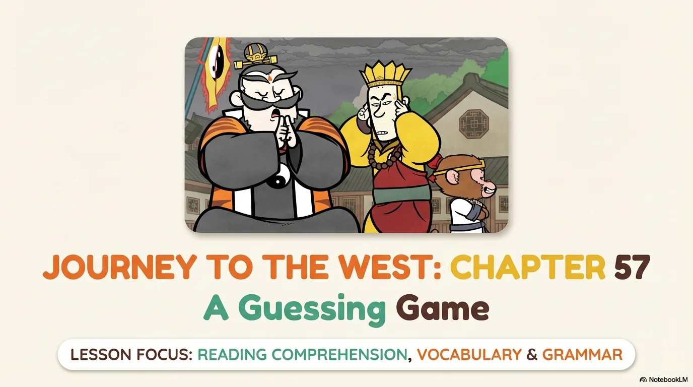

- 来源：`ppt/media/image1.png`（relationship `rId2`）
- 尺寸：1376×768
- 源 SHA-256：`76be744615e326f19c52cb08c729944d56c282251dea7f3fea901a2370ffd0ad`
- 输出 SHA-256：`52b3df7eb1ab914ed6c1982b3cb839c4c3a5e3970390da028254a3d30a216caf`
- 分类：unknown ｜ OCR：blocked ｜ 审核：unreviewed

## Slide 002

- 来源：`ppt/media/image3.png`（relationship `rId2`）
- 尺寸：1376×768
- 源 SHA-256：`0ebb045bc305baf68a3ff5a81455744b6093da9bebd2902837fb5867d01db41f`
- 输出 SHA-256：`ae2385df114f58c8db2d744434b3c3b9ad16b7c3300aa4336b6008d60473626a`
- 分类：unknown ｜ OCR：blocked ｜ 审核：unreviewed

## Slide 003

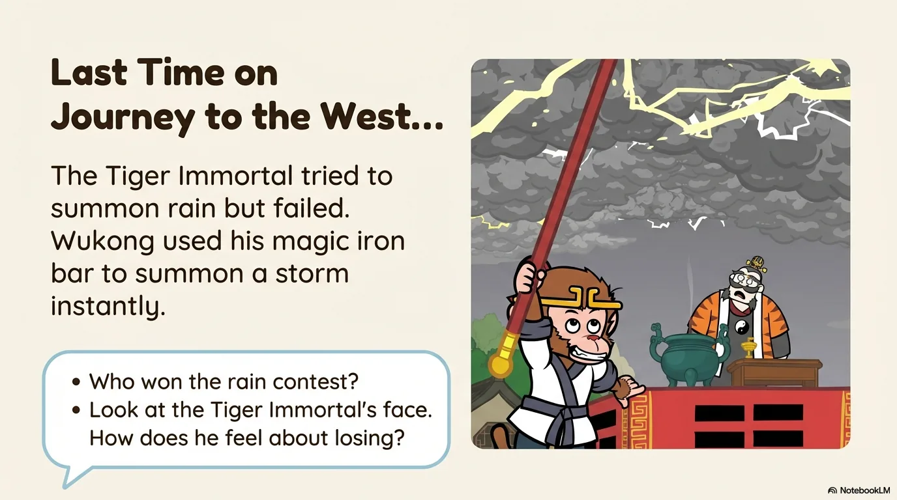

- 来源：`ppt/media/image4.png`（relationship `rId2`）
- 尺寸：1376×768
- 源 SHA-256：`c7e3ea41af1844db5674ebc5e7b7d5f269c3ee3df4f1eaf3765dcc1346052047`
- 输出 SHA-256：`51c688524397344ae109cfa26da52ad4bd869c4523b02f6cd68584ac5ae515ab`
- 分类：unknown ｜ OCR：blocked ｜ 审核：unreviewed

## Slide 004

- 来源：`ppt/media/image5.png`（relationship `rId2`）
- 尺寸：1376×768
- 源 SHA-256：`ab41625c694b289ec68ff056e4fdc363a979e5c1d8db59e8f0f9a50c353ce641`
- 输出 SHA-256：`286cac048316cdb83c71e95c2d6a88be3af52a7815be4140a05d747eaae6b934`
- 分类：unknown ｜ OCR：blocked ｜ 审核：unreviewed

## Slide 005

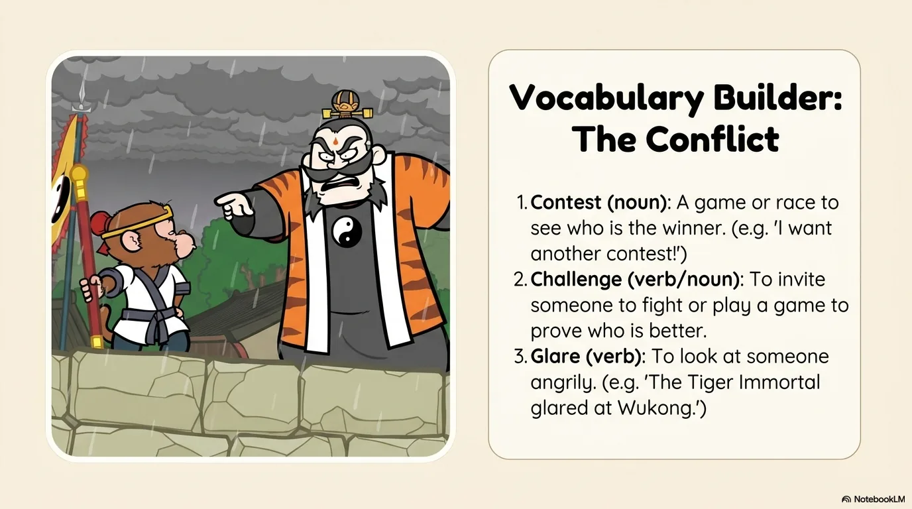

- 来源：`ppt/media/image6.png`（relationship `rId2`）
- 尺寸：1376×768
- 源 SHA-256：`6178f21820b96cd64de28bb00162c6329f2b54a96130bc8787548bb88a388dd4`
- 输出 SHA-256：`aec4419e31208449e4d0a7034a9b93aef5ce68cd79339eddd4378376aafc9951`
- 分类：unknown ｜ OCR：blocked ｜ 审核：unreviewed

## Slide 006

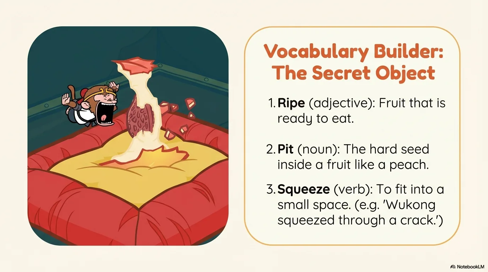

- 来源：`ppt/media/image7.png`（relationship `rId2`）
- 尺寸：1376×768
- 源 SHA-256：`2bbf2899d97e1d0b52f9735489ac5ced0e7bd3e7ed3c853bd4595a1d9011e511`
- 输出 SHA-256：`8b1daa673b54e6190a1bba76797bac764de05d4c6934225c8a81b0881e05b084`
- 分类：unknown ｜ OCR：blocked ｜ 审核：unreviewed

## Slide 007

- 来源：`ppt/media/image8.png`（relationship `rId2`）
- 尺寸：1376×768
- 源 SHA-256：`ae3ada4a536eff195e64cddfab448d7dbd1603382bfe72480b02618d1d003e81`
- 输出 SHA-256：`1afe3b60e95569ea4168e8b772649328166709478fdd4170d2bdf44b335f0485`
- 分类：unknown ｜ OCR：blocked ｜ 审核：unreviewed

## Slide 008

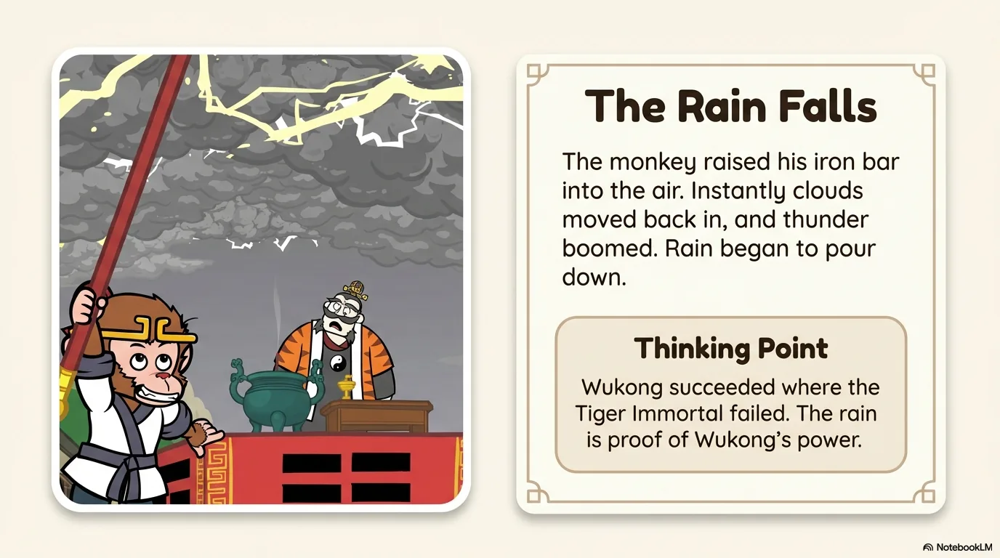

- 来源：`ppt/media/image9.png`（relationship `rId2`）
- 尺寸：1376×768
- 源 SHA-256：`7b6f90b2765421aa3a24d01a7ba6019a38db1068a6dfd316cc158baf714e1aa3`
- 输出 SHA-256：`0cdb4eaa85b605504a46f50f1e32ce75d58e78413ee63ac0b4403eba14712ded`
- 分类：unknown ｜ OCR：blocked ｜ 审核：unreviewed

## Slide 009

- 来源：`ppt/media/image10.png`（relationship `rId2`）
- 尺寸：1376×768
- 源 SHA-256：`7a7958feb67df21bd72724c45b18790de0254716177eb82788df4e95ec3591f1`
- 输出 SHA-256：`a8809550f8468358bf549a6dd904bc2b4023c5b7b9623a843f510f42bc3d64c0`
- 分类：unknown ｜ OCR：blocked ｜ 审核：unreviewed

## Slide 010

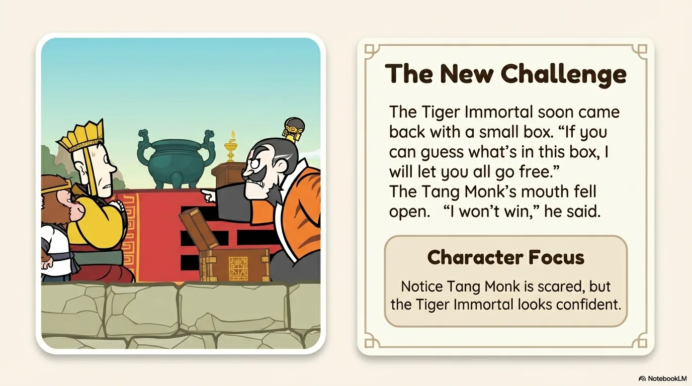

- 来源：`ppt/media/image11.png`（relationship `rId2`）
- 尺寸：1376×768
- 源 SHA-256：`128bf71f7d0012405ffabdbd230f6eab3eca57ddc9f7da31f8466b60c9c42e64`
- 输出 SHA-256：`072aa968d39607d1a6eeb60094826866b17e5217e5e542dab2fbadbaec0c33b9`
- 分类：unknown ｜ OCR：blocked ｜ 审核：unreviewed

## Slide 011

- 来源：`ppt/media/image12.png`（relationship `rId2`）
- 尺寸：1376×768
- 源 SHA-256：`6a104077d39cfc90829388ced07861629fdc3c6ffc638146bfdd225ceebbec8a`
- 输出 SHA-256：`23eb9e0139e4559ea0b852f24e00a48ee14564b46ef42d4f81df6b6307f9ea80`
- 分类：unknown ｜ OCR：blocked ｜ 审核：unreviewed

## Slide 012

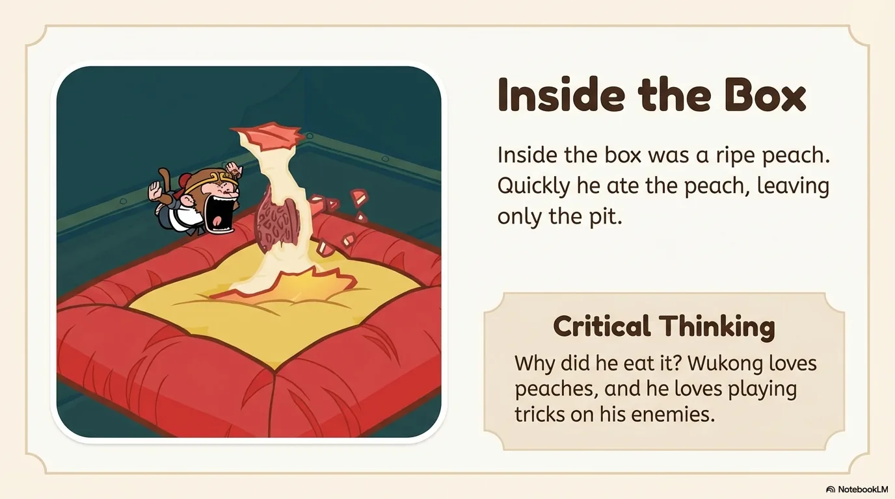

- 来源：`ppt/media/image13.png`（relationship `rId2`）
- 尺寸：1376×768
- 源 SHA-256：`1aad3bc5b4b1036db4414fcd01d1131335f1c1574790a7331f492f8780936e9a`
- 输出 SHA-256：`33c1596b610b3855ad4acb41913a89835c6a9a8c136e9830e667345aaa5f82a4`
- 分类：unknown ｜ OCR：blocked ｜ 审核：unreviewed

## Slide 013

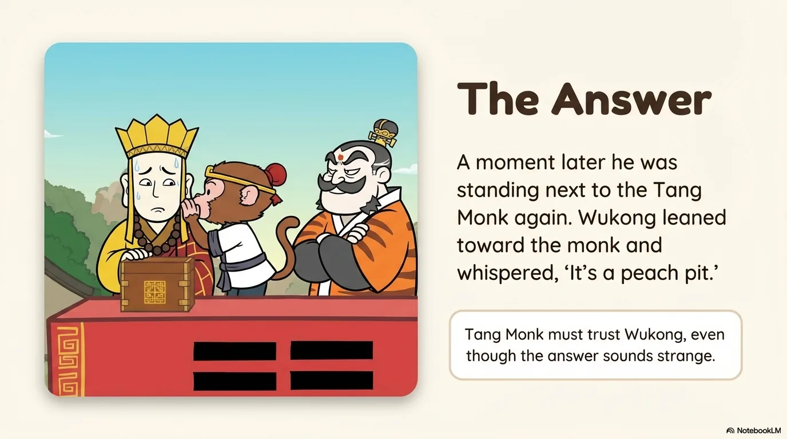

- 来源：`ppt/media/image14.png`（relationship `rId2`）
- 尺寸：1376×768
- 源 SHA-256：`66041b96de8a968d9c00ad61047f4d1b5b02b559a96ff93de564b45f229c1ace`
- 输出 SHA-256：`59720710683bf1c48981d6f101c2402c74d72c7316f64aed4d18cb76399a7684`
- 分类：unknown ｜ OCR：blocked ｜ 审核：unreviewed

## Slide 014

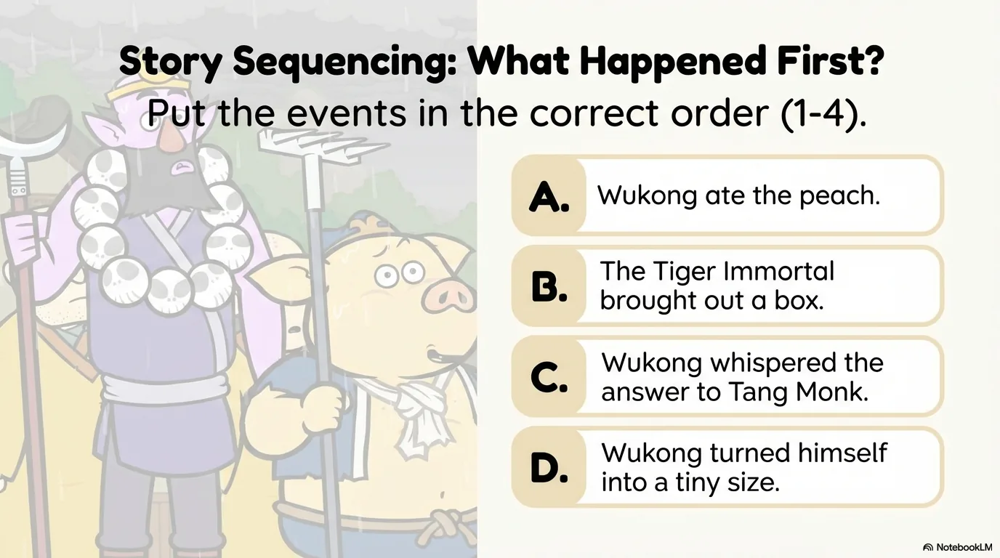

- 来源：`ppt/media/image15.png`（relationship `rId2`）
- 尺寸：1376×768
- 源 SHA-256：`14104f30076a04bdeed3f798583c9229c2a984d8077181a8a99e63d74d7a35f8`
- 输出 SHA-256：`bdb5101a60eab2856c4f1936e4d0097fad8df3d36899f5b723bcec6d1fa581a3`
- 分类：unknown ｜ OCR：blocked ｜ 审核：unreviewed

## Slide 015

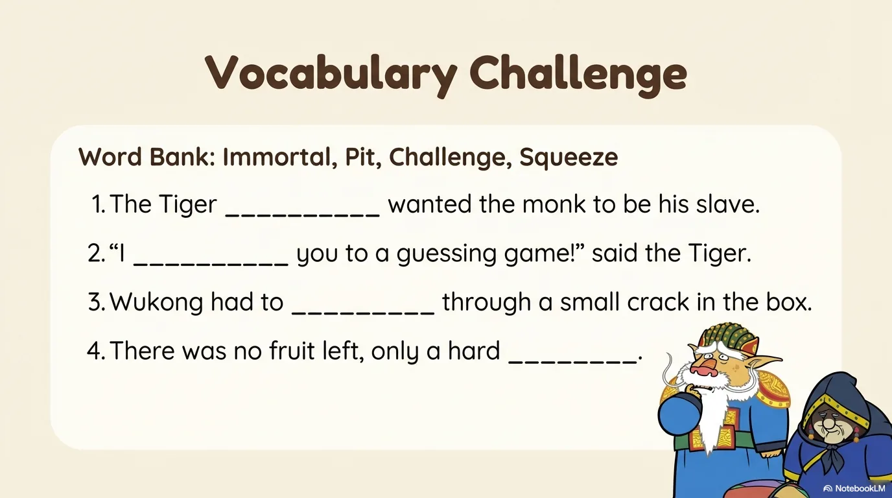

- 来源：`ppt/media/image16.png`（relationship `rId2`）
- 尺寸：1376×768
- 源 SHA-256：`126b38e1f7c80f5d63cb4774234a04c8740755971ca502d5d133270a0b14d027`
- 输出 SHA-256：`e2a5677bfcdeba483c2bc8650428b4e237241e46713a026d6796bf35799b5bc2`
- 分类：unknown ｜ OCR：blocked ｜ 审核：unreviewed

## Slide 016

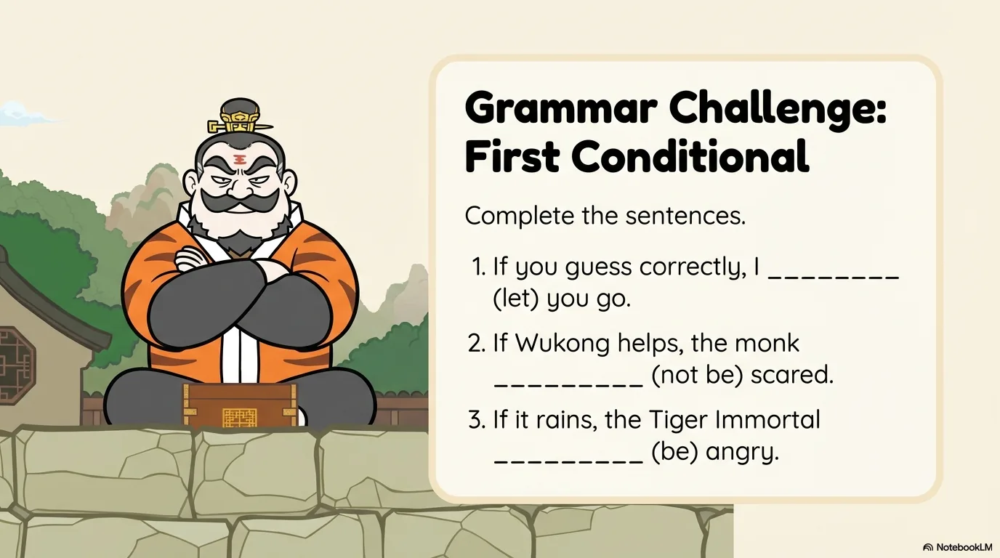

- 来源：`ppt/media/image17.png`（relationship `rId2`）
- 尺寸：1376×768
- 源 SHA-256：`66c4ec314a6301e7f2754c2d1bcb04b31dbd53d56e42d3d2f87bfd187473d1c2`
- 输出 SHA-256：`d0e26414844e14fe6c6e12ce553babc76a8b5829488bad0f36d7ed6d61b15fac`
- 分类：unknown ｜ OCR：blocked ｜ 审核：unreviewed

## Slide 017

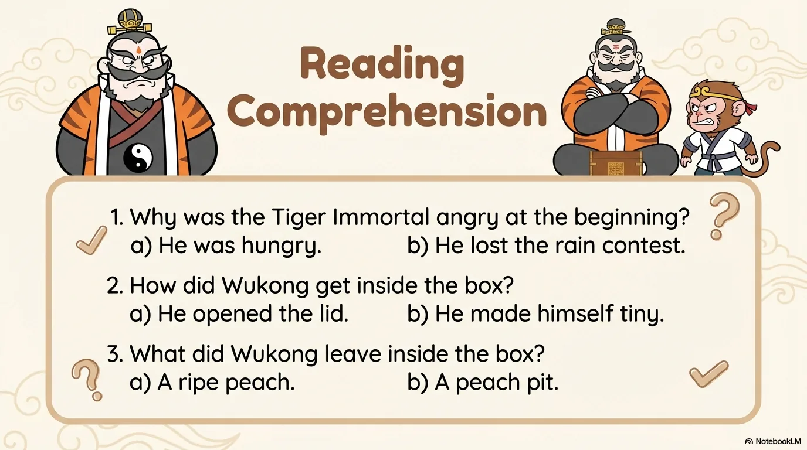

- 来源：`ppt/media/image18.png`（relationship `rId2`）
- 尺寸：1376×768
- 源 SHA-256：`61d47570b38d0d0008530defcb82b9526a8f463f2cf4292aadc366329bbb3166`
- 输出 SHA-256：`2e6bedbb422a9916cedb92a6313cb30e583ce8cb831bb1f0e7acafe8e3ab147a`
- 分类：unknown ｜ OCR：blocked ｜ 审核：unreviewed

## Slide 018

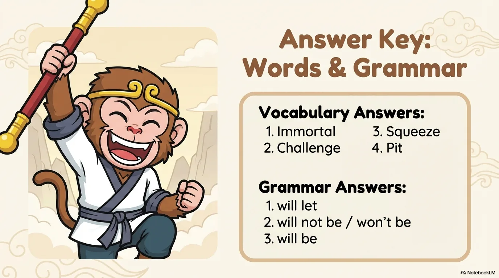

- 来源：`ppt/media/image19.png`（relationship `rId2`）
- 尺寸：1376×768
- 源 SHA-256：`d77f18f4982468f98e92626ceeb22a756e6e8d03c5fb95317301d0fe3d6e0832`
- 输出 SHA-256：`82e5d310704a70ce25224cb4e8d9051a0732699c51f7569d1c84a0051e4c50ee`
- 分类：unknown ｜ OCR：blocked ｜ 审核：unreviewed

## Slide 019

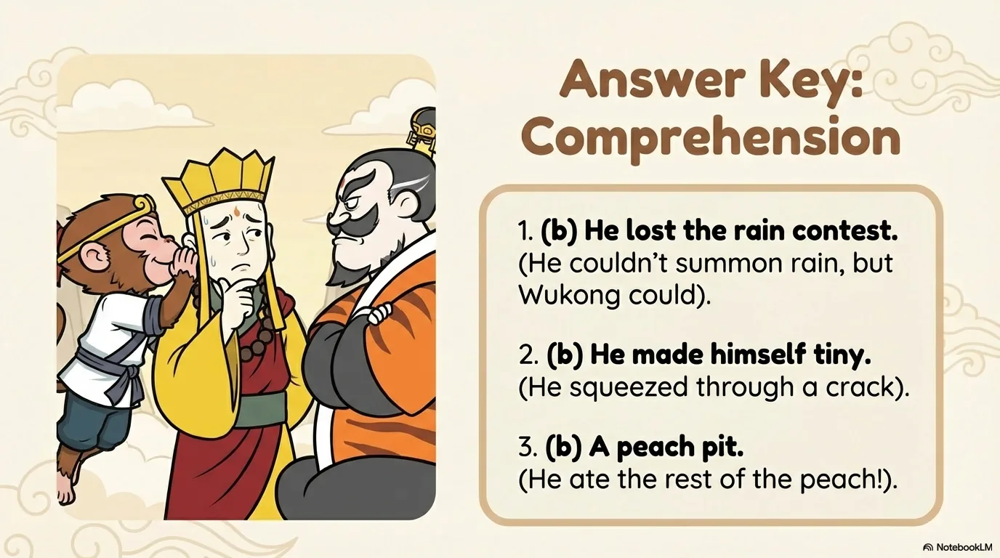

- 来源：`ppt/media/image20.png`（relationship `rId2`）
- 尺寸：1376×768
- 源 SHA-256：`081b533c87fd365a4dc9ad27c284d37e98fa8a3620331db3a1b5f2557c55b41f`
- 输出 SHA-256：`4a6b5a49d27c65de678b6a7584ac51ce728f8b9a565be263af1aad277c2041a2`
- 分类：unknown ｜ OCR：blocked ｜ 审核：unreviewed

## Slide 020

- 来源：`ppt/media/image21.png`（relationship `rId2`）
- 尺寸：1376×768
- 源 SHA-256：`e6cdbc946376092f44e6fc4d5a9de3037bdec544a5f2d36452400ca4f55eedd0`
- 输出 SHA-256：`6906584806b30ab581338fcb85d0be07cb2188a636f3f745baa9ddc1e3760a35`
- 分类：unknown ｜ OCR：blocked ｜ 审核：unreviewed
