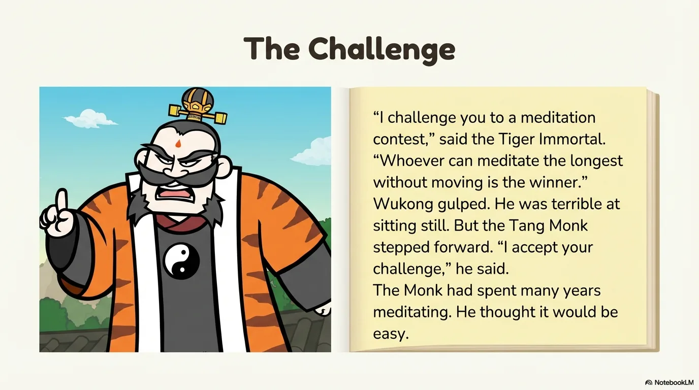
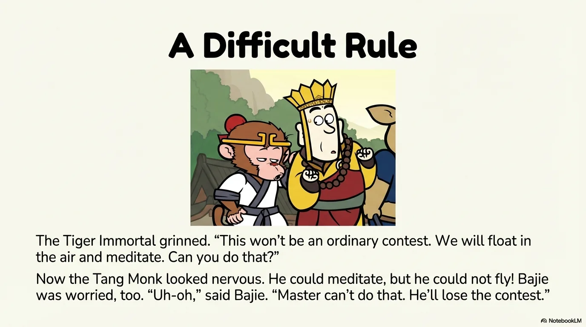
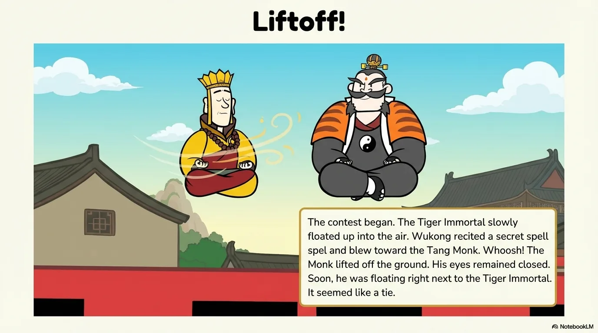
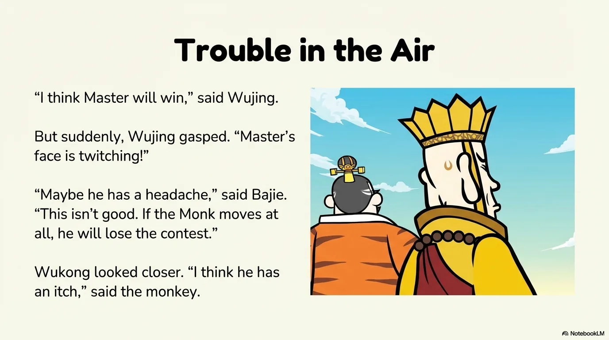
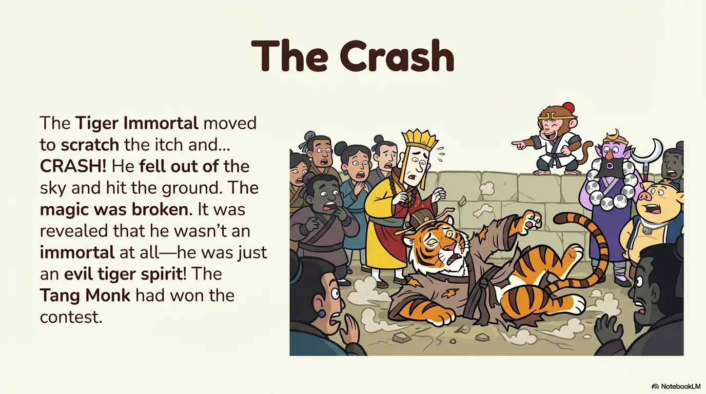
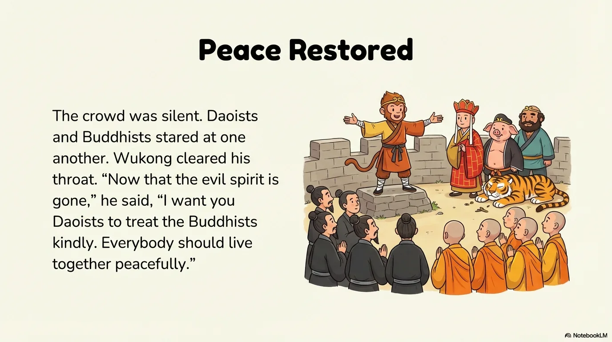
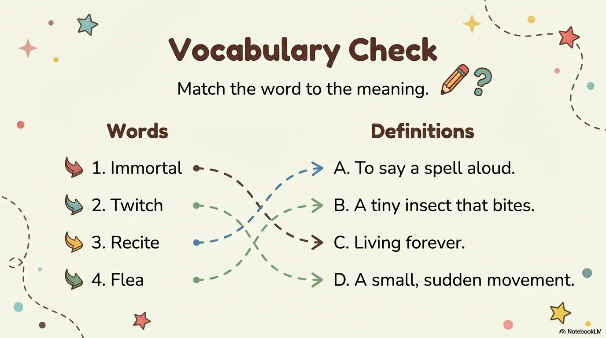
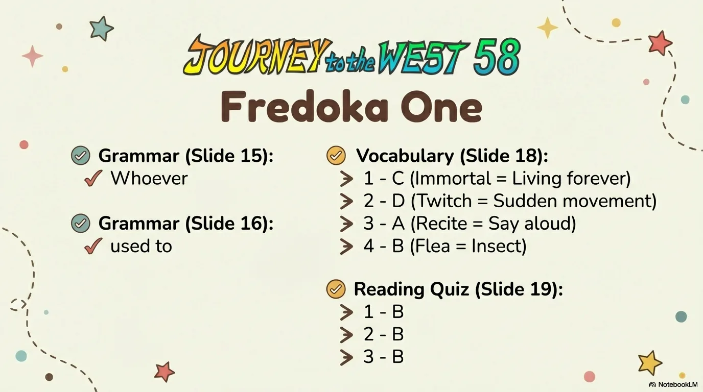

# 豆豆龙英语 · 第 58 集课件（EP058 草稿）

- 来源：`058_Journey to the West 58_The Meditation Contest.pptx`（主课件，20 页）
- OCR：`blocked`（no local OCR provider importable (pytesseract missing): No module named 'pytesseract'）
- 分类：待人工审核（unknown）
- 审核状态：`unreviewed`

## Slide 001

- 来源：`ppt/media/image1.png`（relationship `rId2`）
- 尺寸：1376×768
- 源 SHA-256：`9304ebe0c436f3051c431718744117e61a63af5e0c04b27b39806369985d26a6`
- 输出 SHA-256：`a8e566a3365fdbb75404ce942eed8eb270375e2d67e6e736a4efb638ee2622d3`
- 分类：unknown ｜ OCR：blocked ｜ 审核：unreviewed

## Slide 002

- 来源：`ppt/media/image3.png`（relationship `rId2`）
- 尺寸：1376×768
- 源 SHA-256：`db009f532914f060001571d1842cb0525bc1a32c21adb6b3e67854c278b0dcc2`
- 输出 SHA-256：`adc760e905aa070b03b3779a03ec58518522ade529537ecbc181ab0c6625595d`
- 分类：unknown ｜ OCR：blocked ｜ 审核：unreviewed

## Slide 003

- 来源：`ppt/media/image4.png`（relationship `rId2`）
- 尺寸：1376×768
- 源 SHA-256：`c4af7e596aa18b3f4caed1b6f9f999f108da6c8ad4bde2e180e9a0e6946a16b2`
- 输出 SHA-256：`ecfc0b01462b38a55bd3a25581f8344d1edbc8583240dc5e440f3326d12de78e`
- 分类：unknown ｜ OCR：blocked ｜ 审核：unreviewed

## Slide 004

- 来源：`ppt/media/image5.png`（relationship `rId2`）
- 尺寸：1376×768
- 源 SHA-256：`2f6683236e521fead0f9be8d292563bcfa4b1d3159e5c086c11badf09305af7c`
- 输出 SHA-256：`26d484d8f98cee5400a111fd3ebc8d352a3b14457c7871ca79212c4498313802`
- 分类：unknown ｜ OCR：blocked ｜ 审核：unreviewed

## Slide 005

- 来源：`ppt/media/image6.png`（relationship `rId2`）
- 尺寸：1376×768
- 源 SHA-256：`5fdaf457947e18f6cc03afea8a02d867bc77131f02c1ef3ac4ff692ff51e049a`
- 输出 SHA-256：`35d3c2c6107950b0c9ac57594491812a6bdfe0503b5b75b7cac83ba6fec1e357`
- 分类：unknown ｜ OCR：blocked ｜ 审核：unreviewed

## Slide 006

- 来源：`ppt/media/image7.png`（relationship `rId2`）
- 尺寸：1376×768
- 源 SHA-256：`c8aa4139c71781e8b32cf9e4ddaa3ade63d18f78a307096250567ac60d1dc9dc`
- 输出 SHA-256：`5a42c16edb5636ac9d9d93c3a5730a6c9971614bbb3bd29f55243b2bb08e62d5`
- 分类：unknown ｜ OCR：blocked ｜ 审核：unreviewed

## Slide 007

- 来源：`ppt/media/image8.png`（relationship `rId2`）
- 尺寸：1376×768
- 源 SHA-256：`1cb99359a98637ebb4ea2b740306775360dd1b1e1a1e4c849f5c00b4cb028bda`
- 输出 SHA-256：`b02a86d1d276dd1d2c91deec566ca90bd534416b45d58106f498825eef68814e`
- 分类：unknown ｜ OCR：blocked ｜ 审核：unreviewed

## Slide 008

- 来源：`ppt/media/image9.png`（relationship `rId2`）
- 尺寸：1376×768
- 源 SHA-256：`2e99c51258ffec1640e08d4530e11d7a06d96ffaba41c038d513e81a99193637`
- 输出 SHA-256：`443e633d85dce8f3b6823fee5d543f80e210ecf4ac930c0dc6abd67b67bb8aa6`
- 分类：unknown ｜ OCR：blocked ｜ 审核：unreviewed

## Slide 009

- 来源：`ppt/media/image10.png`（relationship `rId2`）
- 尺寸：1376×768
- 源 SHA-256：`774706626ad6d8a28f45b93e9f667dd5452c520cfc2335b399472b3925797fdb`
- 输出 SHA-256：`76d405d2517b387ad6ad3fd5086560785152576f284978c041b54776c788a075`
- 分类：unknown ｜ OCR：blocked ｜ 审核：unreviewed

## Slide 010

- 来源：`ppt/media/image11.png`（relationship `rId2`）
- 尺寸：1376×768
- 源 SHA-256：`3583e71511fa4c5503563ba711df8db96a144b9b608bac679eb1fce62177d131`
- 输出 SHA-256：`c0ba12e38ad070b5c008a563eb3e8139162cc638dd30a35cd3830008d00ca0f6`
- 分类：unknown ｜ OCR：blocked ｜ 审核：unreviewed

## Slide 011

- 来源：`ppt/media/image12.png`（relationship `rId2`）
- 尺寸：1376×768
- 源 SHA-256：`202d4c10e8bc4d4ed8fbdaca262c5c30f7bf47cf583f9a3a3a2f4f5367ed6243`
- 输出 SHA-256：`684b02bb00ef42565e6fdfb154cad0ebbcfbb239904991e3f9710183047f34f2`
- 分类：unknown ｜ OCR：blocked ｜ 审核：unreviewed

## Slide 012

- 来源：`ppt/media/image13.png`（relationship `rId2`）
- 尺寸：1376×768
- 源 SHA-256：`0b3fabf1e58727737d6018826e9e064082ba059977be442e2a8c91cfcd972757`
- 输出 SHA-256：`8f2f26c2392bc3897554deb5ce00926c78466fbd9e6f1506dcb08d556bbe2134`
- 分类：unknown ｜ OCR：blocked ｜ 审核：unreviewed

## Slide 013

- 来源：`ppt/media/image14.png`（relationship `rId2`）
- 尺寸：1376×768
- 源 SHA-256：`a98f1fbda12b59cbb4b8bc61c4e4aec4b936bc53a16ced7822b3c9a1a784fbb1`
- 输出 SHA-256：`74e2e8bb07a57b8b03c93c4e470bf60a5729e8dddcacab7d1c2155c78f4290b4`
- 分类：unknown ｜ OCR：blocked ｜ 审核：unreviewed

## Slide 014

- 来源：`ppt/media/image15.png`（relationship `rId2`）
- 尺寸：1376×768
- 源 SHA-256：`f6d2a1df7f04110749e62c85bad2543ce18fb950c1b1f5da2c3f0c45b32f564e`
- 输出 SHA-256：`629fceed0c45f2617bebdd7d2b212374664d191ca092c857413a5ca8a6b0c53b`
- 分类：unknown ｜ OCR：blocked ｜ 审核：unreviewed

## Slide 015

- 来源：`ppt/media/image16.png`（relationship `rId2`）
- 尺寸：1376×768
- 源 SHA-256：`f48da89eee05fb8811cf418c28cfa94664729c196af72ec8c52ef888fccde2bb`
- 输出 SHA-256：`04c9a4940c73aff0a09184888df06aac733ff7e45fa4ae171c6fd78aaa8ef9e3`
- 分类：unknown ｜ OCR：blocked ｜ 审核：unreviewed

## Slide 016

- 来源：`ppt/media/image17.png`（relationship `rId2`）
- 尺寸：1376×768
- 源 SHA-256：`e36da90a0e74fb901ae803c375ab51b19804eafde8909f536640b94df12c161d`
- 输出 SHA-256：`86398e1a8a4204576d398c087c999153a39766fdca98719fb3928ee0bb071103`
- 分类：unknown ｜ OCR：blocked ｜ 审核：unreviewed

## Slide 017

- 来源：`ppt/media/image18.png`（relationship `rId2`）
- 尺寸：1376×768
- 源 SHA-256：`267038491ccc887240ed19c030478dfba334366c251426b48bffaaf2ab93602f`
- 输出 SHA-256：`cb4a259014e5cd8d164695ebc8a319659faf5d0f2736ea37bdf69b11185322f4`
- 分类：unknown ｜ OCR：blocked ｜ 审核：unreviewed

## Slide 018

- 来源：`ppt/media/image19.png`（relationship `rId2`）
- 尺寸：1376×768
- 源 SHA-256：`c5455af18d1ef038fb4b777235e922b526f4aff8883f51e3e6114af4a010ec9c`
- 输出 SHA-256：`1c05efb033b40af82efe93fd677439b249506c2ddbac1434a2837f403a1d22e6`
- 分类：unknown ｜ OCR：blocked ｜ 审核：unreviewed

## Slide 019

- 来源：`ppt/media/image20.png`（relationship `rId2`）
- 尺寸：1376×768
- 源 SHA-256：`cb864e275440b1d9135ae570dd7f777b810bd2390fa214229c129a6bf1d94dee`
- 输出 SHA-256：`3b9ea4c3e17ee81cb2984932ec3feead2e7bab978a5642266feec0939f03d3f1`
- 分类：unknown ｜ OCR：blocked ｜ 审核：unreviewed

## Slide 020

- 来源：`ppt/media/image21.png`（relationship `rId2`）
- 尺寸：1376×768
- 源 SHA-256：`2b90f4e265c2164ec8fdd30d23b30db728cc19255c98811234c2da0c8f1681fe`
- 输出 SHA-256：`bffa807ce7f4b6a61f8db3e196b368ca0159bd99775b306afad10e4d78ee98f5`
- 分类：unknown ｜ OCR：blocked ｜ 审核：unreviewed
