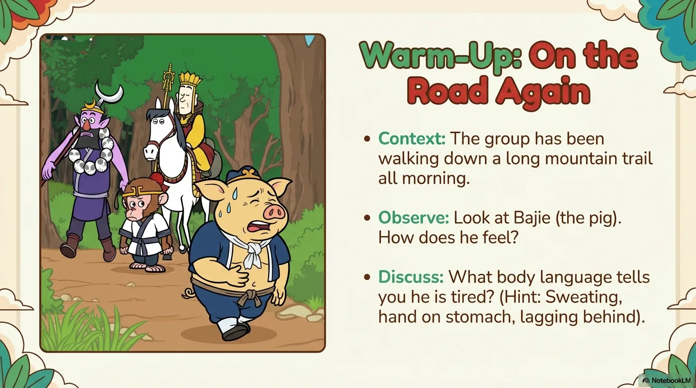
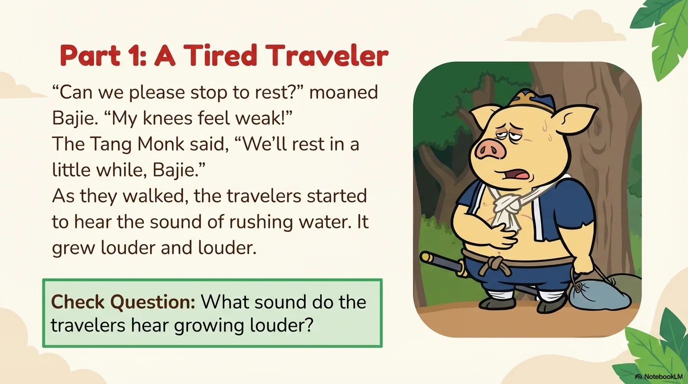
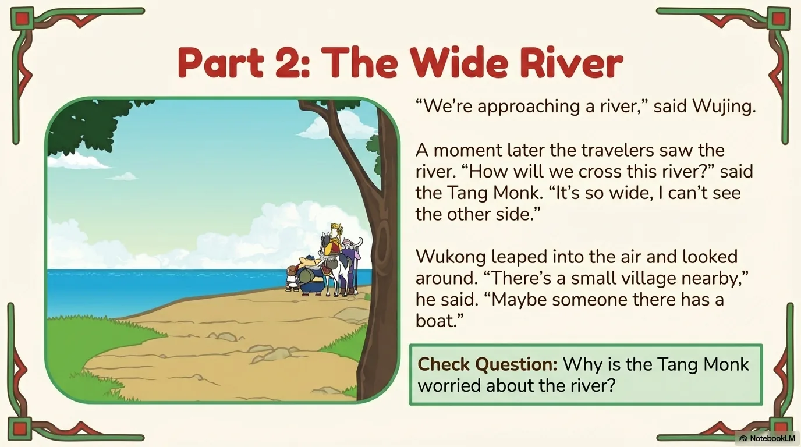
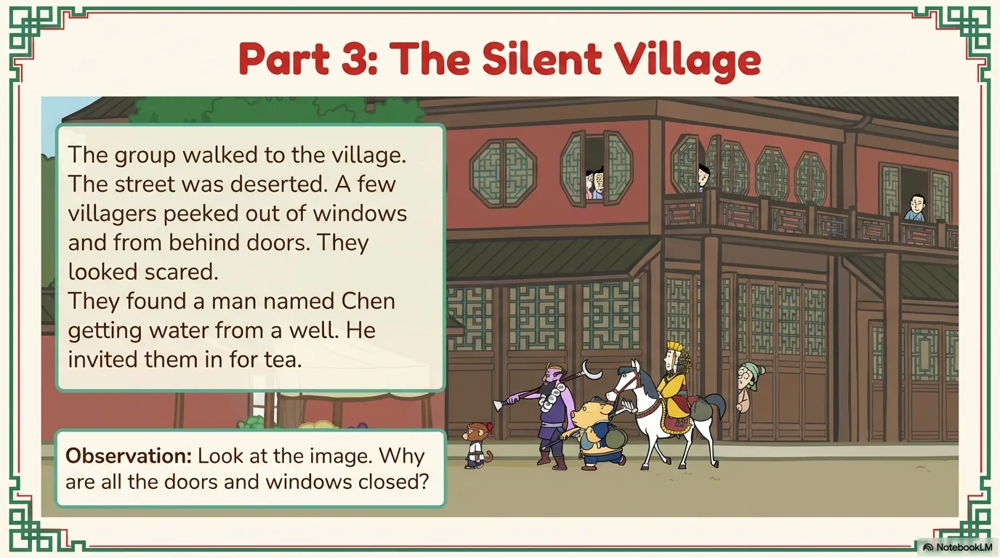
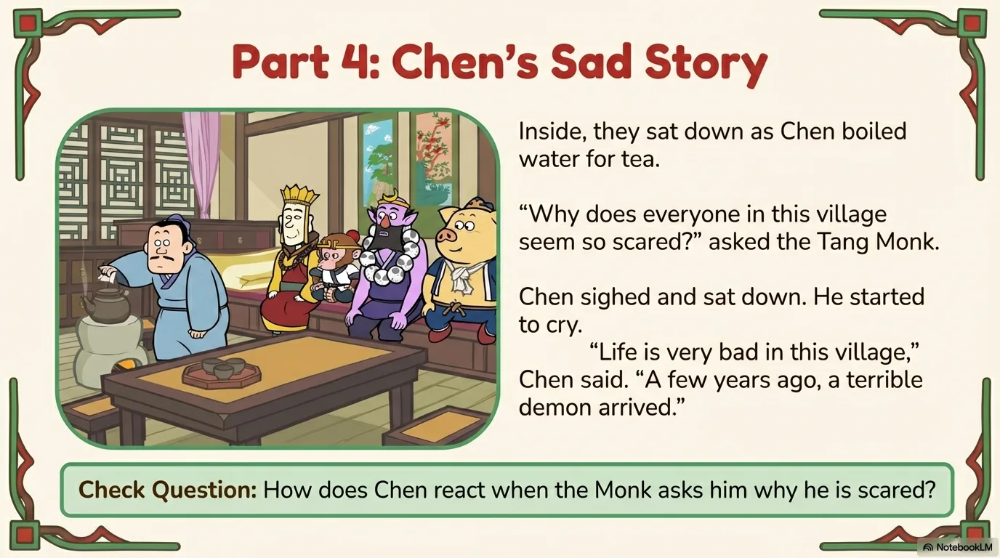
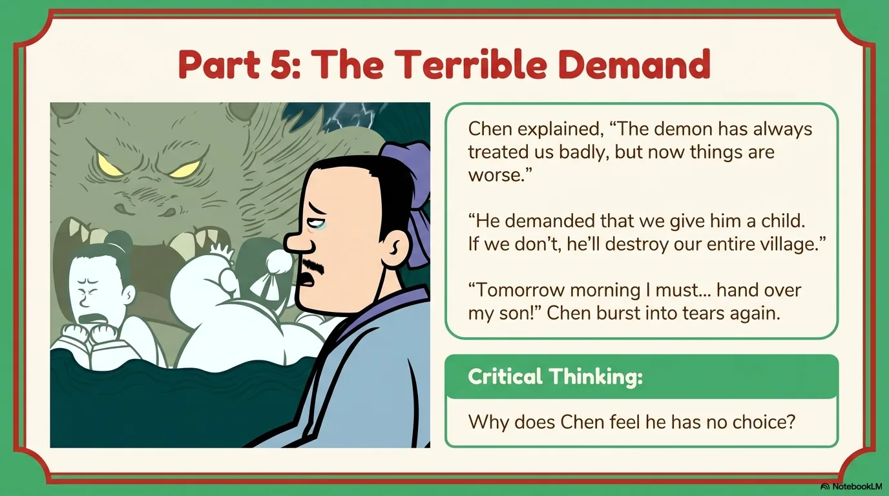
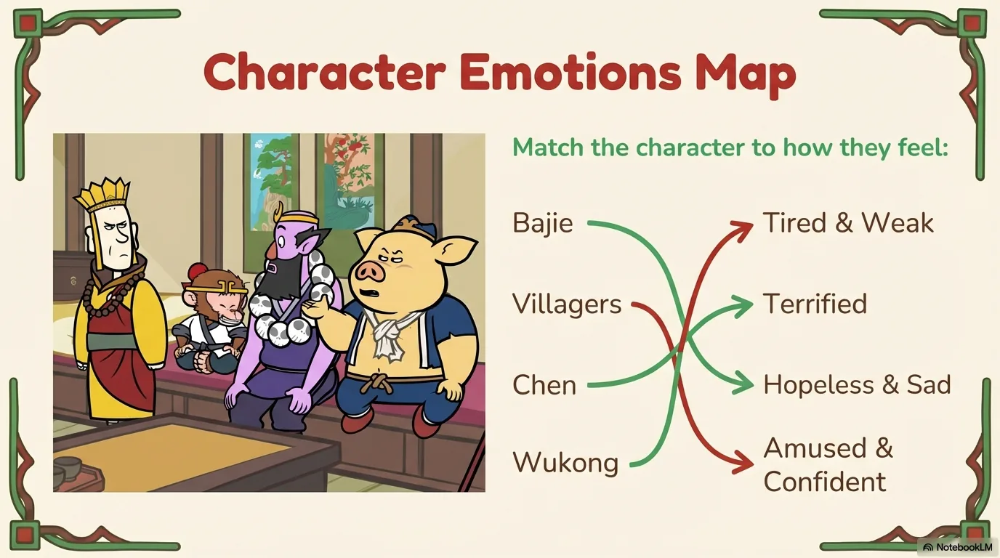
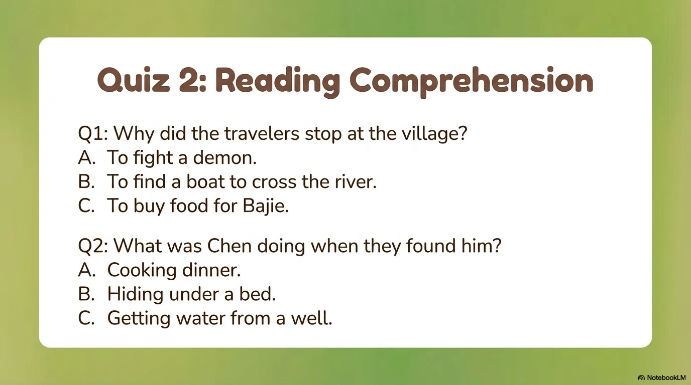
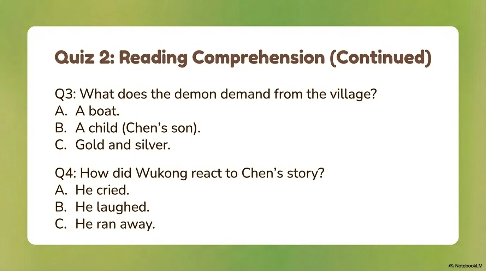

# 豆豆龙英语 · 第 59 集课件（EP059 草稿）

- 来源：`059_Journey to the West 59_Scared Villagers.pptx`（主课件，20 页）
- OCR：`blocked`（no local OCR provider importable (pytesseract missing): No module named 'pytesseract'）
- 分类：待人工审核（unknown）
- 审核状态：`unreviewed`

## Slide 001

- 来源：`ppt/media/image1.png`（relationship `rId2`）
- 尺寸：1376×768
- 源 SHA-256：`efe2f4d86fb348b113f43818bbf883d5a326b1605ac98895f54f2cc14bb7c10d`
- 输出 SHA-256：`d1e669fca4cee8f7880de1018ef60572a2d4f9c3b69791360d613df24605cd56`
- 分类：unknown ｜ OCR：blocked ｜ 审核：unreviewed

## Slide 002

- 来源：`ppt/media/image3.png`（relationship `rId2`）
- 尺寸：1376×768
- 源 SHA-256：`7507cdc0a387a960a7fbc8c4cbd4155e67b1e951210a0ed50d6da401e7416732`
- 输出 SHA-256：`af19fc21366d05ea1dfcd99fe1735f21c5d392fb83ffd71124c712c9abac1fc8`
- 分类：unknown ｜ OCR：blocked ｜ 审核：unreviewed

## Slide 003

- 来源：`ppt/media/image4.png`（relationship `rId2`）
- 尺寸：1376×768
- 源 SHA-256：`2cafaafbd18acd04f1380414a2f0e149f92170f9116ab620a147dc4d4a464344`
- 输出 SHA-256：`dcf2c6f42fca743631f0bae59bbd53f79bf09e612223c8170febfbd55ff0751e`
- 分类：unknown ｜ OCR：blocked ｜ 审核：unreviewed

## Slide 004

- 来源：`ppt/media/image5.png`（relationship `rId2`）
- 尺寸：1376×768
- 源 SHA-256：`37cd60f812bb6e04ea279fb6056c9dd425235e73396363601e81b730c235bdac`
- 输出 SHA-256：`92c3c95c2c675061d9513f4f8f99f85d1ddd0d4c9d122f00a0c682d4d76f66e4`
- 分类：unknown ｜ OCR：blocked ｜ 审核：unreviewed

## Slide 005

- 来源：`ppt/media/image6.png`（relationship `rId2`）
- 尺寸：1376×768
- 源 SHA-256：`b120465a51fcb8333f7877c8e29affea3c22dd3c0e3bcc708aebfa0d58dec077`
- 输出 SHA-256：`4f83ec5f360b2aa7a5b0ce0dbeb5aff9485fa0d14422799f2444936e565d12aa`
- 分类：unknown ｜ OCR：blocked ｜ 审核：unreviewed

## Slide 006

- 来源：`ppt/media/image7.png`（relationship `rId2`）
- 尺寸：1376×768
- 源 SHA-256：`6d1a75c3f403adb624a86e37faf92ea32927e00b8a534525bdda13a8c04bb347`
- 输出 SHA-256：`7687dbf8accabff76fd0e8ef80eaf8b4c1aab3b0470326f9b4ae3a059f5b2b06`
- 分类：unknown ｜ OCR：blocked ｜ 审核：unreviewed

## Slide 007

- 来源：`ppt/media/image8.png`（relationship `rId2`）
- 尺寸：1376×768
- 源 SHA-256：`bcf7fb964e3b27fc537b2bc8504cee291aaa1d792d5ba1a049641770aff1855a`
- 输出 SHA-256：`63b5a9924dfae5b5a250fccc7eddc7d3da4752501c387ebf5d1b5bd23df0f39b`
- 分类：unknown ｜ OCR：blocked ｜ 审核：unreviewed

## Slide 008

- 来源：`ppt/media/image9.png`（relationship `rId2`）
- 尺寸：1376×768
- 源 SHA-256：`67447b2f37354fbf123a407a0f3fffd6c7734f2da9206c78f8d029688a49eba5`
- 输出 SHA-256：`54eb2ab6eb2f18e6129e9ce27ea96d566eb7056abe93a34d6d88db1cd28a7008`
- 分类：unknown ｜ OCR：blocked ｜ 审核：unreviewed

## Slide 009

- 来源：`ppt/media/image10.png`（relationship `rId2`）
- 尺寸：1376×768
- 源 SHA-256：`d6a1330c41955278d1311fbe3656569dd16bcfba56f0574bdbcf73fa6568a859`
- 输出 SHA-256：`acae53dc837b7b5fd5e70c5a0decb8512687fa1847fe787c0a5834061d3763d1`
- 分类：unknown ｜ OCR：blocked ｜ 审核：unreviewed

## Slide 010

- 来源：`ppt/media/image11.png`（relationship `rId2`）
- 尺寸：1376×768
- 源 SHA-256：`61767073700d4a1ef6a7f93fbfbeb93e0f5612328a97a51b5dd2ac6bf45da3fd`
- 输出 SHA-256：`e3080952093185cd67367227e26ad4828566206f035c77132658df63d0019d6e`
- 分类：unknown ｜ OCR：blocked ｜ 审核：unreviewed

## Slide 011

- 来源：`ppt/media/image12.png`（relationship `rId2`）
- 尺寸：1376×768
- 源 SHA-256：`7ffcc0360930fa516081d9ffb07ce2d35f7197d88cbb6491ae15d8d4f9ea327c`
- 输出 SHA-256：`204aaa3ec66c47db31d413f2a3134e7072de9436b61c56dc71b7e167b245a82f`
- 分类：unknown ｜ OCR：blocked ｜ 审核：unreviewed

## Slide 012

- 来源：`ppt/media/image13.png`（relationship `rId2`）
- 尺寸：1376×768
- 源 SHA-256：`1be40c30ed09a57dfc266c7d966ce5ae80e4599cf49107274a80144119fc29aa`
- 输出 SHA-256：`0448adb2489503bbb5f2072e6e75dfeec13e4ba74a16fb29b435139bca936e0e`
- 分类：unknown ｜ OCR：blocked ｜ 审核：unreviewed

## Slide 013

- 来源：`ppt/media/image14.png`（relationship `rId2`）
- 尺寸：1376×768
- 源 SHA-256：`9a3d9eef38c15db24d64e21affae716ab10ad485ef4a5c3957e8cf875d5b255c`
- 输出 SHA-256：`57d9bea93995b1d4f60e57652a99ec18716dbaed2243e2dab9614f5fc3bcb145`
- 分类：unknown ｜ OCR：blocked ｜ 审核：unreviewed

## Slide 014

- 来源：`ppt/media/image15.png`（relationship `rId2`）
- 尺寸：1376×768
- 源 SHA-256：`ae4b8174e4354fa9fb97dc1867c368a701724568b9b162f9061fd6b5bcf2b0c6`
- 输出 SHA-256：`544108edc9c1fb920232443a1285702cc165ce4b4a61457f28190537e3897553`
- 分类：unknown ｜ OCR：blocked ｜ 审核：unreviewed

## Slide 015

- 来源：`ppt/media/image16.png`（relationship `rId2`）
- 尺寸：1376×768
- 源 SHA-256：`8b0c126a8fd2deec9406ad7e3dfefa040bcfe4be11bfd2f4d9ffeac53283629e`
- 输出 SHA-256：`9fcc58e17c8d4f61b3942f2325df886ec3cb163cf6eedf729478478846feea4a`
- 分类：unknown ｜ OCR：blocked ｜ 审核：unreviewed

## Slide 016

- 来源：`ppt/media/image17.png`（relationship `rId2`）
- 尺寸：1376×768
- 源 SHA-256：`6c6fc2fce5365020d03ab8f03d4ad5b2a36eac3df724c2a4d0fe7af51d631da8`
- 输出 SHA-256：`7808b8030e91172093ffa76720a8e96adc44eb6ea5ca9f6e6bff8a7b96947f0c`
- 分类：unknown ｜ OCR：blocked ｜ 审核：unreviewed

## Slide 017

- 来源：`ppt/media/image18.png`（relationship `rId2`）
- 尺寸：1376×768
- 源 SHA-256：`e552b5ce264e743c921d35e4862d516a79f5229f7d1b1b481157f7a56d0e1cd1`
- 输出 SHA-256：`cc8f72664a65b5fadd864d35b35c0ae16fdc6d8bc87a0da207198618bf67d6f5`
- 分类：unknown ｜ OCR：blocked ｜ 审核：unreviewed

## Slide 018

- 来源：`ppt/media/image19.png`（relationship `rId2`）
- 尺寸：1376×768
- 源 SHA-256：`18a48272f4c45364148339f06ac274ce5dfe0bdcc8c2fd0cb9c31a9e25ef37f0`
- 输出 SHA-256：`d9945c9a1c4ca8a9253be45a5ebbb875b9947c8411dfb74690d1fddb7092a0d6`
- 分类：unknown ｜ OCR：blocked ｜ 审核：unreviewed

## Slide 019

- 来源：`ppt/media/image20.png`（relationship `rId2`）
- 尺寸：1376×768
- 源 SHA-256：`02933e3c949d1d1553ab09160b225077d9ad1dd33d8b5b528e541c468645c673`
- 输出 SHA-256：`c636a91ab68245212d2818191da44531a68bc5d94cb9eac7b35d59eb4e99b0ba`
- 分类：unknown ｜ OCR：blocked ｜ 审核：unreviewed

## Slide 020

- 来源：`ppt/media/image21.png`（relationship `rId2`）
- 尺寸：1376×768
- 源 SHA-256：`84b855b4a53a5b63c47ffdea16a97e0555ff5298e6b6471cd5571eb082ea5e13`
- 输出 SHA-256：`6a385b0a69b83b90d2b06e441c89bfe34a13e45677894bcf07859c84dfe45ecf`
- 分类：unknown ｜ OCR：blocked ｜ 审核：unreviewed
