# 豆豆龙英语 · 第 60 集课件（EP060 草稿）

- 来源：`060_Journey to the West 60_Snow!pptx.pptx`（主课件，20 页）
- OCR：`blocked`（no local OCR provider importable (pytesseract missing): No module named 'pytesseract'）
- 分类：待人工审核（unknown）
- 审核状态：`unreviewed`

## Slide 001

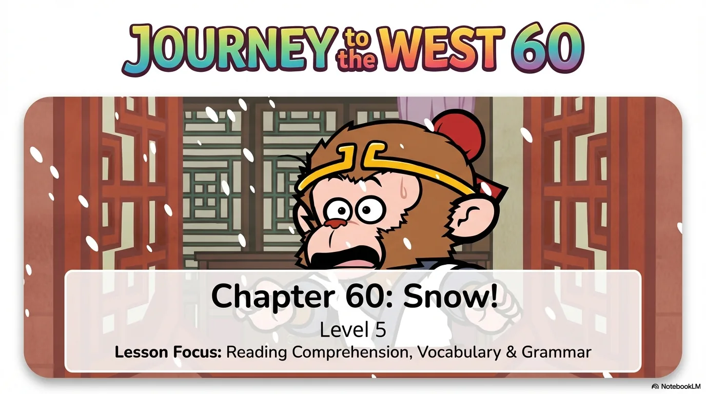

- 来源：`ppt/media/image1.png`（relationship `rId2`）
- 尺寸：1376×768
- 源 SHA-256：`4e5070b302485746e95bade3ccddb1f58c5af702b8c099c55f78bd83d73f0243`
- 输出 SHA-256：`5818dfb568eba43ff0502ed0385f3c18eb0828825ea1f5f9c2b3e7397a3d86ce`
- 分类：unknown ｜ OCR：blocked ｜ 审核：unreviewed

## Slide 002

- 来源：`ppt/media/image3.png`（relationship `rId2`）
- 尺寸：1376×768
- 源 SHA-256：`d4c7d17dc5af14c1a87b05a9c3fff0c932d6dc41fab3893aa21cf45a0416fbf8`
- 输出 SHA-256：`59924015506988ea705fe834f4cbf86921e61582ed3cb0a21d2cc202d1531e2f`
- 分类：unknown ｜ OCR：blocked ｜ 审核：unreviewed

## Slide 003

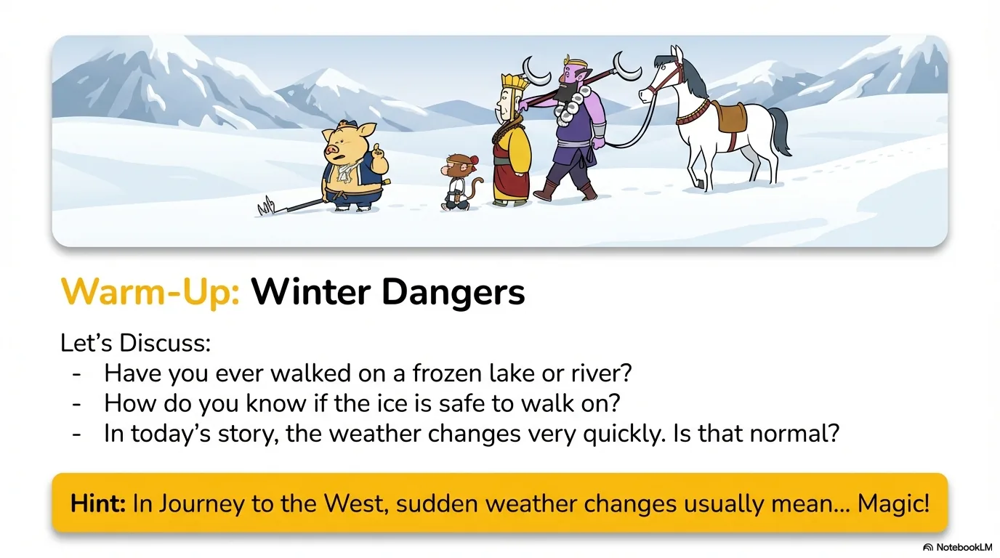

- 来源：`ppt/media/image4.png`（relationship `rId2`）
- 尺寸：1376×768
- 源 SHA-256：`aad9b57c2cbc84ae95829915ffc6b1c3611f50d8cadfa5f15673a992aac72c18`
- 输出 SHA-256：`3172f68124de1f887706bbc77c06c0f9b7e8e786a50e05883e06ac92d96030ed`
- 分类：unknown ｜ OCR：blocked ｜ 审核：unreviewed

## Slide 004

- 来源：`ppt/media/image5.png`（relationship `rId2`）
- 尺寸：1376×768
- 源 SHA-256：`448e342265c1f5a23b153a0feb6cb2e1b64037d8391aba7187da0c8f9f3d1da5`
- 输出 SHA-256：`50113f4c30023f521ba5c478c32dbb36b29b7f6eef73cc7cbab0bac9d8ad8daf`
- 分类：unknown ｜ OCR：blocked ｜ 审核：unreviewed

## Slide 005

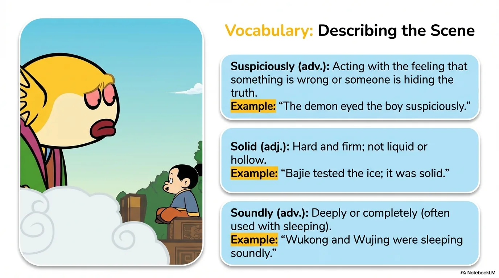

- 来源：`ppt/media/image6.png`（relationship `rId2`）
- 尺寸：1376×768
- 源 SHA-256：`bc9f7d44044cf6090b7391721b531623ba6b8c39c0996c2a8617c1779e61dca6`
- 输出 SHA-256：`d03389f8793f467b06039d1a4345b2c0bcb735ab412ac887795119ac57240e8a`
- 分类：unknown ｜ OCR：blocked ｜ 审核：unreviewed

## Slide 006

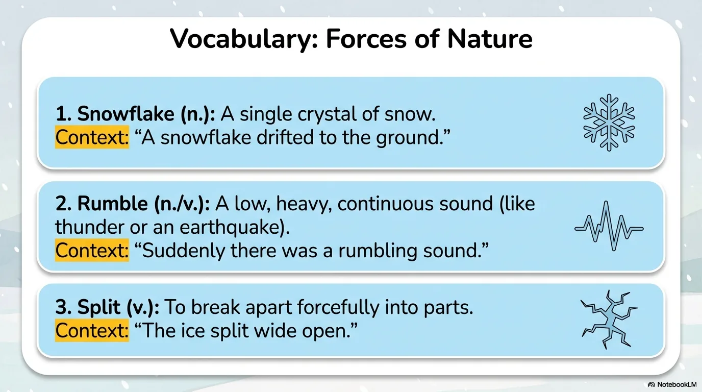

- 来源：`ppt/media/image7.png`（relationship `rId2`）
- 尺寸：1376×768
- 源 SHA-256：`e1dd5226a7a3974707061a2dc139f847ed8c9def02527a7c1a5dd699b2748f54`
- 输出 SHA-256：`80810bd698995faed83f7db566049f7e61f9cd8654dfe48be3bbdb4a7ca8b219`
- 分类：unknown ｜ OCR：blocked ｜ 审核：unreviewed

## Slide 007

- 来源：`ppt/media/image8.png`（relationship `rId2`）
- 尺寸：1376×768
- 源 SHA-256：`5df305766eb726e2a27acacd4e438f65ac8cca666acc30b2f20cc9a07de3024e`
- 输出 SHA-256：`bb103db740fbda2aa365867e78a26ac5b79fddd337c213b4727f090e4f74829c`
- 分类：unknown ｜ OCR：blocked ｜ 审核：unreviewed

## Slide 008

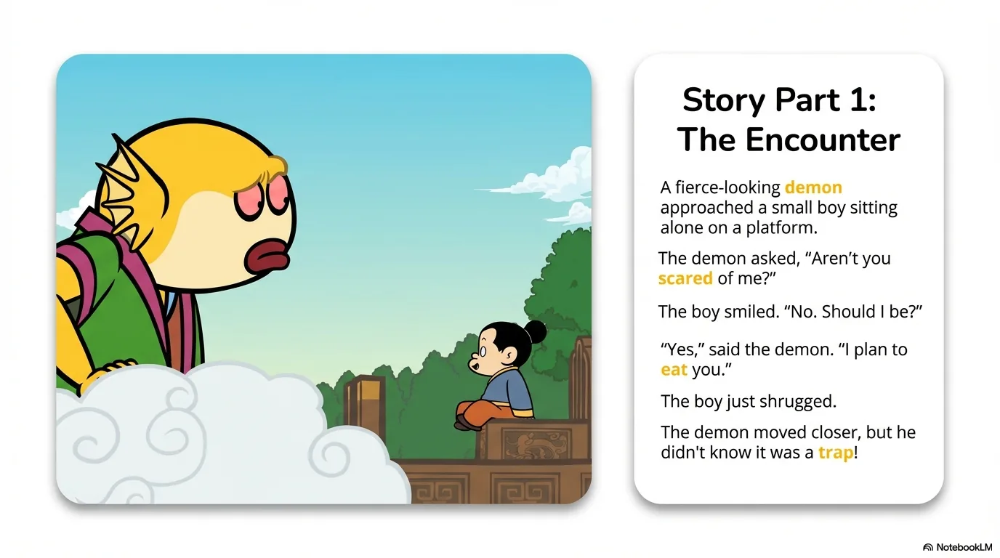

- 来源：`ppt/media/image9.png`（relationship `rId2`）
- 尺寸：1376×768
- 源 SHA-256：`dee6514ba294a8e4cc97fc50ae72008c647a790fc87b4ecd4d5989fec225e0c5`
- 输出 SHA-256：`aefcba6932d60ea9e6f8bbd304adcc453e5abd94cefe58594b231c2997d948f2`
- 分类：unknown ｜ OCR：blocked ｜ 审核：unreviewed

## Slide 009

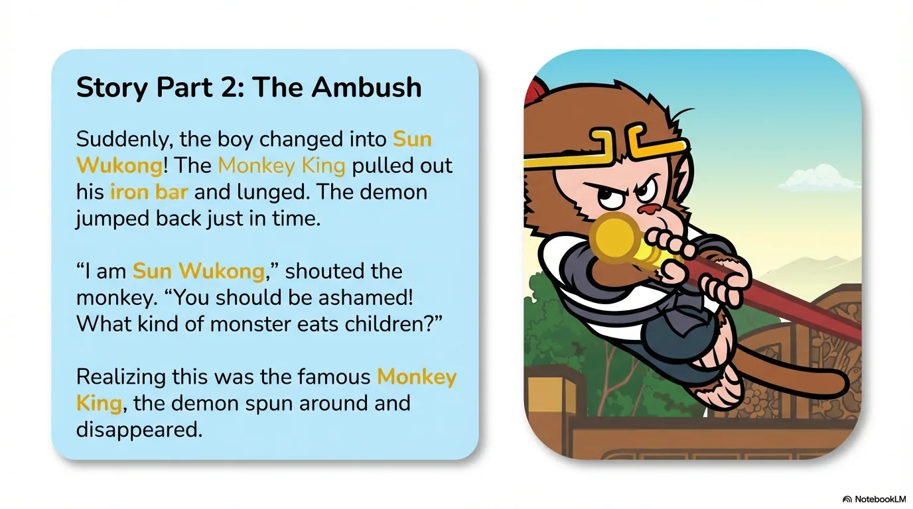

- 来源：`ppt/media/image10.png`（relationship `rId2`）
- 尺寸：1376×768
- 源 SHA-256：`ab5ce5c8808d5cbcf956ee01b9925547a4d08cec2dbd2db1f7ed5ae3aa59dae7`
- 输出 SHA-256：`726d710c46a9ec2cbda167558b073d93da52c6cea57d1f0a033c0892a67160ad`
- 分类：unknown ｜ OCR：blocked ｜ 审核：unreviewed

## Slide 010

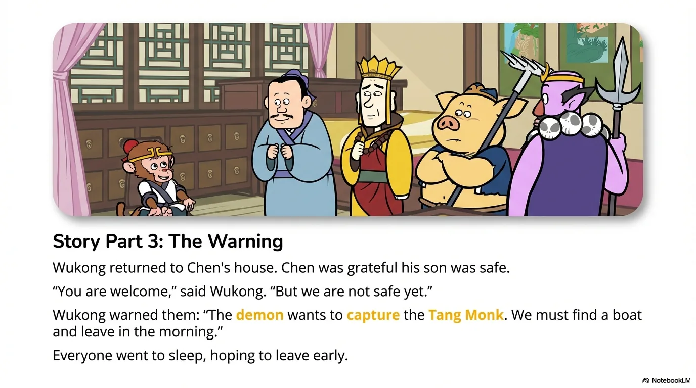

- 来源：`ppt/media/image11.png`（relationship `rId2`）
- 尺寸：1376×768
- 源 SHA-256：`9cf96b121d878b13e96972500cd60696abda555daaa2e03ef55140cf4931e65b`
- 输出 SHA-256：`c0c58022b5dc924795f0e1b2421f3b16de622fed5a606d166e26d9fcd378b7aa`
- 分类：unknown ｜ OCR：blocked ｜ 审核：unreviewed

## Slide 011

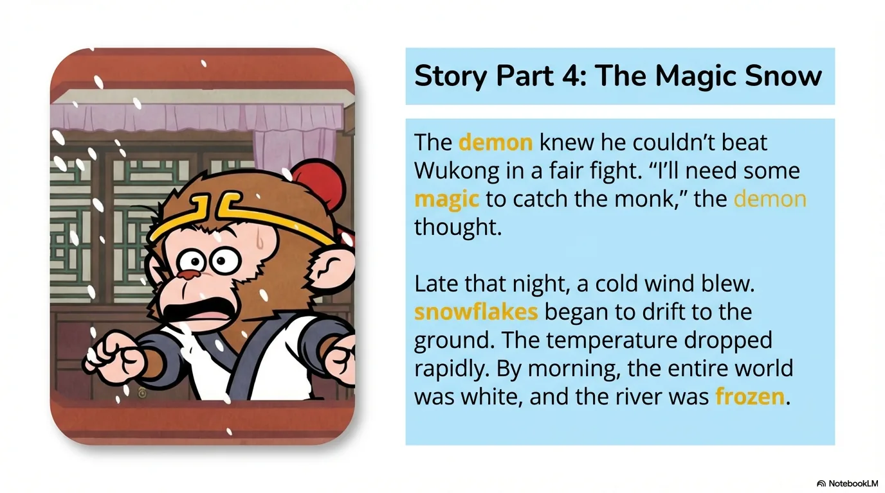

- 来源：`ppt/media/image12.png`（relationship `rId2`）
- 尺寸：1376×768
- 源 SHA-256：`462a9cbd64bb6ae0d15526631765419a5cd73df30461ec92510a1a383b747ebc`
- 输出 SHA-256：`b73ffedc0b39d68fc84d377bbd0625e532a230428042239e5a8ba99ec6159701`
- 分类：unknown ｜ OCR：blocked ｜ 审核：unreviewed

## Slide 012

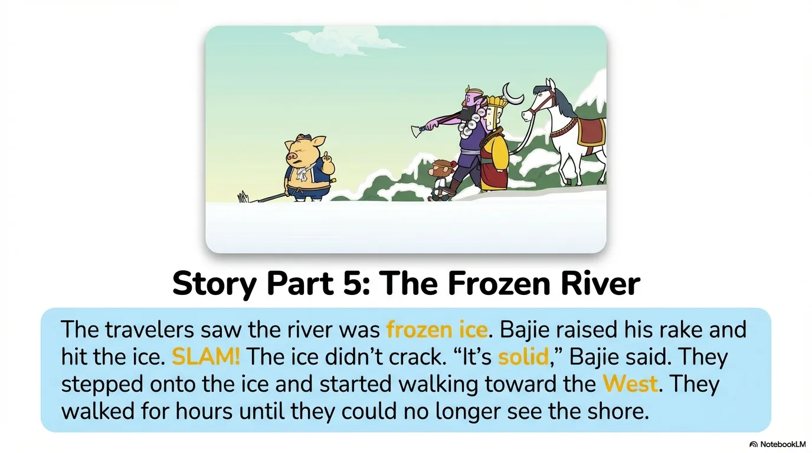

- 来源：`ppt/media/image13.png`（relationship `rId2`）
- 尺寸：1376×768
- 源 SHA-256：`fbf1fcd57296f3e49c232b829550ecb042af8a5ad0d52e4044fe4c7ea0bd372a`
- 输出 SHA-256：`b594238c6256338d7cd8ed73c03d0149632d2e4cddd54348702e4d6ccb86ea97`
- 分类：unknown ｜ OCR：blocked ｜ 审核：unreviewed

## Slide 013

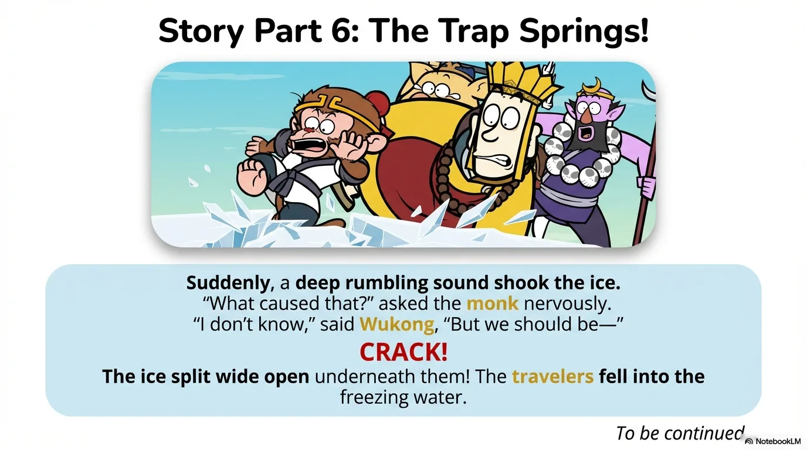

- 来源：`ppt/media/image14.png`（relationship `rId2`）
- 尺寸：1376×768
- 源 SHA-256：`6d2b45d816179dbb5e420b2a3973fe988e0ccb3057ac9a1cdb649e5bd47ef576`
- 输出 SHA-256：`99d398dbdcdfe3687cb87f413de9805bb34297a0531945d350021852db215695`
- 分类：unknown ｜ OCR：blocked ｜ 审核：unreviewed

## Slide 014

- 来源：`ppt/media/image15.png`（relationship `rId2`）
- 尺寸：1376×768
- 源 SHA-256：`ce1a6110d62babb829343aaee54a18da5e3e4b097d76cce701ad9f6708cbd4d8`
- 输出 SHA-256：`430bcaec29ce7157d54896ab01626ced0e5eecf74810d028501023dd242ea4cf`
- 分类：unknown ｜ OCR：blocked ｜ 审核：unreviewed

## Slide 015

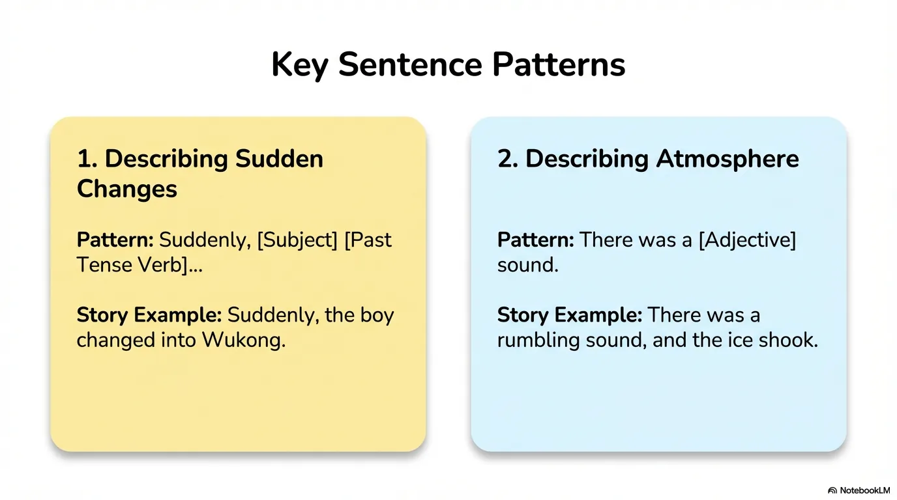

- 来源：`ppt/media/image16.png`（relationship `rId2`）
- 尺寸：1376×768
- 源 SHA-256：`2dcb4ae375aa1049702c5fd0e87a5bfb1561c7e58e59dc51ef136eaf10cfe888`
- 输出 SHA-256：`e48fdddc0159a6a37125c3b0120df10415e61ce887738caad6316e320bb01d2d`
- 分类：unknown ｜ OCR：blocked ｜ 审核：unreviewed

## Slide 016

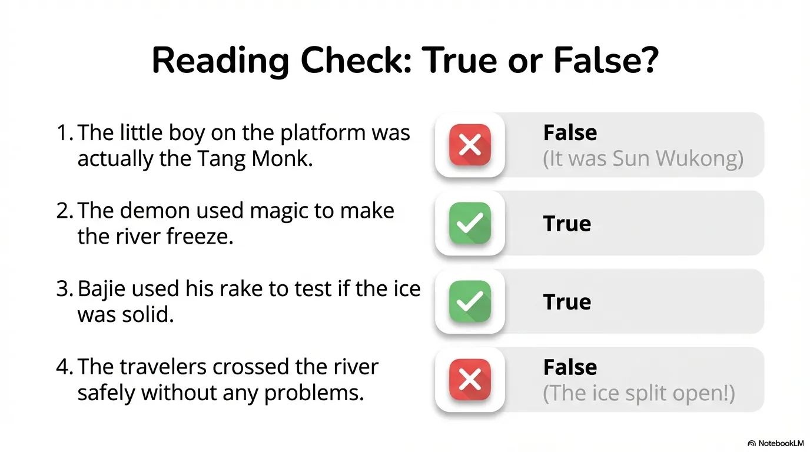

- 来源：`ppt/media/image17.png`（relationship `rId2`）
- 尺寸：1376×768
- 源 SHA-256：`eef3cc0037dd719d5f5dbbbc4b9c63061b7e15093405db6df6fa953661aa67ec`
- 输出 SHA-256：`8374411cf65f46304b8ae1b34df37a8cb43501133d6f24f7d648113322c6bbb9`
- 分类：unknown ｜ OCR：blocked ｜ 审核：unreviewed

## Slide 017

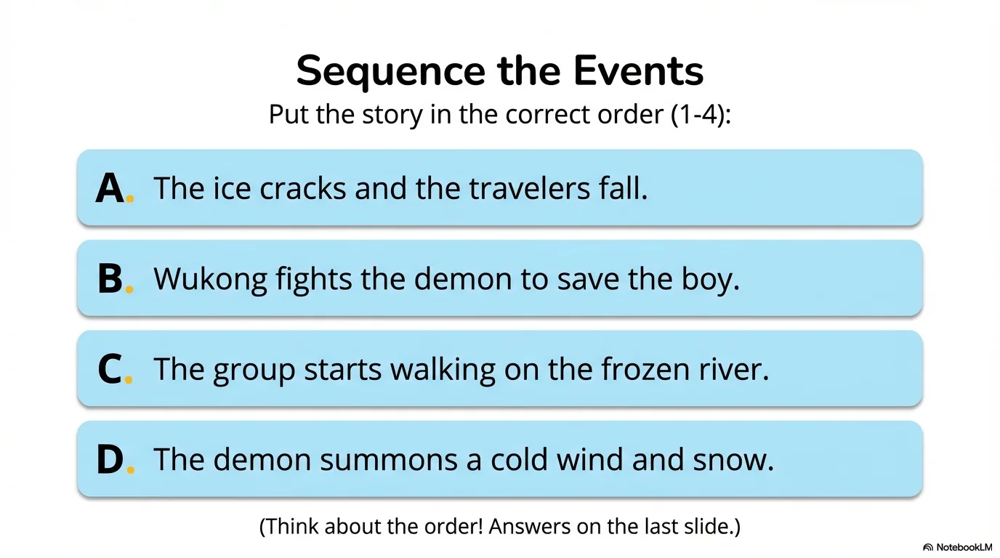

- 来源：`ppt/media/image18.png`（relationship `rId2`）
- 尺寸：1376×768
- 源 SHA-256：`5a4efb86cbc2831ca811521957a617aa97079a2946a0239a231ad5eceed1c7bb`
- 输出 SHA-256：`47920916e024267686eb5d8c4ea796fc4040a536f20d912de21a090bcc2f0510`
- 分类：unknown ｜ OCR：blocked ｜ 审核：unreviewed

## Slide 018

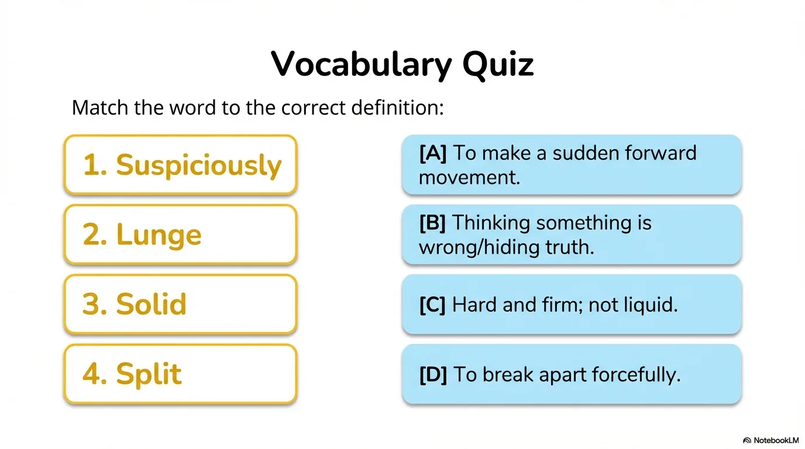

- 来源：`ppt/media/image19.png`（relationship `rId2`）
- 尺寸：1376×768
- 源 SHA-256：`4d6a2629434434a33cfe32d8856937a1bbf91e3fbd9b151f3bb03bb84b5ab5b2`
- 输出 SHA-256：`f914c0c920f9f5070f07c408a409e26120742aa2466790c6e22b9626c869d880`
- 分类：unknown ｜ OCR：blocked ｜ 审核：unreviewed

## Slide 019

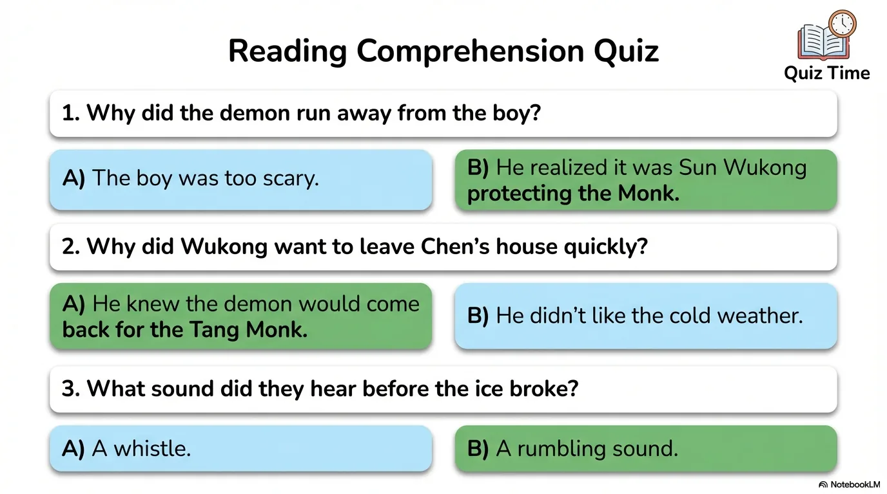

- 来源：`ppt/media/image20.png`（relationship `rId2`）
- 尺寸：1376×768
- 源 SHA-256：`7a74dd1b24a4177efa8ac5b91763480120983b11f1839afec1062b14271de7f9`
- 输出 SHA-256：`e1ce593766242bf4aa7ae5fbf93bbf9e373329783fe50b780551b721145b7122`
- 分类：unknown ｜ OCR：blocked ｜ 审核：unreviewed

## Slide 020

- 来源：`ppt/media/image21.png`（relationship `rId2`）
- 尺寸：1376×768
- 源 SHA-256：`631ce152e878d8511b6c1431720943d1be16227225de37cbb5a596eb7165417e`
- 输出 SHA-256：`a9db9cab1cf1e6868f2427a3566f12a67dcace622ea47bd3aae4039168a84d04`
- 分类：unknown ｜ OCR：blocked ｜ 审核：unreviewed
