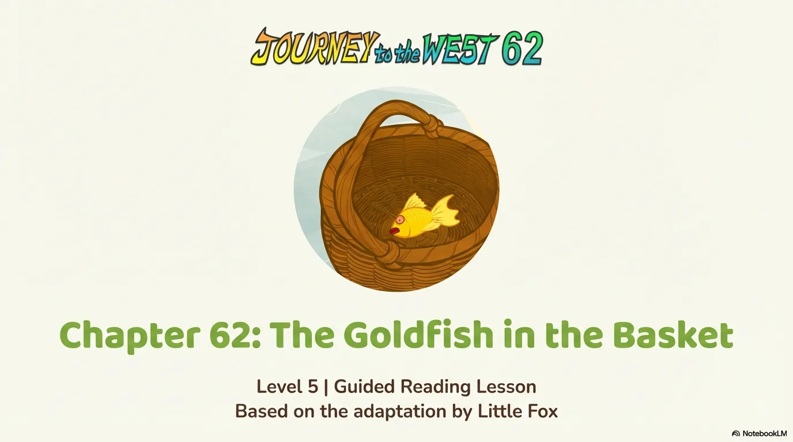
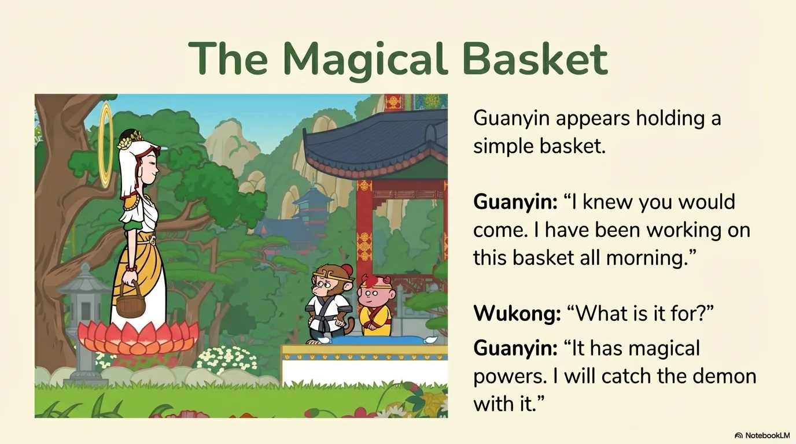
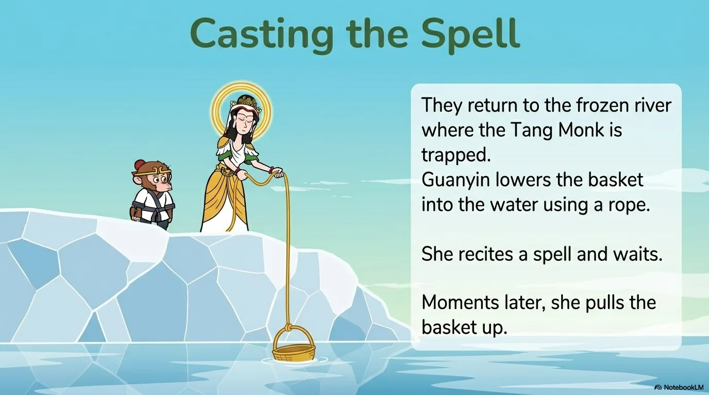
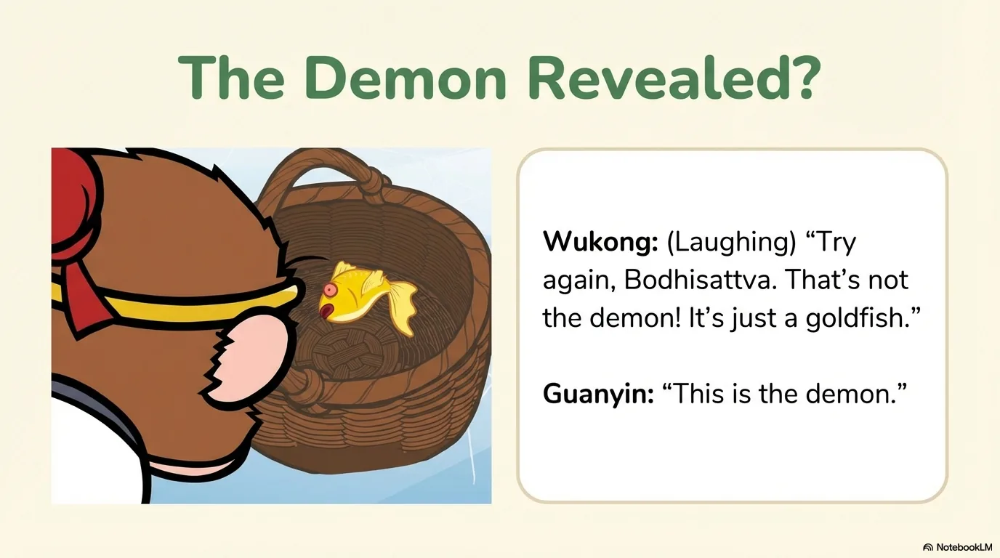
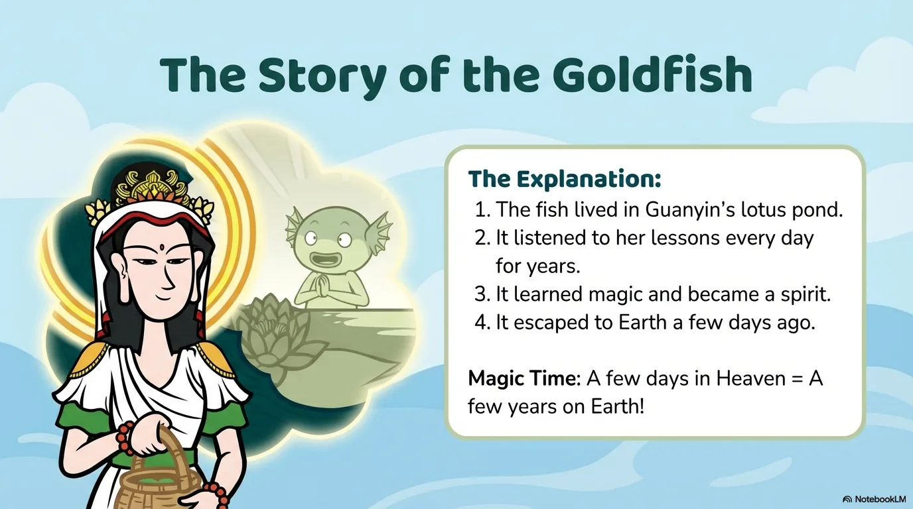
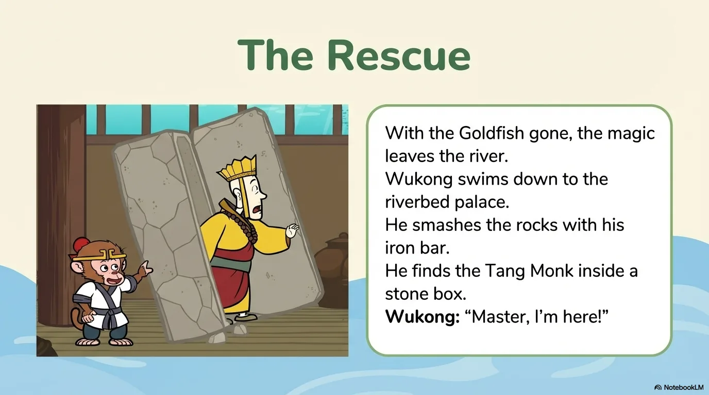
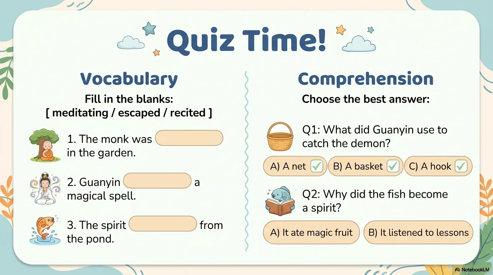

# 豆豆龙英语 · 第 62 集课件（EP062 草稿）

- 来源：`062_Journey to the West 62_The Goldfish in the Basket.pptx`（主课件，15 页）
- OCR：`blocked`（no local OCR provider importable (pytesseract missing): No module named 'pytesseract'）
- 分类：待人工审核（unknown）
- 审核状态：`unreviewed`

## Slide 001

- 来源：`ppt/media/image1.png`（relationship `rId2`）
- 尺寸：1376×768
- 源 SHA-256：`688524124f0e6332c9f8ae025b42d3f4ffe08999d08119f558af48189caf98a9`
- 输出 SHA-256：`070455afbc45331b7c2279bb5e964bc4c2d1393676bea079495b97cff6ad446f`
- 分类：unknown ｜ OCR：blocked ｜ 审核：unreviewed

## Slide 002

- 来源：`ppt/media/image3.png`（relationship `rId2`）
- 尺寸：1376×768
- 源 SHA-256：`b77f0d8844f6a0f7edac62f42916a4d17aa42cb481c54be09399895a68d52630`
- 输出 SHA-256：`ca2701456b8f591f399bf63f92b5eb7a30a8938744ad3edd300fb794bdaf31de`
- 分类：unknown ｜ OCR：blocked ｜ 审核：unreviewed

## Slide 003

- 来源：`ppt/media/image4.png`（relationship `rId2`）
- 尺寸：1376×768
- 源 SHA-256：`02a13f56af9e00a7f238cadd243d7a8ae47e302adbcba13809647f68f9a0c597`
- 输出 SHA-256：`1589acc2479929f6f839a1f1cf2acade83d9ddc208251cf175c90c52cc05169a`
- 分类：unknown ｜ OCR：blocked ｜ 审核：unreviewed

## Slide 004

- 来源：`ppt/media/image5.png`（relationship `rId2`）
- 尺寸：1376×768
- 源 SHA-256：`42663da575dd75f2d7a74906bf08e70b08c1c066a131974032cec4cac8364b59`
- 输出 SHA-256：`cad4d83659216fdb3d62ee311876f8cd4133a03197dba393236bf28b48b989a1`
- 分类：unknown ｜ OCR：blocked ｜ 审核：unreviewed

## Slide 005

- 来源：`ppt/media/image6.png`（relationship `rId2`）
- 尺寸：1376×768
- 源 SHA-256：`f77a5924a69ee06fb10dd53525cac7c800a6a57982acf303283c78bf0d0f85dc`
- 输出 SHA-256：`79f4f4ca1e3d7e16da31ccee928a60b3ee413219d100a1a5ef8d0d77e2ac9c69`
- 分类：unknown ｜ OCR：blocked ｜ 审核：unreviewed

## Slide 006

- 来源：`ppt/media/image7.png`（relationship `rId2`）
- 尺寸：1376×768
- 源 SHA-256：`61da05921be47ebabfce94684235c32eb479ac48db7a9219530e35919ecb4873`
- 输出 SHA-256：`b1c1a05a749c279706ee4aa83b1393ea3242e3346ab1c80ac7b98f5b82e76069`
- 分类：unknown ｜ OCR：blocked ｜ 审核：unreviewed

## Slide 007

- 来源：`ppt/media/image8.png`（relationship `rId2`）
- 尺寸：1376×768
- 源 SHA-256：`b4a07149aae270f35d10770874069c76dd7ea3d733bbec03dbad55c83b59d4f0`
- 输出 SHA-256：`1108d2bc5075e0fb0559108e075002183c119f0877416742269770e26bdc6c90`
- 分类：unknown ｜ OCR：blocked ｜ 审核：unreviewed

## Slide 008

- 来源：`ppt/media/image9.png`（relationship `rId2`）
- 尺寸：1376×768
- 源 SHA-256：`6f0ed963183a15786ba63014dcce31864afc9b080f018956eeefa3c640148089`
- 输出 SHA-256：`f73315dd48b1fdb6b36e35cd8883ade7c517b2199975a2467cd464a4da3e4cc0`
- 分类：unknown ｜ OCR：blocked ｜ 审核：unreviewed

## Slide 009

- 来源：`ppt/media/image10.png`（relationship `rId2`）
- 尺寸：1376×768
- 源 SHA-256：`4a8c0b7d5b44af277c842d224f4e45ede10f8485e94a32dd2c13325a029194ff`
- 输出 SHA-256：`982484a3cf04ab6241c59c7f53809d40ed8c2b7667b78820a1b5beb7dd97d5f8`
- 分类：unknown ｜ OCR：blocked ｜ 审核：unreviewed

## Slide 010

- 来源：`ppt/media/image11.png`（relationship `rId2`）
- 尺寸：1376×768
- 源 SHA-256：`d5039d1831f4d4a511c2d8fe80a1cfdaf7c425e9ae36551de1956495b4445c89`
- 输出 SHA-256：`974888fdfdfceeae2339ce8d3e8f6dafeb92f604ad11345788badbf6c751f70b`
- 分类：unknown ｜ OCR：blocked ｜ 审核：unreviewed

## Slide 011

- 来源：`ppt/media/image12.png`（relationship `rId2`）
- 尺寸：1376×768
- 源 SHA-256：`57073105bd5bcb5b4312084beeaa84270c4facde7f0ab7378e6330245f96de03`
- 输出 SHA-256：`cc8978e77f781728cbec2633a94fb72fffb4ec53d7d9903e8f1c4aef083b640d`
- 分类：unknown ｜ OCR：blocked ｜ 审核：unreviewed

## Slide 012

- 来源：`ppt/media/image13.png`（relationship `rId2`）
- 尺寸：1376×768
- 源 SHA-256：`164b240997c098509433fae6cf0036f1207da643cd50bb8a49304a80cfa82bfc`
- 输出 SHA-256：`ec60d9245b08002edb4c0de05245544547673242ecf3bde1fe152163b513846b`
- 分类：unknown ｜ OCR：blocked ｜ 审核：unreviewed

## Slide 013

- 来源：`ppt/media/image14.png`（relationship `rId2`）
- 尺寸：1376×768
- 源 SHA-256：`d170d60624d9fbb4f7dcb0089fe699ad5967520cb0039f8414d1e923b43af212`
- 输出 SHA-256：`0e1c3ddae0e1bd82ed81a8655c01a58839704c1370d3b89921976ec5ca5f8b89`
- 分类：unknown ｜ OCR：blocked ｜ 审核：unreviewed

## Slide 014

- 来源：`ppt/media/image15.png`（relationship `rId2`）
- 尺寸：1376×768
- 源 SHA-256：`02590fa654d30cfa022e585c7457f0ff0e1a5e4c44f90e9eebe4abe015340b78`
- 输出 SHA-256：`a52a4e029a1fe417db28764ec2f1499601b3408e8b6ff6a95fa69e22097d0004`
- 分类：unknown ｜ OCR：blocked ｜ 审核：unreviewed

## Slide 015

- 来源：`ppt/media/image16.png`（relationship `rId2`）
- 尺寸：1376×768
- 源 SHA-256：`70d1bba49c11d511ffa6d76aafd8eeec41dc49ac344708a08163e1b58fe12ad7`
- 输出 SHA-256：`0b812b6bdd02cbc539c2a8282bc5594ae16de95d0f67a916c90aa2444837dd68`
- 分类：unknown ｜ OCR：blocked ｜ 审核：unreviewed
