# 豆豆龙英语 · 第 63 集课件（EP063 草稿）

- 来源：`063_Journey to the West 63_A Question for Buddha.pptx`（主课件，20 页）
- OCR：`blocked`（no local OCR provider importable (pytesseract missing): No module named 'pytesseract'）
- 分类：待人工审核（unknown）
- 审核状态：`unreviewed`

## Slide 001

- 来源：`ppt/media/image1.png`（relationship `rId2`）
- 尺寸：1376×768
- 源 SHA-256：`eb4f0c4a3b30c564ae9f84218f4c86c592b4e2729cd9cf7ea73052fc99f10721`
- 输出 SHA-256：`c85bd64e82ec12fa0503942902653fcd53a43dbe4e54149b3832430f8c56a1ba`
- 分类：unknown ｜ OCR：blocked ｜ 审核：unreviewed

## Slide 002

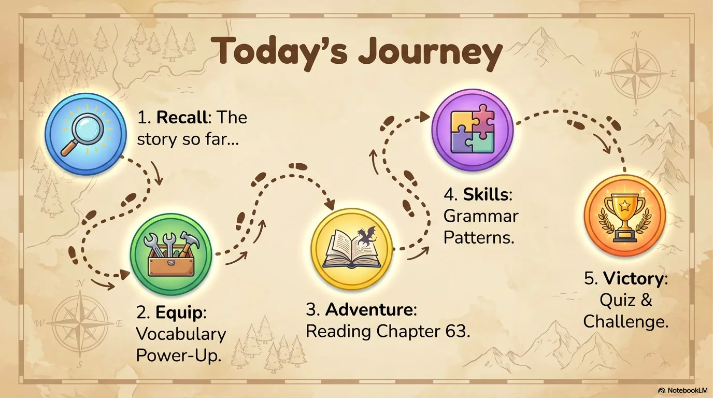

- 来源：`ppt/media/image3.png`（relationship `rId2`）
- 尺寸：1376×768
- 源 SHA-256：`0d66a00d86210cc3c3363242815a984c57a58ed82d751b098d3641390f616d5f`
- 输出 SHA-256：`3b9e7ade4ae4e070335aff406d5eb8b6065c1d72a2b6a26a66f7c61acab45794`
- 分类：unknown ｜ OCR：blocked ｜ 审核：unreviewed

## Slide 003

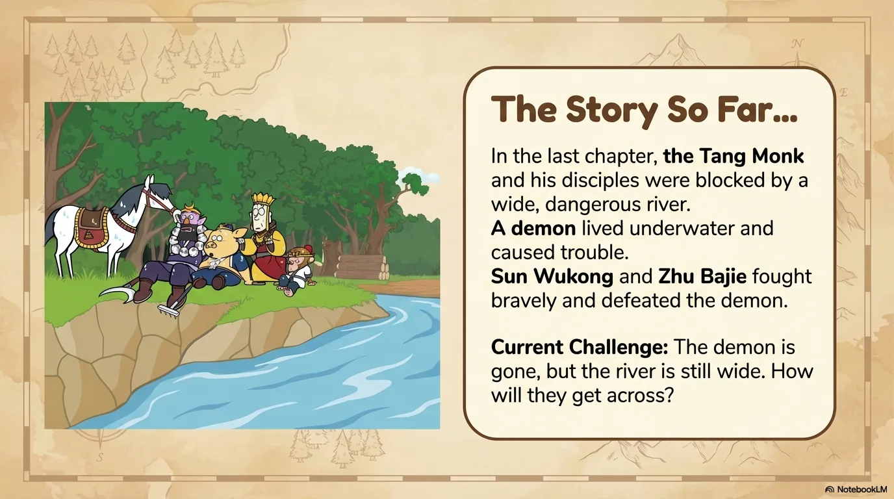

- 来源：`ppt/media/image4.png`（relationship `rId2`）
- 尺寸：1376×768
- 源 SHA-256：`4a0a246abe3b6e61e174b97bdd9d6925535e3568eec01d1e98c1c7f25ffb4d39`
- 输出 SHA-256：`c8a8a647122496a22b813e12587cd04439c8f39ef3dcee5a98c58eb5198366a1`
- 分类：unknown ｜ OCR：blocked ｜ 审核：unreviewed

## Slide 004

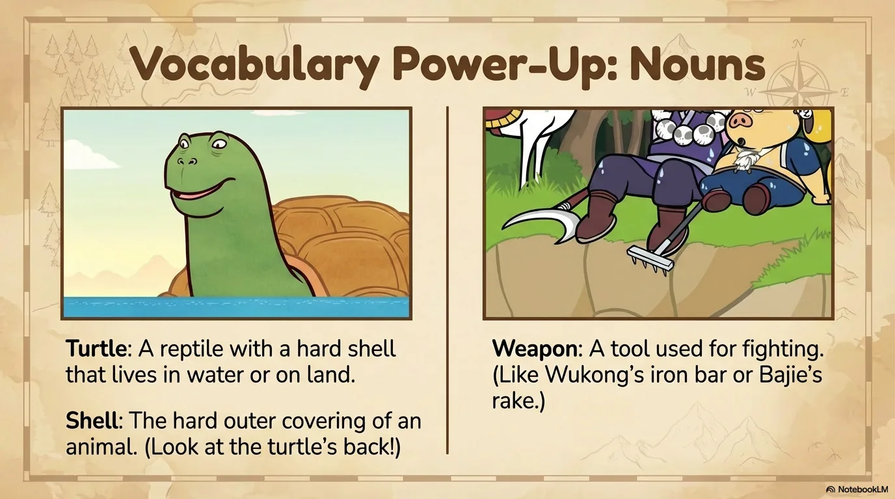

- 来源：`ppt/media/image5.png`（relationship `rId2`）
- 尺寸：1376×768
- 源 SHA-256：`0f322e5a8a920321109bf0ebfc70eb4726a5b9e53e872a4c11d4d6c93a8d4786`
- 输出 SHA-256：`6d5ba65c28fc0385a8a3fa6e24b6fefc889554d090612ce49af589a9b481172e`
- 分类：unknown ｜ OCR：blocked ｜ 审核：unreviewed

## Slide 005

- 来源：`ppt/media/image6.png`（relationship `rId2`）
- 尺寸：1376×768
- 源 SHA-256：`ea1f7fc2c5449a11b0414ea5067b49f0bb7716e23193d0dad90ef2e7a45bd797`
- 输出 SHA-256：`9d6a4dfc8a618b2115752fd16179239ac5e85e4083065cff3fb759540d8a66b5`
- 分类：unknown ｜ OCR：blocked ｜ 审核：unreviewed

## Slide 006

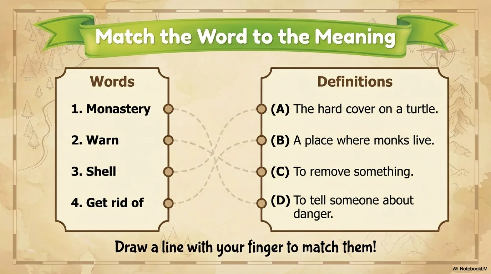

- 来源：`ppt/media/image7.png`（relationship `rId2`）
- 尺寸：1376×768
- 源 SHA-256：`8718c25adfeebc73d637486deef96ca1a68837dcddcf9ab0c0c18f877ab24b0d`
- 输出 SHA-256：`ae37d0dc462e24d5a0170de3cc944dd21a04d381e5ae7f8ce7678614e05aa0e5`
- 分类：unknown ｜ OCR：blocked ｜ 审核：unreviewed

## Slide 007

- 来源：`ppt/media/image8.png`（relationship `rId2`）
- 尺寸：1376×768
- 源 SHA-256：`52c675df3385bb7cbeaa665a24cb3eda4feb62ff3b338d97b17b351b4938c59d`
- 输出 SHA-256：`c8e36adca4f9c75d8b2162165b53f7a846ebc24a368346a9f6bebac7eb7bfef3`
- 分类：unknown ｜ OCR：blocked ｜ 审核：unreviewed

## Slide 008

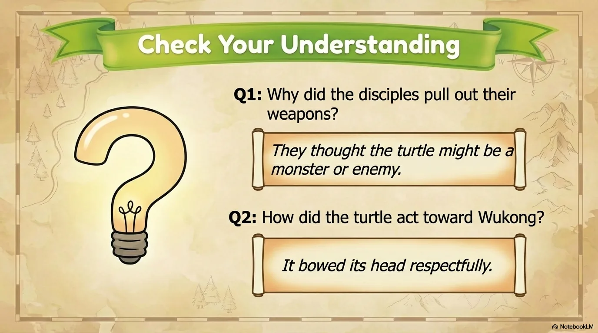

- 来源：`ppt/media/image9.png`（relationship `rId2`）
- 尺寸：1376×768
- 源 SHA-256：`d96057e3a4d2124105f71846e5ae495db7e443679299fa6b8427360840e3ac24`
- 输出 SHA-256：`fac2528257b970a4fd8fa7c1e70f87a097d1bdd4ad4ce59350d905e9f918e507`
- 分类：unknown ｜ OCR：blocked ｜ 审核：unreviewed

## Slide 009

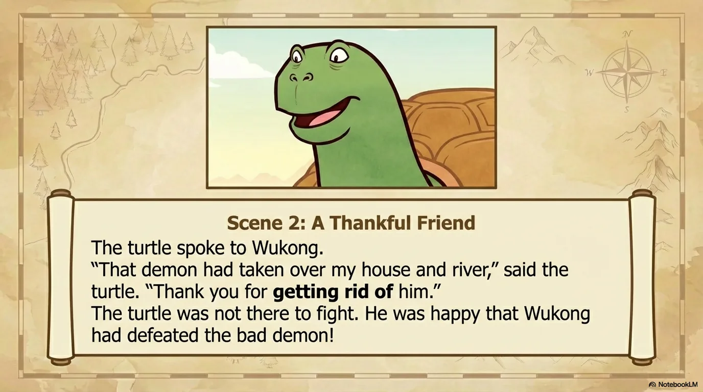

- 来源：`ppt/media/image10.png`（relationship `rId2`）
- 尺寸：1376×768
- 源 SHA-256：`e5e01dbcb5804231999877755420d4556b9542d317dab890da832ae7bcd72bd9`
- 输出 SHA-256：`dc2c342f486eceb7e5d1902fe76f8b31db0c8a4c3767f2e0810de4a947ca9f24`
- 分类：unknown ｜ OCR：blocked ｜ 审核：unreviewed

## Slide 010

- 来源：`ppt/media/image11.png`（relationship `rId2`）
- 尺寸：1376×768
- 源 SHA-256：`05fcad531c38b190ed021ed9845befabb9982eaf821b358feb6efb2577a3e3ea`
- 输出 SHA-256：`7b4d7b2bcd02bcc66c861fd3c76a7e25076fe7a7cdab6b41664c2ed1449aede1`
- 分类：unknown ｜ OCR：blocked ｜ 审核：unreviewed

## Slide 011

- 来源：`ppt/media/image12.png`（relationship `rId2`）
- 尺寸：1376×768
- 源 SHA-256：`0a7e007f1b181b1a8c9b131288b54acd81d6de503151323af41e552c05db7e0e`
- 输出 SHA-256：`8eb44845da57f70e577956c74d98df600801f18d9328301acaca7122f95b30ec`
- 分类：unknown ｜ OCR：blocked ｜ 审核：unreviewed

## Slide 012

- 来源：`ppt/media/image13.png`（relationship `rId2`）
- 尺寸：1376×768
- 源 SHA-256：`a83bbaac48727759906b7cc8ce478494a370bca0f66a6cbacbf79b954ea39618`
- 输出 SHA-256：`148412c3f72f77f81014321e0009d88455be464ca027bec8f67762309fd05675`
- 分类：unknown ｜ OCR：blocked ｜ 审核：unreviewed

## Slide 013

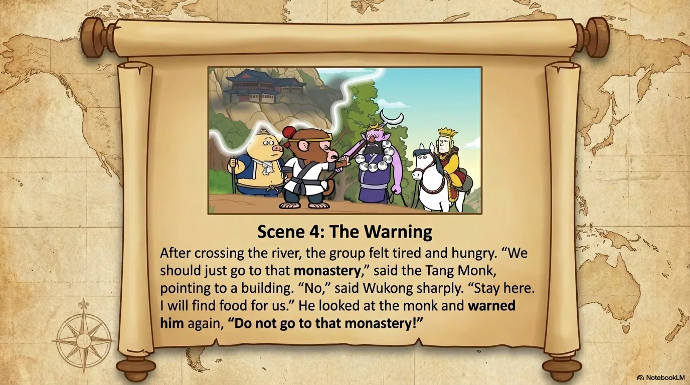

- 来源：`ppt/media/image14.png`（relationship `rId2`）
- 尺寸：1376×768
- 源 SHA-256：`2516e8b38b2e0ad18636bc8e81d591599c208a1e0a42dfcde100a4aec46d4f98`
- 输出 SHA-256：`38483009cb3e262a831558320c18ad1a05ee6778d2aee1e2147c1e9b30df8d03`
- 分类：unknown ｜ OCR：blocked ｜ 审核：unreviewed

## Slide 014

- 来源：`ppt/media/image15.png`（relationship `rId2`）
- 尺寸：1376×768
- 源 SHA-256：`6a36a65ddc636ff75a63d80a9c08c26904a13a02f22402e37bf921d3ee05baa1`
- 输出 SHA-256：`1b404d1dff8f9c5d5e3e7ffc7391ed7b91538e48613e1b8b0ad55681bad10539`
- 分类：unknown ｜ OCR：blocked ｜ 审核：unreviewed

## Slide 015

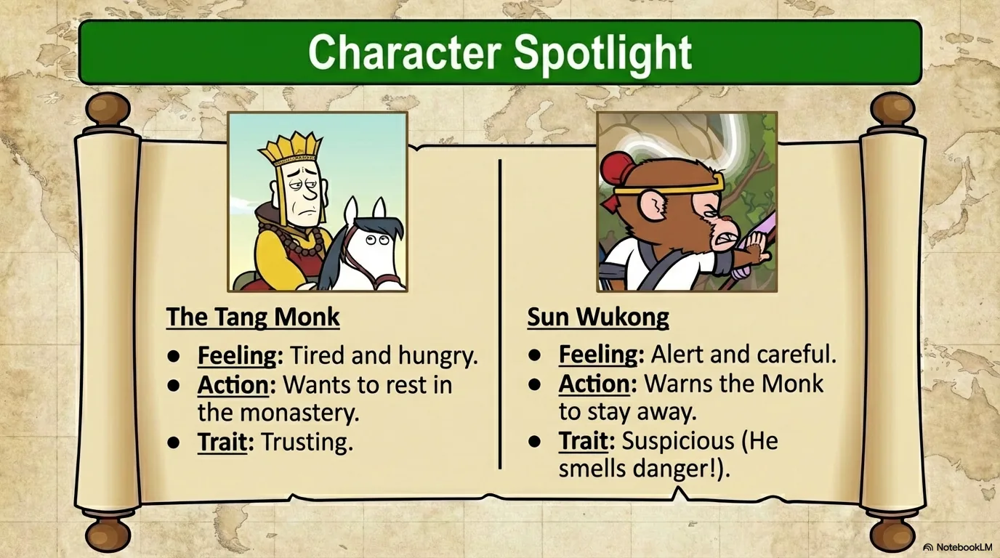

- 来源：`ppt/media/image16.png`（relationship `rId2`）
- 尺寸：1376×768
- 源 SHA-256：`60c8a9be8b433485f3c4ddde0981cd3818546bcd0b6697c212b7aea8561eafcd`
- 输出 SHA-256：`70dfa55460e90db4cdc39214c96fe755e488deacb0b5b7b3ce4a3f9725f7885a`
- 分类：unknown ｜ OCR：blocked ｜ 审核：unreviewed

## Slide 016

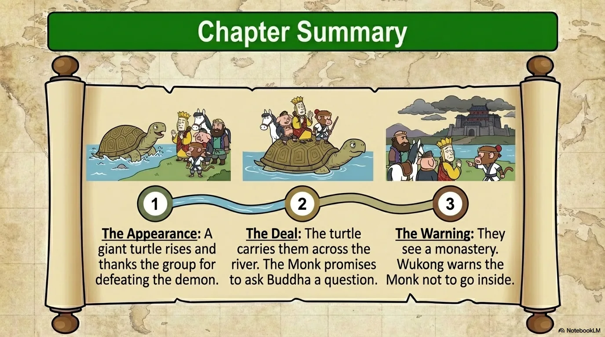

- 来源：`ppt/media/image17.png`（relationship `rId2`）
- 尺寸：1376×768
- 源 SHA-256：`da70d05d8c91cfe538c4ccc86285c897e49a19361445ff5e82ad0d64f74a9b0a`
- 输出 SHA-256：`adb85babe5ab1437d696e37df22d8ed34da42254e1631a539522650ba1292d74`
- 分类：unknown ｜ OCR：blocked ｜ 审核：unreviewed

## Slide 017

- 来源：`ppt/media/image18.png`（relationship `rId2`）
- 尺寸：1376×768
- 源 SHA-256：`9e17175ac3a99625a45ef4edbf059226d5eb75aa90c65234afaac3a838b8df48`
- 输出 SHA-256：`c86501c8b74da4a911d19cd216477bea44eb67eae44b9063a797688090dda476`
- 分类：unknown ｜ OCR：blocked ｜ 审核：unreviewed

## Slide 018

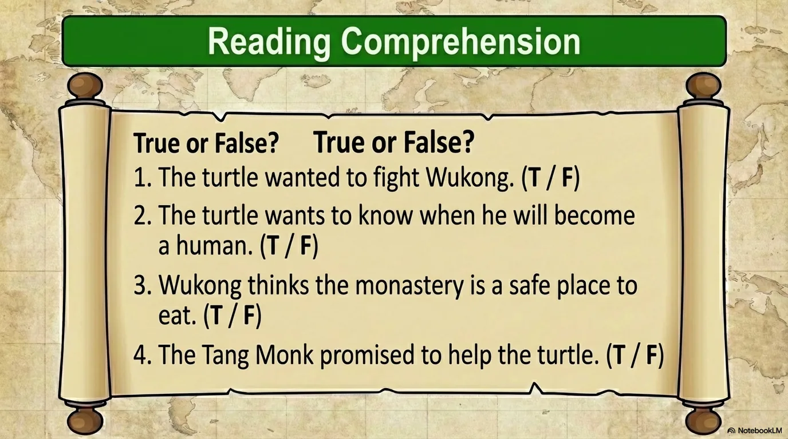

- 来源：`ppt/media/image19.png`（relationship `rId2`）
- 尺寸：1376×768
- 源 SHA-256：`a06a6d025c6a845f4a80add8eef7d26dcaa37b5b339fdea9e7bd9a737ee9c29e`
- 输出 SHA-256：`d88920c2684899d4b90b6255aa4c6e8435c7044b945025f9d07a9933d49a4322`
- 分类：unknown ｜ OCR：blocked ｜ 审核：unreviewed

## Slide 019

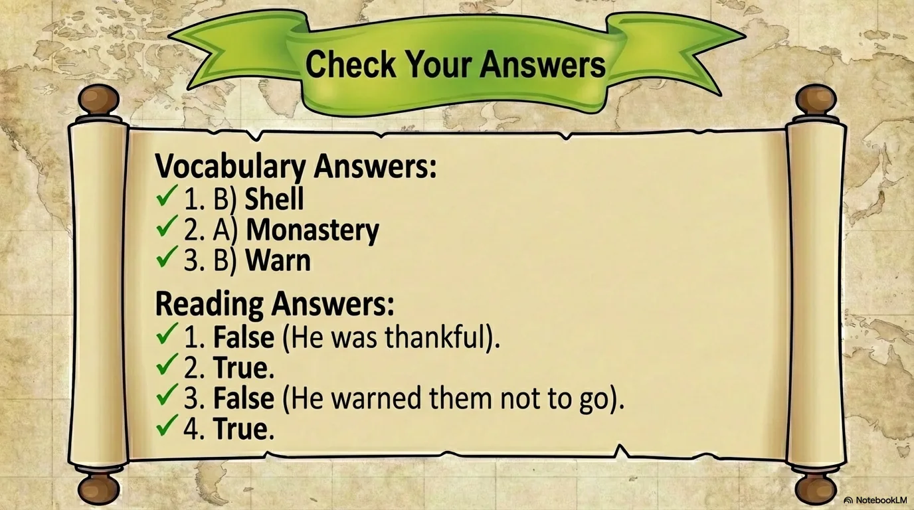

- 来源：`ppt/media/image20.png`（relationship `rId2`）
- 尺寸：1376×768
- 源 SHA-256：`eb3c6ea2cc9c5456ea55f740c44640ada534bd88eefb5a7faf0670382ce06206`
- 输出 SHA-256：`66f014fdc9bc9b84a862036e3e72be6629557f69df7665f3d5ddcc1ec797b4d5`
- 分类：unknown ｜ OCR：blocked ｜ 审核：unreviewed

## Slide 020

- 来源：`ppt/media/image21.png`（relationship `rId2`）
- 尺寸：1376×768
- 源 SHA-256：`4a10b3e4029382dc939389e7f74e0ff2621922bfee2df5c7dc52593c5113f626`
- 输出 SHA-256：`f74106b4a1f966a2a0da58f06d645e14aced4ed1b447d3df47a95864ea503821`
- 分类：unknown ｜ OCR：blocked ｜ 审核：unreviewed
