# 豆豆龙英语 · 第 64 集课件（EP064 草稿）

- 来源：`064_Journey to the West 64_Magnificent Silk Vests.pptx`（主课件，20 页）
- OCR：`blocked`（no local OCR provider importable (pytesseract missing): No module named 'pytesseract'）
- 分类：待人工审核（unknown）
- 审核状态：`unreviewed`

## Slide 001

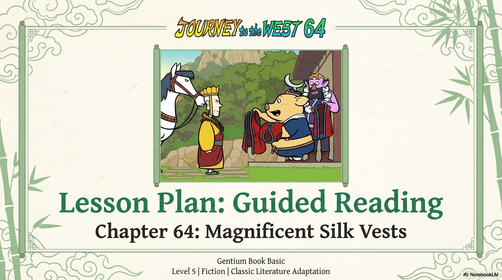

- 来源：`ppt/media/image1.png`（relationship `rId2`）
- 尺寸：1376×768
- 源 SHA-256：`ece6b377ef5dd185331d6124be90908104518cf8278087c8d3b97cba436bc1b1`
- 输出 SHA-256：`cd495422f7801898e1a5da5e117ae0dca47e7b8354c0391919c23be4381bae60`
- 分类：unknown ｜ OCR：blocked ｜ 审核：unreviewed

## Slide 002

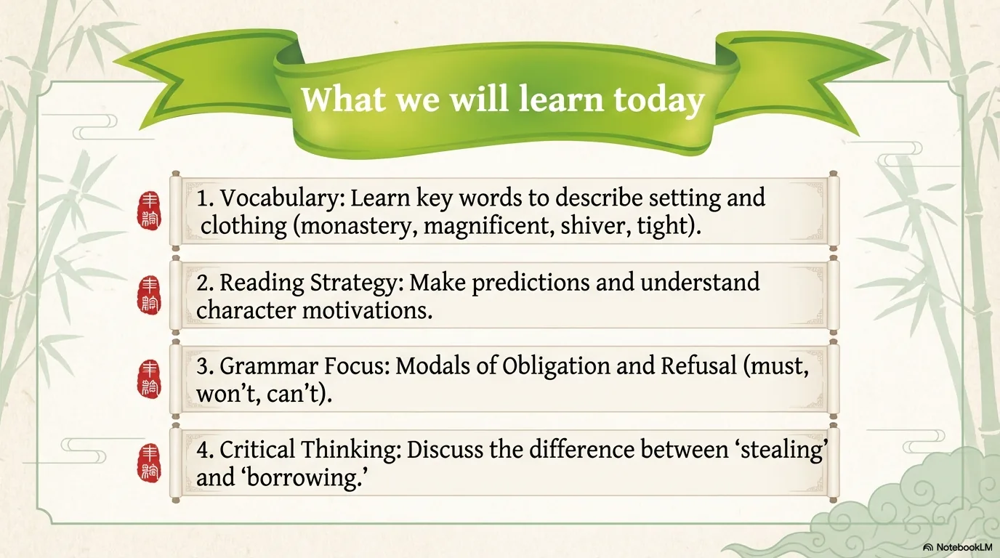

- 来源：`ppt/media/image3.png`（relationship `rId2`）
- 尺寸：1376×768
- 源 SHA-256：`86ff9688027c3a8d6c106c81f2c8a14e605db83422303b19650f38315e0ef7d6`
- 输出 SHA-256：`bd89a50d9a08b03705009de8d5224829159c08943335b90181b5ad1d3e0571b1`
- 分类：unknown ｜ OCR：blocked ｜ 审核：unreviewed

## Slide 003

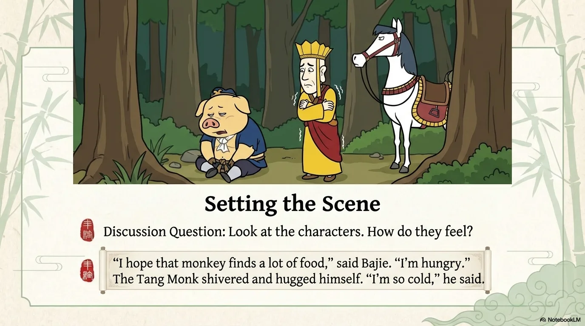

- 来源：`ppt/media/image4.png`（relationship `rId2`）
- 尺寸：1376×768
- 源 SHA-256：`98b861db4723b1e1b809fb1356cb7a95076cbab8e47f6dd217bd3262fc57525f`
- 输出 SHA-256：`658e46128ea1fce3da0fd123595f50e00961eea12997815906b109ccb87a6c53`
- 分类：unknown ｜ OCR：blocked ｜ 审核：unreviewed

## Slide 004

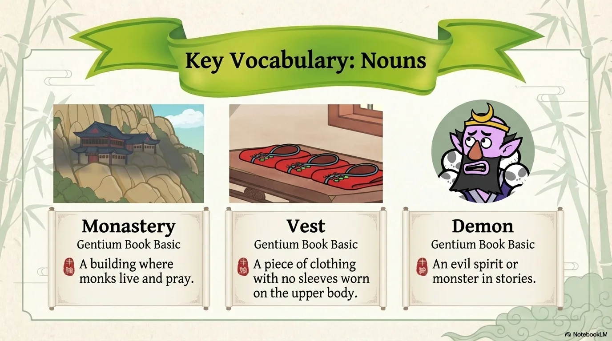

- 来源：`ppt/media/image5.png`（relationship `rId2`）
- 尺寸：1376×768
- 源 SHA-256：`ea9e959711f599351f7d9c5ad1bbb5590b0a5a1cfb5b9595a4a7130a4c594299`
- 输出 SHA-256：`7671b14b5a7be3d8b3a4abbb84d63e461278a6dea6fb73c088921fcf4919d758`
- 分类：unknown ｜ OCR：blocked ｜ 审核：unreviewed

## Slide 005

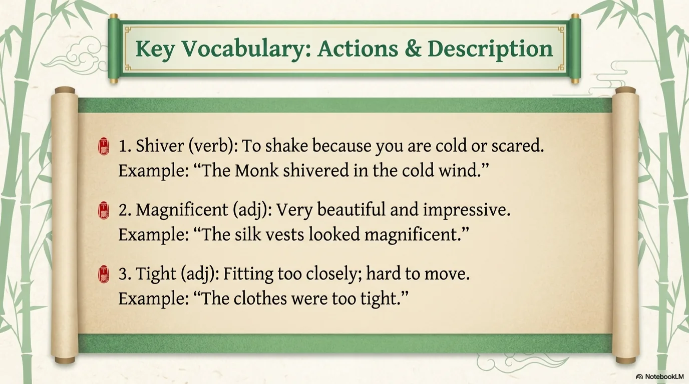

- 来源：`ppt/media/image6.png`（relationship `rId2`）
- 尺寸：1376×768
- 源 SHA-256：`8af53670ea687842a7ab120e49f159f9cb56cf968fedd20acaeafe67ca46ec73`
- 输出 SHA-256：`9a9d039e1891ea6875929b4c291dac9e2a199ebaa4357d0cb91190cc963b7284`
- 分类：unknown ｜ OCR：blocked ｜ 审核：unreviewed

## Slide 006

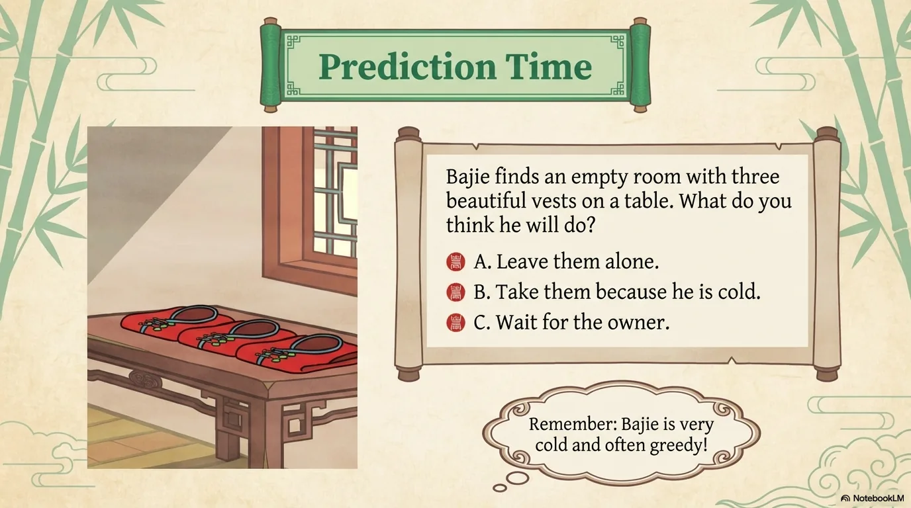

- 来源：`ppt/media/image7.png`（relationship `rId2`）
- 尺寸：1376×768
- 源 SHA-256：`245f5fb0f30f51afdb3306d95ab3da572134bbc09530ad09da4fd01e928bdc3d`
- 输出 SHA-256：`a04b0ca15a2201d558b37e5f69b86c5d78288f3e682d3e16cd8b5c5f381a8166`
- 分类：unknown ｜ OCR：blocked ｜ 审核：unreviewed

## Slide 007

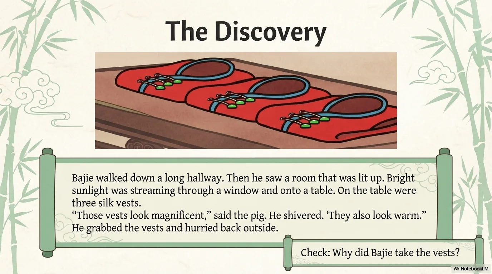

- 来源：`ppt/media/image8.png`（relationship `rId2`）
- 尺寸：1376×768
- 源 SHA-256：`721a6c7c4631bb3ca125d832160202adb13b4301951fa3d11d44b1087aecfd5c`
- 输出 SHA-256：`783a6b30a6a274074f324dd51605b36dcc4f0d192c585c457bff8828190e0bfc`
- 分类：unknown ｜ OCR：blocked ｜ 审核：unreviewed

## Slide 008

- 来源：`ppt/media/image9.png`（relationship `rId2`）
- 尺寸：1376×768
- 源 SHA-256：`4d9431ad803a20f96b5a50d3a5a554b37727bde6ea82a2fd826a63edfffd487a`
- 输出 SHA-256：`a8a69766d44aad1669d1641aa3c93f070b3307958894e13359fa60be9c1972b2`
- 分类：unknown ｜ OCR：blocked ｜ 审核：unreviewed

## Slide 009

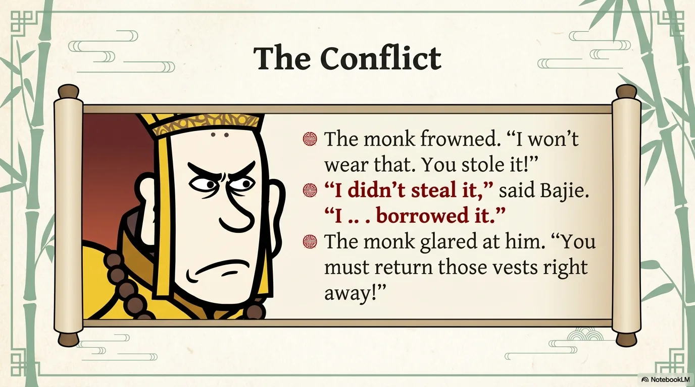

- 来源：`ppt/media/image10.png`（relationship `rId2`）
- 尺寸：1376×768
- 源 SHA-256：`6c28367b53a9f6a1d25c83d297e96f0f1868dd07d85f51007a35ac88202d678b`
- 输出 SHA-256：`2d9bff5ed892c3fe8dce18ec4600744baf660bd11dabba0c0c309918a6fa3a43`
- 分类：unknown ｜ OCR：blocked ｜ 审核：unreviewed

## Slide 010

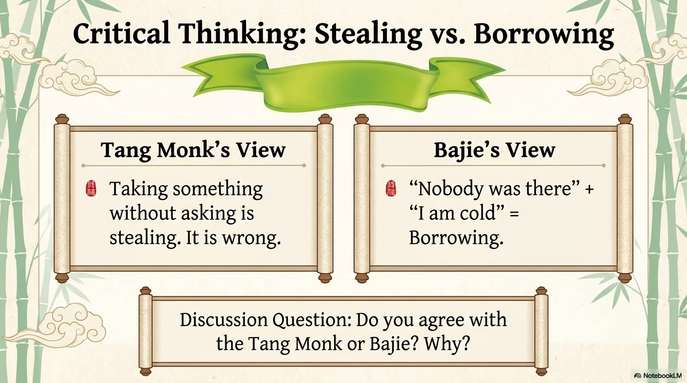

- 来源：`ppt/media/image11.png`（relationship `rId2`）
- 尺寸：1376×768
- 源 SHA-256：`166d1dd730d88766ae4d01b18c1c34786eec8be3e054c713b16f0cf552a503f3`
- 输出 SHA-256：`d537fadeb34be8957cc01a779e06a5d68017d821b7a93d6ffb682fd1f5e2abbc`
- 分类：unknown ｜ OCR：blocked ｜ 审核：unreviewed

## Slide 011

- 来源：`ppt/media/image12.png`（relationship `rId2`）
- 尺寸：1376×768
- 源 SHA-256：`71ee2fb6163e1a67dfd449aff1f7160cd2ec442c28e27a7428c211299f54d67e`
- 输出 SHA-256：`f4b8f988020adbba7cf1242e76ba4d98fa4fa9e777a007d0b7552d9526d7e2c3`
- 分类：unknown ｜ OCR：blocked ｜ 审核：unreviewed

## Slide 012

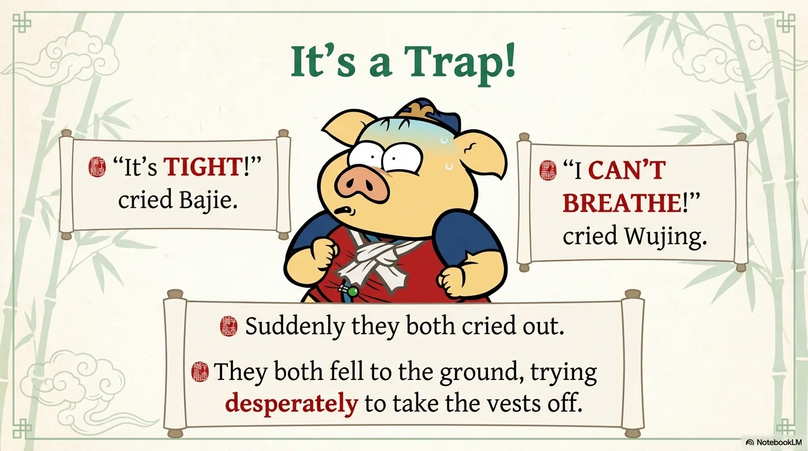

- 来源：`ppt/media/image13.png`（relationship `rId2`）
- 尺寸：1376×768
- 源 SHA-256：`5c18f935a398f0155ba20581a7ff4404bed6e9512ef1aacc3e1796f0448d1b55`
- 输出 SHA-256：`db15cb1e11fcc0e8eaa67e38bfb7a6d1b099f2bd22aaeffae36e8643c2ab2309`
- 分类：unknown ｜ OCR：blocked ｜ 审核：unreviewed

## Slide 013

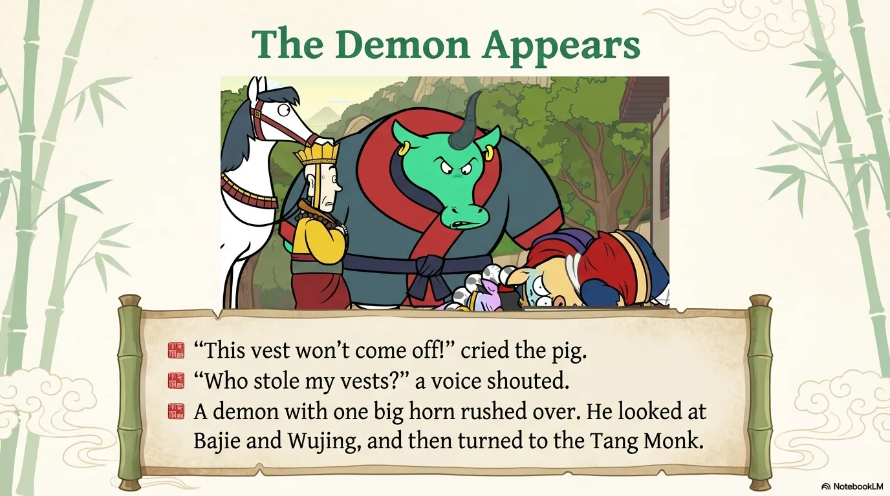

- 来源：`ppt/media/image14.png`（relationship `rId2`）
- 尺寸：1376×768
- 源 SHA-256：`d588d94c09c99e88b10c2880e556fde1f79cce4696403b98a4bfe58dd4e9b30b`
- 输出 SHA-256：`429976d1b3f36b6285dc842943182856919382299edd5675d7f15ae28a0b1cc5`
- 分类：unknown ｜ OCR：blocked ｜ 审核：unreviewed

## Slide 014

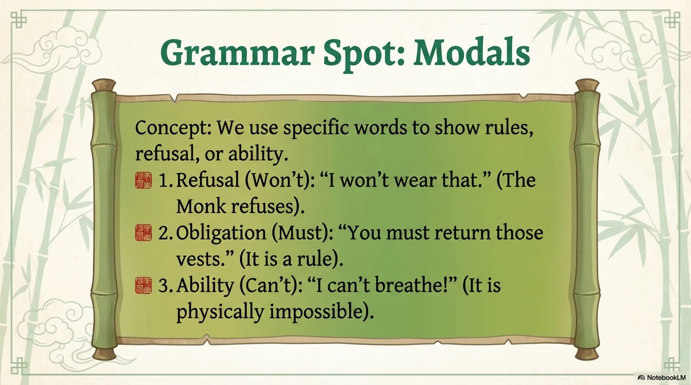

- 来源：`ppt/media/image15.png`（relationship `rId2`）
- 尺寸：1376×768
- 源 SHA-256：`feb599e4ad885f50c7c590f29b77ba217ceadf78dd6b21e4cd1be9fe9821bbb9`
- 输出 SHA-256：`614fbdf2ca346475a30b7eded4deeda9c7fd65936cdb806460e486b44b2761ad`
- 分类：unknown ｜ OCR：blocked ｜ 审核：unreviewed

## Slide 015

- 来源：`ppt/media/image16.png`（relationship `rId2`）
- 尺寸：1376×768
- 源 SHA-256：`58dbfd3a3e4556007295b778ff8c4c2e00e7868d09dc04a40d0b7f1e9a16a2bd`
- 输出 SHA-256：`ae23e1b00436248549b2ff1d7c9297e001945d9d6d3b4bec7dd05a4183fefda6`
- 分类：unknown ｜ OCR：blocked ｜ 审核：unreviewed

## Slide 016

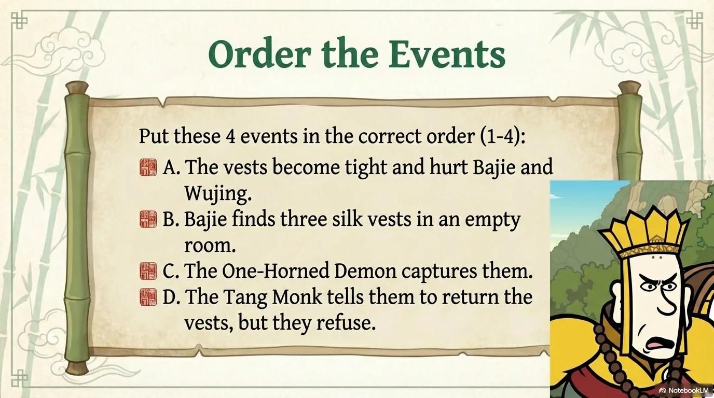

- 来源：`ppt/media/image17.png`（relationship `rId2`）
- 尺寸：1376×768
- 源 SHA-256：`3aa9ec1608ee732edb01d7b75fb85dcad4ca1c15dee686f72a8935d2f768d72f`
- 输出 SHA-256：`4918a9bdca2c44e1e9b116fcec0daaeddd2463e978b219978a9b2e0ed07e6229`
- 分类：unknown ｜ OCR：blocked ｜ 审核：unreviewed

## Slide 017

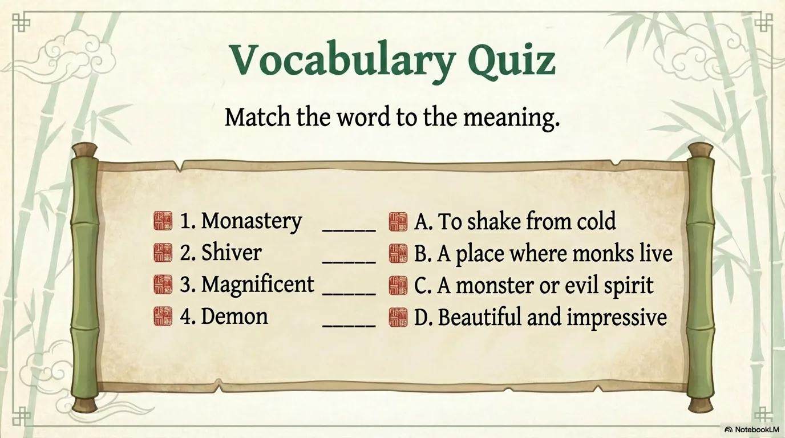

- 来源：`ppt/media/image18.png`（relationship `rId2`）
- 尺寸：1376×768
- 源 SHA-256：`888d2a5ebd69825f8d6366afe627b77ed9a159c8f8aabbb733089ede3a6c9504`
- 输出 SHA-256：`ca09188cb8e44a07245f26c9c1d3f6f0875289b00c10228ffacec9ea17f97ce7`
- 分类：unknown ｜ OCR：blocked ｜ 审核：unreviewed

## Slide 018

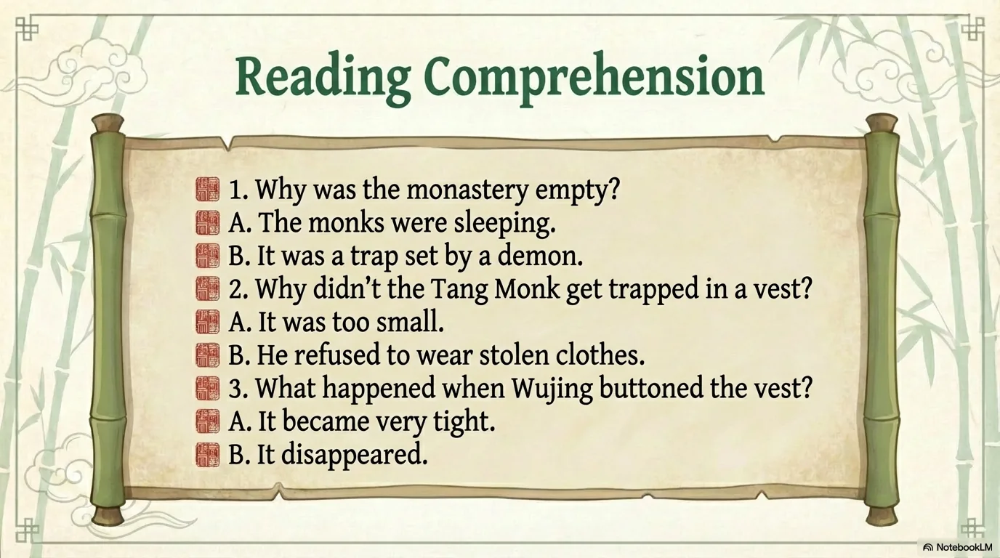

- 来源：`ppt/media/image19.png`（relationship `rId2`）
- 尺寸：1376×768
- 源 SHA-256：`e041adda977d601ae046e76cfaec54c92475dec1ef9caf89a789172a88ec2f8d`
- 输出 SHA-256：`211d144aecc35da376b5ea3bb86ce0256e8f9aff27482d36803fe1d0956cdf08`
- 分类：unknown ｜ OCR：blocked ｜ 审核：unreviewed

## Slide 019

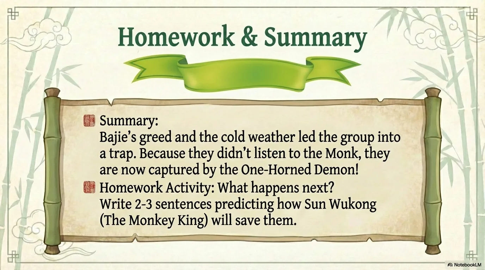

- 来源：`ppt/media/image20.png`（relationship `rId2`）
- 尺寸：1376×768
- 源 SHA-256：`720215c3f6928f684f12b3cfd7cac13bd2cbbdf6c7e10b0fdf5e5594260c12a2`
- 输出 SHA-256：`09746672b5c32277e81508ff5841053e51247d6781800ba067bab379eaa16425`
- 分类：unknown ｜ OCR：blocked ｜ 审核：unreviewed

## Slide 020

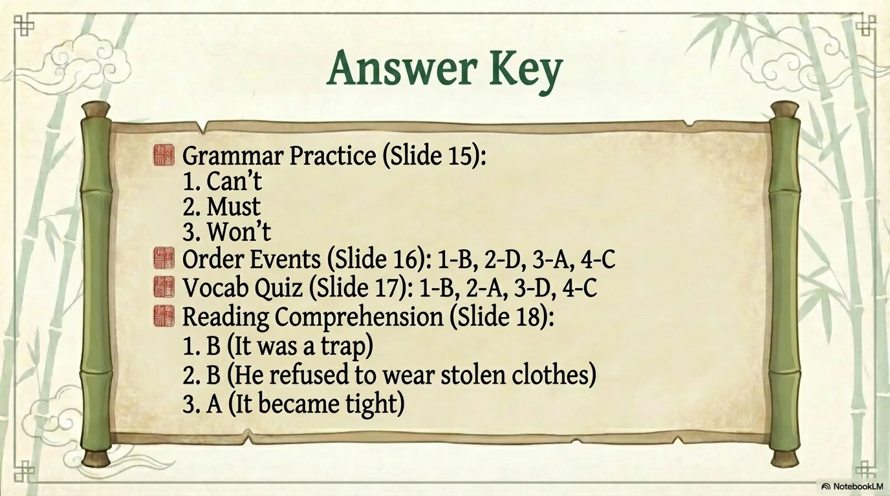

- 来源：`ppt/media/image21.png`（relationship `rId2`）
- 尺寸：1376×768
- 源 SHA-256：`abac767cb205054cb83e82a43abef79f1165e79ffeb503e12ee82c725ad2936c`
- 输出 SHA-256：`21f76c0715ea0f716f1a8f2d904d87a200071b194b04eee41816db5c553034ff`
- 分类：unknown ｜ OCR：blocked ｜ 审核：unreviewed
