# 豆豆龙英语 · 第 65 集课件（EP065 草稿）

- 来源：`065_Journey to the West 65_The Metal Ring.pptx`（主课件，20 页）
- OCR：`blocked`（no local OCR provider importable (pytesseract missing): No module named 'pytesseract'）
- 分类：待人工审核（unknown）
- 审核状态：`unreviewed`

## Slide 001

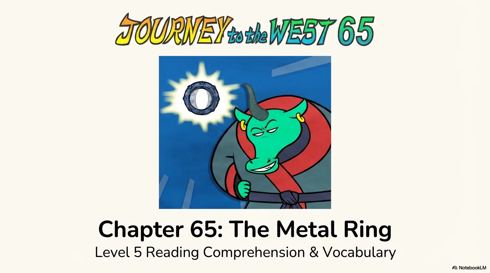

- 来源：`ppt/media/image1.png`（relationship `rId2`）
- 尺寸：1376×768
- 源 SHA-256：`5353c44fc79626f100751c0c9025d4d4967773b61a71e91bb9c70ae8a035d999`
- 输出 SHA-256：`17d15f49aef1a1562b04b941e2926abcd5afe63bb9567cad2b9c463fca000e6d`
- 分类：unknown ｜ OCR：blocked ｜ 审核：unreviewed

## Slide 002

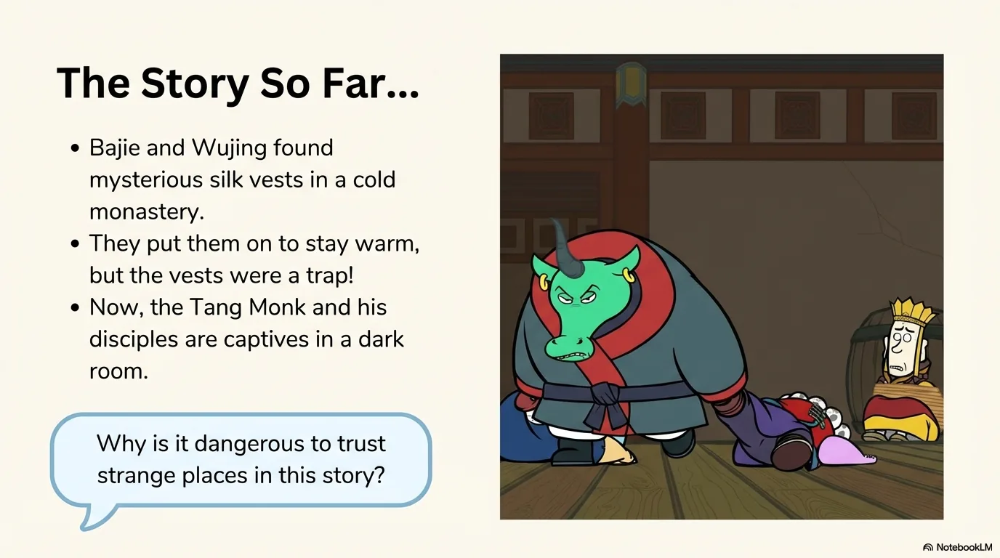

- 来源：`ppt/media/image3.png`（relationship `rId2`）
- 尺寸：1376×768
- 源 SHA-256：`f996db2a91ce00f0047aec9953ab674f57bd660ca42e6e2a885332db9024ea7c`
- 输出 SHA-256：`ae65794049ea6b65f1b373e83116bfa3925674c7589bce88bef0b7d0b25f08da`
- 分类：unknown ｜ OCR：blocked ｜ 审核：unreviewed

## Slide 003

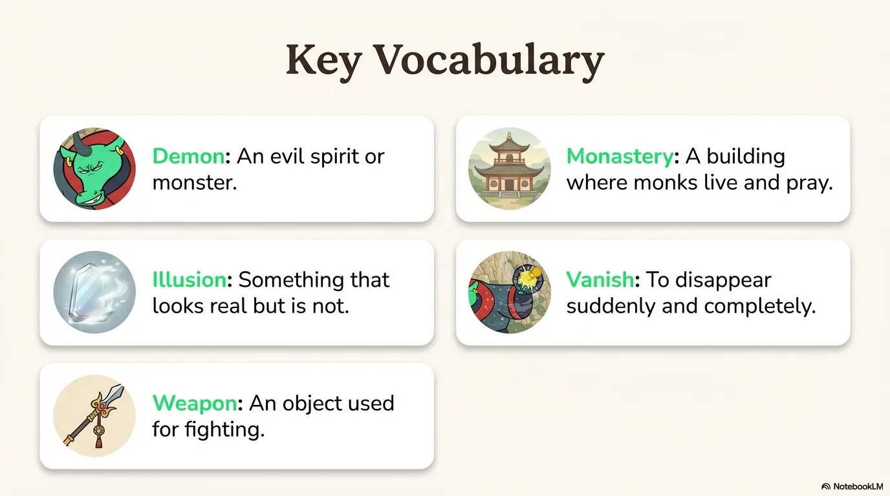

- 来源：`ppt/media/image4.png`（relationship `rId2`）
- 尺寸：1376×768
- 源 SHA-256：`51a31d91d1b43189d138d465ab855b185ffa1b7b9ac0745614d021feb0784b4e`
- 输出 SHA-256：`501b4952eefbb5d09f02aded42ce8b4380331d647159c1f44ab574393d009291`
- 分类：unknown ｜ OCR：blocked ｜ 审核：unreviewed

## Slide 004

- 来源：`ppt/media/image5.png`（relationship `rId2`）
- 尺寸：1376×768
- 源 SHA-256：`7455521ca2959e1111605fea99fe7e8ab9787d083316dcc6a41c5f0ca381cd93`
- 输出 SHA-256：`1c112965141fb0484daf812a39a8366b247ff2e916a60db0ac2e1c58501703be`
- 分类：unknown ｜ OCR：blocked ｜ 审核：unreviewed

## Slide 005

- 来源：`ppt/media/image6.png`（relationship `rId2`）
- 尺寸：1376×768
- 源 SHA-256：`3e77b715aa654fc439eadb4e55b7d78aef84eacb99fbda53c0ee5e7cc3ae287f`
- 输出 SHA-256：`324e8d3e9d534360b27f652c73f5752491e52059e9eaeb33d102b615d24989ea`
- 分类：unknown ｜ OCR：blocked ｜ 审核：unreviewed

## Slide 006

- 来源：`ppt/media/image7.png`（relationship `rId2`）
- 尺寸：1376×768
- 源 SHA-256：`e2441698efa89f47dcab1ebea2a7812492399596e2a2ca4de28b902d31b5774e`
- 输出 SHA-256：`aad5ba2c792aec8419d0611cf2dba75373d8e52ef59b060cc207e5b90b90ca10`
- 分类：unknown ｜ OCR：blocked ｜ 审核：unreviewed

## Slide 007

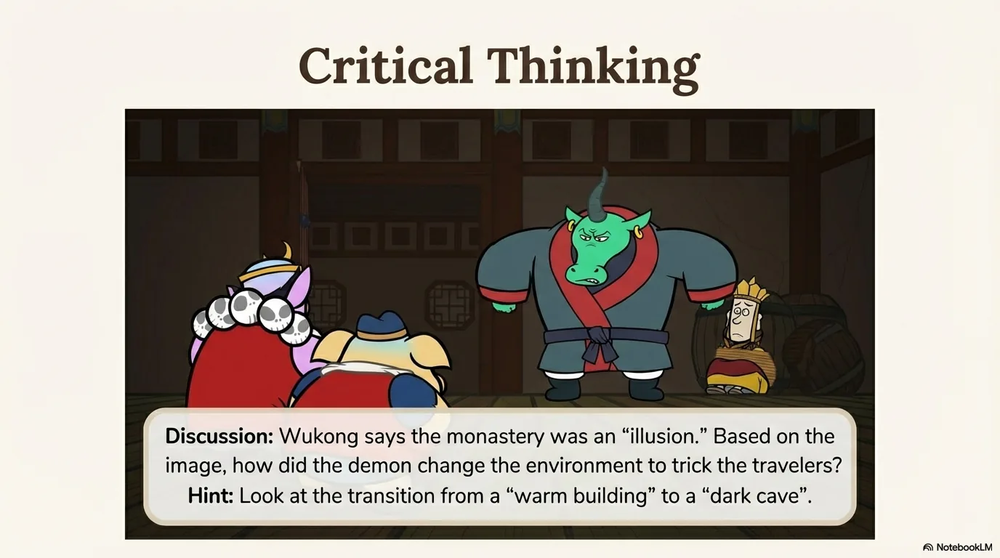

- 来源：`ppt/media/image8.png`（relationship `rId2`）
- 尺寸：1376×768
- 源 SHA-256：`9be7cc3a1efb52c08e6acda584fa9498acdb6d09c7650bfaba46c42a9f51d8e2`
- 输出 SHA-256：`67b8700867cad696902b96b88668e4ce3e4a7db5fc911689b9556b00e7cfa271`
- 分类：unknown ｜ OCR：blocked ｜ 审核：unreviewed

## Slide 008

- 来源：`ppt/media/image9.png`（relationship `rId2`）
- 尺寸：1376×768
- 源 SHA-256：`4867f3b12c5f435f6d3390b0a90f1d6f29054e1d64ad823146c3ae3eb72a656a`
- 输出 SHA-256：`2679f625483075fec0134c994e58bff357bfe631946a95fb2d22e207e8a744ac`
- 分类：unknown ｜ OCR：blocked ｜ 审核：unreviewed

## Slide 009

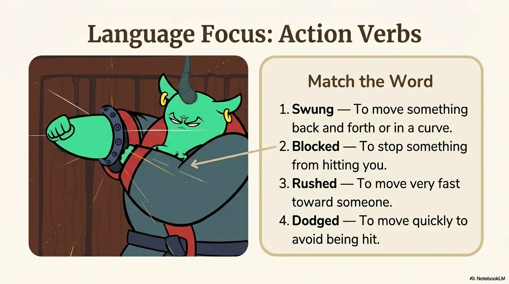

- 来源：`ppt/media/image10.png`（relationship `rId2`）
- 尺寸：1376×768
- 源 SHA-256：`97e6db148322f5e7a332cae5bb7c169cb8f7aeee209579f8ce83c155c6146d32`
- 输出 SHA-256：`3318b64b7180cf52c3a2507536da22fc99492247cd320a32da867a25a42bd27b`
- 分类：unknown ｜ OCR：blocked ｜ 审核：unreviewed

## Slide 010

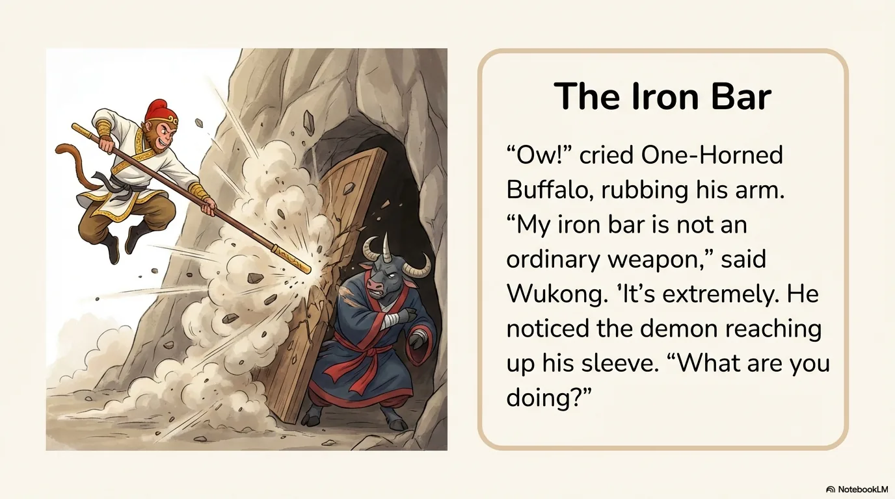

- 来源：`ppt/media/image11.png`（relationship `rId2`）
- 尺寸：1376×768
- 源 SHA-256：`929ea5af0d0ca2595e50a2b83ff0ca4965d5782a8479f9df4982cb02f151c135`
- 输出 SHA-256：`099994e4b2993476b9c481665b4c7012a6e77d3080edc145518ced455c08b08b`
- 分类：unknown ｜ OCR：blocked ｜ 审核：unreviewed

## Slide 011

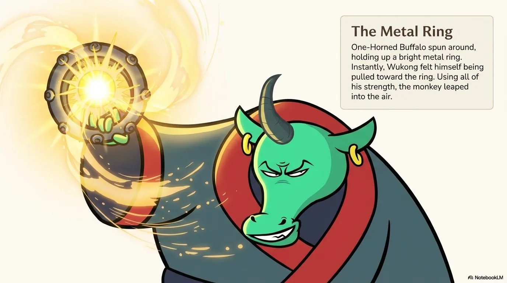

- 来源：`ppt/media/image12.png`（relationship `rId2`）
- 尺寸：1376×768
- 源 SHA-256：`ebde00b61d998dcbd2f44925719b99032e4084ba2d48f1d75c4ae17c05e96f91`
- 输出 SHA-256：`8548b08c3c837c6086a7d85a29e50b56f4f6b184cca12592494ffd004546d763`
- 分类：unknown ｜ OCR：blocked ｜ 审核：unreviewed

## Slide 012

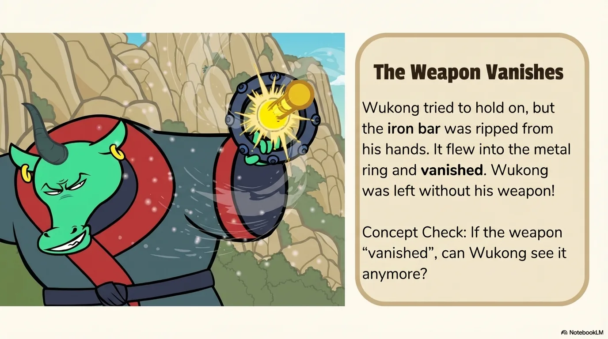

- 来源：`ppt/media/image13.png`（relationship `rId2`）
- 尺寸：1376×768
- 源 SHA-256：`d9a9501b40296b11ccbb19f35e4c080d54a4a54636f10d9c3af43252a0a6c2af`
- 输出 SHA-256：`314bb74f32c739d74d30f944300e58db30d4e3becf269d779cd86314605a8417`
- 分类：unknown ｜ OCR：blocked ｜ 审核：unreviewed

## Slide 013

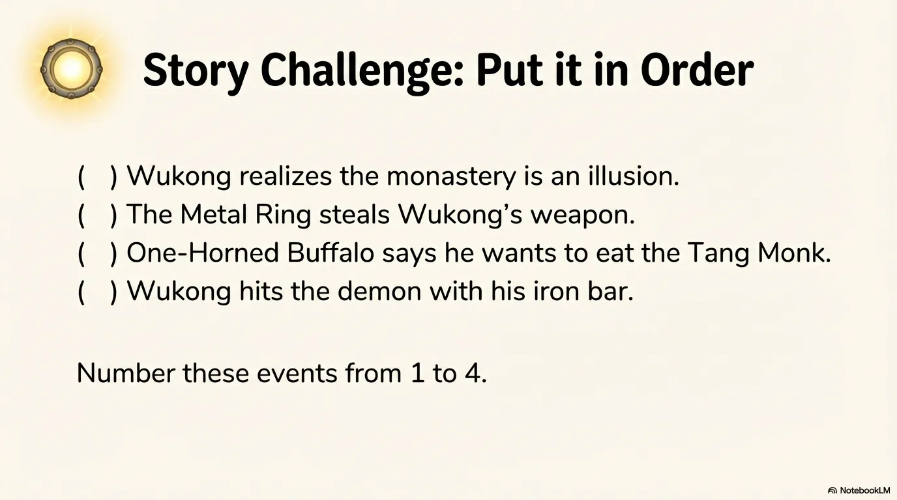

- 来源：`ppt/media/image14.png`（relationship `rId2`）
- 尺寸：1376×768
- 源 SHA-256：`353387fb5a4c353a785a72b2cd896502a7bcc6cdedc30780b1ac476ce4dc966c`
- 输出 SHA-256：`89bf69f1cfcd659f72e2afd2498df37de59fc910ed88d9b452acf0e5b58c7694`
- 分类：unknown ｜ OCR：blocked ｜ 审核：unreviewed

## Slide 014

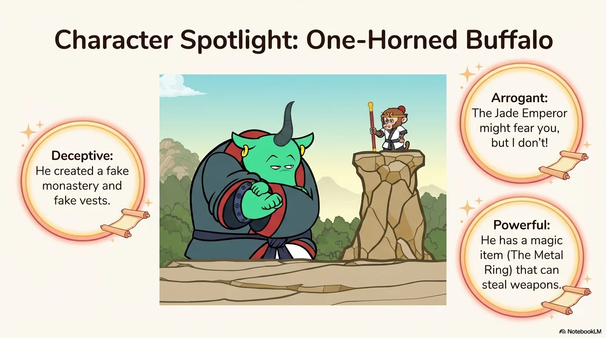

- 来源：`ppt/media/image15.png`（relationship `rId2`）
- 尺寸：1376×768
- 源 SHA-256：`64fa538dd9cebe348746eb59e6ce8ce21a28c380bd8eb96c622cba8b4d74a8a6`
- 输出 SHA-256：`7f4b1c67b684cbb093a4bcc700c8bb14e681871be5e6c2a3cbe1055919435c41`
- 分类：unknown ｜ OCR：blocked ｜ 审核：unreviewed

## Slide 015

- 来源：`ppt/media/image16.png`（relationship `rId2`）
- 尺寸：1376×768
- 源 SHA-256：`ef487a4a48f7cc883258018014d0041e6a30837d5f652a5ca3efc03d962d4802`
- 输出 SHA-256：`e7dc9ecbbd067dd6d777d773c8ee5660ac7c47e353e81af943e8bd126ebd1a20`
- 分类：unknown ｜ OCR：blocked ｜ 审核：unreviewed

## Slide 016

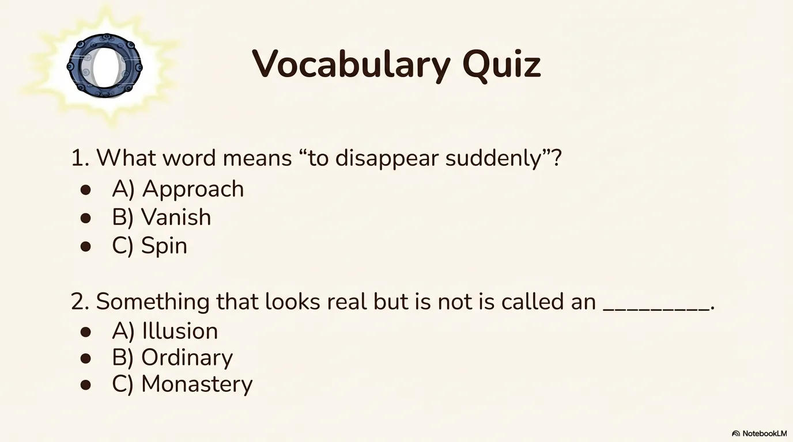

- 来源：`ppt/media/image17.png`（relationship `rId2`）
- 尺寸：1376×768
- 源 SHA-256：`5534933b474fb5ef1c5581c468ee13db60a5c0eeaa09f5077af086652461c58e`
- 输出 SHA-256：`2d7d265a1a237f5f4cd40425d510298c8dbcc31153c054eaa091c8f57e252a8c`
- 分类：unknown ｜ OCR：blocked ｜ 审核：unreviewed

## Slide 017

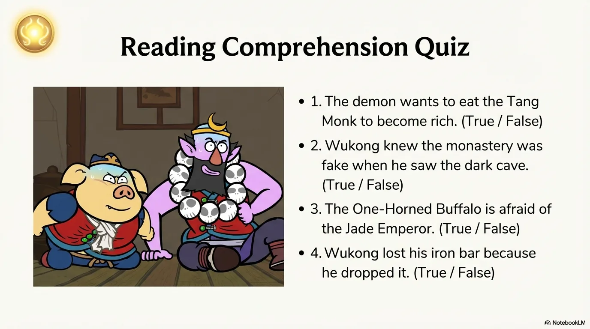

- 来源：`ppt/media/image18.png`（relationship `rId2`）
- 尺寸：1376×768
- 源 SHA-256：`0380711db937fc1d1e10f46dc915ca78b12b119304f4752da1342b0b0d53e2bf`
- 输出 SHA-256：`489ed03273b18e5d42fc0f4341478cdd3b072da31b7c2415b46b2f2dc1280d00`
- 分类：unknown ｜ OCR：blocked ｜ 审核：unreviewed

## Slide 018

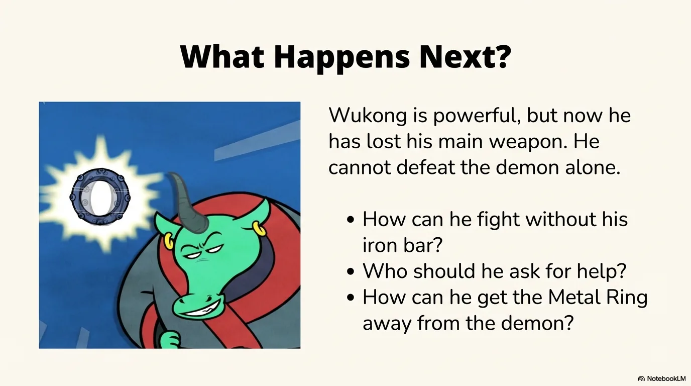

- 来源：`ppt/media/image19.png`（relationship `rId2`）
- 尺寸：1376×768
- 源 SHA-256：`4be876ab1c77a37d16f04a15f1fa0c6a085ffb975e888b60fc06c9cb0f48614b`
- 输出 SHA-256：`cf9635f575ee78dc90def9f85090e04d3fa6211031e51ac575a5e893715be545`
- 分类：unknown ｜ OCR：blocked ｜ 审核：unreviewed

## Slide 019

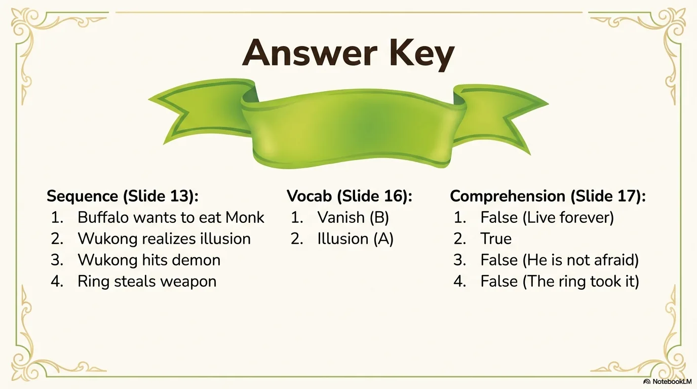

- 来源：`ppt/media/image20.png`（relationship `rId2`）
- 尺寸：1376×768
- 源 SHA-256：`602f156643470cea986e5bcc2bfee2b397307cb2a643528dc0fd93c8fb10f648`
- 输出 SHA-256：`da9e82e20cd7c5afbcc27fade1b7ed550fb7aa2efb31be1cad8b385a23f867c9`
- 分类：unknown ｜ OCR：blocked ｜ 审核：unreviewed

## Slide 020

- 来源：`ppt/media/image21.png`（relationship `rId2`）
- 尺寸：1376×768
- 源 SHA-256：`e0fdf86a9fb5f7ce428a3d87c99c9c29abf8d261623a5cd308267e1c0d8da66a`
- 输出 SHA-256：`2f0c6fc054adc2689d9012ad375184f27506564a43a6672778fcf91a321593ad`
- 分类：unknown ｜ OCR：blocked ｜ 审核：unreviewed
