# 豆豆龙英语 · 第 66 集课件（EP066 草稿）

- 来源：`066_Journey to the West 66_Help from Heaven.pptx`（主课件，20 页）
- OCR：`blocked`（no local OCR provider importable (pytesseract missing): No module named 'pytesseract'）
- 分类：待人工审核（unknown）
- 审核状态：`unreviewed`

## Slide 001

- 来源：`ppt/media/image1.png`（relationship `rId2`）
- 尺寸：1376×768
- 源 SHA-256：`a3462625e264e6b2d924ee88dc6cd0ac659ce92290115ba644d86640f6e6d1e1`
- 输出 SHA-256：`284060ea8cd526846507634b850203e9206b749b1794d50e943eba1464d8663f`
- 分类：unknown ｜ OCR：blocked ｜ 审核：unreviewed

## Slide 002

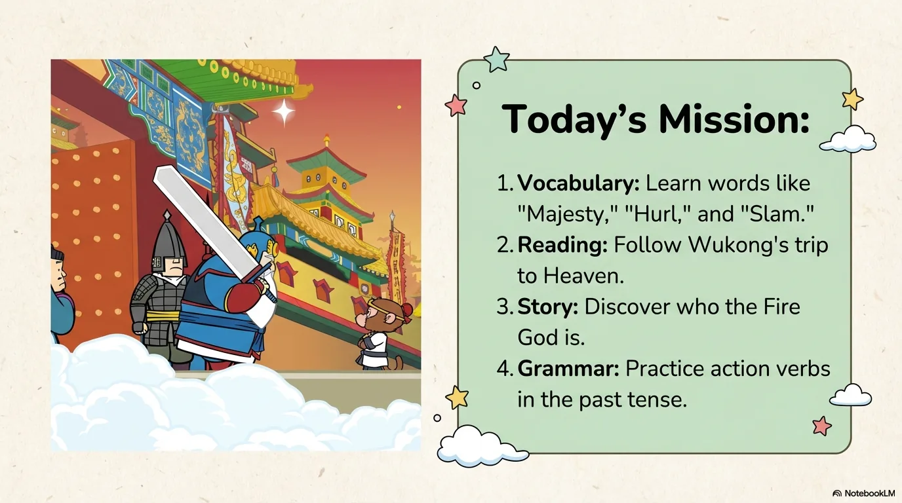

- 来源：`ppt/media/image3.png`（relationship `rId2`）
- 尺寸：1376×768
- 源 SHA-256：`3f7b05fe6805462be8bb6a9d85e3509d8cbaaf3f4fb222332a961bb64a395fad`
- 输出 SHA-256：`e90b64283002bef239dd6f7f8837fa8db7f063a91b90808d8d000675934e406c`
- 分类：unknown ｜ OCR：blocked ｜ 审核：unreviewed

## Slide 003

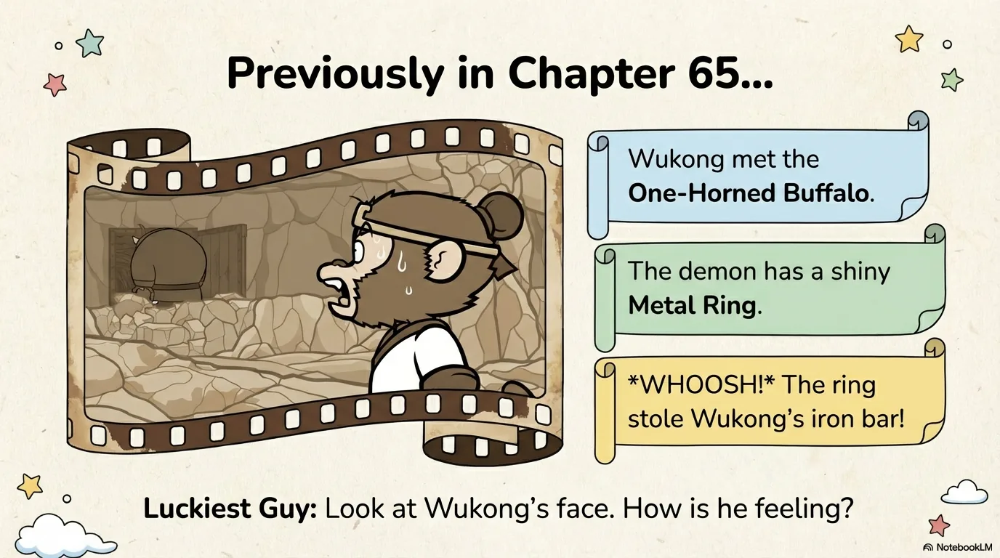

- 来源：`ppt/media/image4.png`（relationship `rId2`）
- 尺寸：1376×768
- 源 SHA-256：`94d59156c5ba79be2199d4dca548dd14dc14f19e6d5bb90a4adc6a6f13a164f4`
- 输出 SHA-256：`3de4ccf9692440a319f6f5d5ca9d84dd3dea720d57de66536ac923169b659e2d`
- 分类：unknown ｜ OCR：blocked ｜ 审核：unreviewed

## Slide 004

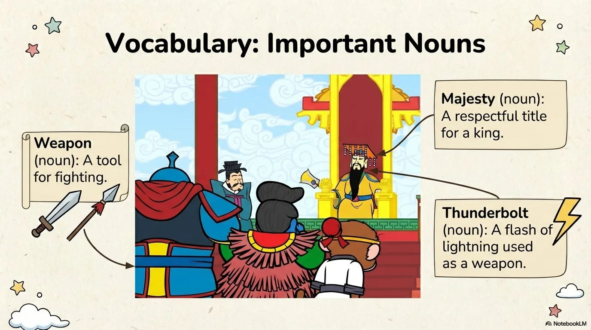

- 来源：`ppt/media/image5.png`（relationship `rId2`）
- 尺寸：1376×768
- 源 SHA-256：`0072a4045721885a535052c01f821a5685289467984f352162fcf4c24feb90f3`
- 输出 SHA-256：`224c8308c20bbf51eecae3fb5de02d6d815a514e72b1a04e423ac6a18da9d1c9`
- 分类：unknown ｜ OCR：blocked ｜ 审核：unreviewed

## Slide 005

- 来源：`ppt/media/image6.png`（relationship `rId2`）
- 尺寸：1376×768
- 源 SHA-256：`da20462fc9519a9cf0268c9cc162badb2ec7c22a16c0131c5625021f65e3759f`
- 输出 SHA-256：`55bb7004d5db93d56f02177565af94594ed141a9b66a97ac61fc92f86b064b24`
- 分类：unknown ｜ OCR：blocked ｜ 审核：unreviewed

## Slide 006

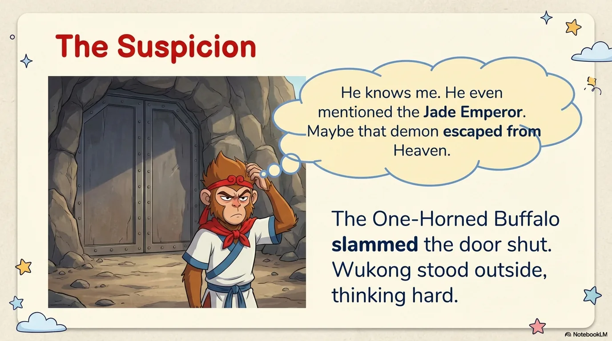

- 来源：`ppt/media/image7.png`（relationship `rId2`）
- 尺寸：1376×768
- 源 SHA-256：`066fbf2b725b2d4c5253a5d673ee50af2d46de1ed1b1091650102c5162370eeb`
- 输出 SHA-256：`045acc03b6fe88709b0c24dc70c2841e2f30ebc9233d886abc929b0a35853feb`
- 分类：unknown ｜ OCR：blocked ｜ 审核：unreviewed

## Slide 007

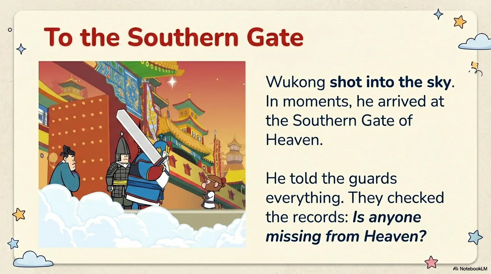

- 来源：`ppt/media/image8.png`（relationship `rId2`）
- 尺寸：1376×768
- 源 SHA-256：`86196ce0a863ac4e5082d9f5a351306430c967f9804b764c68b3dbf81e9a974a`
- 输出 SHA-256：`a6c328c5d6cd70c1e4037d79502f2919a37bbee3f676e8bb4f2e9a5acdfc6a31`
- 分类：unknown ｜ OCR：blocked ｜ 审核：unreviewed

## Slide 008

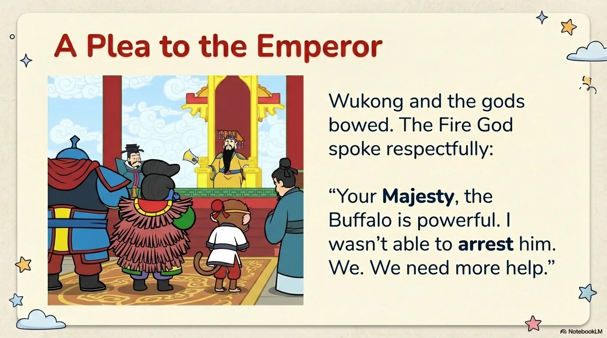

- 来源：`ppt/media/image9.png`（relationship `rId2`）
- 尺寸：1376×768
- 源 SHA-256：`cd4efd413557328e110ca95e826c479a83da22df3d969201ed1dbcd130d58bbc`
- 输出 SHA-256：`c3542d6a969cf055de3b646745b96e96967c2ff08038727f63802fa981e92ba9`
- 分类：unknown ｜ OCR：blocked ｜ 审核：unreviewed

## Slide 009

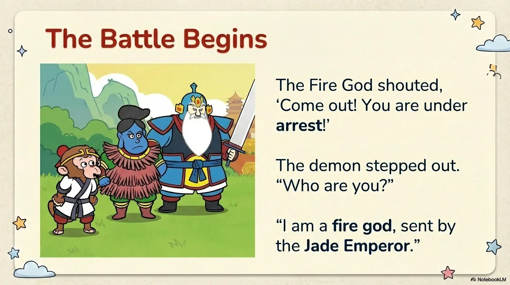

- 来源：`ppt/media/image10.png`（relationship `rId2`）
- 尺寸：1376×768
- 源 SHA-256：`2f005a656b992acdf461584c85cd0db4b7899915efc4dbff5b6b223123a043ad`
- 输出 SHA-256：`9d10d091905dc6687c8aa0c180f6c46e6c903139dbceedb377109eb667c80a29`
- 分类：unknown ｜ OCR：blocked ｜ 审核：unreviewed

## Slide 010

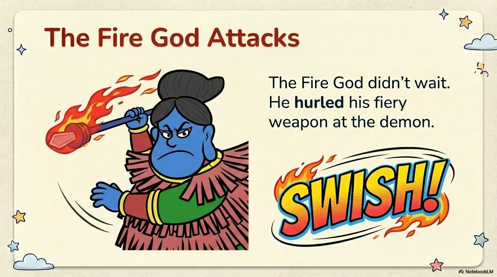

- 来源：`ppt/media/image11.png`（relationship `rId2`）
- 尺寸：1376×768
- 源 SHA-256：`a37f199a9e304bad478c917dc0676d55446b382047fce86023beed740ed8b2ec`
- 输出 SHA-256：`0998d1af111785e31a1f2a82e63af775a5814fff46463d18143c7926670ae35d`
- 分类：unknown ｜ OCR：blocked ｜ 审核：unreviewed

## Slide 011

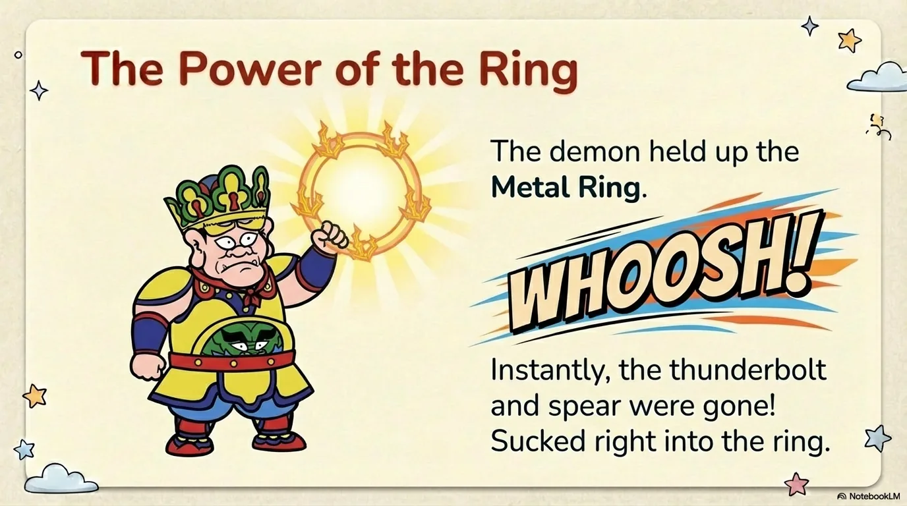

- 来源：`ppt/media/image12.png`（relationship `rId2`）
- 尺寸：1376×768
- 源 SHA-256：`2e5af0674813b92240f6a856bbb80e0ded7b44bfe54808a0a3aa742433c4fe58`
- 输出 SHA-256：`4f9f7cd41ecb5f1bdbd15d266f62ce2b28b86d724eca68f24108cfdac5461649`
- 分类：unknown ｜ OCR：blocked ｜ 审核：unreviewed

## Slide 012

- 来源：`ppt/media/image13.png`（relationship `rId2`）
- 尺寸：1376×768
- 源 SHA-256：`ed3760b575008d4c0cd055050272b449a39d1705e354896de5d40c48daa4c572`
- 输出 SHA-256：`25be14b1251771340c2be43580a0a24bd40c067f0425d78bc03dfd46d581cac3`
- 分类：unknown ｜ OCR：blocked ｜ 审核：unreviewed

## Slide 013

- 来源：`ppt/media/image14.png`（relationship `rId2`）
- 尺寸：1376×768
- 源 SHA-256：`a7598dae5254b073cba727367a4a8f4ac19435ffe9ecfce6d326aecc826e8f3b`
- 输出 SHA-256：`98d7af0ac09c8f88998e380f4192b59f5536248784ce18d50cd82e218b992ba5`
- 分类：unknown ｜ OCR：blocked ｜ 审核：unreviewed

## Slide 014

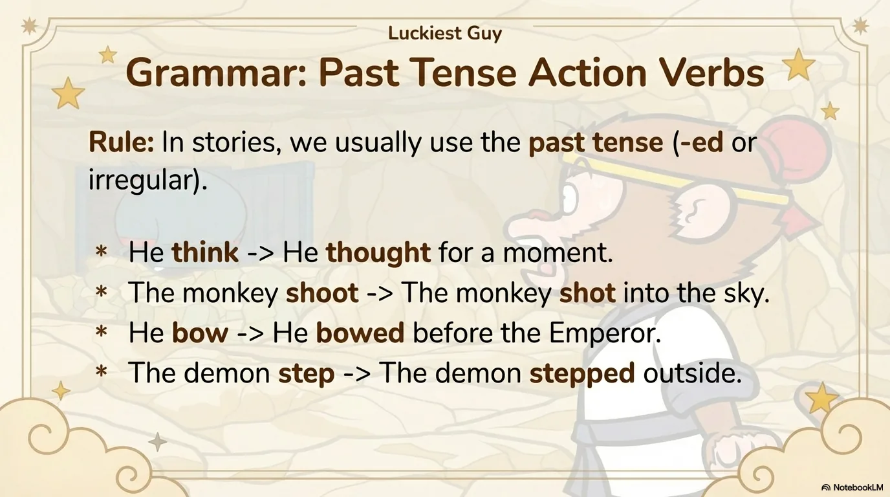

- 来源：`ppt/media/image15.png`（relationship `rId2`）
- 尺寸：1376×768
- 源 SHA-256：`c1fedc48cfbc473c7501216d636cfaa60ed02f54d566fba59f78fd0ae434def8`
- 输出 SHA-256：`ae62197b97e0b69ea1af6d5c100f2f9a4db9ae20b230ccf7d5e00b53457fda39`
- 分类：unknown ｜ OCR：blocked ｜ 审核：unreviewed

## Slide 015

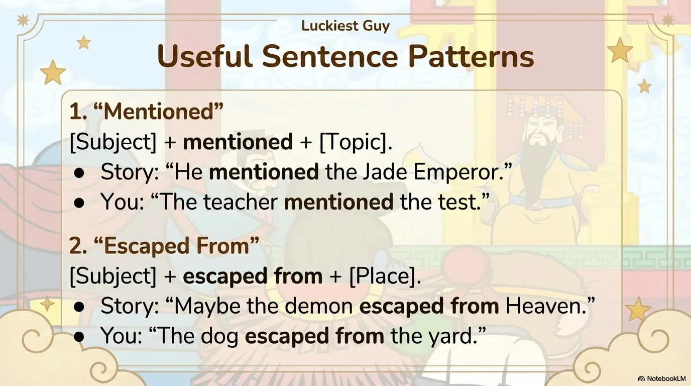

- 来源：`ppt/media/image16.png`（relationship `rId2`）
- 尺寸：1376×768
- 源 SHA-256：`be1b0b82c6f727c946ec3a250252a8f5a6aeb00ab54af66144213a8c1238282f`
- 输出 SHA-256：`ea6d39c7ae8b2b740ed40bab179384b7f62830ff7bfe6ed3f49ef018d8111b05`
- 分类：unknown ｜ OCR：blocked ｜ 审核：unreviewed

## Slide 016

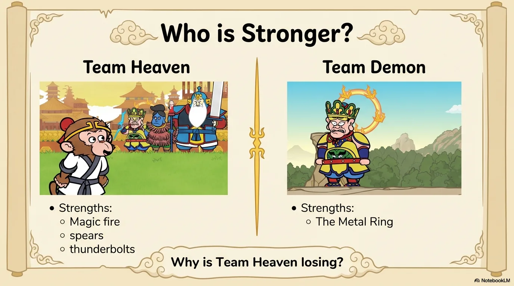

- 来源：`ppt/media/image17.png`（relationship `rId2`）
- 尺寸：1376×768
- 源 SHA-256：`1d0b78ddfb2533c97093c10c3ab4c5764fbb7620597e18c9770c55956afcc5fd`
- 输出 SHA-256：`02775c970248d601a18f485964a8f9c767490d4aff4e3175aa39bf122ad7775d`
- 分类：unknown ｜ OCR：blocked ｜ 审核：unreviewed

## Slide 017

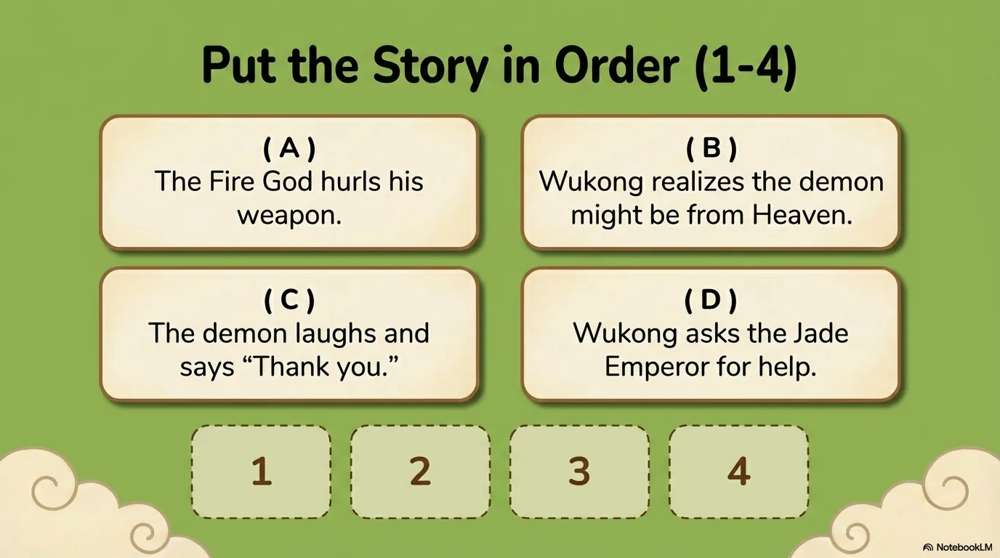

- 来源：`ppt/media/image18.png`（relationship `rId2`）
- 尺寸：1376×768
- 源 SHA-256：`33e90906a5eba9906a0b815dc2c622fcafbaf42e59f5f6a9642a332280284cec`
- 输出 SHA-256：`6380b0744ecf557c1faf1ce55e222fb58ca03bee48fa69d2468dad1e6b28ea2a`
- 分类：unknown ｜ OCR：blocked ｜ 审核：unreviewed

## Slide 018

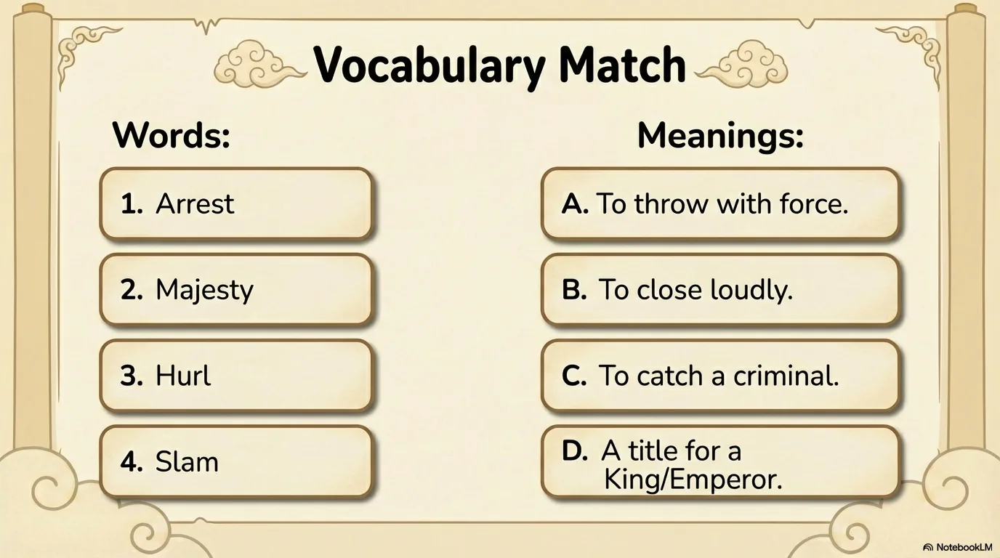

- 来源：`ppt/media/image19.png`（relationship `rId2`）
- 尺寸：1376×768
- 源 SHA-256：`82373dcf1e5e61a40ecbd4d0772e55ddb78956ccb95298a4434cb39e7ebdee59`
- 输出 SHA-256：`cffc378caf94018bfe0ce38291ca99429c3b2062cb9aadaff317bcab73171154`
- 分类：unknown ｜ OCR：blocked ｜ 审核：unreviewed

## Slide 019

- 来源：`ppt/media/image20.png`（relationship `rId2`）
- 尺寸：1376×768
- 源 SHA-256：`56d371f27ea81a2c99a3cd2c052563f7892d0c350d16dce365941b7d5510e6cc`
- 输出 SHA-256：`0550e4f8c9fed485e5d2bf79f96705d56f9b50634403ca4ec09c07ec1aa6367b`
- 分类：unknown ｜ OCR：blocked ｜ 审核：unreviewed

## Slide 020

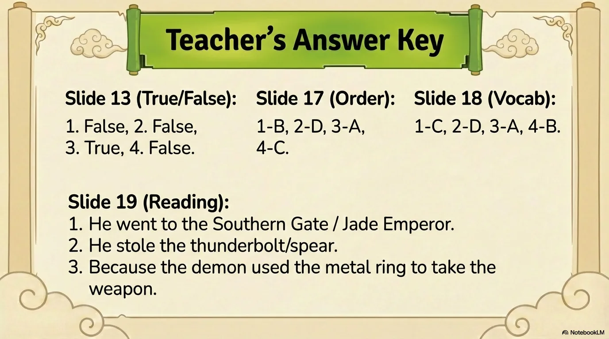

- 来源：`ppt/media/image21.png`（relationship `rId2`）
- 尺寸：1376×768
- 源 SHA-256：`199deb5c0b23159ce143ceb52711024a2ff5ddc3d43f0b254f55c57161a7a2d3`
- 输出 SHA-256：`db75388270a74a6a25925ae908e4fa6ce4f9879b035bf696d6424248393b6f18`
- 分类：unknown ｜ OCR：blocked ｜ 审核：unreviewed
