# 豆豆龙英语 · 第 67 集课件（EP067 草稿）

- 来源：`067_Journey to the West 67_The Master Thief.pptx`（主课件，20 页）
- OCR：`blocked`（no local OCR provider importable (pytesseract missing): No module named 'pytesseract'）
- 分类：待人工审核（unknown）
- 审核状态：`unreviewed`

## Slide 001

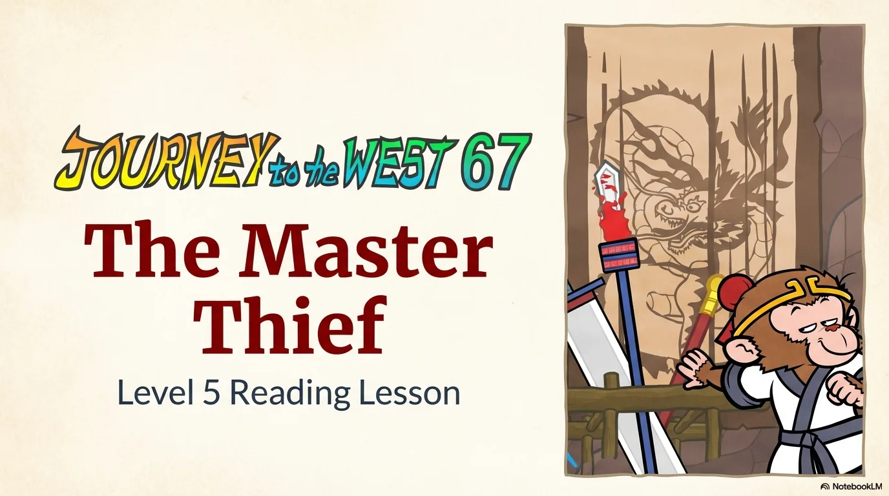

- 来源：`ppt/media/image1.png`（relationship `rId2`）
- 尺寸：1376×768
- 源 SHA-256：`1d3a46b8bcb910a8db114aa599c2cca50109d8277c91c8704e74194b8da2fa9e`
- 输出 SHA-256：`8adfc54be4293c2c999d4196774ba582741fb037d685f4ceb5d468a59d6804bf`
- 分类：unknown ｜ OCR：blocked ｜ 审核：unreviewed

## Slide 002

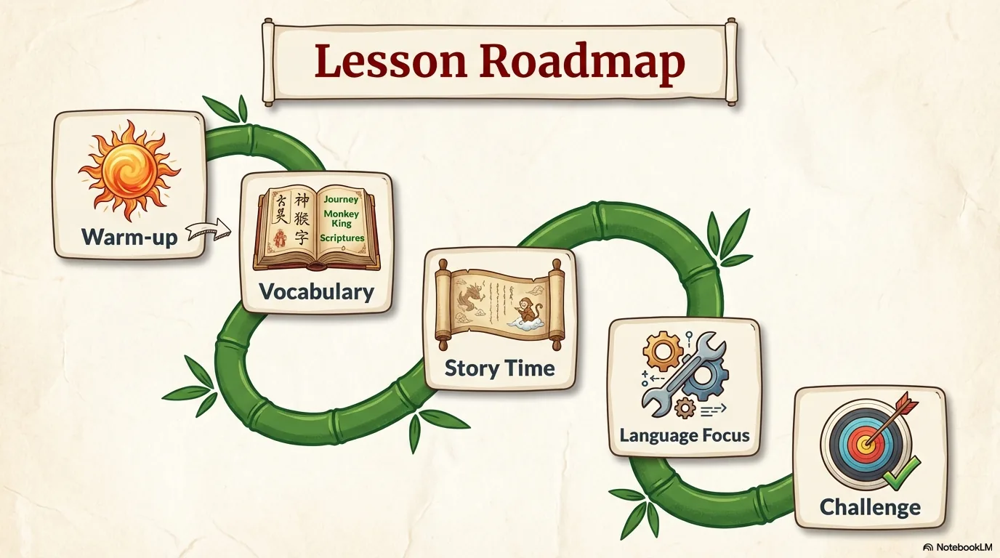

- 来源：`ppt/media/image3.png`（relationship `rId2`）
- 尺寸：1376×768
- 源 SHA-256：`520ae84520b191ba31072050932fea9b6c88bd3574984d8b38c89caffbc2d970`
- 输出 SHA-256：`13af5653ee47152723d54afc3697c0c3333017628c564d07bb5edcbf42bd9194`
- 分类：unknown ｜ OCR：blocked ｜ 审核：unreviewed

## Slide 003

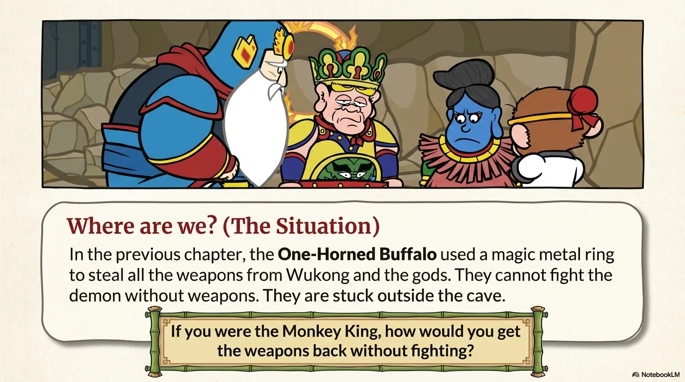

- 来源：`ppt/media/image4.png`（relationship `rId2`）
- 尺寸：1376×768
- 源 SHA-256：`95e52e99682967a3c5aa0f96559c4d1f7149bb1b8f0edb2a5253ad4ca60bd621`
- 输出 SHA-256：`40ba9e5a0ea07a801bbccdd82e9262a37c39107f2ec8833612df433dadfa1406`
- 分类：unknown ｜ OCR：blocked ｜ 审核：unreviewed

## Slide 004

- 来源：`ppt/media/image5.png`（relationship `rId2`）
- 尺寸：1376×768
- 源 SHA-256：`ecd87dc7864458c149249ad7e49059c34b7d8bd9fbe0b293be802d3507eda591`
- 输出 SHA-256：`f77fa3f4c7c38990cf9735f7890bb3ae49317e4d420d7e35f6a60773e5b89fc4`
- 分类：unknown ｜ OCR：blocked ｜ 审核：unreviewed

## Slide 005

- 来源：`ppt/media/image6.png`（relationship `rId2`）
- 尺寸：1376×768
- 源 SHA-256：`c296d2adea73f507217157818379c80ba18b081e572d896533ad48d21b46b6c3`
- 输出 SHA-256：`55556df0f3403d343bae66989a08d57b9df75fab3a225964a56ff81c53b9cdc3`
- 分类：unknown ｜ OCR：blocked ｜ 审核：unreviewed

## Slide 006

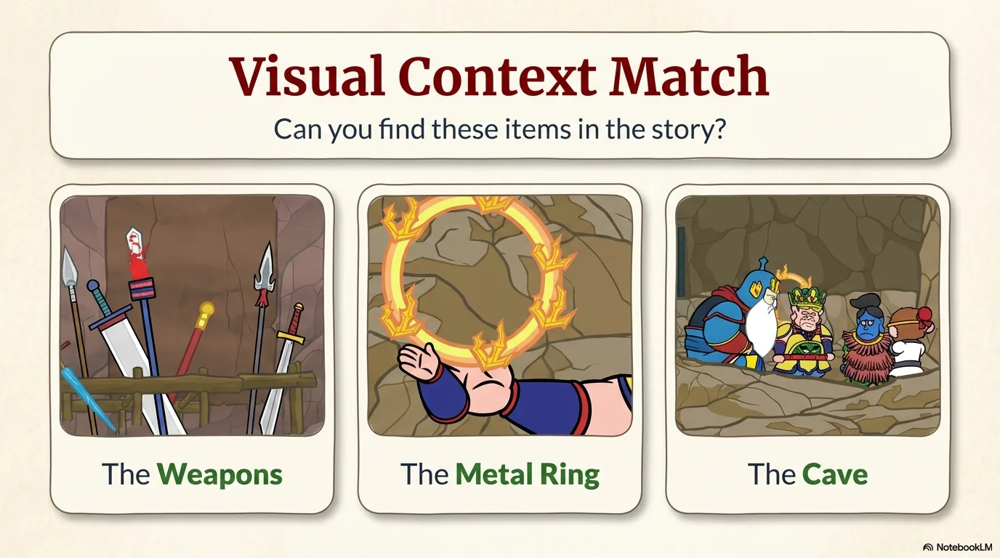

- 来源：`ppt/media/image7.png`（relationship `rId2`）
- 尺寸：1376×768
- 源 SHA-256：`0a7681b6036fe913581e1c75b7625ddd528b2c1024bc0dfa1c9b097b330c8fe9`
- 输出 SHA-256：`eef401f7863d1a5ffdd78efe64f2053842402cd6b095f0ca3d0ffa0d80f66eba`
- 分类：unknown ｜ OCR：blocked ｜ 审核：unreviewed

## Slide 007

- 来源：`ppt/media/image8.png`（relationship `rId2`）
- 尺寸：1376×768
- 源 SHA-256：`f0cea89083ec7e6d0474eeb46ec9ed0c8bd0e2d09a09c89d98b3824d60a1f092`
- 输出 SHA-256：`40d11b14bacb0b43a2cdbbb6be221cd75d6ce9c3e01094611befbd72fcabf532`
- 分类：unknown ｜ OCR：blocked ｜ 审核：unreviewed

## Slide 008

- 来源：`ppt/media/image9.png`（relationship `rId2`）
- 尺寸：1376×768
- 源 SHA-256：`e18e244522a63c14a65cbec573341c5a17c9956fae56546a542ca56fd519f660`
- 输出 SHA-256：`e1ea6a19469c6f0c01ca738d326afdf6b9fdc0e6da92717198697464ce0366d4`
- 分类：unknown ｜ OCR：blocked ｜ 审核：unreviewed

## Slide 009

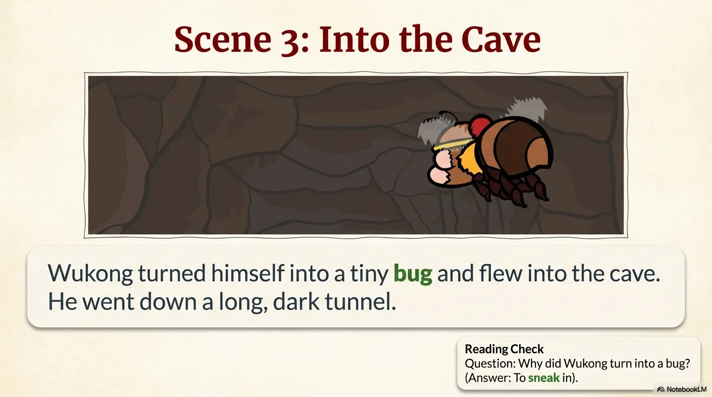

- 来源：`ppt/media/image10.png`（relationship `rId2`）
- 尺寸：1376×768
- 源 SHA-256：`48311c58cb215fb5f7b7c3344a62db450ffd5b7c777bd57f809b4cc3a266acac`
- 输出 SHA-256：`44425e7b88e57841f42b6eac16e3ef3ff02a4b5f5220b39cdc6de7244f09cd12`
- 分类：unknown ｜ OCR：blocked ｜ 审核：unreviewed

## Slide 010

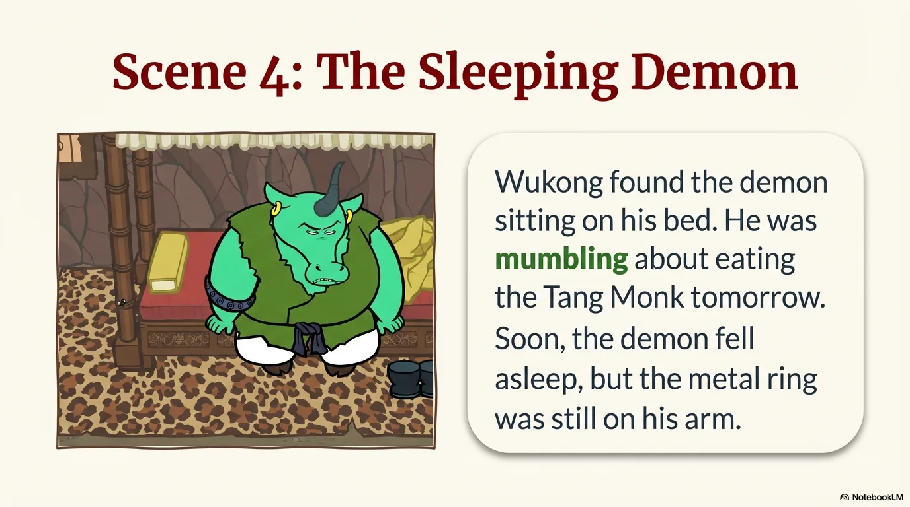

- 来源：`ppt/media/image11.png`（relationship `rId2`）
- 尺寸：1376×768
- 源 SHA-256：`133494ed62a7114d54dac03c4d8d93e9d98e8e881734ba41d8465870b6bd457c`
- 输出 SHA-256：`db39ac2e22ad5ef6f82cebdeff45c61bac26f8c7ff3c5921c9385959a1a4595e`
- 分类：unknown ｜ OCR：blocked ｜ 审核：unreviewed

## Slide 011

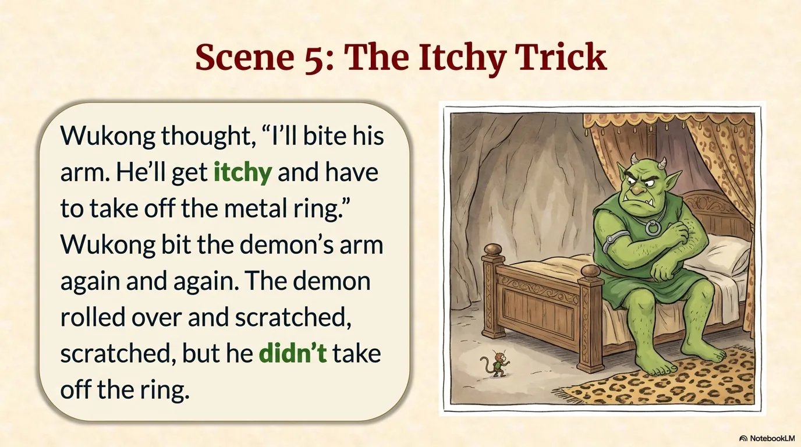

- 来源：`ppt/media/image12.png`（relationship `rId2`）
- 尺寸：1376×768
- 源 SHA-256：`023915a6ff0983d01adc88c3e87591c7be2a2555c0a560ed442e726c4bbaa6ac`
- 输出 SHA-256：`fa567679e9063b7f366c92ef9a1989f327dfec57748fa564388e570aefe2aa56`
- 分类：unknown ｜ OCR：blocked ｜ 审核：unreviewed

## Slide 012

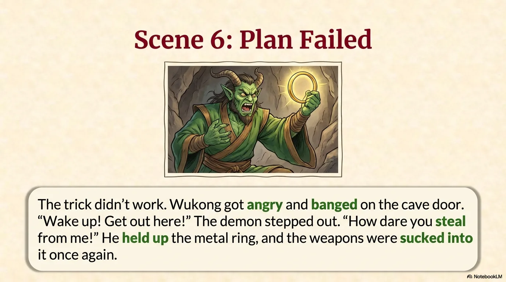

- 来源：`ppt/media/image13.png`（relationship `rId2`）
- 尺寸：1376×768
- 源 SHA-256：`e1506d9d24eed5bb81ad6b7c57246212a80b1b5f4f733d9c47eeb7f5dabca86b`
- 输出 SHA-256：`8025b055f90e339daf6f79c80fbf48494beea5e952e39962e5f3178970cb7d79`
- 分类：unknown ｜ OCR：blocked ｜ 审核：unreviewed

## Slide 013

- 来源：`ppt/media/image14.png`（relationship `rId2`）
- 尺寸：1376×768
- 源 SHA-256：`47b02a9d07fadd7f7577344be7819af299a58cd6e3588ec862563370a0dd4dd6`
- 输出 SHA-256：`0d1f854b989a91808c385b197e47e2ffa1cccaab6570602eef0f41b1ace7d031`
- 分类：unknown ｜ OCR：blocked ｜ 审核：unreviewed

## Slide 014

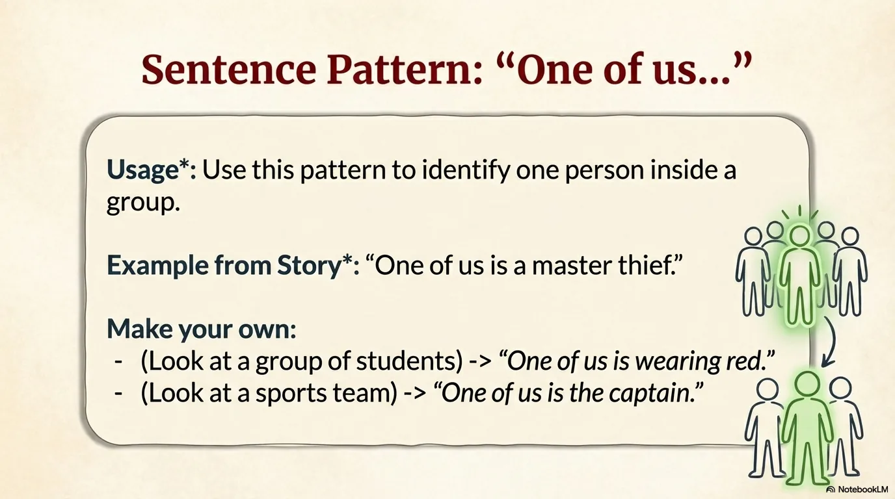

- 来源：`ppt/media/image15.png`（relationship `rId2`）
- 尺寸：1376×768
- 源 SHA-256：`02bb9d9e0e45df170212480ac57e4d6856603951cd7e156003e790d3dac0027e`
- 输出 SHA-256：`26b6f9d30cdf7db91c3073019721548144585ad6146fdf9174546d2613f44c73`
- 分类：unknown ｜ OCR：blocked ｜ 审核：unreviewed

## Slide 015

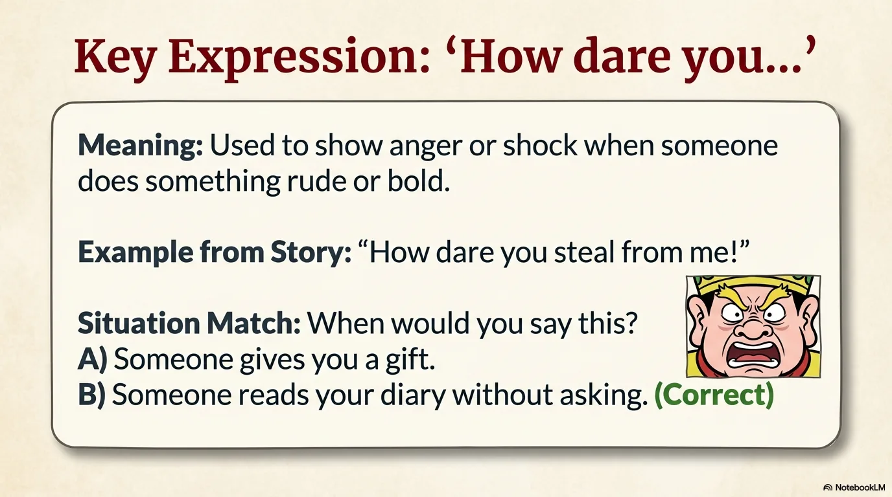

- 来源：`ppt/media/image16.png`（relationship `rId2`）
- 尺寸：1376×768
- 源 SHA-256：`23ba2541bcbd97eca9d1489b0c00dfd75ff511f6907dcaeeb97afc6dd3b64464`
- 输出 SHA-256：`b4a2b4a498981a827b8deadc89fc5ad200f9f4fa64db14483b137631db4aefaf`
- 分类：unknown ｜ OCR：blocked ｜ 审核：unreviewed

## Slide 016

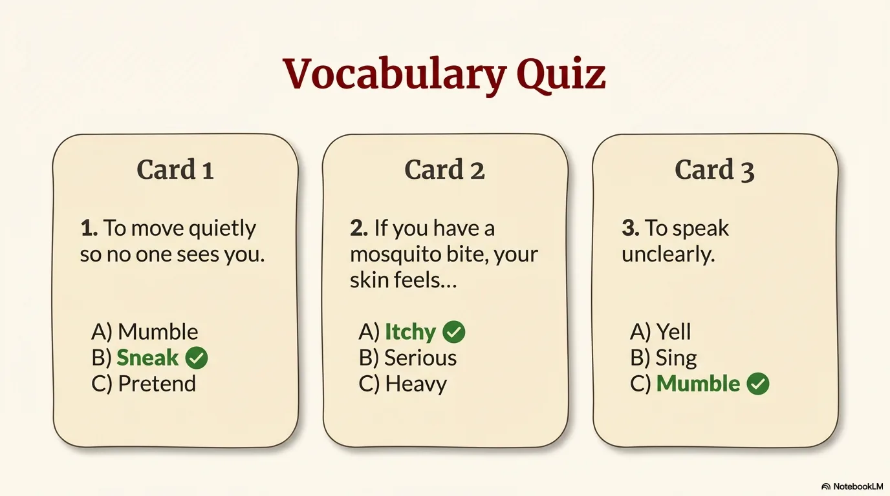

- 来源：`ppt/media/image17.png`（relationship `rId2`）
- 尺寸：1376×768
- 源 SHA-256：`b72d13b33133f3a2542fc829d46b1a042d17b70f57b8111a2b6668d73e545f5f`
- 输出 SHA-256：`f9d1ce0ab39b4b02366c23114c2fdfd2830a311a740d46de8aa2c48d03e2e85d`
- 分类：unknown ｜ OCR：blocked ｜ 审核：unreviewed

## Slide 017

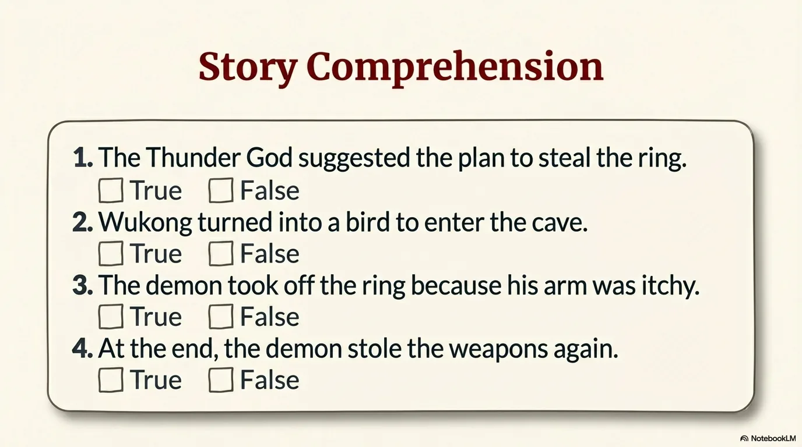

- 来源：`ppt/media/image18.png`（relationship `rId2`）
- 尺寸：1376×768
- 源 SHA-256：`a2f3e1c1a16552d40e04bddda42cecd2d0f985ea6bdf49b3677af1c8ce45b14d`
- 输出 SHA-256：`9c6f90a4538cde6252b21579d9be7eb307a78e5ebd5e652a9fc4b2f9d1655eef`
- 分类：unknown ｜ OCR：blocked ｜ 审核：unreviewed

## Slide 018

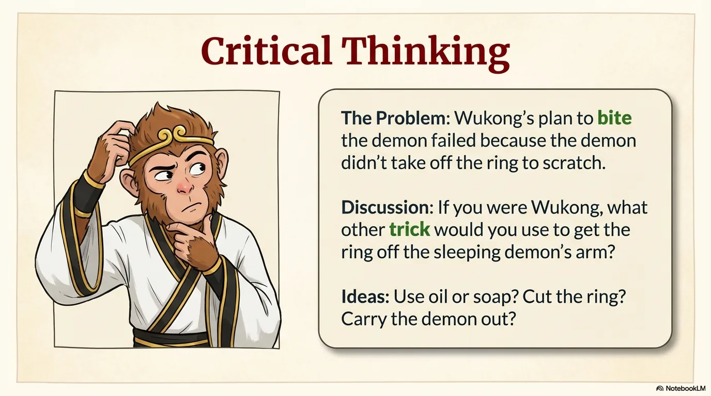

- 来源：`ppt/media/image19.png`（relationship `rId2`）
- 尺寸：1376×768
- 源 SHA-256：`9e98c0b6101b4d3e5d8fc713610a9b80768c2e8cb71fd2cc0e50d6669e5817c3`
- 输出 SHA-256：`ae2c900f6d7ed141f6b29cf172dfe48d44e4dd269ee539abe6f9123fc2146b94`
- 分类：unknown ｜ OCR：blocked ｜ 审核：unreviewed

## Slide 019

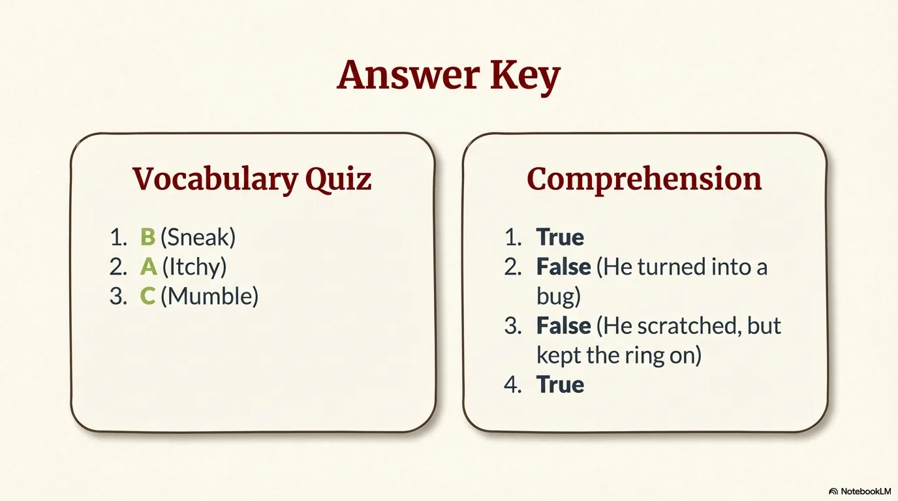

- 来源：`ppt/media/image20.png`（relationship `rId2`）
- 尺寸：1376×768
- 源 SHA-256：`26965927c29ccc393ec4ab313a6fdedbd554d76512b0ff9110a37928ee9f97f3`
- 输出 SHA-256：`a664bae4a18db3deb71407623eff4723a909a522eb2b6ee199340658641e2369`
- 分类：unknown ｜ OCR：blocked ｜ 审核：unreviewed

## Slide 020

- 来源：`ppt/media/image21.png`（relationship `rId2`）
- 尺寸：1376×768
- 源 SHA-256：`2820c01331c8fb250d31647017b0d8f84cd6b21ed646fbf916eeb1a3461f8c82`
- 输出 SHA-256：`f2576caf5b83da5a32dca6e3c5660b86e4404240daf89a32f9f0e0bbf74e1f4e`
- 分类：unknown ｜ OCR：blocked ｜ 审核：unreviewed
