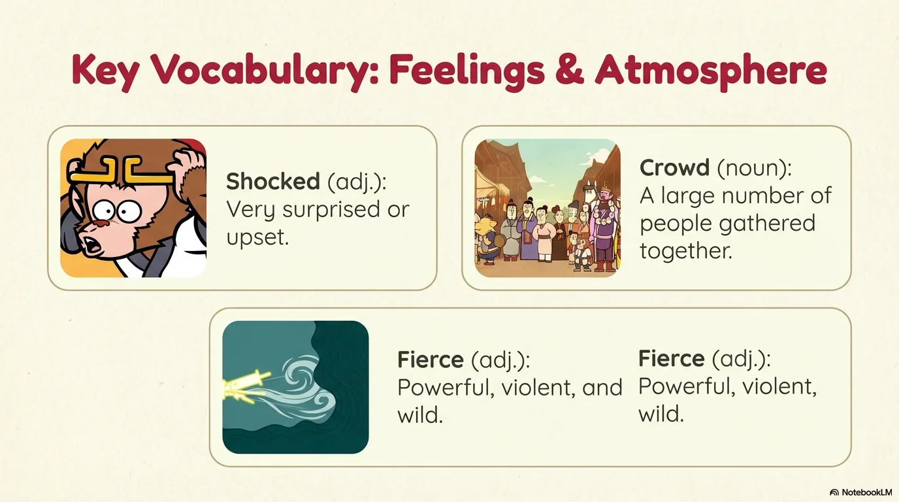
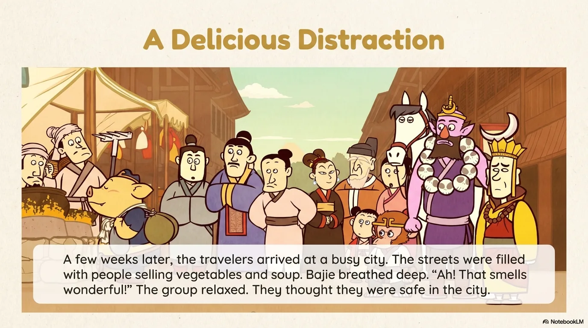
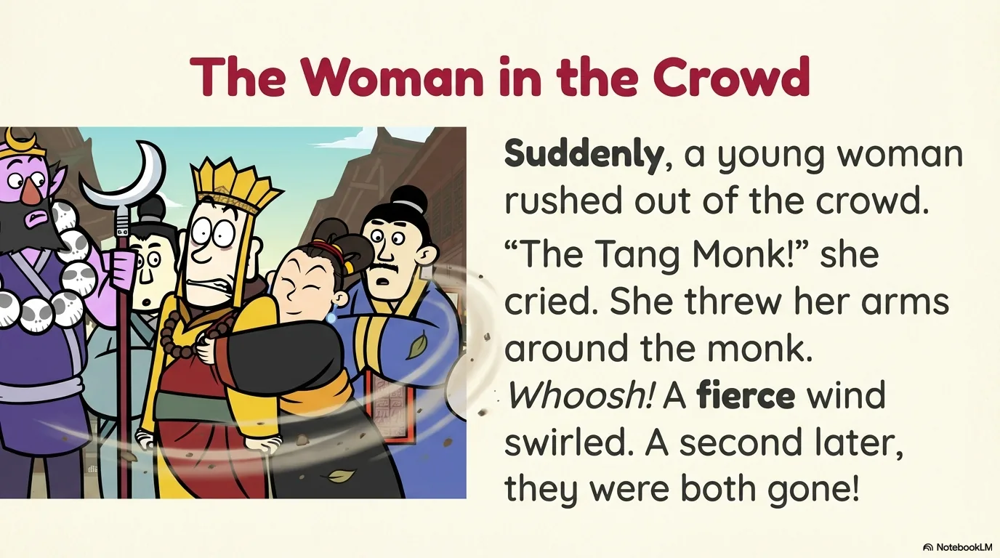
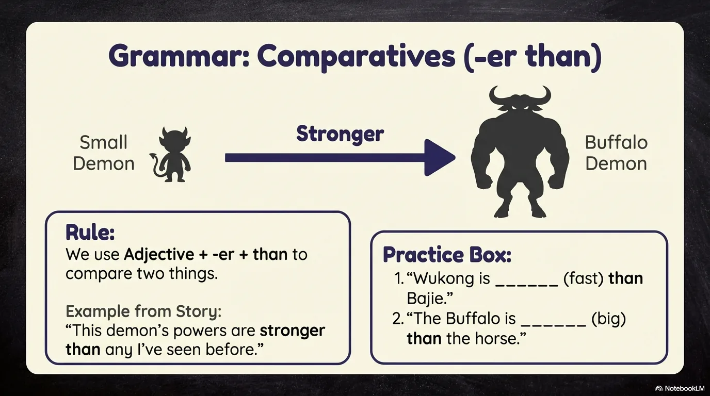
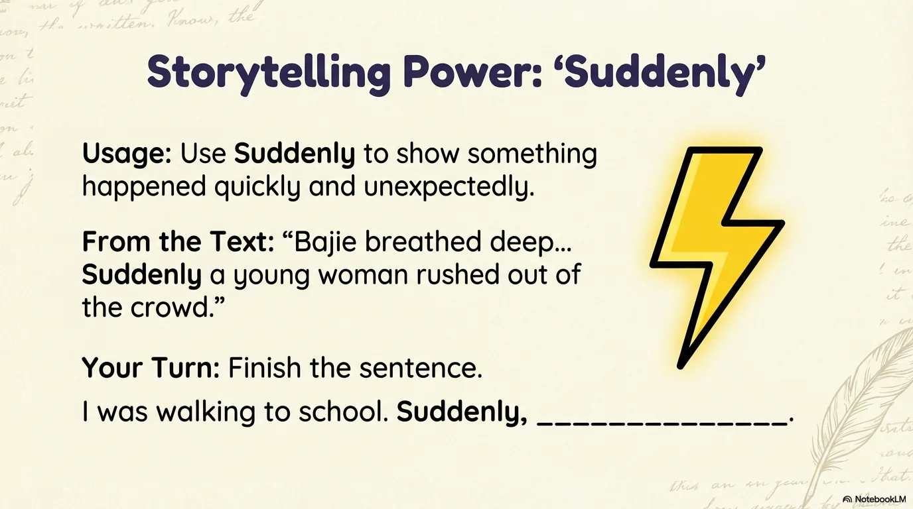
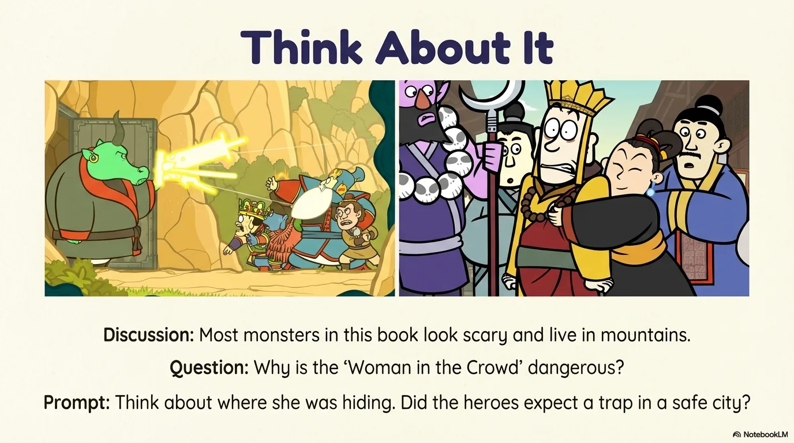
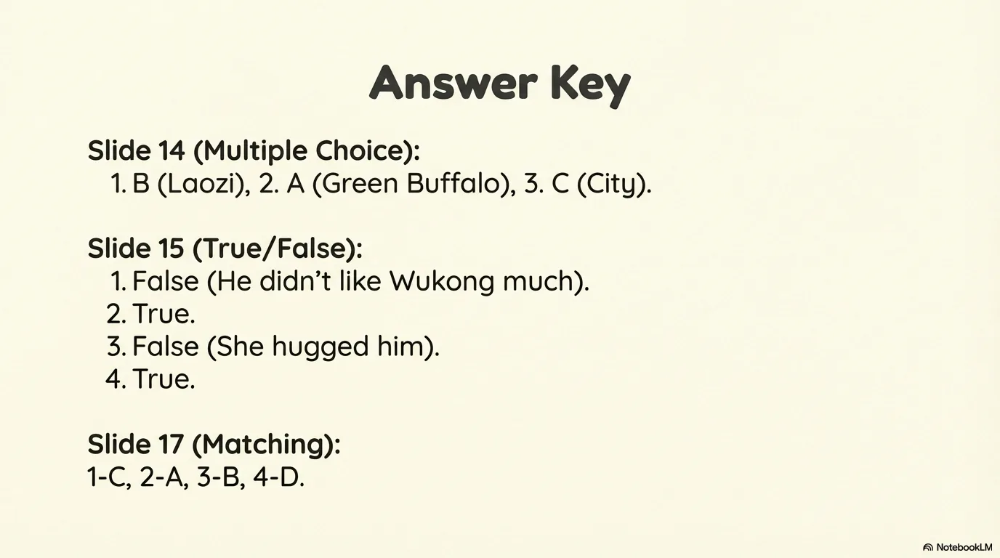

# 豆豆龙英语 · 第 68 集课件（EP068 草稿）

- 来源：`068_Journey to the West 68_The Woman in the Crowd.pptx`（主课件，20 页）
- OCR：`blocked`（no local OCR provider importable (pytesseract missing): No module named 'pytesseract'）
- 分类：待人工审核（unknown）
- 审核状态：`unreviewed`

## Slide 001

- 来源：`ppt/media/image1.png`（relationship `rId2`）
- 尺寸：1376×768
- 源 SHA-256：`21a396cc699d77c0444edf39c2ecd19aec882509d04d393121b2e453f1e97466`
- 输出 SHA-256：`3e51e242527aed9c3cb1f4a9609e17009a82942826bb979ce4da9d6af524815c`
- 分类：unknown ｜ OCR：blocked ｜ 审核：unreviewed

## Slide 002

- 来源：`ppt/media/image3.png`（relationship `rId2`）
- 尺寸：1376×768
- 源 SHA-256：`29740be029af4d8c54a6eafd368a77b8efe0d2f298834923ab876c6ec5f365c7`
- 输出 SHA-256：`09503f0d2cf6538b91e635eafd202d5efbc7704d8753fa8477c4f552ae40590b`
- 分类：unknown ｜ OCR：blocked ｜ 审核：unreviewed

## Slide 003

- 来源：`ppt/media/image4.png`（relationship `rId2`）
- 尺寸：1376×768
- 源 SHA-256：`3145dad1ff1db3a4f80ecef6ee47ba93a45d243516d40aa2e688b7b46b1041a1`
- 输出 SHA-256：`8cd83222cb9abef5ee06bcbd60fc7274b1cf9ee38937f574676733d0fba73ab6`
- 分类：unknown ｜ OCR：blocked ｜ 审核：unreviewed

## Slide 004

- 来源：`ppt/media/image5.png`（relationship `rId2`）
- 尺寸：1376×768
- 源 SHA-256：`aeb726f1bd44667387e08729138abf48fbae50d9806766ff5cf526b108d57115`
- 输出 SHA-256：`dd484fd01c4cada52847adb5d9fc5ce2f9d7909604fdcf396654fac3e296055e`
- 分类：unknown ｜ OCR：blocked ｜ 审核：unreviewed

## Slide 005

- 来源：`ppt/media/image6.png`（relationship `rId2`）
- 尺寸：1376×768
- 源 SHA-256：`02c733e5a19718dd5ae9b526676f92963440c8fe167bf80e86af680353f8e342`
- 输出 SHA-256：`5a8b101fbda71ed309e135ae8ce5113ab4ff82762e7bebefe3bb6bcc5a322e48`
- 分类：unknown ｜ OCR：blocked ｜ 审核：unreviewed

## Slide 006

- 来源：`ppt/media/image7.png`（relationship `rId2`）
- 尺寸：1376×768
- 源 SHA-256：`405c0b4a164926c0eb2690351b1187fbc1816b1feda84ffc3332133ecebe98a4`
- 输出 SHA-256：`4a537b219e50ef4d33cf95f30a4331ef72f87f45bf48040906e4cb05f7fb4ec9`
- 分类：unknown ｜ OCR：blocked ｜ 审核：unreviewed

## Slide 007

- 来源：`ppt/media/image8.png`（relationship `rId2`）
- 尺寸：1376×768
- 源 SHA-256：`d2ae0c9c906735e7ee78156415332108061ff17b2418eea645e269bcbfd54ed0`
- 输出 SHA-256：`4ce3f439df3d067b6dde747aa0ce72ccbeaf9dd42521ca7abeff37e96d51132c`
- 分类：unknown ｜ OCR：blocked ｜ 审核：unreviewed

## Slide 008

- 来源：`ppt/media/image9.png`（relationship `rId2`）
- 尺寸：1376×768
- 源 SHA-256：`ecd8c20cbcbac11c20b247381b705932a70c9fbc5843131f19bb15873370a734`
- 输出 SHA-256：`28d2f513a6d724d3db3019524bbbf08325939d478f9449aeb791af7114ae1ee6`
- 分类：unknown ｜ OCR：blocked ｜ 审核：unreviewed

## Slide 009

- 来源：`ppt/media/image10.png`（relationship `rId2`）
- 尺寸：1376×768
- 源 SHA-256：`55ee4b036f3a4d3c17edf78b7e5b2a6e00932ceb723eccc26f0cc982e4654c38`
- 输出 SHA-256：`a54fa34132bc02b029b2fd5cc035d412e5d119afb2700adafe99e856b6fef3eb`
- 分类：unknown ｜ OCR：blocked ｜ 审核：unreviewed

## Slide 010

- 来源：`ppt/media/image11.png`（relationship `rId2`）
- 尺寸：1376×768
- 源 SHA-256：`aef841433b769a20ada6c8e34a6c6801a8bd20fa7153c46510b006c406a66976`
- 输出 SHA-256：`29a12e17328978fa80bb998248f4f6f7950d22fe8d65362fcc05a6863c399a41`
- 分类：unknown ｜ OCR：blocked ｜ 审核：unreviewed

## Slide 011

- 来源：`ppt/media/image12.png`（relationship `rId2`）
- 尺寸：1376×768
- 源 SHA-256：`13df9c9184fd46d97718321e3b51a5770dff905fcebbefb40da2253721fd8a07`
- 输出 SHA-256：`0a602fef09df677bdf71223ad7680bfbccdb90765720f54ea725bfcb34af4b5f`
- 分类：unknown ｜ OCR：blocked ｜ 审核：unreviewed

## Slide 012

- 来源：`ppt/media/image13.png`（relationship `rId2`）
- 尺寸：1376×768
- 源 SHA-256：`9e094524b946a8e360b56f9a8b4ef5a8dee8dd938ebc0cad688621a88c6b8db7`
- 输出 SHA-256：`f8c87d437766e9c1ee707a15536179b681971b3ef7537810ffc266bdedf3ed9a`
- 分类：unknown ｜ OCR：blocked ｜ 审核：unreviewed

## Slide 013

- 来源：`ppt/media/image14.png`（relationship `rId2`）
- 尺寸：1376×768
- 源 SHA-256：`caa7e82901933b758f80885e0b79329b84840de60b96a9f324368770d6c489df`
- 输出 SHA-256：`3f755764b2757c7e350781fbc5a9fe989b2f1c0a2feca3ec4a1869e1168c3b5c`
- 分类：unknown ｜ OCR：blocked ｜ 审核：unreviewed

## Slide 014

- 来源：`ppt/media/image15.png`（relationship `rId2`）
- 尺寸：1376×768
- 源 SHA-256：`37259d2468c00bf65aa2d5bf6e50e7916dad3f02a8b6489125f12cf1a43653a7`
- 输出 SHA-256：`141c320f5896f6537418600b8dd33b7e1b28bfff8c87c1cad9264aed45af9233`
- 分类：unknown ｜ OCR：blocked ｜ 审核：unreviewed

## Slide 015

- 来源：`ppt/media/image16.png`（relationship `rId2`）
- 尺寸：1376×768
- 源 SHA-256：`60b8fd557c2c32945475335fe52bab9bd5b8674bd572ff35166b72d199745622`
- 输出 SHA-256：`939959b8a49e8917f0f60041cfffe641f6d522dcb2c63da399da2de4395cb277`
- 分类：unknown ｜ OCR：blocked ｜ 审核：unreviewed

## Slide 016

- 来源：`ppt/media/image17.png`（relationship `rId2`）
- 尺寸：1376×768
- 源 SHA-256：`e9deea388e1c503db267061f5463f82c9e32d8e3de4381a2456e9cd2765db0c6`
- 输出 SHA-256：`895dd32aa50e58dead54b5d375adce6206c3d985d15270f7d2b5a83276333e0d`
- 分类：unknown ｜ OCR：blocked ｜ 审核：unreviewed

## Slide 017

- 来源：`ppt/media/image18.png`（relationship `rId2`）
- 尺寸：1376×768
- 源 SHA-256：`3928584f774f56239679d0d45e49cf47e1354c89acf677469ffe9a3e48c26926`
- 输出 SHA-256：`63ff1fc0ef537b9a35752aa28454fd478edc7146a51a98a88fa5645d72a5b1e8`
- 分类：unknown ｜ OCR：blocked ｜ 审核：unreviewed

## Slide 018

- 来源：`ppt/media/image19.png`（relationship `rId2`）
- 尺寸：1376×768
- 源 SHA-256：`cf32d8db04c2b28c72179ffefa2f5f81d4c29597864bb099777e4a24003f492f`
- 输出 SHA-256：`2b43a1efd54a73c5af3ccb638f4dd8007fb21c43da8bc9dbed62d682657bb4ec`
- 分类：unknown ｜ OCR：blocked ｜ 审核：unreviewed

## Slide 019

- 来源：`ppt/media/image20.png`（relationship `rId2`）
- 尺寸：1376×768
- 源 SHA-256：`2bce3fc352fc26d936031fffa52a12bfe62db7a977b8836c34600a0e18dedb67`
- 输出 SHA-256：`27eac17a107be0317bb3ab657c758d307d40cd29a424aafa38d866ebf161722d`
- 分类：unknown ｜ OCR：blocked ｜ 审核：unreviewed

## Slide 020

- 来源：`ppt/media/image21.png`（relationship `rId2`）
- 尺寸：1376×768
- 源 SHA-256：`dc5f55a2693a9dc0ba53e5f5419dbbf6bccf1db10a307c1b014e931c3f67acc5`
- 输出 SHA-256：`a8c64a732319abd7306ba519aff40f3c51ce2c7359f3d650bfd26affe57fc718`
- 分类：unknown ｜ OCR：blocked ｜ 审核：unreviewed
