# 豆豆龙英语 · 第 69 集课件（EP069 草稿）

- 来源：`069_Journey to the West 69_The Stabbing Pain.pptx`（主课件，20 页）
- OCR：`blocked`（no local OCR provider importable (pytesseract missing): No module named 'pytesseract'）
- 分类：待人工审核（unknown）
- 审核状态：`unreviewed`

## Slide 001

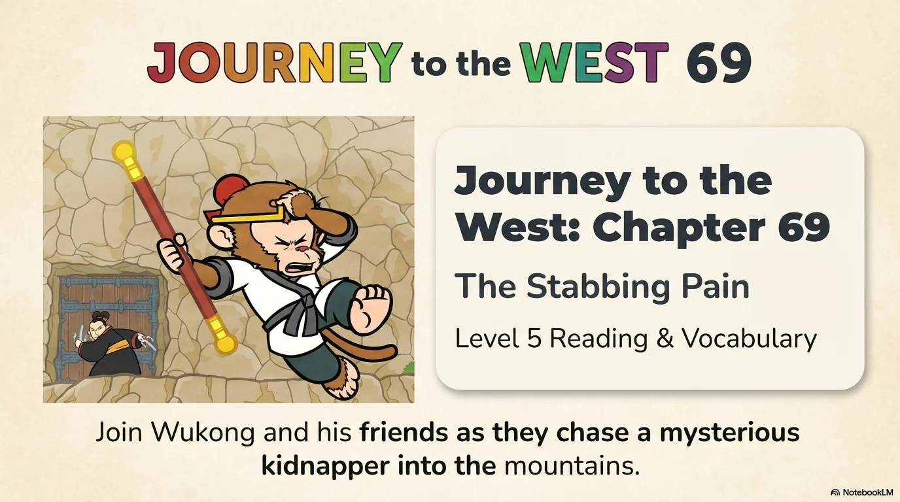

- 来源：`ppt/media/image1.png`（relationship `rId2`）
- 尺寸：1376×768
- 源 SHA-256：`e443255321ae5a4cab17b38a901e432591ee45ab05aa63fafe22e3cd1328633e`
- 输出 SHA-256：`33de5c7f7da63323584c3efbb8301a1a8059c1b8e1c5635996815de64c4a374b`
- 分类：unknown ｜ OCR：blocked ｜ 审核：unreviewed

## Slide 002

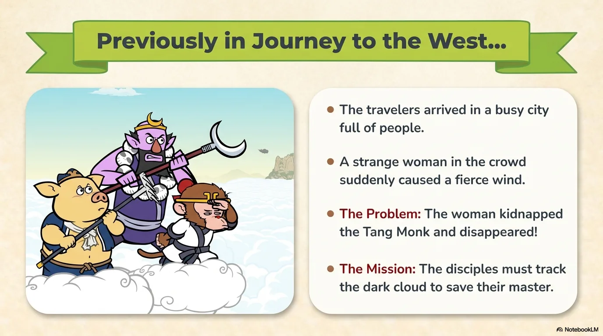

- 来源：`ppt/media/image3.png`（relationship `rId2`）
- 尺寸：1376×768
- 源 SHA-256：`962ae9e8e698a56d3ea75f21c4043ef9b231173bf57366754516af86ac9d1ec3`
- 输出 SHA-256：`75238b5bdced1da9d56c9268c4c2d530232bea1a3817b11206f949d01cc6a628`
- 分类：unknown ｜ OCR：blocked ｜ 审核：unreviewed

## Slide 003

- 来源：`ppt/media/image4.png`（relationship `rId2`）
- 尺寸：1376×768
- 源 SHA-256：`43f4d728d2c0e61e20734e82808395338b48e1a135e069f0a59f9fb514d52255`
- 输出 SHA-256：`e088d213453e7328b249ad48832b61d05b696b9500d67873af3cf56b4ac49d41`
- 分类：unknown ｜ OCR：blocked ｜ 审核：unreviewed

## Slide 004

- 来源：`ppt/media/image5.png`（relationship `rId2`）
- 尺寸：1376×768
- 源 SHA-256：`9e2a4ed815c3795c43bdbebe01db198d7d6db78065c29ee2b7c21f7e87104c59`
- 输出 SHA-256：`834b1d043f3587ca6253b0bca58a24e3d82e3eccd45495919b3c8d42bface621`
- 分类：unknown ｜ OCR：blocked ｜ 审核：unreviewed

## Slide 005

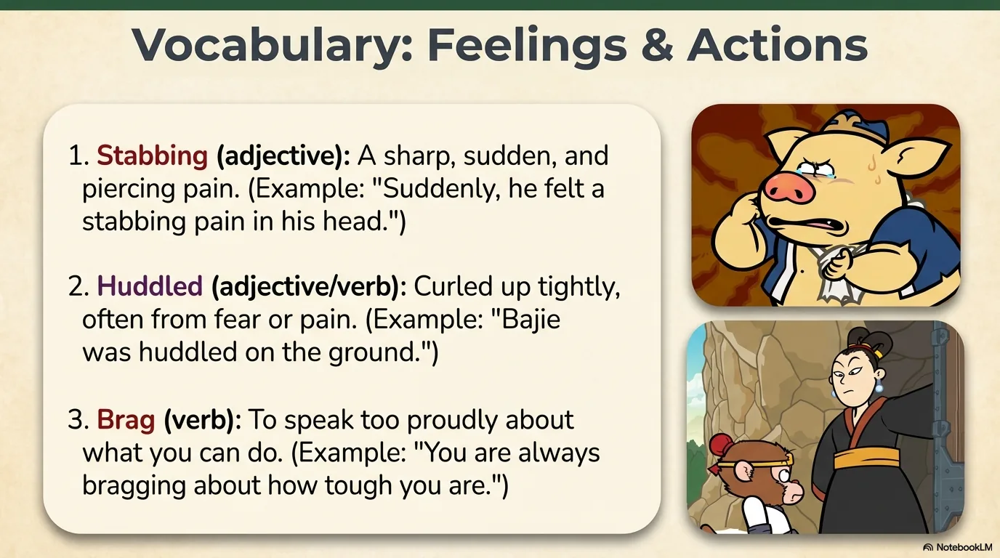

- 来源：`ppt/media/image6.png`（relationship `rId2`）
- 尺寸：1376×768
- 源 SHA-256：`e677d219eeea1daebdd5ab9e5767df8a1a68d7042749307007414630732d4a10`
- 输出 SHA-256：`1787cfd88d11271314b1e5f83381bd634a8ec74d9cbfe138466015f1b9ada7f3`
- 分类：unknown ｜ OCR：blocked ｜ 审核：unreviewed

## Slide 006

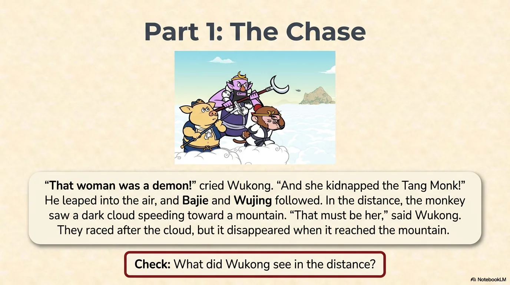

- 来源：`ppt/media/image7.png`（relationship `rId2`）
- 尺寸：1376×768
- 源 SHA-256：`192b645197ecd618c7362c7858acb6bb0e1937d047cd23e639ce5646349384c7`
- 输出 SHA-256：`7ecf0072808e994c58782f0a43c462b619e1ab75f03fd94d31db67c2f7a94db6`
- 分类：unknown ｜ OCR：blocked ｜ 审核：unreviewed

## Slide 007

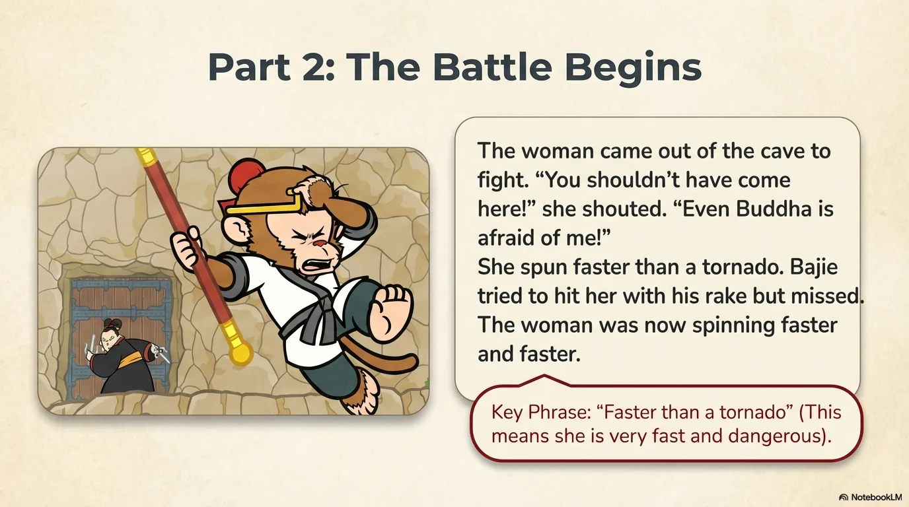

- 来源：`ppt/media/image8.png`（relationship `rId2`）
- 尺寸：1376×768
- 源 SHA-256：`a183b1214517d50ec41e00ceef52ed297c15d051a79f77daf2e9d510c2e9c1e1`
- 输出 SHA-256：`2907a9b8d7d3c4dd0fee53b157a74f217dfc7c15669351a6504f710cedee0d4a`
- 分类：unknown ｜ OCR：blocked ｜ 审核：unreviewed

## Slide 008

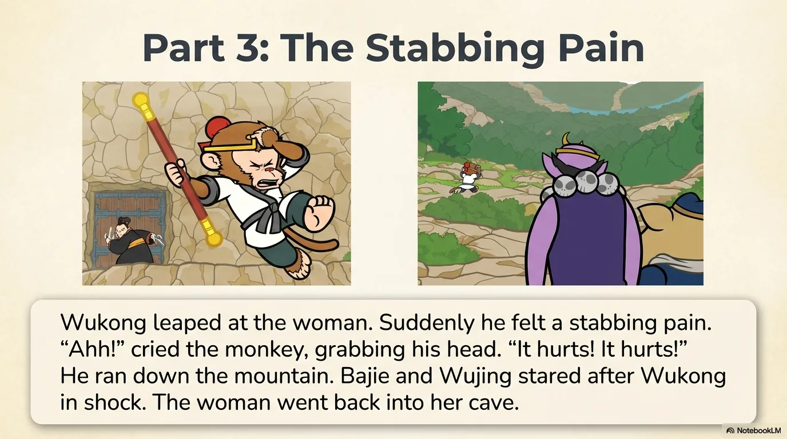

- 来源：`ppt/media/image9.png`（relationship `rId2`）
- 尺寸：1376×768
- 源 SHA-256：`c536382e1cca62108aa7ddf5154677ab59191a2c7fe3247fcedbc077cf693bc9`
- 输出 SHA-256：`a0d967c836d3eeafe320b52cb4faa461e00613930302de202178c4cf047b585e`
- 分类：unknown ｜ OCR：blocked ｜ 审核：unreviewed

## Slide 009

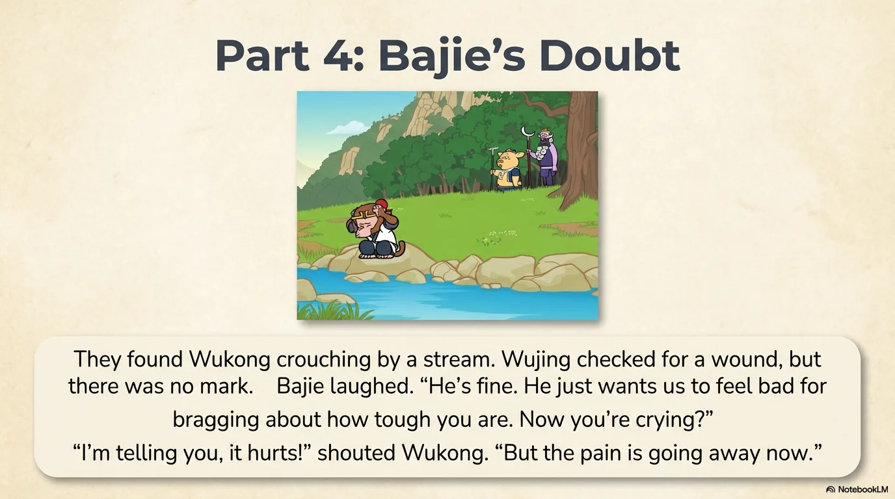

- 来源：`ppt/media/image10.png`（relationship `rId2`）
- 尺寸：1376×768
- 源 SHA-256：`ea676419043abf9b79420237f14e4fe3d7f4cba587cd14c6b5f1a361e447ee95`
- 输出 SHA-256：`141a6f7a401b78cdbd2db1ce93e7226365d8867ee5c4462f5e09746c93e16717`
- 分类：unknown ｜ OCR：blocked ｜ 审核：unreviewed

## Slide 010

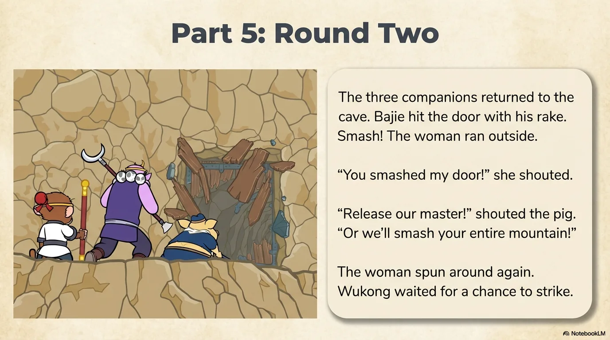

- 来源：`ppt/media/image11.png`（relationship `rId2`）
- 尺寸：1376×768
- 源 SHA-256：`2b88e2b4bc48dd21b2e137912140211645077da82fc4831afaf6d519ac6a5aca`
- 输出 SHA-256：`3da1fa96855a31f9e065a557ca4acaa6714e74b0cd545c3042a3bb6b638b9fcf`
- 分类：unknown ｜ OCR：blocked ｜ 审核：unreviewed

## Slide 011

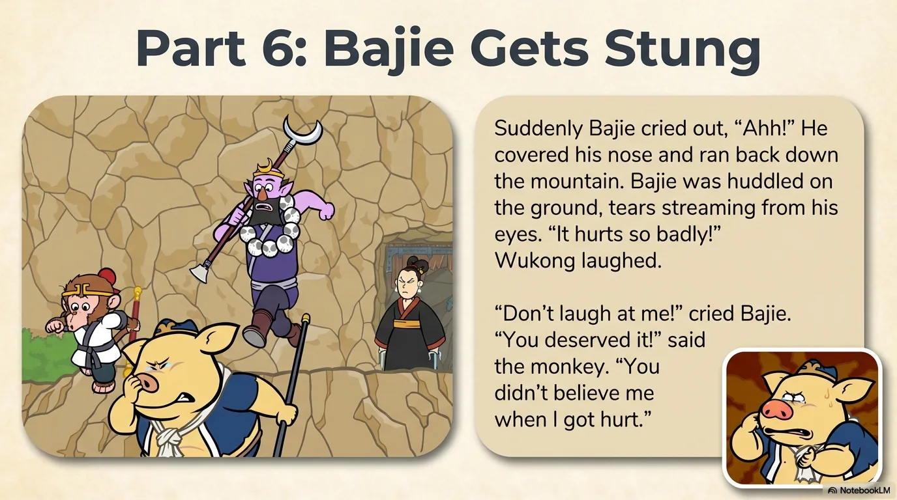

- 来源：`ppt/media/image12.png`（relationship `rId2`）
- 尺寸：1376×768
- 源 SHA-256：`0372e6f8f7d25a7d527380232667825a2b7e1923392a60d75efb06cc9ac30afc`
- 输出 SHA-256：`a9dae83a7c658ff6894f4b123609cdc1c73a0513ac01604952339471eb2f0753`
- 分类：unknown ｜ OCR：blocked ｜ 审核：unreviewed

## Slide 012

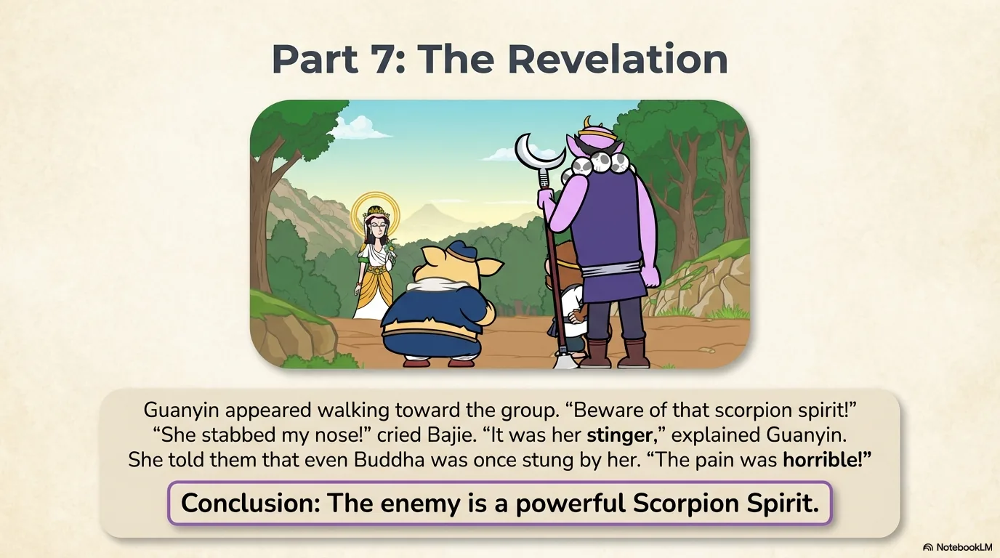

- 来源：`ppt/media/image13.png`（relationship `rId2`）
- 尺寸：1376×768
- 源 SHA-256：`357a6184045d72e01009ee37a149b84367cb108b39d4c0deae43dcd2214d29c3`
- 输出 SHA-256：`49d35cf8cffae847fd024fabf6f6d462a7c57c0ee38e38badc556756d5a16d94`
- 分类：unknown ｜ OCR：blocked ｜ 审核：unreviewed

## Slide 013

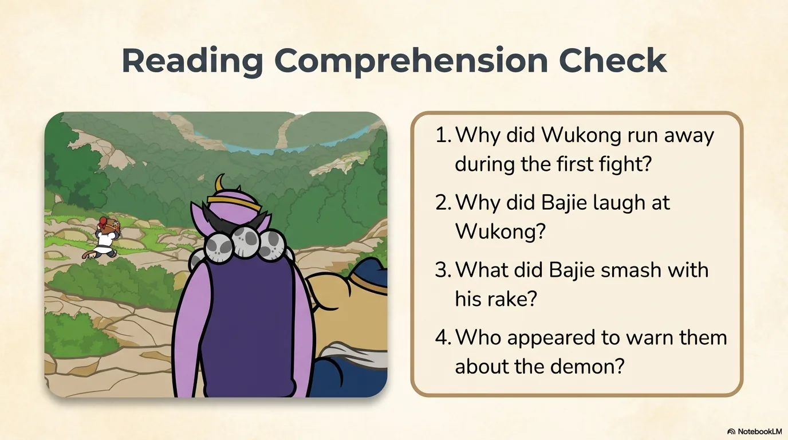

- 来源：`ppt/media/image14.png`（relationship `rId2`）
- 尺寸：1376×768
- 源 SHA-256：`0bda697f97dd3f7882e7e515062cf8387939cb00f573113b430582575522b118`
- 输出 SHA-256：`f8155041df595c60b8fc66f1215a38be3c5d557f24be1c4ae609f5c64dfebabb`
- 分类：unknown ｜ OCR：blocked ｜ 审核：unreviewed

## Slide 014

- 来源：`ppt/media/image15.png`（relationship `rId2`）
- 尺寸：1376×768
- 源 SHA-256：`cf7c1a1ef9e4471ac3364253c55f29869c57fe87ceb86a35026c4432c86d43bc`
- 输出 SHA-256：`2e0448c878b82727a2523647f96c381192d2a39dfde146e1c827ae963e9a9ffb`
- 分类：unknown ｜ OCR：blocked ｜ 审核：unreviewed

## Slide 015

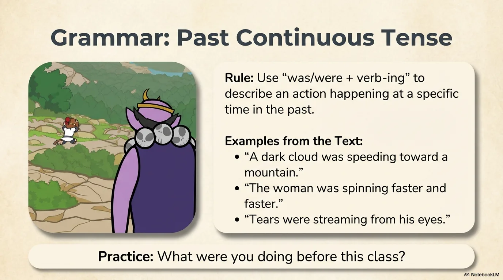

- 来源：`ppt/media/image16.png`（relationship `rId2`）
- 尺寸：1376×768
- 源 SHA-256：`93018ad2657bf1b2f630444b651fc6422db6bc6876664315ca00332d1427e424`
- 输出 SHA-256：`870e79f1e3187feb9cfc6480f2db7f9290f7e065dfca558aa06d5dfe7c3f9834`
- 分类：unknown ｜ OCR：blocked ｜ 审核：unreviewed

## Slide 016

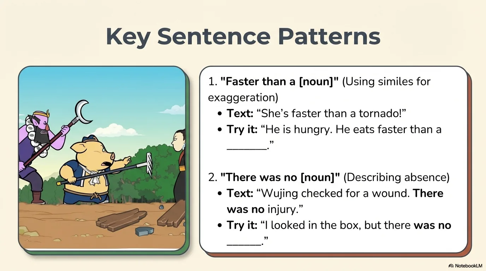

- 来源：`ppt/media/image17.png`（relationship `rId2`）
- 尺寸：1376×768
- 源 SHA-256：`c053bf3822a81fcfea01c344f25f4ef592867bab0fc3d7e22670a69de9951fdb`
- 输出 SHA-256：`fa54e79aee2dc44d53d02e381c5dea1f0c281286f6182b0c0b1e1f4db704ed64`
- 分类：unknown ｜ OCR：blocked ｜ 审核：unreviewed

## Slide 017

- 来源：`ppt/media/image18.png`（relationship `rId2`）
- 尺寸：1376×768
- 源 SHA-256：`7d1a5b08f72e433d04213d2b5bc6f69ebd51a3da0aab3536ea615c91bcbde398`
- 输出 SHA-256：`3477b9fa13c92005a5e040d2a82e4949fc7bbb50db4cdbf620bc38aec8555ade`
- 分类：unknown ｜ OCR：blocked ｜ 审核：unreviewed

## Slide 018

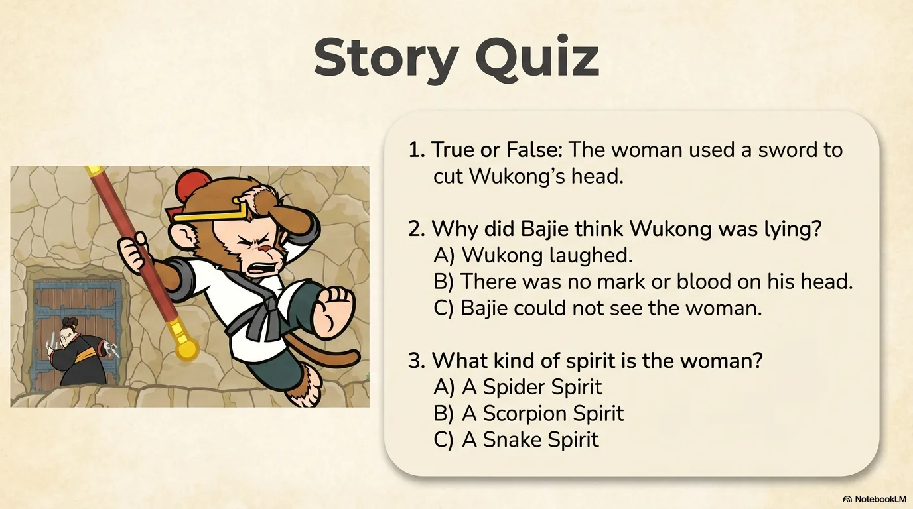

- 来源：`ppt/media/image19.png`（relationship `rId2`）
- 尺寸：1376×768
- 源 SHA-256：`7301f475d0f1767d4c3f1d0baea9466dab0e661492c2bab8a54d83dcfdc5e271`
- 输出 SHA-256：`d8e2f761794930e1c72822fe4c7bc8d5f1a8f2be27c048eb5ff329f4ed5bfccf`
- 分类：unknown ｜ OCR：blocked ｜ 审核：unreviewed

## Slide 019

- 来源：`ppt/media/image20.png`（relationship `rId2`）
- 尺寸：1376×768
- 源 SHA-256：`8a6c041563d74ec71bd8d90ce48eeffc0fdcf2333d994489eb0c9334d6e4b980`
- 输出 SHA-256：`a76da88fc69adf914bc94f3e72427ffdff2e728ee7ec423217827f97428cd275`
- 分类：unknown ｜ OCR：blocked ｜ 审核：unreviewed

## Slide 020

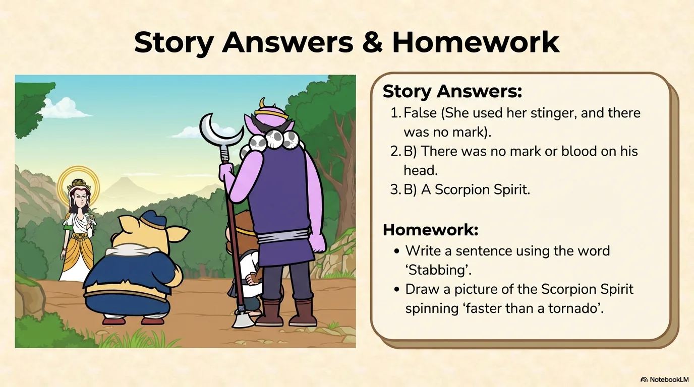

- 来源：`ppt/media/image21.png`（relationship `rId2`）
- 尺寸：1376×768
- 源 SHA-256：`39b949d50784e6706928ee2eceb905be25622141676763d43f5ba5675efea1f2`
- 输出 SHA-256：`eefdb672fd1bc7f22698bf4f7de124a5579240114aa3e9b22d6e9d6f367e5cce`
- 分类：unknown ｜ OCR：blocked ｜ 审核：unreviewed
