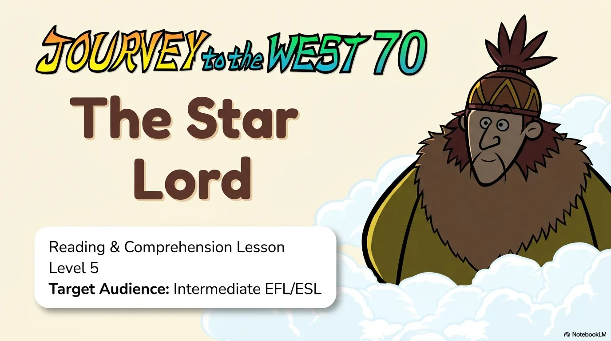
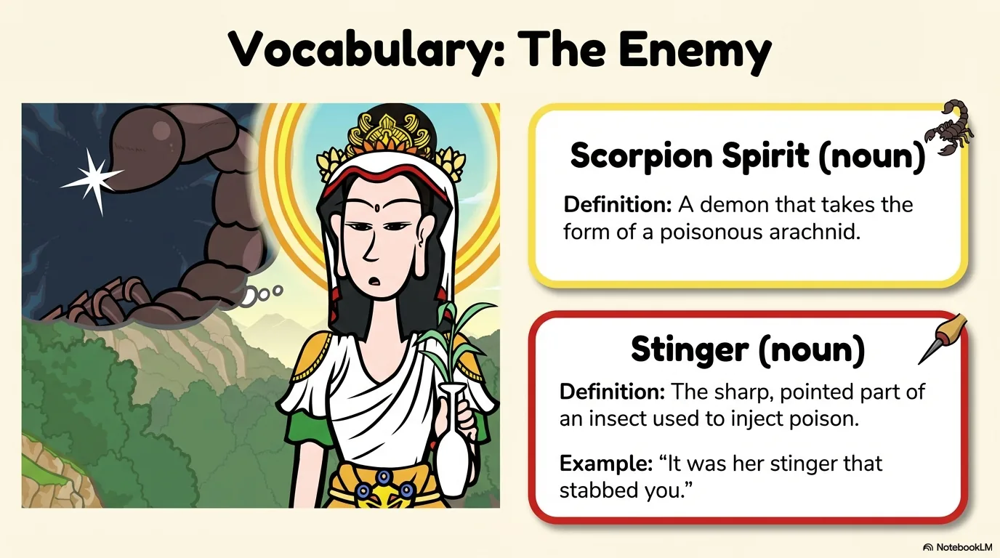
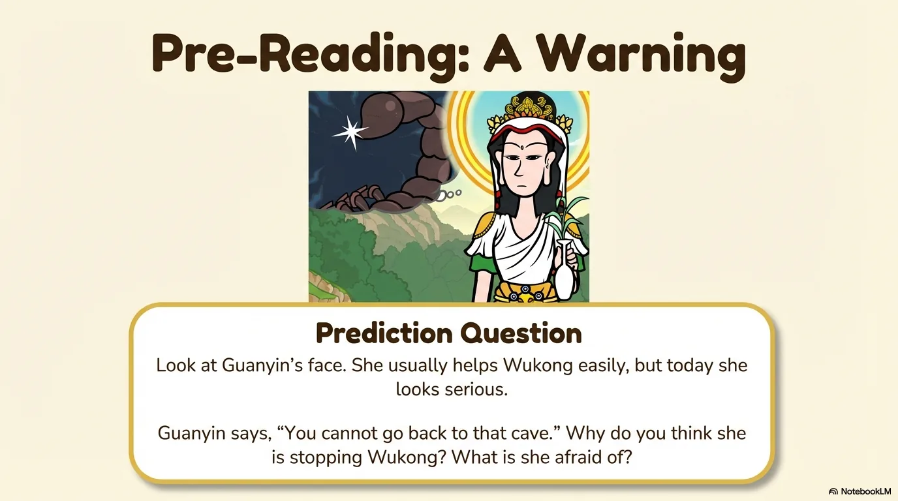
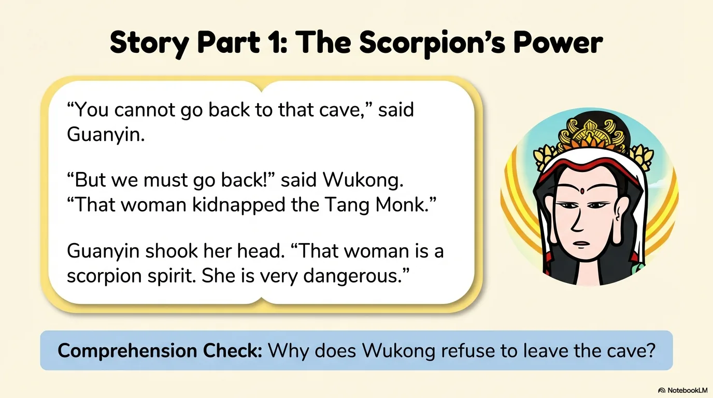
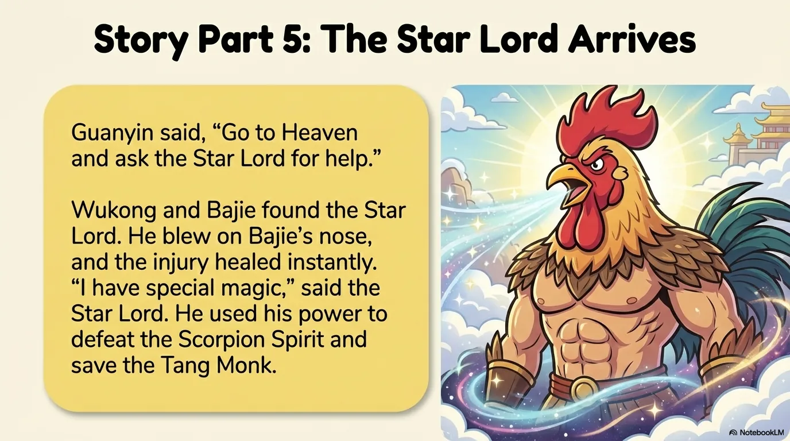
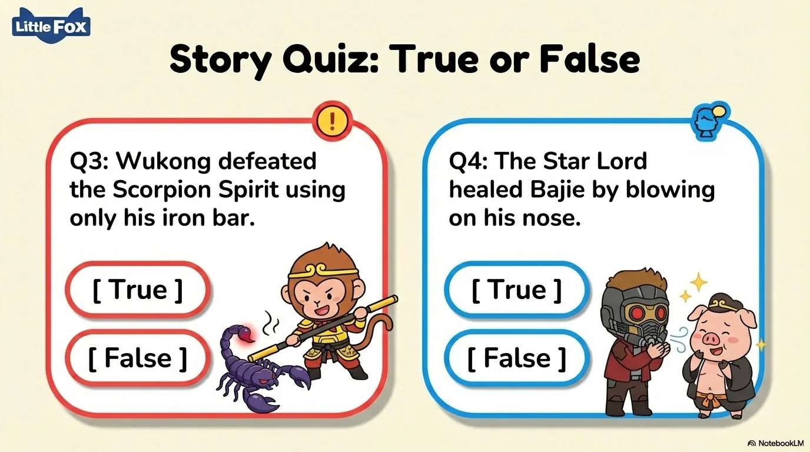

# 豆豆龙英语 · 第 70 集课件（EP070 草稿）

- 来源：`070_Journey to the West 70_The Star Lord.pptx`（主课件，20 页）
- OCR：`blocked`（no local OCR provider importable (pytesseract missing): No module named 'pytesseract'）
- 分类：待人工审核（unknown）
- 审核状态：`unreviewed`

## Slide 001

- 来源：`ppt/media/image1.png`（relationship `rId2`）
- 尺寸：1376×768
- 源 SHA-256：`5108c004c7ffd4604fdb32ff6d2247c6c3533373186365155e3bdf046f2b24d5`
- 输出 SHA-256：`a812b782671b860f650a2fbc36eda82426aa35b1b6dec19f01f344c1a8a159d0`
- 分类：unknown ｜ OCR：blocked ｜ 审核：unreviewed

## Slide 002

- 来源：`ppt/media/image3.png`（relationship `rId2`）
- 尺寸：1376×768
- 源 SHA-256：`a1b464be1e632460f9c4a64ae76a1f02c459e4a2ae261e53dec02139e8cf9554`
- 输出 SHA-256：`ab08cac84cbaf38fc138305ced0f6795803f2f1f5b6120c3cc92d736900ca5a1`
- 分类：unknown ｜ OCR：blocked ｜ 审核：unreviewed

## Slide 003

- 来源：`ppt/media/image4.png`（relationship `rId2`）
- 尺寸：1376×768
- 源 SHA-256：`6bab1f14692db44ba70786a95710a39f8602b220703dc5a9f22c95cadb8fd87d`
- 输出 SHA-256：`e44359c5f823a6dfa5b29ddfab93982ca56fa1dfeda842b80478d4587ce702cb`
- 分类：unknown ｜ OCR：blocked ｜ 审核：unreviewed

## Slide 004

- 来源：`ppt/media/image5.png`（relationship `rId2`）
- 尺寸：1376×768
- 源 SHA-256：`15caac9e015534562fc62898af7dddf78c24368c020980f6171f6e571fd646f0`
- 输出 SHA-256：`077354dd471061ce0c44f2a57e9f6dc291341192fffaae89410b4050a9b8c343`
- 分类：unknown ｜ OCR：blocked ｜ 审核：unreviewed

## Slide 005

- 来源：`ppt/media/image6.png`（relationship `rId2`）
- 尺寸：1376×768
- 源 SHA-256：`c72473e14f9d45fc0665ae303cb0a8e5be2a2b47f01999b6dab3489692042b55`
- 输出 SHA-256：`87ca3d51b8736db77d0376b4a5bc3f6e263fe347d5a85f62078cf67917a55906`
- 分类：unknown ｜ OCR：blocked ｜ 审核：unreviewed

## Slide 006

- 来源：`ppt/media/image7.png`（relationship `rId2`）
- 尺寸：1376×768
- 源 SHA-256：`c9d7fdb7ee600b9c44c1527f3a21c06301365481284fe05810c8a094724513d3`
- 输出 SHA-256：`2d8a0341b3070c5a358c67f1ddaed48f405a1207d4d852bc20539c218f483afe`
- 分类：unknown ｜ OCR：blocked ｜ 审核：unreviewed

## Slide 007

- 来源：`ppt/media/image8.png`（relationship `rId2`）
- 尺寸：1376×768
- 源 SHA-256：`7569468b6d984f3ebc2bcebc9638ffa30bb957c75ad46cf93c76a5467e05128e`
- 输出 SHA-256：`d5dfcb914b35f63a0ee996917ad65616489ed041f755f365d441f084f73f6d25`
- 分类：unknown ｜ OCR：blocked ｜ 审核：unreviewed

## Slide 008

- 来源：`ppt/media/image9.png`（relationship `rId2`）
- 尺寸：1376×768
- 源 SHA-256：`a46f2c8c7726fe1bc97bc742f9c39ebed212bb9b50bafbbd8281186600bcdd8d`
- 输出 SHA-256：`0e9b8fb031a88bb7c89da1b4e2188e9d8deda0c9d83b26862e465a160806a4d1`
- 分类：unknown ｜ OCR：blocked ｜ 审核：unreviewed

## Slide 009

- 来源：`ppt/media/image10.png`（relationship `rId2`）
- 尺寸：1376×768
- 源 SHA-256：`69bda660d29359313a0e0cc84db76fd3ac9581fa254a40d74c902a2ce9a6e530`
- 输出 SHA-256：`97a72f58c33a35b8d179ea21a74a656c93738d7f8276ed7dd09882fa26db86b6`
- 分类：unknown ｜ OCR：blocked ｜ 审核：unreviewed

## Slide 010

- 来源：`ppt/media/image11.png`（relationship `rId2`）
- 尺寸：1376×768
- 源 SHA-256：`291261f09e7c38c41a4cc47495d1b0919c0da7bd0a8cfd5820291eb33a2d55b6`
- 输出 SHA-256：`a61c1b5dad41dee39aaccda5480d48bd09aab00d52d249f78e9828cc13d22dfa`
- 分类：unknown ｜ OCR：blocked ｜ 审核：unreviewed

## Slide 011

- 来源：`ppt/media/image12.png`（relationship `rId2`）
- 尺寸：1376×768
- 源 SHA-256：`08e6423c93cc1d7b28f78ce9f22364cf0eca79a5b377081a546e58776a36969a`
- 输出 SHA-256：`460c55178e4228d19c5e7c36397d312fe91c2e26eaf7b571047ec94181f4a7a5`
- 分类：unknown ｜ OCR：blocked ｜ 审核：unreviewed

## Slide 012

- 来源：`ppt/media/image13.png`（relationship `rId2`）
- 尺寸：1376×768
- 源 SHA-256：`26aa51238612661146dcfeeb355b1e9a3973bc5bcbd3c8fc93362ae183a5fe79`
- 输出 SHA-256：`64eac6f7a9564346182ea4a6cb182b00e2f8439efd4865ac184e83b5ef56bb2c`
- 分类：unknown ｜ OCR：blocked ｜ 审核：unreviewed

## Slide 013

- 来源：`ppt/media/image14.png`（relationship `rId2`）
- 尺寸：1376×768
- 源 SHA-256：`5ac042c94de3e0a387d98b86c09db42552f8129233c4242ef05e5c4c2c768c45`
- 输出 SHA-256：`21d81d9192f4290264c770e399cdf0472dae87703bdd488daf382e8853761427`
- 分类：unknown ｜ OCR：blocked ｜ 审核：unreviewed

## Slide 014

- 来源：`ppt/media/image15.png`（relationship `rId2`）
- 尺寸：1376×768
- 源 SHA-256：`ddf77275c1ba5394e5ceabbbf2efe7c4ae724f7963a3db46c85861ece5260cb8`
- 输出 SHA-256：`efd98e1ba11875a3cbde18762566a1dd4f0c86fde8d8e1d22c04657aa0f3fbf5`
- 分类：unknown ｜ OCR：blocked ｜ 审核：unreviewed

## Slide 015

- 来源：`ppt/media/image16.png`（relationship `rId2`）
- 尺寸：1376×768
- 源 SHA-256：`9701ceef272dc377cb8b543e7abb6bc696b1f12c3609b9620b3a2ff0ac8f25fc`
- 输出 SHA-256：`995b5f7898c96f305b1fcf8151ee63a23207f87da83bcc54511b8c7ac725cd6c`
- 分类：unknown ｜ OCR：blocked ｜ 审核：unreviewed

## Slide 016

- 来源：`ppt/media/image17.png`（relationship `rId2`）
- 尺寸：1376×768
- 源 SHA-256：`8baea25c5f712f017a23cccaada1277e75943f18d3422cef7188450aff2892b0`
- 输出 SHA-256：`e5d8c8c35704eea221410d61e170f83a0e394520270d625528b886b6501293e0`
- 分类：unknown ｜ OCR：blocked ｜ 审核：unreviewed

## Slide 017

- 来源：`ppt/media/image18.png`（relationship `rId2`）
- 尺寸：1376×768
- 源 SHA-256：`c577eff8cede5b409f9641292c250f614bb3c572ae57b4897d82efb79e05ebaf`
- 输出 SHA-256：`3cbca2d57d9f833e61fb2f2977091f0bdd903235a03b05e6cd14af3159950505`
- 分类：unknown ｜ OCR：blocked ｜ 审核：unreviewed

## Slide 018

- 来源：`ppt/media/image19.png`（relationship `rId2`）
- 尺寸：1376×768
- 源 SHA-256：`054a24a79f715d84ffa49e27ab650273e01e17d2a64c9ba25eba0a1522b2ba1e`
- 输出 SHA-256：`afed0c3982642dbcdffe7d964719623ad71833dc025e3da846c3afd2a2e7939d`
- 分类：unknown ｜ OCR：blocked ｜ 审核：unreviewed

## Slide 019

- 来源：`ppt/media/image20.png`（relationship `rId2`）
- 尺寸：1376×768
- 源 SHA-256：`0c2e2fc1ed720b4d3ae4c6934ade3e3b009e0c9d381dd4d1088993becd77f5ff`
- 输出 SHA-256：`7265811f42eb44d7436739d6aa4ec74e5cdbdda1288f5f8719123d7838bb2d72`
- 分类：unknown ｜ OCR：blocked ｜ 审核：unreviewed

## Slide 020

- 来源：`ppt/media/image21.png`（relationship `rId2`）
- 尺寸：1376×768
- 源 SHA-256：`6cf013ba1d9b3e664b361c65cdba91a135c957f1003edc67b21317ed3aed37c7`
- 输出 SHA-256：`607804c837f853057897156ccca12e2a0c92017d8ca0bffa6acf981f90b398c4`
- 分类：unknown ｜ OCR：blocked ｜ 审核：unreviewed
