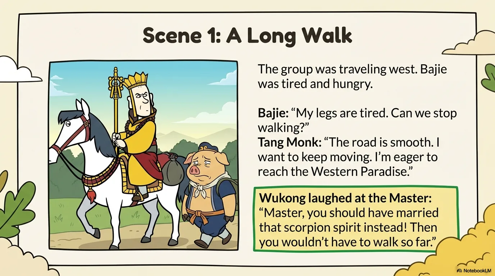
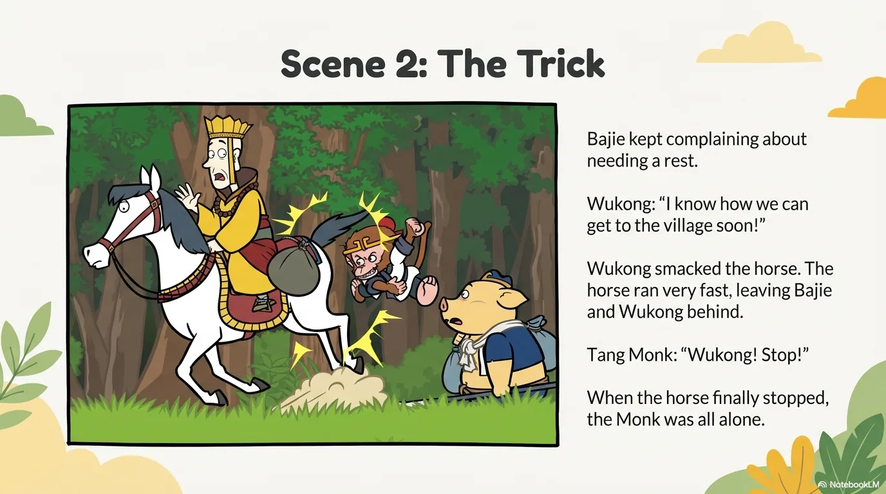
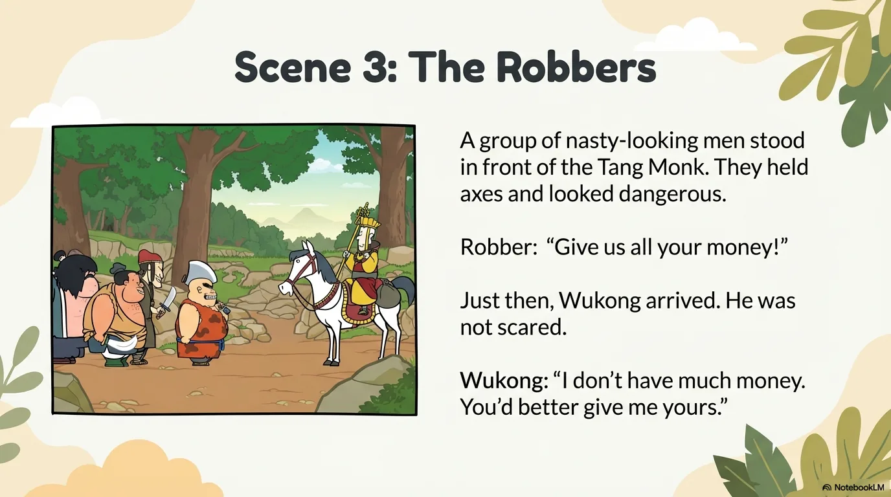
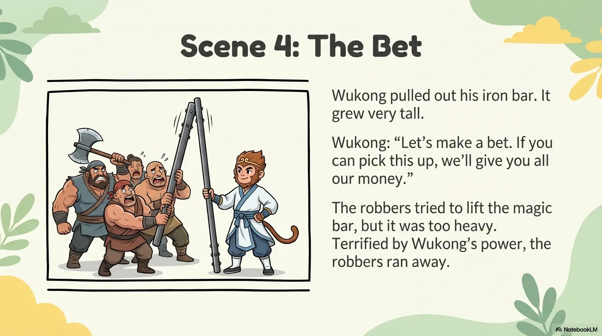
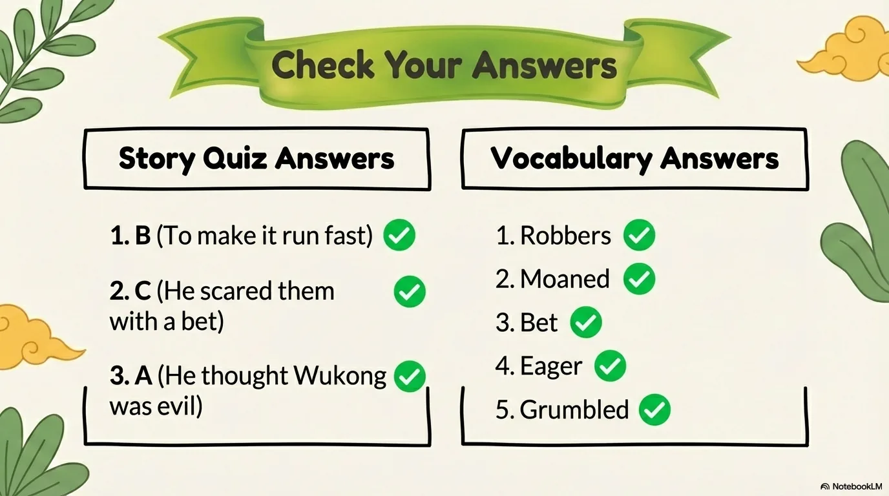

# 豆豆龙英语 · 第 71 集课件（EP071 草稿）

- 来源：`071_Journey to the West 71_Money.pptx`（主课件，17 页）
- OCR：`blocked`（no local OCR provider importable (pytesseract missing): No module named 'pytesseract'）
- 分类：待人工审核（unknown）
- 审核状态：`unreviewed`

## Slide 001

- 来源：`ppt/media/image1.png`（relationship `rId2`）
- 尺寸：1376×768
- 源 SHA-256：`ebb8853331676096100cbb6382697fdcfe6b1117b3d2b307689c5256fd8a1e76`
- 输出 SHA-256：`9bf882bb9acfa70d4b7952ed089fd2697146149bdb73e049586e920585c38193`
- 分类：unknown ｜ OCR：blocked ｜ 审核：unreviewed

## Slide 002

- 来源：`ppt/media/image3.png`（relationship `rId2`）
- 尺寸：1376×768
- 源 SHA-256：`f8445065ab474ccf61379c81b70268636b9f8b78121d38c6b5d67dd9937cdc0c`
- 输出 SHA-256：`534590e83dedbcf15d71b9a8df1cc48fac4330b27971ff7e2c15b0b501bbecaf`
- 分类：unknown ｜ OCR：blocked ｜ 审核：unreviewed

## Slide 003

- 来源：`ppt/media/image4.png`（relationship `rId2`）
- 尺寸：1376×768
- 源 SHA-256：`b64a3718570264f3c54c6dc39e624e00114c161b928144dbf36138e85220e483`
- 输出 SHA-256：`ec845229497809d223be3a4f420b25629d7c74b72e06dd5f538b33884183ded9`
- 分类：unknown ｜ OCR：blocked ｜ 审核：unreviewed

## Slide 004

- 来源：`ppt/media/image5.png`（relationship `rId2`）
- 尺寸：1376×768
- 源 SHA-256：`79369dafd74beac9cf204fb79bb75977be512b19f00ebc730c94d0910c4d89af`
- 输出 SHA-256：`e35941dc9ae79e120816fee4ec3c2d4732086a36f2ab2323ec1384c896089f7c`
- 分类：unknown ｜ OCR：blocked ｜ 审核：unreviewed

## Slide 005

- 来源：`ppt/media/image6.png`（relationship `rId2`）
- 尺寸：1376×768
- 源 SHA-256：`296094fc690916bc1b6ec380d8437ad4746c401a0871ca1064859f093d15804a`
- 输出 SHA-256：`b36668a05f5af9a48634c004a7101c9b8e05b2febfc7fb08567907b07e466bb7`
- 分类：unknown ｜ OCR：blocked ｜ 审核：unreviewed

## Slide 006

- 来源：`ppt/media/image7.png`（relationship `rId2`）
- 尺寸：1376×768
- 源 SHA-256：`a136ebe613af94a4123db51d9b24282c7235e8345d2587f5e519e034eb5293d8`
- 输出 SHA-256：`8f92521962a6763d7efef65ff32d14aed3b3797b845085662154d058afae388b`
- 分类：unknown ｜ OCR：blocked ｜ 审核：unreviewed

## Slide 007

- 来源：`ppt/media/image8.png`（relationship `rId2`）
- 尺寸：1376×768
- 源 SHA-256：`b90d4c635897a21956059b15c9804a57cbe4e8675cbb783ce13a75c0f221a96c`
- 输出 SHA-256：`96dddc55cbde51a3be7fa8181732c509fefa9c9f3803e5287e3dd57a4526c02a`
- 分类：unknown ｜ OCR：blocked ｜ 审核：unreviewed

## Slide 008

- 来源：`ppt/media/image9.png`（relationship `rId2`）
- 尺寸：1376×768
- 源 SHA-256：`4dc71ffcb5d5c4dc35c22f4a5d80c1f365726db3e1ff701e7600c283372ddfe8`
- 输出 SHA-256：`9f9a70512b3dfc73349bb0cf3df639c252bb06574d40f41826dceecf18414c26`
- 分类：unknown ｜ OCR：blocked ｜ 审核：unreviewed

## Slide 009

- 来源：`ppt/media/image10.png`（relationship `rId2`）
- 尺寸：1376×768
- 源 SHA-256：`29043cdd5b1b9b23d17001060408029f715141bc69be839527d70aeae3f125c0`
- 输出 SHA-256：`6f85852f78e5ac52b7cfd0a5286bad0df625ab08f4e6f6f2367dd1930bb1b602`
- 分类：unknown ｜ OCR：blocked ｜ 审核：unreviewed

## Slide 010

- 来源：`ppt/media/image11.png`（relationship `rId2`）
- 尺寸：1376×768
- 源 SHA-256：`84e016b79e271bba85fe6885980b5e0519914240f3c149eb8c17091dc597afcd`
- 输出 SHA-256：`38c414dcfa29da1995e9d2511b736345289497d2c3e0b2b32345e3761f1da743`
- 分类：unknown ｜ OCR：blocked ｜ 审核：unreviewed

## Slide 011

- 来源：`ppt/media/image12.png`（relationship `rId2`）
- 尺寸：1376×768
- 源 SHA-256：`916a66ded4e62adaef75cacfd835fd62d53cc8d847a6b275c57e045b7631689e`
- 输出 SHA-256：`0cc221dbbc577296893e33b5c201190d7cc809ee99ce3dc74a58964f62475978`
- 分类：unknown ｜ OCR：blocked ｜ 审核：unreviewed

## Slide 012

- 来源：`ppt/media/image13.png`（relationship `rId2`）
- 尺寸：1376×768
- 源 SHA-256：`9c14228704f0025f8cece2a8aeb907a8a53bb04ed3d737b31e522be56e43eae6`
- 输出 SHA-256：`50be04ce4ad61bd7b0fc0dcc8ed1e1fd826908acf52aa40a3dae2a830d5b24f6`
- 分类：unknown ｜ OCR：blocked ｜ 审核：unreviewed

## Slide 013

- 来源：`ppt/media/image14.png`（relationship `rId2`）
- 尺寸：1376×768
- 源 SHA-256：`1e6f30ca422c8b83a0ec4c060d14b406a02eedc219725e8c2eea729c57d7e6cb`
- 输出 SHA-256：`5b369516d69bdca0873251ee7c04e7c0c6a4dae20be527352df3c42d2d9456af`
- 分类：unknown ｜ OCR：blocked ｜ 审核：unreviewed

## Slide 014

- 来源：`ppt/media/image15.png`（relationship `rId2`）
- 尺寸：1376×768
- 源 SHA-256：`e5d6ee90ab87cafda4aec8e4f8e776d6e0c003ff1f7562b8d836c03423d204aa`
- 输出 SHA-256：`840310bb4fa56e74a5de0f34f621ab732c5981fc6056c1331f2e87d8d3fe9175`
- 分类：unknown ｜ OCR：blocked ｜ 审核：unreviewed

## Slide 015

- 来源：`ppt/media/image16.png`（relationship `rId2`）
- 尺寸：1376×768
- 源 SHA-256：`87ae13ea7ef391d95ec4fd17957ee3a02f6f79dfd9eb80a61a7d475bb5dab5be`
- 输出 SHA-256：`e285910a8d70a57aa1dbdf622c9ebe190ed492c6a25275c6f9f26c66c0d0c585`
- 分类：unknown ｜ OCR：blocked ｜ 审核：unreviewed

## Slide 016

- 来源：`ppt/media/image17.png`（relationship `rId2`）
- 尺寸：1376×768
- 源 SHA-256：`4c03e0fdbe40a397dd21cf975ac0fbebdd2a6428778857b31ea367e2f32ece8f`
- 输出 SHA-256：`2867ceee11c71dd88a34b38ef649b9d557f5b0ba4ad22ff77291062b1d9f1674`
- 分类：unknown ｜ OCR：blocked ｜ 审核：unreviewed

## Slide 017

- 来源：`ppt/media/image18.png`（relationship `rId2`）
- 尺寸：1376×768
- 源 SHA-256：`450a331fe9e188d22119b1d68c8e9ec411ba6659a818697f8000fc0c9a1a3bd8`
- 输出 SHA-256：`7336941ac37a17a34eeed2cb4ab20b17b7ebf52892c68756ff211cef2a38dae8`
- 分类：unknown ｜ OCR：blocked ｜ 审核：unreviewed
