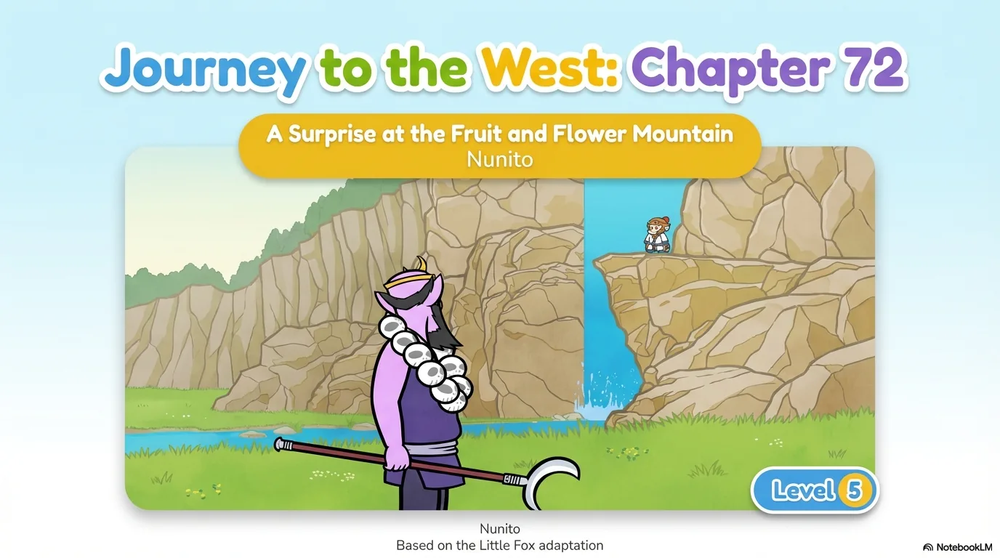
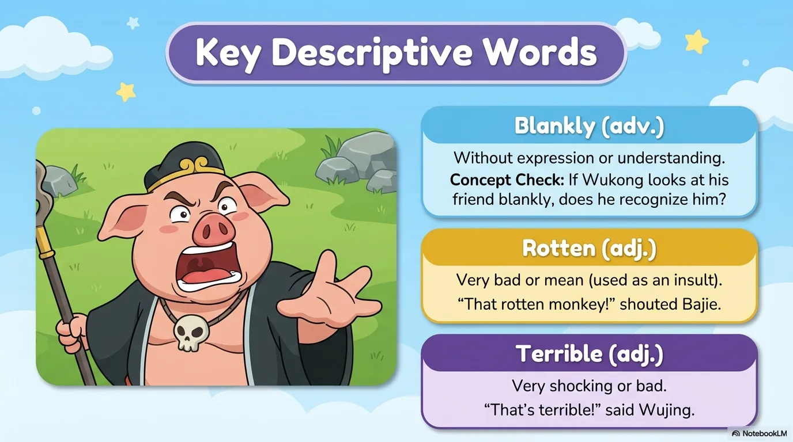
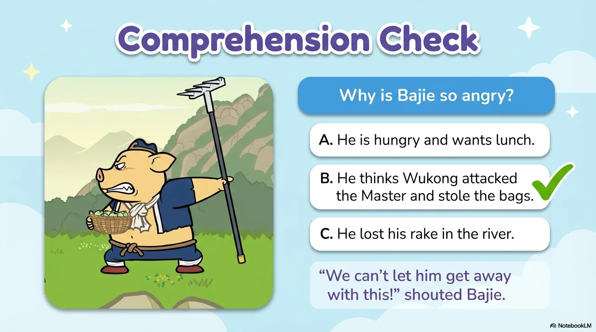
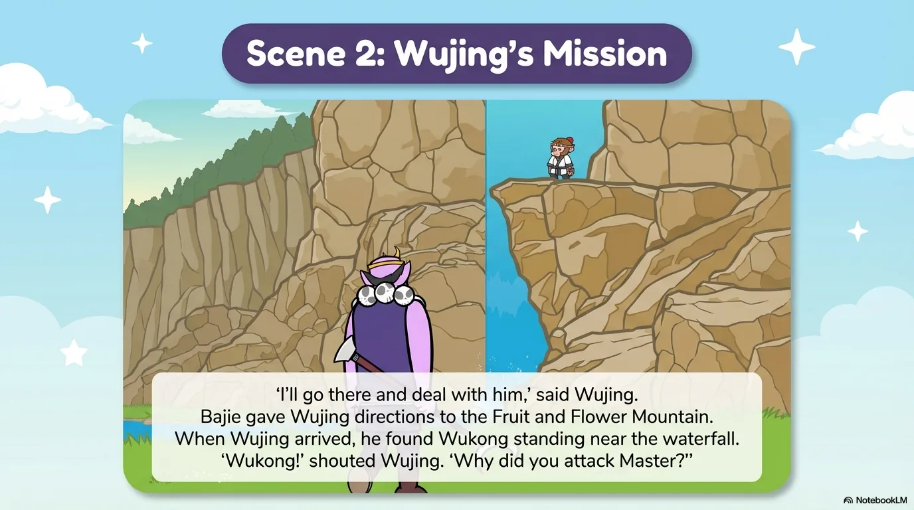
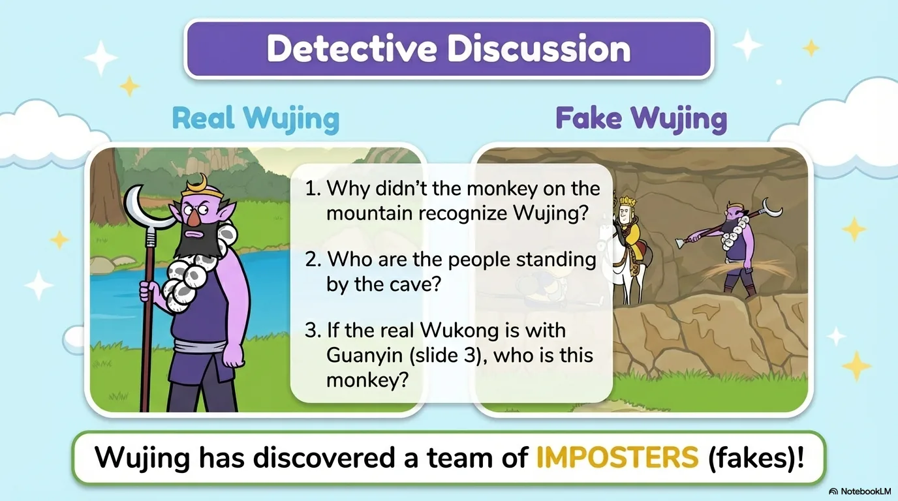
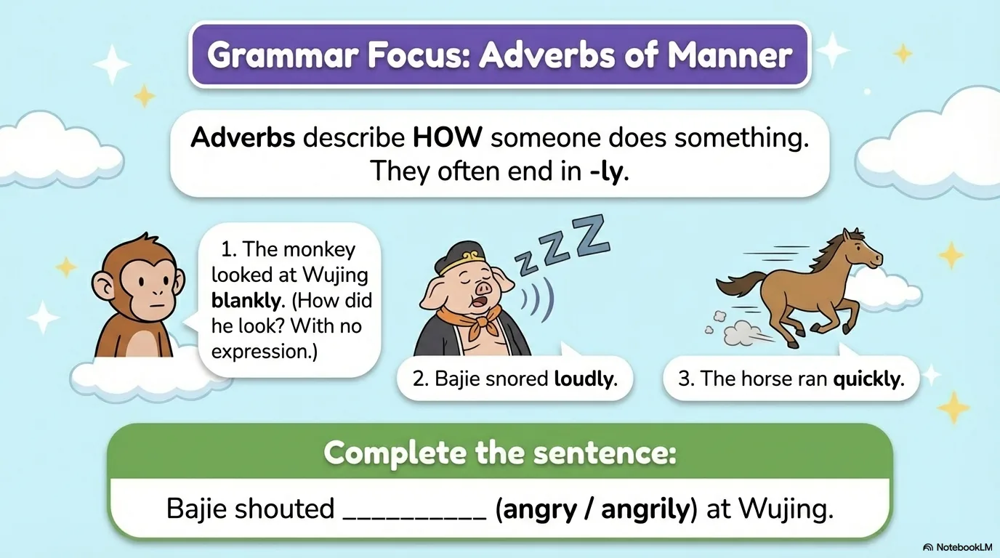
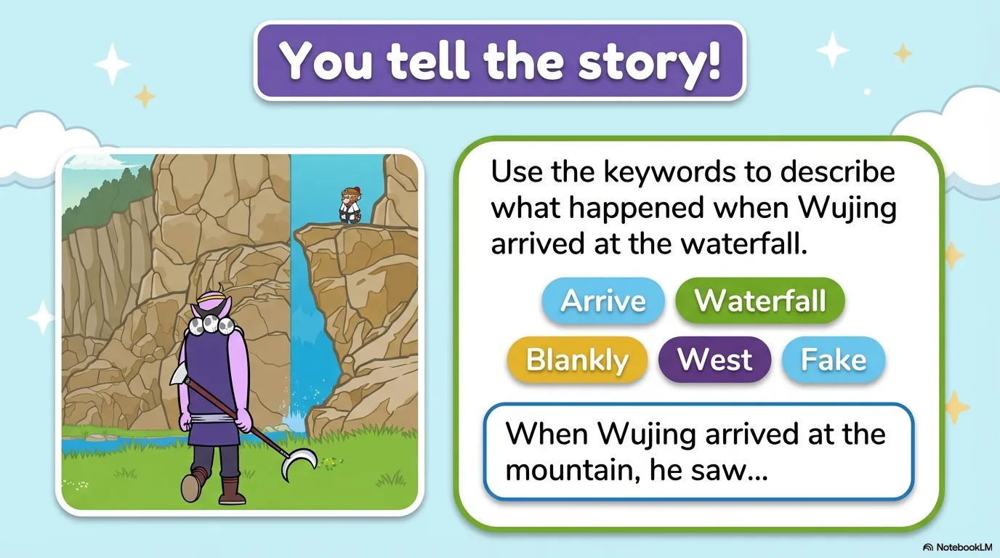

# 豆豆龙英语 · 第 72 集课件（EP072 草稿）

- 来源：`072_Journey to the West 72_A Surprise at the Fruit and Flower Mountain.pptx`（主课件，20 页）
- OCR：`blocked`（no local OCR provider importable (pytesseract missing): No module named 'pytesseract'）
- 分类：待人工审核（unknown）
- 审核状态：`unreviewed`

## Slide 001

- 来源：`ppt/media/image1.png`（relationship `rId2`）
- 尺寸：1376×768
- 源 SHA-256：`789b8016b71013d1e95cb86cc9bcf55d64999d0b39371b2f221c6e002008f151`
- 输出 SHA-256：`646a9db4f85bdd8705c1a75059615433d8c382abc3a4456ffb29b6c6c8f6b339`
- 分类：unknown ｜ OCR：blocked ｜ 审核：unreviewed

## Slide 002

- 来源：`ppt/media/image3.png`（relationship `rId2`）
- 尺寸：1376×768
- 源 SHA-256：`d0fe3261a35af6d931d4e7b0fb884fb342e396fe214e7ed19f695195f86c4fde`
- 输出 SHA-256：`d627f75a8614b5500eb5dc6d2cd6cddc2b3b23490df65dd9b1e328991400e56e`
- 分类：unknown ｜ OCR：blocked ｜ 审核：unreviewed

## Slide 003

- 来源：`ppt/media/image4.png`（relationship `rId2`）
- 尺寸：1376×768
- 源 SHA-256：`8dec1ea3a013d0807530d08f7e153980315c9576aea7e8269d4165b99d4ee5d0`
- 输出 SHA-256：`711fd6cb0107b936e9fef3a7d0a468b028739552b061bb4a6ec7a65d812c2de3`
- 分类：unknown ｜ OCR：blocked ｜ 审核：unreviewed

## Slide 004

- 来源：`ppt/media/image5.png`（relationship `rId2`）
- 尺寸：1376×768
- 源 SHA-256：`5d8f9209678c00e568443c88f472bbf7aad948dffbd4c56e521a8df8e98e0044`
- 输出 SHA-256：`bda1ece7ce3f86b90607deee7d7784381fe8e029c39f9acdc885817a12c40b8c`
- 分类：unknown ｜ OCR：blocked ｜ 审核：unreviewed

## Slide 005

- 来源：`ppt/media/image6.png`（relationship `rId2`）
- 尺寸：1376×768
- 源 SHA-256：`e962e9bf71ed89574a5addb1115fc24b7b0e1955a6ef76856250bf43d30f64c5`
- 输出 SHA-256：`709dd6030544a37c0c10835a023f3a98adbff632273229b6dfe99cf7bb7a7eee`
- 分类：unknown ｜ OCR：blocked ｜ 审核：unreviewed

## Slide 006

- 来源：`ppt/media/image7.png`（relationship `rId2`）
- 尺寸：1376×768
- 源 SHA-256：`72145dd1b447e7f93ec65252cbfa5ca8fdfc3f329ae9781b6dc8fc73cccaa5af`
- 输出 SHA-256：`26e49ef40396cb2345de5848abe7409101b92fec5ae728df1ec052b3187554a3`
- 分类：unknown ｜ OCR：blocked ｜ 审核：unreviewed

## Slide 007

- 来源：`ppt/media/image8.png`（relationship `rId2`）
- 尺寸：1376×768
- 源 SHA-256：`ab1f8fef191f9a364233ef1158f237036d7220652d2ce40565bdb24f9c0825d8`
- 输出 SHA-256：`2b07f59bc475a507f28e270ede6018fb5e913f30e57e1f03f54ec110319d5ced`
- 分类：unknown ｜ OCR：blocked ｜ 审核：unreviewed

## Slide 008

- 来源：`ppt/media/image9.png`（relationship `rId2`）
- 尺寸：1376×768
- 源 SHA-256：`203d49530659c604dd58a0bc89d6acb04d1e88932107dd409c5d2d76e7c618f0`
- 输出 SHA-256：`7a9c3b87c3de41f7d323e73c2f1ac970e9b66121785ded31d76a46628e443306`
- 分类：unknown ｜ OCR：blocked ｜ 审核：unreviewed

## Slide 009

- 来源：`ppt/media/image10.png`（relationship `rId2`）
- 尺寸：1376×768
- 源 SHA-256：`92809a3e7df86fe436639d67955874750e0bf2af2fbf036bd6d7f3d69e05860c`
- 输出 SHA-256：`90aa1e0e568af6e170761490d253e114f680d3e3c954c9a952d0414973199b06`
- 分类：unknown ｜ OCR：blocked ｜ 审核：unreviewed

## Slide 010

- 来源：`ppt/media/image11.png`（relationship `rId2`）
- 尺寸：1376×768
- 源 SHA-256：`25724729a0446f5f0d63fca67ce96a4357d46f1df1a91868449328d5d9ad14f6`
- 输出 SHA-256：`9201b57ef478f552b8b364d400860609bd05aaefa91078ea8ab552c2548ed717`
- 分类：unknown ｜ OCR：blocked ｜ 审核：unreviewed

## Slide 011

- 来源：`ppt/media/image12.png`（relationship `rId2`）
- 尺寸：1376×768
- 源 SHA-256：`1cd05ab837e52ae6514d5520efba4aa2324855c4cfa793f8567c6c65f3ea1299`
- 输出 SHA-256：`2bd7503cc2f59de7174ba8653c0457b1c1fd258e51f2905386ddbe278765efee`
- 分类：unknown ｜ OCR：blocked ｜ 审核：unreviewed

## Slide 012

- 来源：`ppt/media/image13.png`（relationship `rId2`）
- 尺寸：1376×768
- 源 SHA-256：`584ce425f0050bacd36032e40968c9205ea3dd21ab295d74b7711382de96ab2e`
- 输出 SHA-256：`050849ae740bb94afbd8eb0b296f76d7d6dfaf384c35829d66c278293165befd`
- 分类：unknown ｜ OCR：blocked ｜ 审核：unreviewed

## Slide 013

- 来源：`ppt/media/image14.png`（relationship `rId2`）
- 尺寸：1376×768
- 源 SHA-256：`1bd42a14f5b0f1e84f1cfb0f8aa7556f8e27e707fff1ce3b480303feaee76fd7`
- 输出 SHA-256：`5108b033f2d8e887a98500a94eb07e36ba347cbbbc5db406585569183a6cf9a4`
- 分类：unknown ｜ OCR：blocked ｜ 审核：unreviewed

## Slide 014

- 来源：`ppt/media/image15.png`（relationship `rId2`）
- 尺寸：1376×768
- 源 SHA-256：`d1c8face73644ca9ce5a5fc7f1db237099a7be871c5072c8a87a4d0446fe190f`
- 输出 SHA-256：`a1165cfc730a8b31f7225518af4bccb7391d2e927d63360b3e69b0001cab0bfa`
- 分类：unknown ｜ OCR：blocked ｜ 审核：unreviewed

## Slide 015

- 来源：`ppt/media/image16.png`（relationship `rId2`）
- 尺寸：1376×768
- 源 SHA-256：`f34368c7224865194ca62069520beabc3bddd46724ce3a49736b80225f8f1603`
- 输出 SHA-256：`10823806d71e7a5c23d802982ffbc3252998bf5bee7d0c2c8d12d5885ae32c97`
- 分类：unknown ｜ OCR：blocked ｜ 审核：unreviewed

## Slide 016

- 来源：`ppt/media/image17.png`（relationship `rId2`）
- 尺寸：1376×768
- 源 SHA-256：`0ac2e993085b08cc58326af455fa826a02ad2bd9e670917d723151ceb2428da4`
- 输出 SHA-256：`1880982f9761ddb9ea914a40b45f7e6dbd9c358edba36681dbfd75a11e9e76a4`
- 分类：unknown ｜ OCR：blocked ｜ 审核：unreviewed

## Slide 017

- 来源：`ppt/media/image18.png`（relationship `rId2`）
- 尺寸：1376×768
- 源 SHA-256：`3986a219c80fe070af77ff804b95c089065fcc52348a29affbd8f4ee6566d6fc`
- 输出 SHA-256：`2d5c384f1a55f01df55ddf58d744b4fe11e1c50253ce52d21354c7352318e60b`
- 分类：unknown ｜ OCR：blocked ｜ 审核：unreviewed

## Slide 018

- 来源：`ppt/media/image19.png`（relationship `rId2`）
- 尺寸：1376×768
- 源 SHA-256：`a8ec30a0dc58e9a64d395d5b93ca944f00af463cf97900f85121a760d00c39ac`
- 输出 SHA-256：`e697267a633734f88c15a5da533f61fddd7b23d4bb90b94d23541f5b27b390ee`
- 分类：unknown ｜ OCR：blocked ｜ 审核：unreviewed

## Slide 019

- 来源：`ppt/media/image20.png`（relationship `rId2`）
- 尺寸：1376×768
- 源 SHA-256：`3dabb5ad1871a5c7f84315a2853d88bcfae1d971b3a83278313fe37d282e0c9e`
- 输出 SHA-256：`615b4ee66df03b77dd806a07b9840c14228c1edc8e19c83a0d4e6c8471d7933c`
- 分类：unknown ｜ OCR：blocked ｜ 审核：unreviewed

## Slide 020

- 来源：`ppt/media/image21.png`（relationship `rId2`）
- 尺寸：1376×768
- 源 SHA-256：`872b861e79c62b7a84382e418a6d2c1504d5109357b01c7c9c32b34ae7c9eaac`
- 输出 SHA-256：`e5370757021298d97120c39c338da9a6c55971590a3dc7878c173464fd31a8f2`
- 分类：unknown ｜ OCR：blocked ｜ 审核：unreviewed
