# 豆豆龙英语 · 第 73 集课件（EP073 草稿）

- 来源：`073_Journey to the West 73_Two Wukongs.pptx`（主课件，20 页）
- OCR：`blocked`（no local OCR provider importable (pytesseract missing): No module named 'pytesseract'）
- 分类：待人工审核（unknown）
- 审核状态：`unreviewed`

## Slide 001

- 来源：`ppt/media/image1.png`（relationship `rId2`）
- 尺寸：1376×768
- 源 SHA-256：`844f757b10ea7343fcd62f98e77d6aedfdd459cb38c9e701804e6216b9cfadb7`
- 输出 SHA-256：`604564ead82dd956123ab049a404fcb47ed9e33e53f079664802fd7eb61ac160`
- 分类：unknown ｜ OCR：blocked ｜ 审核：unreviewed

## Slide 002

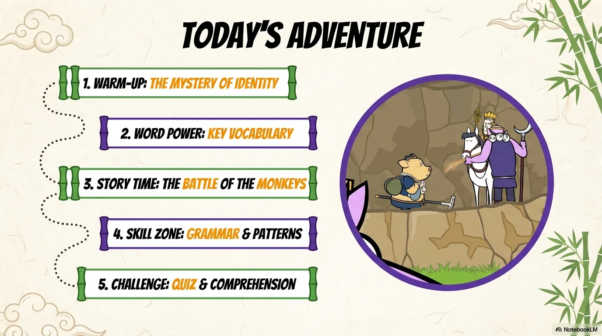

- 来源：`ppt/media/image3.png`（relationship `rId2`）
- 尺寸：1376×768
- 源 SHA-256：`688286058e5a24006f5d111cdaabb339887568cdbdf7aa2c452995a0064a5b69`
- 输出 SHA-256：`0f6fefc123e411d37db8253809a28486398d67ac930b1a0d4d8912010b9f1082`
- 分类：unknown ｜ OCR：blocked ｜ 审核：unreviewed

## Slide 003

- 来源：`ppt/media/image4.png`（relationship `rId2`）
- 尺寸：1376×768
- 源 SHA-256：`a823d61875e86efa296d8628b7f8ba6bf5c29e83ccd988cc453a6c23913f9383`
- 输出 SHA-256：`cff214bcf228dc11cc70d86f09bc97a3fddb065df4c94b057ce93a438b08bf8a`
- 分类：unknown ｜ OCR：blocked ｜ 审核：unreviewed

## Slide 004

- 来源：`ppt/media/image5.png`（relationship `rId2`）
- 尺寸：1376×768
- 源 SHA-256：`3635266ecabf0f32763640e8673ee0d043a24043f94c1c171f0c442860ba3131`
- 输出 SHA-256：`e0a0260b667c762177aa63da734f5dcb235cc66507297855827c42a4c1dae7cf`
- 分类：unknown ｜ OCR：blocked ｜ 审核：unreviewed

## Slide 005

- 来源：`ppt/media/image6.png`（relationship `rId2`）
- 尺寸：1376×768
- 源 SHA-256：`43808257764c5382e78f46738e38d82165228760d356810a6384199a2b70bc03`
- 输出 SHA-256：`484992a5164e433c76832102c4e216e6e0b0fd01d1350ddfb1ae9310c91e746b`
- 分类：unknown ｜ OCR：blocked ｜ 审核：unreviewed

## Slide 006

- 来源：`ppt/media/image7.png`（relationship `rId2`）
- 尺寸：1376×768
- 源 SHA-256：`af5c334bf9d12979e69cd953b437b90ad1597935f10e3bee7e8d9cb48bf43269`
- 输出 SHA-256：`dfb1ee54bcc65da9dce3cd8f7f7cd3ca3f5c80a3b0b8c04b0e14aa8a6a5c7d67`
- 分类：unknown ｜ OCR：blocked ｜ 审核：unreviewed

## Slide 007

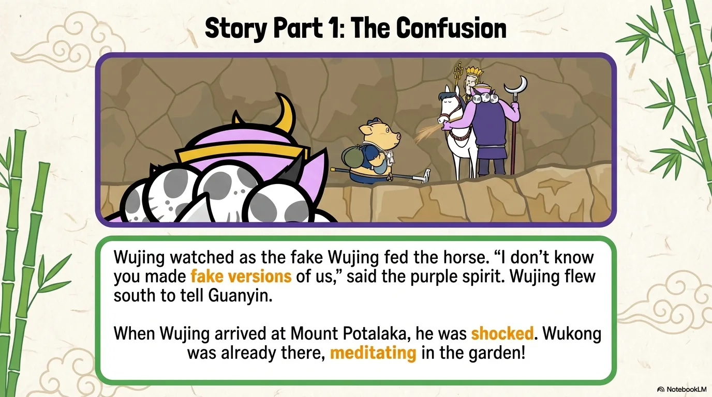

- 来源：`ppt/media/image8.png`（relationship `rId2`）
- 尺寸：1376×768
- 源 SHA-256：`2322667685f8d14488fbe6e7f26087d9b16602d3fbe6d07eb64160511b807188`
- 输出 SHA-256：`d86fbfe082265bfcd885dc9d2d7058fe252a4cf235f2b518d6dec02dc129c023`
- 分类：unknown ｜ OCR：blocked ｜ 审核：unreviewed

## Slide 008

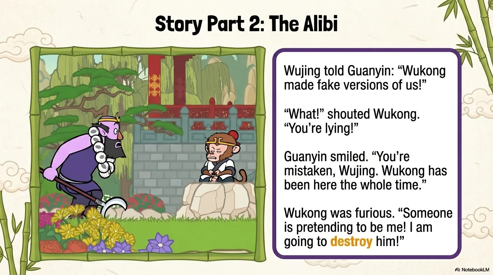

- 来源：`ppt/media/image9.png`（relationship `rId2`）
- 尺寸：1376×768
- 源 SHA-256：`fd06dac9f39a29c72d4fcbc2949715279a061738a5b9f13e6f8eae1ccca8d859`
- 输出 SHA-256：`92f096cbe493ea963a7b8543d4aa08fc2bff4e1f9fc7f5a9de83df053eecebcd`
- 分类：unknown ｜ OCR：blocked ｜ 审核：unreviewed

## Slide 009

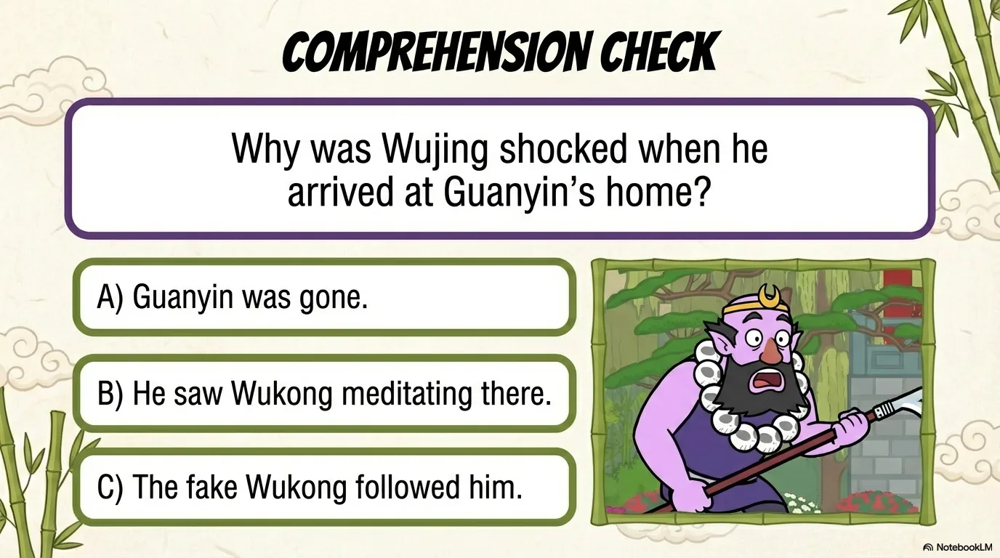

- 来源：`ppt/media/image10.png`（relationship `rId2`）
- 尺寸：1376×768
- 源 SHA-256：`4c5a6155e0f01e37d95747a6de3bd68dd175dbc93104c165e481f38833b04ea6`
- 输出 SHA-256：`b3de4bad2d7a58e9e9c7bb66a524bc95c832c5c96f87c03220fbf728f7056812`
- 分类：unknown ｜ OCR：blocked ｜ 审核：unreviewed

## Slide 010

- 来源：`ppt/media/image11.png`（relationship `rId2`）
- 尺寸：1376×768
- 源 SHA-256：`68a47babcd7aeb7a7038f3b654c28d927ba78f98f2cc42b9b7d28d527e4404d5`
- 输出 SHA-256：`bae7389f31428e700cad2faa77b14c3140e01faea50097315ef62b95cf9a19c6`
- 分类：unknown ｜ OCR：blocked ｜ 审核：unreviewed

## Slide 011

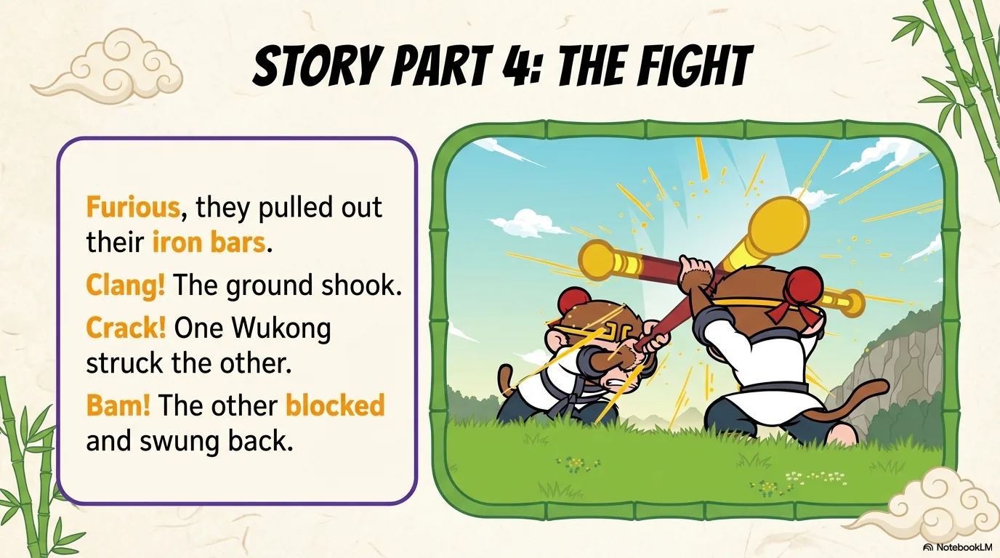

- 来源：`ppt/media/image12.png`（relationship `rId2`）
- 尺寸：1376×768
- 源 SHA-256：`806b162cd9d593d643c65728681b5891476b1b0925326bc48f4ee47d0cefaf6f`
- 输出 SHA-256：`2cb88d362696f418bc89df3aaa5ae0645522f3eb2332f66168c6eb453069c6ee`
- 分类：unknown ｜ OCR：blocked ｜ 审核：unreviewed

## Slide 012

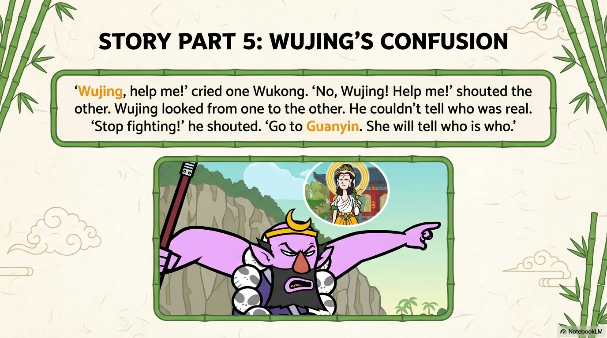

- 来源：`ppt/media/image13.png`（relationship `rId2`）
- 尺寸：1376×768
- 源 SHA-256：`f3de0ab6547a68d5f6c5f6b77291032aa068957e2d3adc231143974b36c8ca50`
- 输出 SHA-256：`db453db15ec3ecddccb2e10ee122d0f0c51e6e971fa496a2e412e62900d5bf23`
- 分类：unknown ｜ OCR：blocked ｜ 审核：unreviewed

## Slide 013

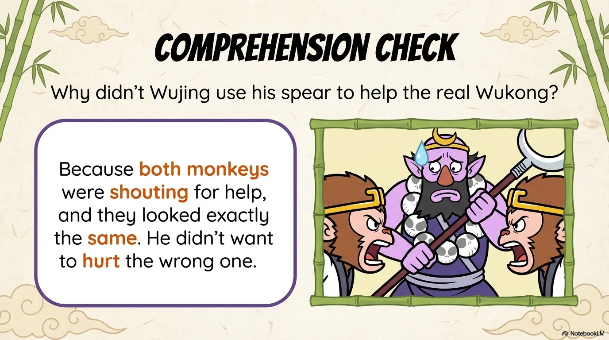

- 来源：`ppt/media/image14.png`（relationship `rId2`）
- 尺寸：1376×768
- 源 SHA-256：`9770c3f3e1812596d49ce4bff7e3549388e22473ff97e1424ed514eae9d3af62`
- 输出 SHA-256：`bb572376b9f89f120a18bec5fbd7aa2003857f5daa50171ac390d131a9bed097`
- 分类：unknown ｜ OCR：blocked ｜ 审核：unreviewed

## Slide 014

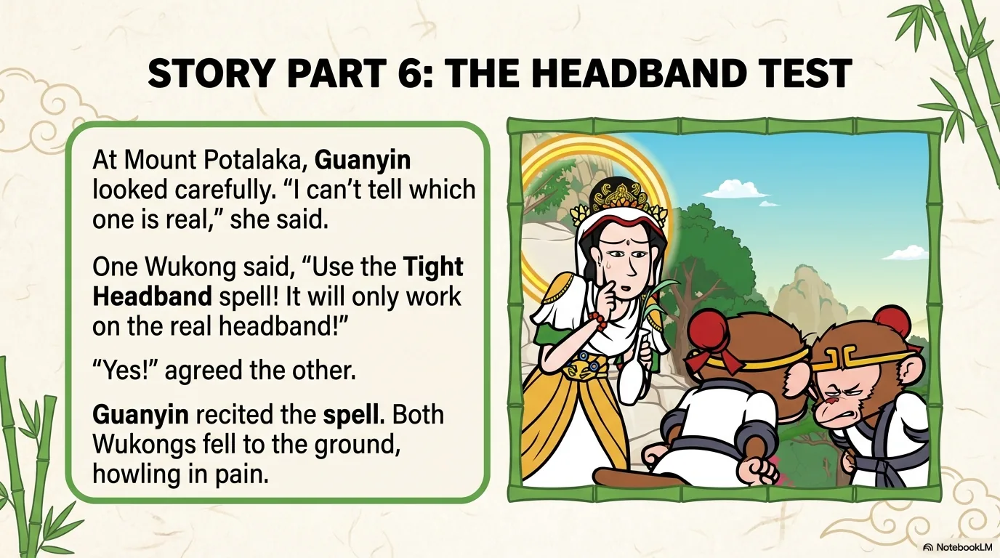

- 来源：`ppt/media/image15.png`（relationship `rId2`）
- 尺寸：1376×768
- 源 SHA-256：`1f06866ae1b382b48f904f89a17622107a14d9ee8866b31166c34674b03455c5`
- 输出 SHA-256：`5f9658b2cbe1428b36acd9c1d8ba9dd552d76f1a3b0eb0705159fd88d56bbff1`
- 分类：unknown ｜ OCR：blocked ｜ 审核：unreviewed

## Slide 015

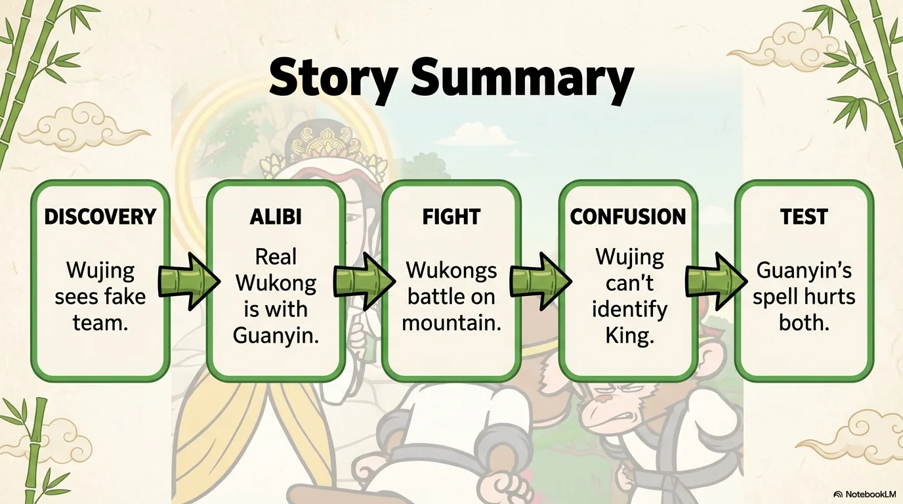

- 来源：`ppt/media/image16.png`（relationship `rId2`）
- 尺寸：1376×768
- 源 SHA-256：`a956462ad6f551655e39fa019ae492a1bc5af65220a5819f9185cc863860374a`
- 输出 SHA-256：`10bb8b113ee67b1cc8e8e20f60c6cd5980fd1488c3529577daa9ee9b5f4d5d95`
- 分类：unknown ｜ OCR：blocked ｜ 审核：unreviewed

## Slide 016

- 来源：`ppt/media/image17.png`（relationship `rId2`）
- 尺寸：1376×768
- 源 SHA-256：`70410443a8eab1a5e4aa66d46ca244e3f072ad1dcdeef3b54c2c65737660064c`
- 输出 SHA-256：`da07e89fd0abc21895d6bd7661730b1c05f45ef0e904f38a7f6b413801cbb838`
- 分类：unknown ｜ OCR：blocked ｜ 审核：unreviewed

## Slide 017

- 来源：`ppt/media/image18.png`（relationship `rId2`）
- 尺寸：1376×768
- 源 SHA-256：`032ee67e606bb410ecc65d0454d8e0744c655e8f99d1dd7215e9c2f4fa266cdd`
- 输出 SHA-256：`b3d941a4a5c0a9b2ca79cfba3bd49879fb82156cb805f06bb85ae57850cbb9cd`
- 分类：unknown ｜ OCR：blocked ｜ 审核：unreviewed

## Slide 018

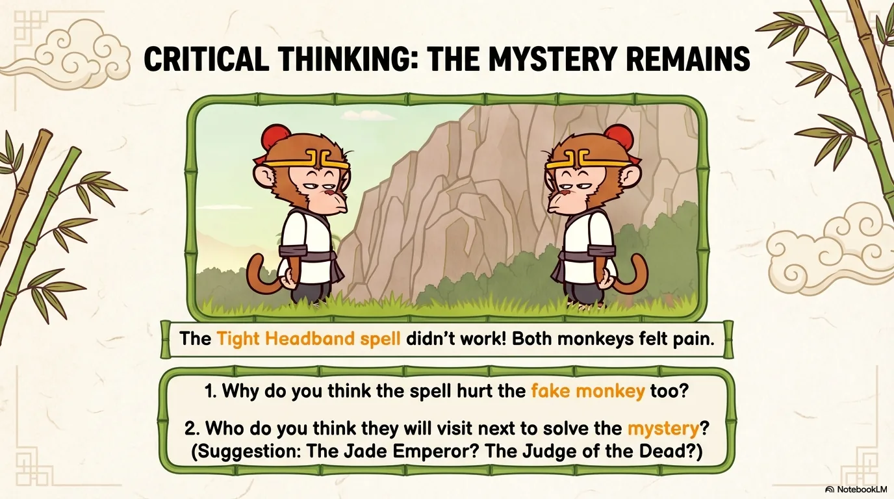

- 来源：`ppt/media/image19.png`（relationship `rId2`）
- 尺寸：1376×768
- 源 SHA-256：`f406df08086ee092b895f83df859e7ae55ced26380201d72ee8218992db1eb98`
- 输出 SHA-256：`6a80856676e6e902c7b9c4574a72e3200d3f9bd8507088fe927f24e204b7f22b`
- 分类：unknown ｜ OCR：blocked ｜ 审核：unreviewed

## Slide 019

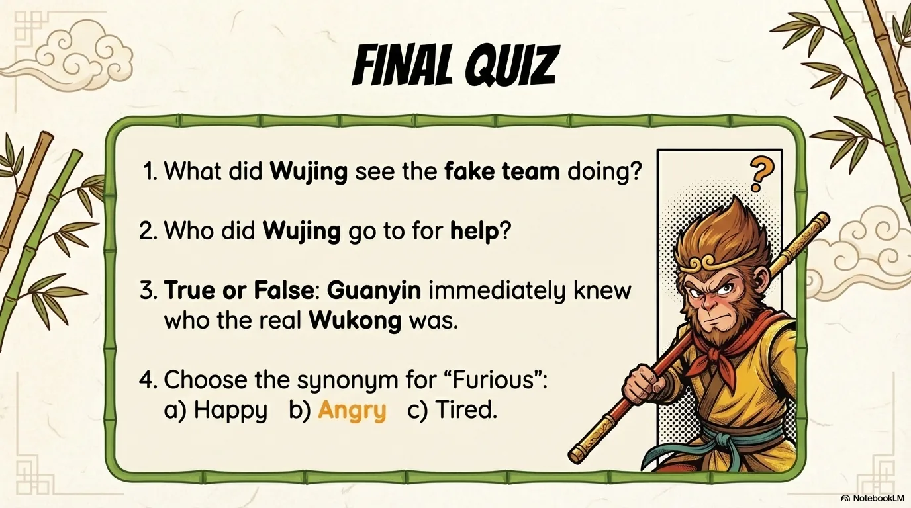

- 来源：`ppt/media/image20.png`（relationship `rId2`）
- 尺寸：1376×768
- 源 SHA-256：`409341514d7303cb55df4e9895fae702b31b589529347cffec8de9131ff5e149`
- 输出 SHA-256：`fcea4d356dc0d21a6d587bf43ef7968a5ac505a4d7ca0a071292be1ef6eafcc7`
- 分类：unknown ｜ OCR：blocked ｜ 审核：unreviewed

## Slide 020

- 来源：`ppt/media/image21.png`（relationship `rId2`）
- 尺寸：1376×768
- 源 SHA-256：`cc9ec66c3ec5c463f37b65e552df9802a82a9d722f000319c07f905bfa6a1061`
- 输出 SHA-256：`336b90a2d39668af341d054d76710b72582db61b23dc1658b6b283b0e2c8643c`
- 分类：unknown ｜ OCR：blocked ｜ 审核：unreviewed
