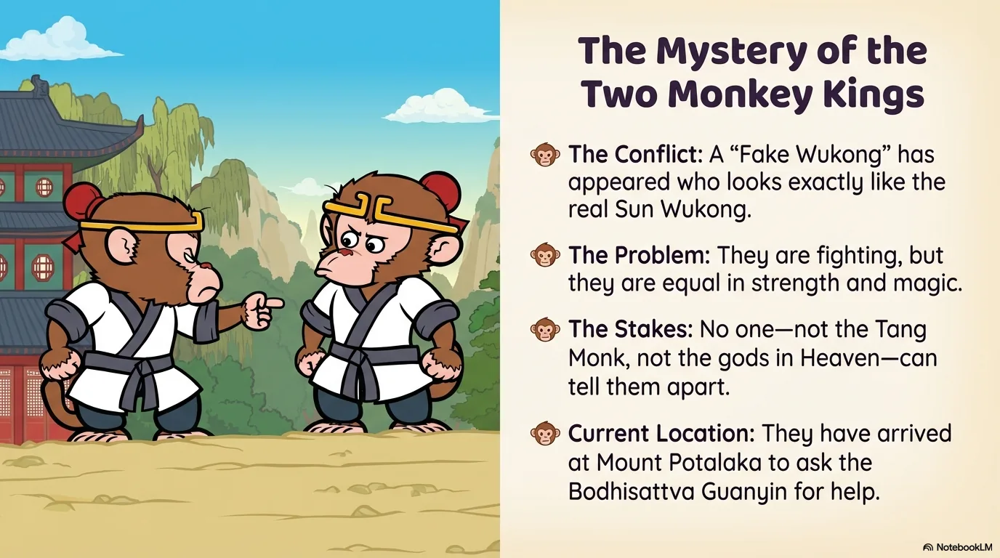
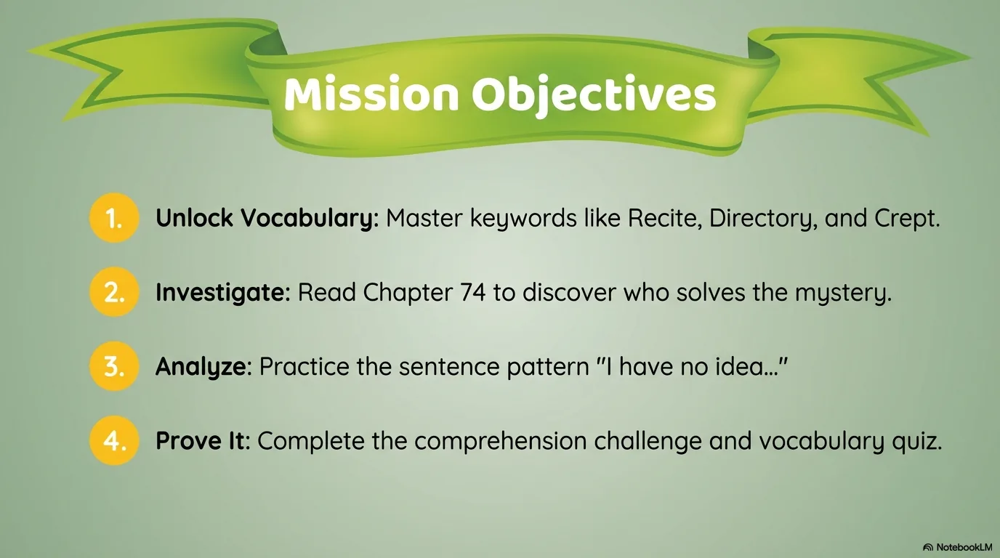
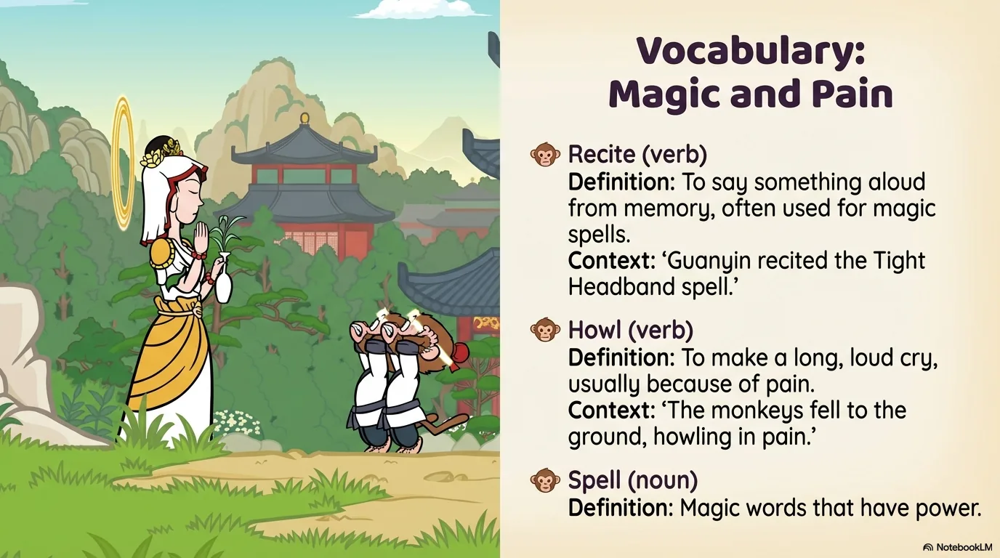
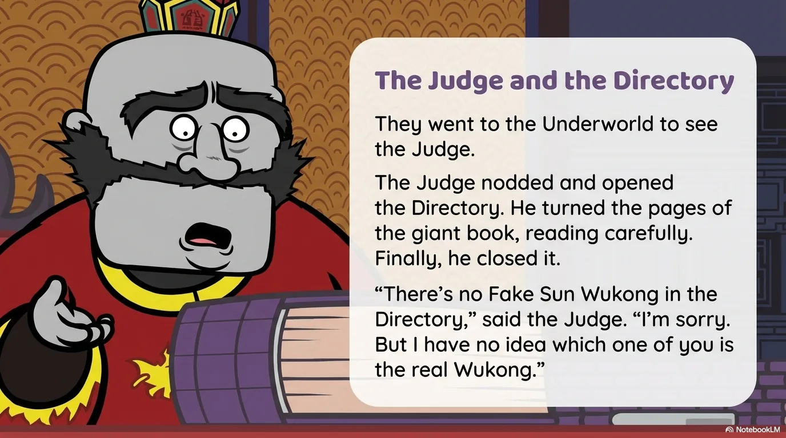
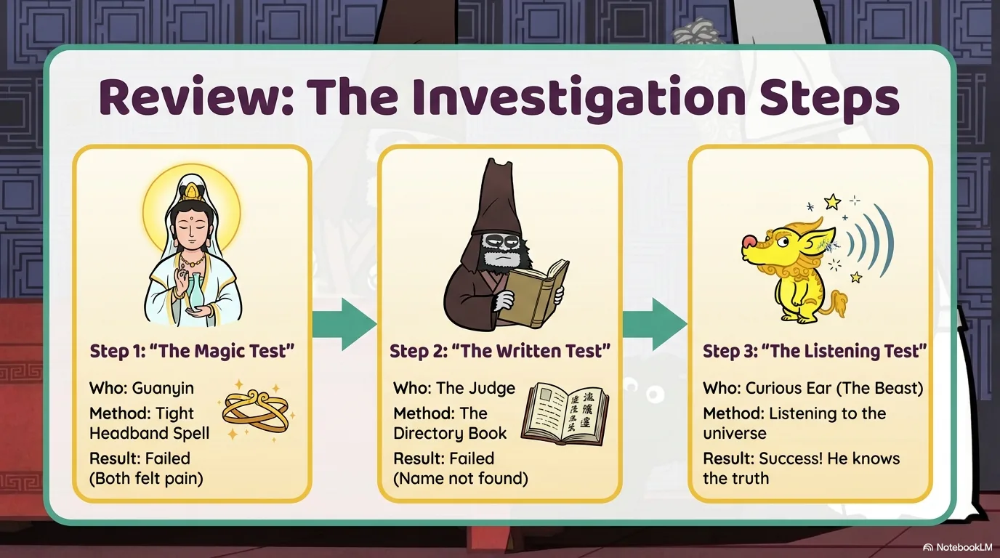
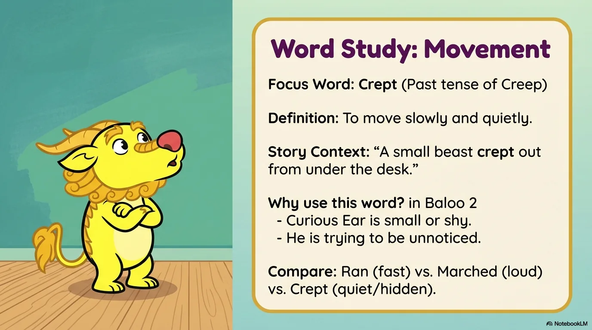
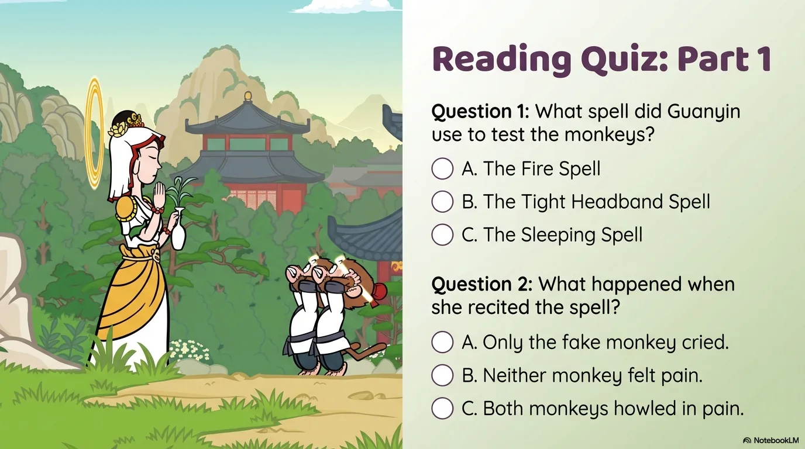
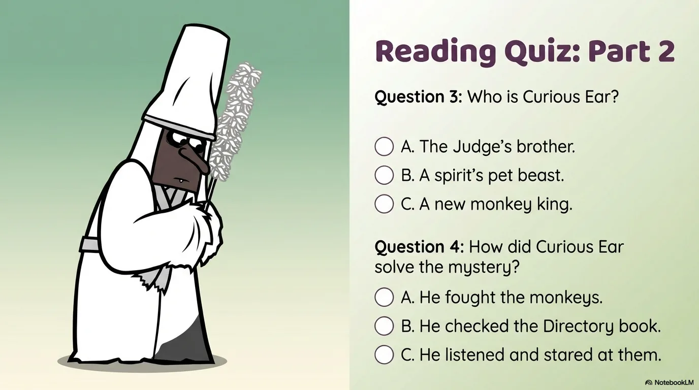
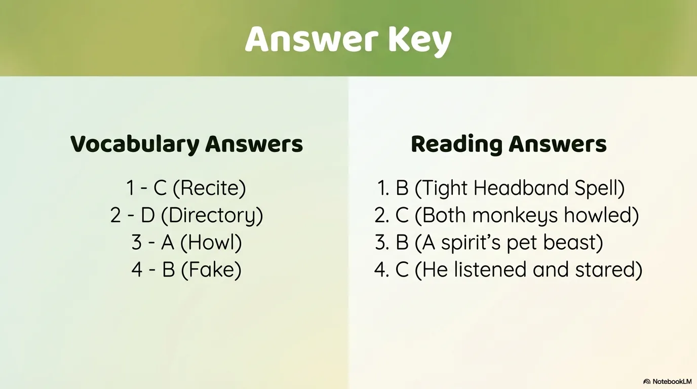

# 豆豆龙英语 · 第 74 集课件（EP074 草稿）

- 来源：`074_Journey to the West 74_Curious Ear.pptx`（主课件，20 页）
- OCR：`blocked`（no local OCR provider importable (pytesseract missing): No module named 'pytesseract'）
- 分类：待人工审核（unknown）
- 审核状态：`unreviewed`

## Slide 001

- 来源：`ppt/media/image1.png`（relationship `rId2`）
- 尺寸：1376×768
- 源 SHA-256：`f4975b68c382c30dc7d7caec28718fe20ca263d922a68a320179c7a9c89df755`
- 输出 SHA-256：`05b2d93605de2514e4e2d0269343504a58d545f45c8296518e500de78567313b`
- 分类：unknown ｜ OCR：blocked ｜ 审核：unreviewed

## Slide 002

- 来源：`ppt/media/image3.png`（relationship `rId2`）
- 尺寸：1376×768
- 源 SHA-256：`209923f62adde512e6c62dcce61f49c347d8595ed7aee1a0880a540af8bbd3ed`
- 输出 SHA-256：`b52ffb5ce615951e9dfe1e24b888bd1334d8beedae306399477e9091696c66e4`
- 分类：unknown ｜ OCR：blocked ｜ 审核：unreviewed

## Slide 003

- 来源：`ppt/media/image4.png`（relationship `rId2`）
- 尺寸：1376×768
- 源 SHA-256：`987a3ac78a7d1e280e09e83dfdfe2e278c1a73fbf5d32ac15f9f09d8f8fb65ad`
- 输出 SHA-256：`12a50e9ac59e16882c87077e9bb25303f9706970a60ac6ddb0bf1e12c9bd79a0`
- 分类：unknown ｜ OCR：blocked ｜ 审核：unreviewed

## Slide 004

- 来源：`ppt/media/image5.png`（relationship `rId2`）
- 尺寸：1376×768
- 源 SHA-256：`d77150fa9ad38f0a636cfdc33544eba4d1e2033c0cc9ff6b9726d2ef90aad7b1`
- 输出 SHA-256：`9ffa8c27ae5a62d7e03a370c01196130f0c973a10f2e9097a5625e0144d5dfec`
- 分类：unknown ｜ OCR：blocked ｜ 审核：unreviewed

## Slide 005

- 来源：`ppt/media/image6.png`（relationship `rId2`）
- 尺寸：1376×768
- 源 SHA-256：`850b8bc02cfe5b7b812d5688fa1b34c89bc8028c0f06ea21744fd46dd45a40ef`
- 输出 SHA-256：`dd697874ec032e81d8787fbef9518e792dbb0930efed5553acdd5d5378410921`
- 分类：unknown ｜ OCR：blocked ｜ 审核：unreviewed

## Slide 006

- 来源：`ppt/media/image7.png`（relationship `rId2`）
- 尺寸：1376×768
- 源 SHA-256：`eee1a454fbd03b2471253b6dba7d0ff6f579c242fa7c150921155b8322604118`
- 输出 SHA-256：`500c6f9b3b5a241de179786f3085514ed2693aa6ba1fa08eb84ad645e9400ccf`
- 分类：unknown ｜ OCR：blocked ｜ 审核：unreviewed

## Slide 007

- 来源：`ppt/media/image8.png`（relationship `rId2`）
- 尺寸：1376×768
- 源 SHA-256：`56caa94251cd09f7984ba4cc19d696bf4b48a0375891450370e8634340af660c`
- 输出 SHA-256：`3c834bde09ba27e7003d1024a83e106ba0e0560dd968aaa9fab10c4941d0e24c`
- 分类：unknown ｜ OCR：blocked ｜ 审核：unreviewed

## Slide 008

- 来源：`ppt/media/image9.png`（relationship `rId2`）
- 尺寸：1376×768
- 源 SHA-256：`8f78e5c46232eb977ee4f34d20d87a735b7fae219aa58d472c4103cdc057c36c`
- 输出 SHA-256：`8a9bc2ab0311575127bff9caf348865191f06fe8e98a900c51b5cbd58adc7054`
- 分类：unknown ｜ OCR：blocked ｜ 审核：unreviewed

## Slide 009

- 来源：`ppt/media/image10.png`（relationship `rId2`）
- 尺寸：1376×768
- 源 SHA-256：`05c84a57f9ea3625511621f8f42a772c5a8aeceb0fa4b227772b76be31c74e7c`
- 输出 SHA-256：`f10b6add9255a5c7aa423a0658ba3fd280c07445c2bf51e8c11fe0bb995eac9f`
- 分类：unknown ｜ OCR：blocked ｜ 审核：unreviewed

## Slide 010

- 来源：`ppt/media/image11.png`（relationship `rId2`）
- 尺寸：1376×768
- 源 SHA-256：`a4d2f8ad3d203b5fa5e90a36467ed11b108f7b517446ba60df1c01a39ee3ab7a`
- 输出 SHA-256：`1ba4a8a5d8552d55af4d0d30ea1cd6dbd2c95c95642efec5296b4f6eb4e401d1`
- 分类：unknown ｜ OCR：blocked ｜ 审核：unreviewed

## Slide 011

- 来源：`ppt/media/image12.png`（relationship `rId2`）
- 尺寸：1376×768
- 源 SHA-256：`888b4bc01ee11cce7b900737d66a501a74b46a25fcb871cfca7a339ff76bda61`
- 输出 SHA-256：`694a5a0900955b114cf7d68f04912d85c94574275dc718f05bb8ac5d3b029c0b`
- 分类：unknown ｜ OCR：blocked ｜ 审核：unreviewed

## Slide 012

- 来源：`ppt/media/image13.png`（relationship `rId2`）
- 尺寸：1376×768
- 源 SHA-256：`87391af36f25f4f11e9068778f53b4b2c8ebfdc1ee5f49af647f283f26853c4e`
- 输出 SHA-256：`0cfaf47cda303f349a9a06ef36c1f409f11b9d304f75156ed1bb571e7d20ed07`
- 分类：unknown ｜ OCR：blocked ｜ 审核：unreviewed

## Slide 013

- 来源：`ppt/media/image14.png`（relationship `rId2`）
- 尺寸：1376×768
- 源 SHA-256：`5c188d10bcb35b81d45fd59a3fe3b94f8377c1996196679f82a5e14ee84d63de`
- 输出 SHA-256：`944ae83bd032c10b58891e6c4d0de08691f0bc0512f425623021e5729b043378`
- 分类：unknown ｜ OCR：blocked ｜ 审核：unreviewed

## Slide 014

- 来源：`ppt/media/image15.png`（relationship `rId2`）
- 尺寸：1376×768
- 源 SHA-256：`4b9556da7adb1d8db2b1b3cccec17164f041cc5dbc2a4b061a130dd656416665`
- 输出 SHA-256：`3ce616b3b25340bd28e5a14d7aa751ee9129cf208a5b4b1620d96dbd92c6a7a4`
- 分类：unknown ｜ OCR：blocked ｜ 审核：unreviewed

## Slide 015

- 来源：`ppt/media/image16.png`（relationship `rId2`）
- 尺寸：1376×768
- 源 SHA-256：`2394ac34e4ab553c8ae8c2c5de7871007bbe0c2991cbffec4d3460903dcafaba`
- 输出 SHA-256：`0959bb2a8f38028c0b40047e02b39cd96d6c7beb08dfd5789e12e36fed427f9d`
- 分类：unknown ｜ OCR：blocked ｜ 审核：unreviewed

## Slide 016

- 来源：`ppt/media/image17.png`（relationship `rId2`）
- 尺寸：1376×768
- 源 SHA-256：`532a12bd1e95385f5feec507361eb324547cc0785f24275c3209bc221d68a4a6`
- 输出 SHA-256：`dc5ad6224d4ed841ba876b356c688b882b3584d8592e2dd5d7fc3f277c923921`
- 分类：unknown ｜ OCR：blocked ｜ 审核：unreviewed

## Slide 017

- 来源：`ppt/media/image18.png`（relationship `rId2`）
- 尺寸：1376×768
- 源 SHA-256：`fe19e9e500db6831addc797229cb725b4216381bc9c9aaa4560a8b78c6d669d5`
- 输出 SHA-256：`153cdc7cd76958341707b6bc61113f671ca93c95985a6651785bb4c9efc65547`
- 分类：unknown ｜ OCR：blocked ｜ 审核：unreviewed

## Slide 018

- 来源：`ppt/media/image19.png`（relationship `rId2`）
- 尺寸：1376×768
- 源 SHA-256：`7257475ea7dc003e3c299cac0fcfb7522b4f51d863417f3586c86b83724be59e`
- 输出 SHA-256：`2c8f1ff4d9ba8e7c6e4824a70404f8d6a022b868bf0dff79c63c3ae71b570223`
- 分类：unknown ｜ OCR：blocked ｜ 审核：unreviewed

## Slide 019

- 来源：`ppt/media/image20.png`（relationship `rId2`）
- 尺寸：1376×768
- 源 SHA-256：`4778ddea352e7fcecc1b6a830eb38f4bd295bee7ac9a655e68bdacc40428ce2a`
- 输出 SHA-256：`88289535577a1589fc85b9810df11ee04cf5cbadaae87d34c933ea44f97856e0`
- 分类：unknown ｜ OCR：blocked ｜ 审核：unreviewed

## Slide 020

- 来源：`ppt/media/image21.png`（relationship `rId2`）
- 尺寸：1376×768
- 源 SHA-256：`d79c8402369bb8bc07df521cc5c163a7be6cd4b745c1c57e0661a7873d2b9266`
- 输出 SHA-256：`7f0699d19847baff3dc68feec0e844cf33210474c9f34df1425fa0e46a5f90e8`
- 分类：unknown ｜ OCR：blocked ｜ 审核：unreviewed
