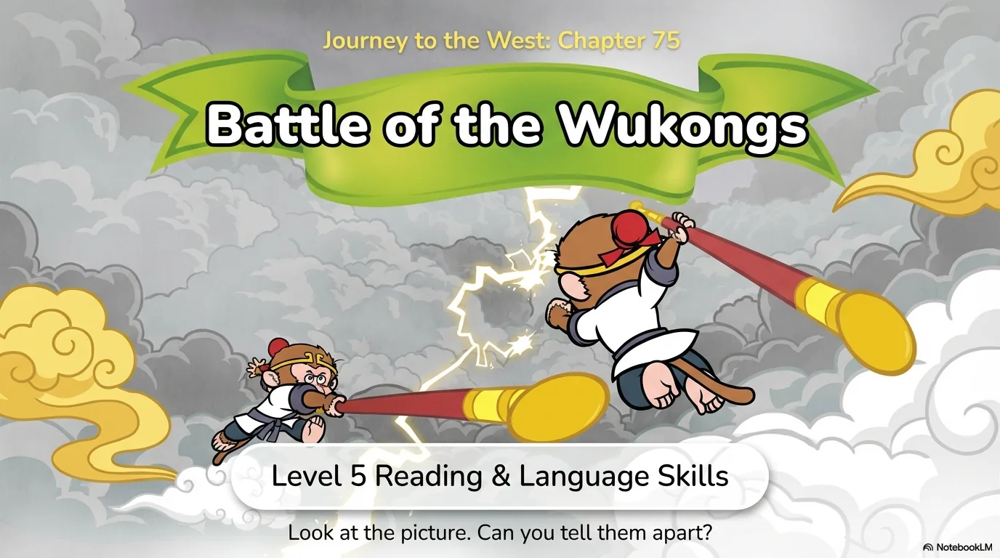
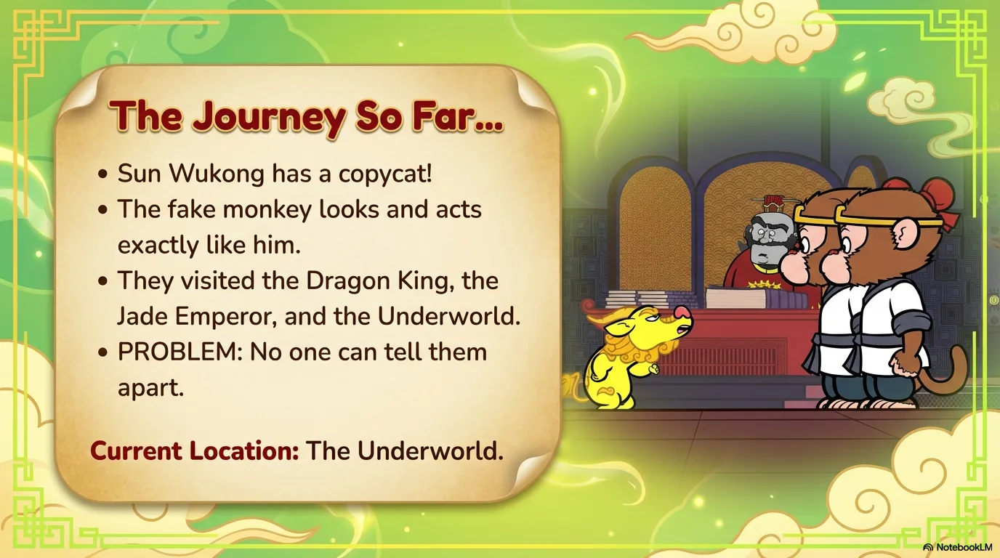
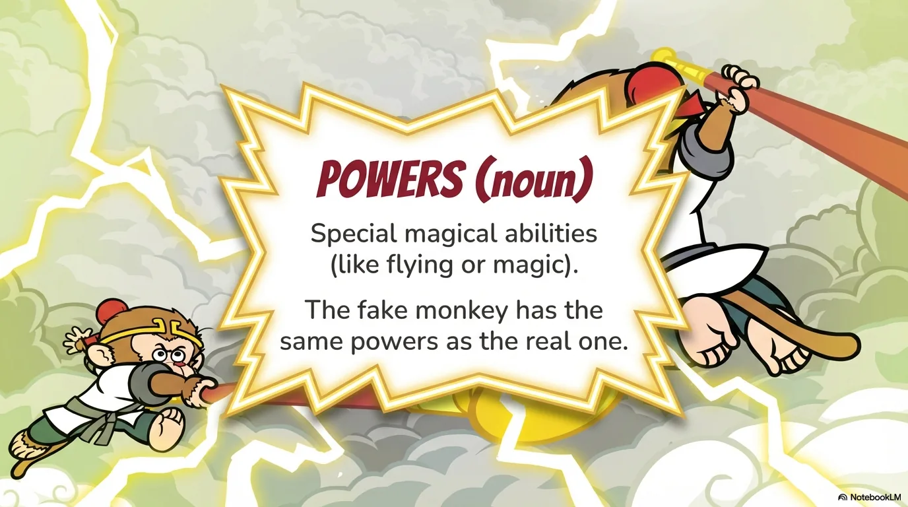
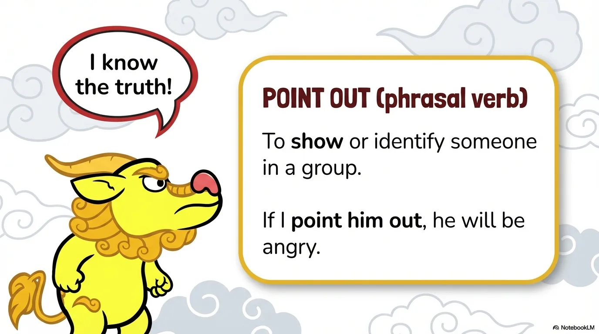
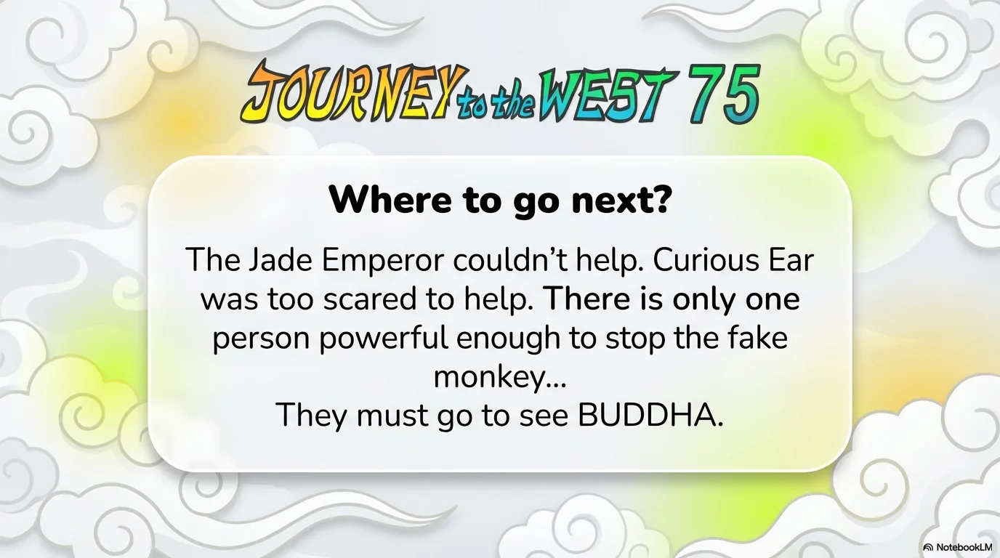
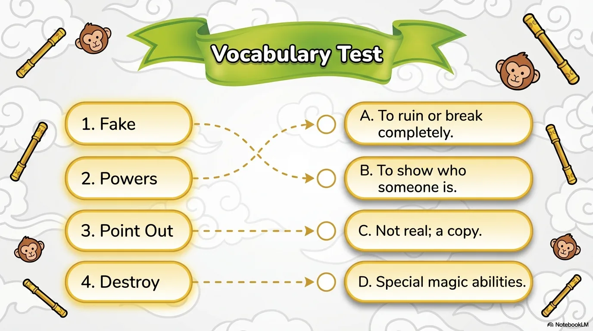
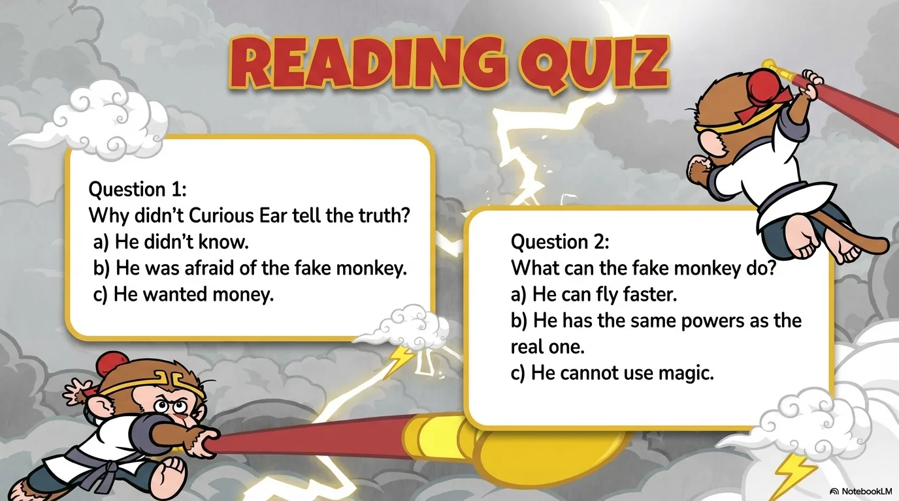

# 豆豆龙英语 · 第 75 集课件（EP075 草稿）

- 来源：`075_Journey to the West 75_Battle of the Wukongs.pptx`（主课件，20 页）
- OCR：`blocked`（no local OCR provider importable (pytesseract missing): No module named 'pytesseract'）
- 分类：待人工审核（unknown）
- 审核状态：`unreviewed`

## Slide 001

- 来源：`ppt/media/image1.png`（relationship `rId2`）
- 尺寸：1376×768
- 源 SHA-256：`3c0b9ef33ab005b0a19ed83704a1c674749bcfc8a7bd1d3e5ab9c5c11fc8ed62`
- 输出 SHA-256：`be49ce9b5d9582e1b9cba9b6c044b7ae9a3a8a85495a30e3132a63bb4a2aa52e`
- 分类：unknown ｜ OCR：blocked ｜ 审核：unreviewed

## Slide 002

- 来源：`ppt/media/image3.png`（relationship `rId2`）
- 尺寸：1376×768
- 源 SHA-256：`8164646fb6433c7ec48db7fb297f030d0c1b608018406d6248adeb5e9cf4e22f`
- 输出 SHA-256：`b97c6189a0916720d21ad5a847660d9465a8223bd9aed503f49356c44b4493ef`
- 分类：unknown ｜ OCR：blocked ｜ 审核：unreviewed

## Slide 003

- 来源：`ppt/media/image4.png`（relationship `rId2`）
- 尺寸：1376×768
- 源 SHA-256：`db94bb7ef3107d94d06f7b51115b6fb78195d0c92fdae408118c98dffcd10253`
- 输出 SHA-256：`ae8fc496ea5ae234ba37ac3ea02e670e2949bb5f414160a5c76b60b47e2f8501`
- 分类：unknown ｜ OCR：blocked ｜ 审核：unreviewed

## Slide 004

- 来源：`ppt/media/image5.png`（relationship `rId2`）
- 尺寸：1376×768
- 源 SHA-256：`5649983b6b3ffe593707b4c9918ffd663c7417232ef096fd0a629c623ac0dfcd`
- 输出 SHA-256：`f6686f25de830a4888c103a1caa414efcab6279893b4cddc523b82d898f37535`
- 分类：unknown ｜ OCR：blocked ｜ 审核：unreviewed

## Slide 005

- 来源：`ppt/media/image6.png`（relationship `rId2`）
- 尺寸：1376×768
- 源 SHA-256：`f69f22320038ddd5e590627ca178c81146f1cf74136335d72be60ce37d676cc2`
- 输出 SHA-256：`938df6f1c5a08f7d3533fcc1982ff8810750e4d4aee7d837972ef13fc1304678`
- 分类：unknown ｜ OCR：blocked ｜ 审核：unreviewed

## Slide 006

- 来源：`ppt/media/image7.png`（relationship `rId2`）
- 尺寸：1376×768
- 源 SHA-256：`8908dad6810ffe8b6793ba32e2803210049e942f3f80890d46a283c5cc12ff96`
- 输出 SHA-256：`fee232596685fddd70ed5e6f9b28368b1dec6d72eb8ff418d677eb2ab8c88328`
- 分类：unknown ｜ OCR：blocked ｜ 审核：unreviewed

## Slide 007

- 来源：`ppt/media/image8.png`（relationship `rId2`）
- 尺寸：1376×768
- 源 SHA-256：`e0b4928ac662aed9f2cebad901d0ec856310ade2ca64d2d727d5d4925a1bed69`
- 输出 SHA-256：`96a89d7af7dfe0e75c5295ce884fc4a512cb314c68e429da68e29c4eb0125627`
- 分类：unknown ｜ OCR：blocked ｜ 审核：unreviewed

## Slide 008

- 来源：`ppt/media/image9.png`（relationship `rId2`）
- 尺寸：1376×768
- 源 SHA-256：`2bcf7f8a8e775fa7e72126906affe1bd1c531edf3ade9818d656e034efbccc4c`
- 输出 SHA-256：`3676e57d4e4b790ab263dbb64551bde472c3a9f82a01fdc68495148e5f61df09`
- 分类：unknown ｜ OCR：blocked ｜ 审核：unreviewed

## Slide 009

- 来源：`ppt/media/image10.png`（relationship `rId2`）
- 尺寸：1376×768
- 源 SHA-256：`67c053b01dd9941c8347d1a100c0f9011cc288e738daeaf0cf409e60d3cbb8e6`
- 输出 SHA-256：`417a8e16a4b4994eb0e6f1f50e8224d6f95a599e0bfe74532110a7a407f7c8ff`
- 分类：unknown ｜ OCR：blocked ｜ 审核：unreviewed

## Slide 010

- 来源：`ppt/media/image11.png`（relationship `rId2`）
- 尺寸：1376×768
- 源 SHA-256：`9b08a0b34f4178073b20a491e145b50d483f04651e57e162bfbb9462de84189d`
- 输出 SHA-256：`d114cceb031e79190642d65d9def4d71404fb57f282169e2a2cf461a2708b35b`
- 分类：unknown ｜ OCR：blocked ｜ 审核：unreviewed

## Slide 011

- 来源：`ppt/media/image12.png`（relationship `rId2`）
- 尺寸：1376×768
- 源 SHA-256：`5325af184bf592dd52241fd2ac313a39397ffaf13b7a4dc2a38a2f25d44bce56`
- 输出 SHA-256：`bdcb71b1f734d30e29004d8d6333ea9f853c5295267a88fa1c45b7d9b6318f42`
- 分类：unknown ｜ OCR：blocked ｜ 审核：unreviewed

## Slide 012

- 来源：`ppt/media/image13.png`（relationship `rId2`）
- 尺寸：1376×768
- 源 SHA-256：`50b46fabbe452d6ef73fdd3d1e840e580fca5eea9883f0c9ccf45b66cee43745`
- 输出 SHA-256：`610f40b17185b03bbaaec9544d7d0fe38fc558b5ed36dc06a66f525605328fa1`
- 分类：unknown ｜ OCR：blocked ｜ 审核：unreviewed

## Slide 013

- 来源：`ppt/media/image14.png`（relationship `rId2`）
- 尺寸：1376×768
- 源 SHA-256：`a48d5660435ce960cbdde62efa8ed23ab0298cc5500bb59975a0072cf1d82917`
- 输出 SHA-256：`bc010169ee4d27c83130d2e16863ff5fdc0339d78567850d0551b82df363f2ff`
- 分类：unknown ｜ OCR：blocked ｜ 审核：unreviewed

## Slide 014

- 来源：`ppt/media/image15.png`（relationship `rId2`）
- 尺寸：1376×768
- 源 SHA-256：`bb8302a4a702a9402964e863da144b0f35224b1aa6cc6f291447b17c45e4a4b5`
- 输出 SHA-256：`3e7a67f1421317276f835419a8c7203ce7d0586b643f68cb638d884d9817318d`
- 分类：unknown ｜ OCR：blocked ｜ 审核：unreviewed

## Slide 015

- 来源：`ppt/media/image16.png`（relationship `rId2`）
- 尺寸：1376×768
- 源 SHA-256：`0d132f9845e4e55b17f9b3154cd7cdcfb94ddd645611f2d36f65b01f6251a13a`
- 输出 SHA-256：`882101f3c39894cf7cd31fe2f8ae58189c4071b855506d40c8d297eed7969255`
- 分类：unknown ｜ OCR：blocked ｜ 审核：unreviewed

## Slide 016

- 来源：`ppt/media/image17.png`（relationship `rId2`）
- 尺寸：1376×768
- 源 SHA-256：`ff7c086801cbea25d61fadb70d1c99cba2556e9e9f8236dd07152d85c06f822c`
- 输出 SHA-256：`daddb2697acc4adbb6545c180418101e877eb2ae23e6fdc76a102209e1cbfccd`
- 分类：unknown ｜ OCR：blocked ｜ 审核：unreviewed

## Slide 017

- 来源：`ppt/media/image18.png`（relationship `rId2`）
- 尺寸：1376×768
- 源 SHA-256：`db85db81066a3d6262bf7b2d5576392978aa92f9c94ddf8e419fa8bfc5d0d3b7`
- 输出 SHA-256：`1c3184fa630f417675c582f481058f2066d7f3d2ee41824c8dba116e6a7bd103`
- 分类：unknown ｜ OCR：blocked ｜ 审核：unreviewed

## Slide 018

- 来源：`ppt/media/image19.png`（relationship `rId2`）
- 尺寸：1376×768
- 源 SHA-256：`f87146603857a0c717d4b85aaebc9c0b81d743236350e24a715382747d1de6ab`
- 输出 SHA-256：`e3a4d807d20f0b9d992aad7c0c40d05a3531b4e5f8e2f649fe14420e32f80739`
- 分类：unknown ｜ OCR：blocked ｜ 审核：unreviewed

## Slide 019

- 来源：`ppt/media/image20.png`（relationship `rId2`）
- 尺寸：1376×768
- 源 SHA-256：`562666d54d12b05c1c805f2d5e19f2fadf8a7ae13424bf722426937cb17f9cea`
- 输出 SHA-256：`2e51e2e55885e674d4f053931f91124b2be726c9707c3899db0569b618a48a6a`
- 分类：unknown ｜ OCR：blocked ｜ 审核：unreviewed

## Slide 020

- 来源：`ppt/media/image21.png`（relationship `rId2`）
- 尺寸：1376×768
- 源 SHA-256：`2043791180b822e98b91aae3e27463e2a9aa4469bc90c721211de34084f5215a`
- 输出 SHA-256：`6be58cdb3f3dedf615afd36fbd527002c8628d2434eeb2f5d9ce16288520c867`
- 分类：unknown ｜ OCR：blocked ｜ 审核：unreviewed
