# 豆豆龙英语 · 第 76 集课件（EP076 草稿）

- 来源：`076_Journey to the West 76_The Iron Immortal.pptx`（主课件，20 页）
- OCR：`blocked`（no local OCR provider importable (pytesseract missing): No module named 'pytesseract'）
- 分类：待人工审核（unknown）
- 审核状态：`unreviewed`

## Slide 001

- 来源：`ppt/media/image1.png`（relationship `rId2`）
- 尺寸：1376×768
- 源 SHA-256：`64edcecff3f7b729278fe46c54aedff9e33ee1764ead5f6db9566fd2150361a0`
- 输出 SHA-256：`e20a4decc3098950e5068ac5420ecc3018c22f80fad7a575ef12ccf3a249eb67`
- 分类：unknown ｜ OCR：blocked ｜ 审核：unreviewed

## Slide 002

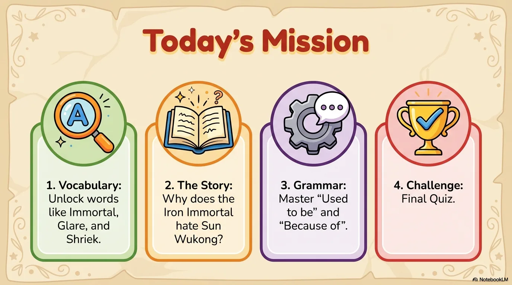

- 来源：`ppt/media/image3.png`（relationship `rId2`）
- 尺寸：1376×768
- 源 SHA-256：`bf9747d5e4d03ad7f80fdbbf1a6008ed5043547224d5772a21dbf4a58a077595`
- 输出 SHA-256：`d5b0b16cf3e7ebc13796513a9d0e937d1b1025a3709ae946bcab5ab7cd8eafda`
- 分类：unknown ｜ OCR：blocked ｜ 审核：unreviewed

## Slide 003

- 来源：`ppt/media/image4.png`（relationship `rId2`）
- 尺寸：1376×768
- 源 SHA-256：`1e11cbf2415c48cb776f89fe834b2066920199c53128e0f829f16e70d4eada6e`
- 输出 SHA-256：`d36b413bda5656b790f1c2f68025397ae882c8fab0b8aa18c172f09d20091726`
- 分类：unknown ｜ OCR：blocked ｜ 审核：unreviewed

## Slide 004

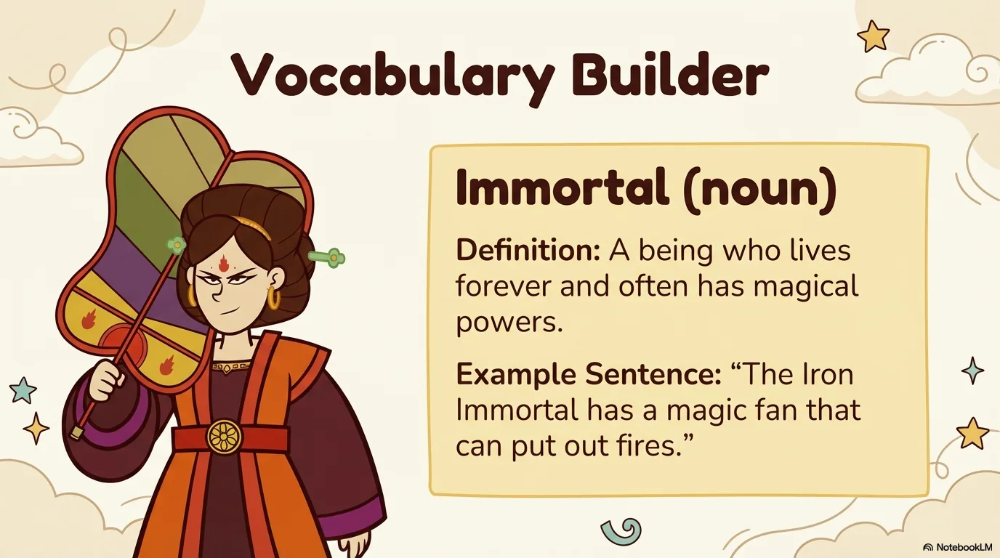

- 来源：`ppt/media/image5.png`（relationship `rId2`）
- 尺寸：1376×768
- 源 SHA-256：`55f968b44d5086ef4393cc06de4c57884ba8689e82dd14eaa550ad4082e93ea8`
- 输出 SHA-256：`9850c5f1020245f60de3a29be63ea355151ef0d6e0144bc2e35f9dc7acf9f45e`
- 分类：unknown ｜ OCR：blocked ｜ 审核：unreviewed

## Slide 005

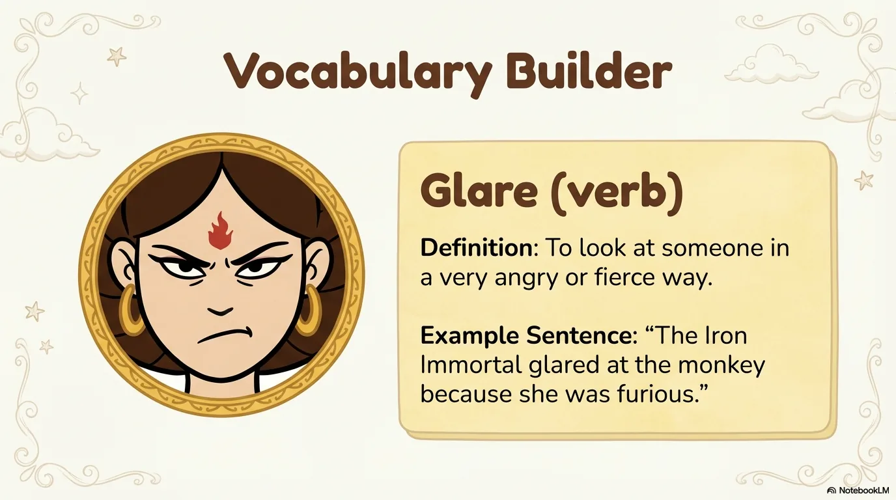

- 来源：`ppt/media/image6.png`（relationship `rId2`）
- 尺寸：1376×768
- 源 SHA-256：`be92575fc66395a50262a336fc3441f9a6a7956f05763783a6f5ebdcd4be8e9a`
- 输出 SHA-256：`9047a3ea4244785dda4ae5b92d90397809ae7879a3c4ead6616e84e48ea486cd`
- 分类：unknown ｜ OCR：blocked ｜ 审核：unreviewed

## Slide 006

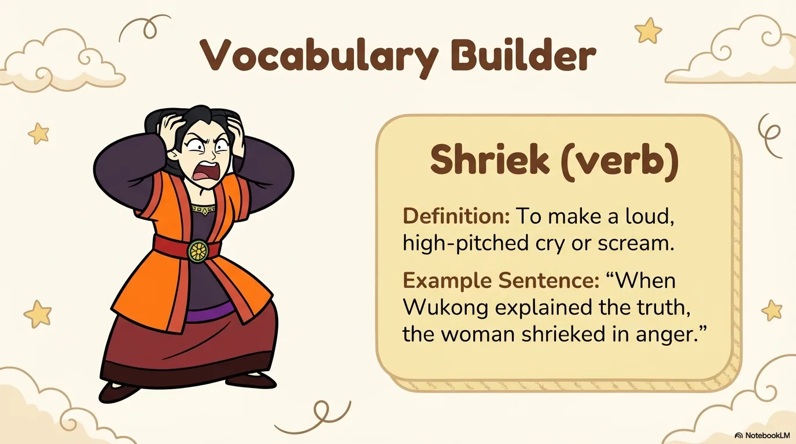

- 来源：`ppt/media/image7.png`（relationship `rId2`）
- 尺寸：1376×768
- 源 SHA-256：`aa25a916bb2fe56eb04670de6cec263490822bea1ad4a9a3f06e70ef18a0d1ba`
- 输出 SHA-256：`c58122dce684e0425c5dc5d6834c16169cf5c7707d560df678b2de0555d5dca0`
- 分类：unknown ｜ OCR：blocked ｜ 审核：unreviewed

## Slide 007

- 来源：`ppt/media/image8.png`（relationship `rId2`）
- 尺寸：1376×768
- 源 SHA-256：`6469b6db353cb2b9a95c1e54ea6cc75cb93b23c74186fcfb36abe8fc6b234fbb`
- 输出 SHA-256：`a2be8a64fd5b2108a9c2eac634aad8a13d831dc71af554accaa6d2c5c5f6e71f`
- 分类：unknown ｜ OCR：blocked ｜ 审核：unreviewed

## Slide 008

- 来源：`ppt/media/image9.png`（relationship `rId2`）
- 尺寸：1376×768
- 源 SHA-256：`894bf50a5b7b41cc0c5cba6203ac6c48511dd9659512c9416f39b86d47ead6a8`
- 输出 SHA-256：`393e62f60739cce0987674e0b21683ace62fd92a6ef2948a3feacd4f41e4f6a9`
- 分类：unknown ｜ OCR：blocked ｜ 审核：unreviewed

## Slide 009

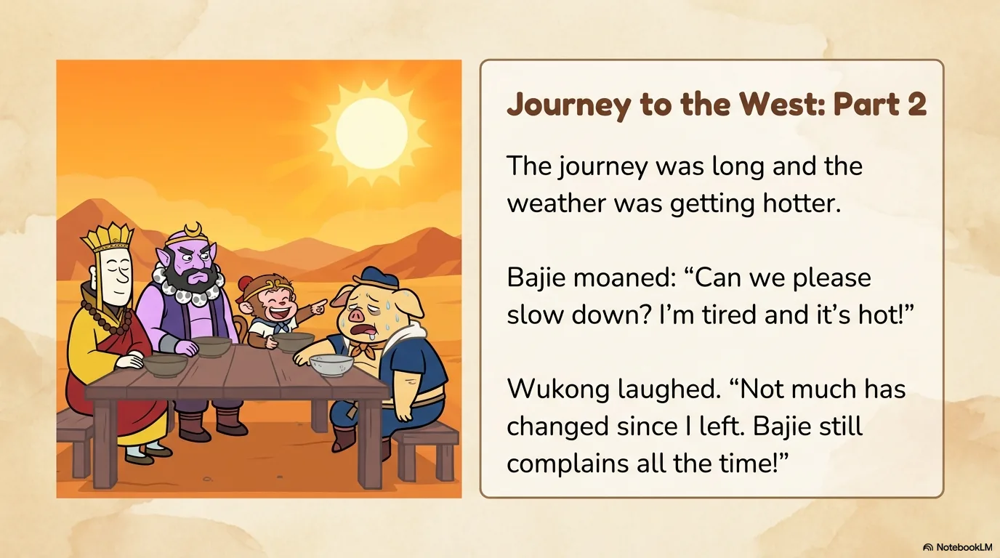

- 来源：`ppt/media/image10.png`（relationship `rId2`）
- 尺寸：1376×768
- 源 SHA-256：`06f85746869f94c5e4fbc8ddcf24467afd8d80ebb92a28420a565eee6950b846`
- 输出 SHA-256：`aa9203cbc8130be9db55fe8a4d65caaf439a0823e296b449f2133e379c1c9f14`
- 分类：unknown ｜ OCR：blocked ｜ 审核：unreviewed

## Slide 010

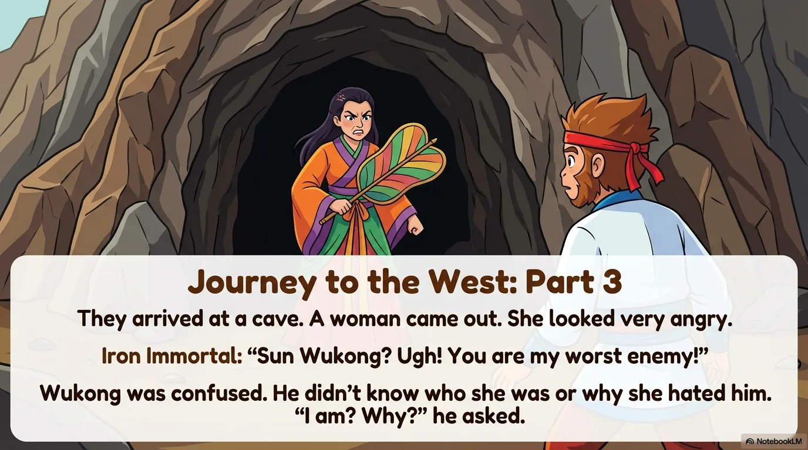

- 来源：`ppt/media/image11.png`（relationship `rId2`）
- 尺寸：1376×768
- 源 SHA-256：`10e12fc481f61cfff084a5a0336fe08a8bde1a2c444ae270a441e753cc331c20`
- 输出 SHA-256：`a17afd7d875c20499afa8969009c553c7e608dec2e5439343bc9ba12d4dddb73`
- 分类：unknown ｜ OCR：blocked ｜ 审核：unreviewed

## Slide 011

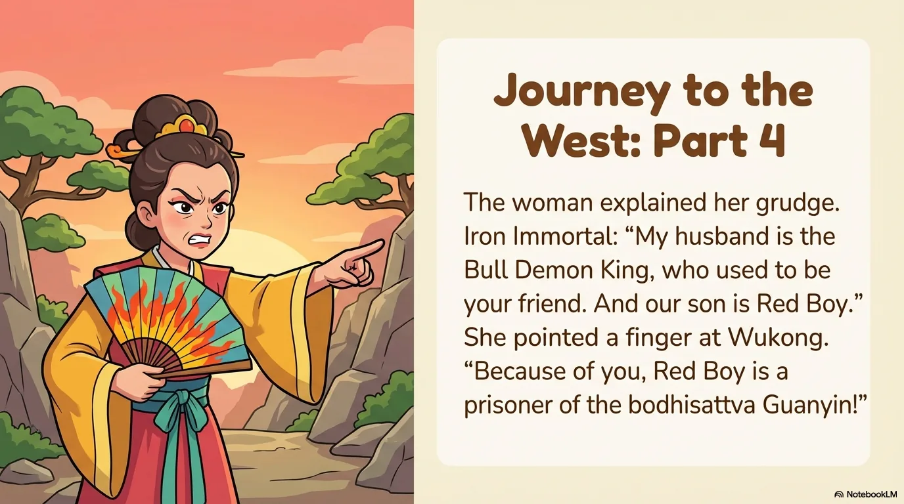

- 来源：`ppt/media/image12.png`（relationship `rId2`）
- 尺寸：1376×768
- 源 SHA-256：`5255a1d53d76909284be5d1bc2f9d306070462c0c8a1a251804e1f59280c900d`
- 输出 SHA-256：`e2df93e6d0cf343eee6cc2dd65abe450c04ee074502fc9fbf8c800d22f18dbc0`
- 分类：unknown ｜ OCR：blocked ｜ 审核：unreviewed

## Slide 012

- 来源：`ppt/media/image13.png`（relationship `rId2`）
- 尺寸：1376×768
- 源 SHA-256：`af1b1ae5cbcd88a8ed79615310b9167af54711f0143fbbcd2ef0678cfb1745b5`
- 输出 SHA-256：`8792d5e75340a0a0bb1bda87aa33798314295ff3a9ed3c7bdc51a6028639ece2`
- 分类：unknown ｜ OCR：blocked ｜ 审核：unreviewed

## Slide 013

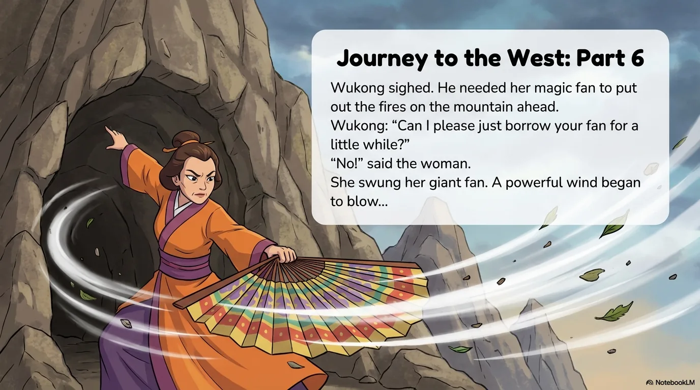

- 来源：`ppt/media/image14.png`（relationship `rId2`）
- 尺寸：1376×768
- 源 SHA-256：`7a9240353f3d870471dc753f5db137d4fc369e4094e1f2658ade523972975225`
- 输出 SHA-256：`e77e9e24957348a7a6606ed8f3918216298b03e934f465b146585297fabc2c6a`
- 分类：unknown ｜ OCR：blocked ｜ 审核：unreviewed

## Slide 014

- 来源：`ppt/media/image15.png`（relationship `rId2`）
- 尺寸：1376×768
- 源 SHA-256：`7568cd4dab66c7eab06101d6cfcf641ec045d3f40d4560777ca2f25d01676130`
- 输出 SHA-256：`e6075057cda7f7844c6919348080ded68f5a155c1393181ddecf5a6e99ee40ba`
- 分类：unknown ｜ OCR：blocked ｜ 审核：unreviewed

## Slide 015

- 来源：`ppt/media/image16.png`（relationship `rId2`）
- 尺寸：1376×768
- 源 SHA-256：`22bcf137e2b59f355895cf2ba6da7d1eed9e6a8b0752768df4807de876ab7f55`
- 输出 SHA-256：`ab7de763b06ac3316b0229c0a42fadd7ae74d235c2cedd34aec62cc409e1baea`
- 分类：unknown ｜ OCR：blocked ｜ 审核：unreviewed

## Slide 016

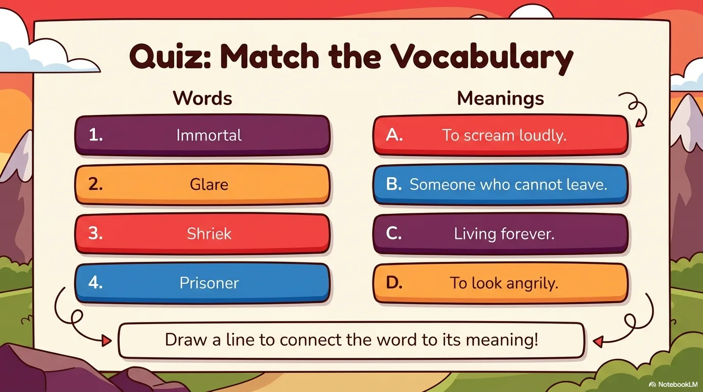

- 来源：`ppt/media/image17.png`（relationship `rId2`）
- 尺寸：1376×768
- 源 SHA-256：`4c7b384d0b0f9392bc7dd4e1fb79badbf56df35bc38c3fd87df11928e24a58e0`
- 输出 SHA-256：`48c2b0602d6d6dc80e94e9f07e2c53ea9090b959cfb0abaa4d8f4da159e79a55`
- 分类：unknown ｜ OCR：blocked ｜ 审核：unreviewed

## Slide 017

- 来源：`ppt/media/image18.png`（relationship `rId2`）
- 尺寸：1376×768
- 源 SHA-256：`abaf3904c01f3fde48d2265794d91e9c9b242b4a6386d089837aa9cb7d792e8e`
- 输出 SHA-256：`e1f0e0fe3617a404fc68e531317b2d7651b50744f6327e86d5d4ee289618de1f`
- 分类：unknown ｜ OCR：blocked ｜ 审核：unreviewed

## Slide 018

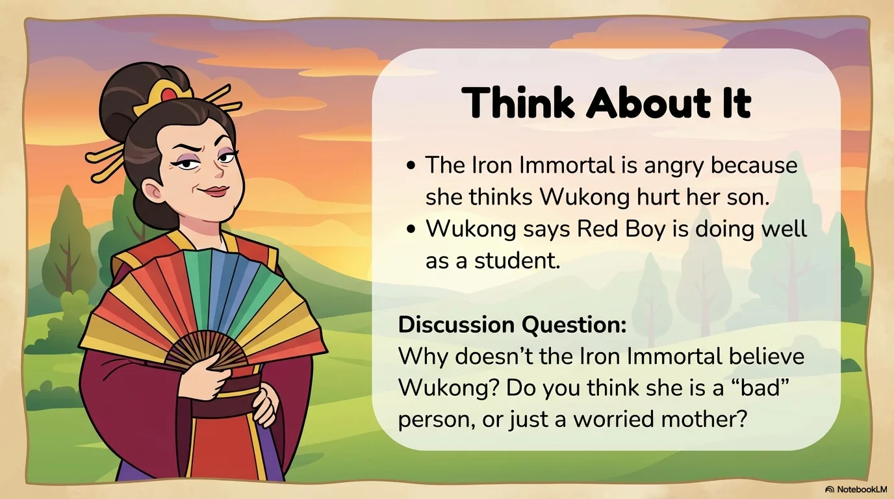

- 来源：`ppt/media/image19.png`（relationship `rId2`）
- 尺寸：1376×768
- 源 SHA-256：`04693c388f80addf21a67ee4ab7dc2eee843558d7432f2e5c1ef147ad6eeafe7`
- 输出 SHA-256：`470d12246710e20adc053d3fe3a7559b9d04a9cfb047655e4d426144c85c0b1d`
- 分类：unknown ｜ OCR：blocked ｜ 审核：unreviewed

## Slide 019

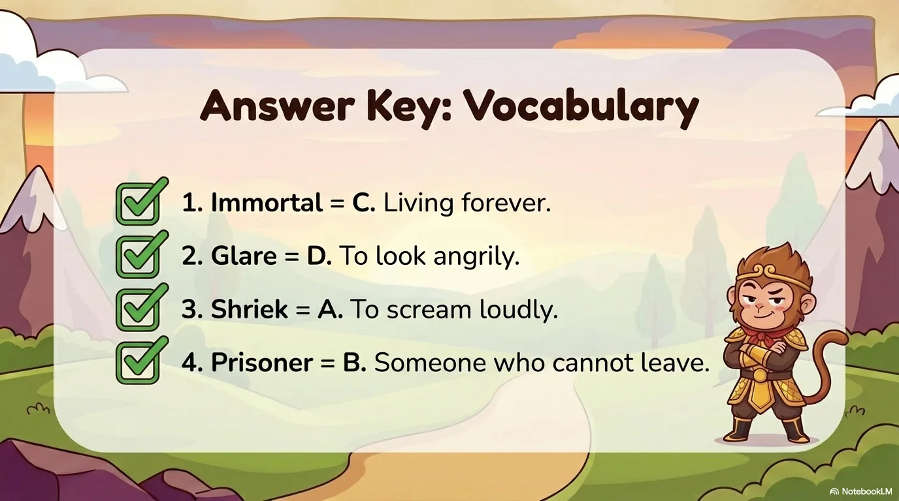

- 来源：`ppt/media/image20.png`（relationship `rId2`）
- 尺寸：1376×768
- 源 SHA-256：`ed217f1b0804c2a28888dc094f5eec76e89d9f9a18f8904988adc987d667a42c`
- 输出 SHA-256：`78a9f489476cc6052ef57a60a2a6ad36b5de43e0434eac1f07217208b5d5e43d`
- 分类：unknown ｜ OCR：blocked ｜ 审核：unreviewed

## Slide 020

- 来源：`ppt/media/image21.png`（relationship `rId2`）
- 尺寸：1376×768
- 源 SHA-256：`a10874c87b84b78133084fe16c78089b03f8d8cbf572a4f7c6bb0731a945d024`
- 输出 SHA-256：`c16aaa6e94ec212b976e90858d4ef0dfe076bda75b7e00d0c1487a26ebcfb590`
- 分类：unknown ｜ OCR：blocked ｜ 审核：unreviewed
