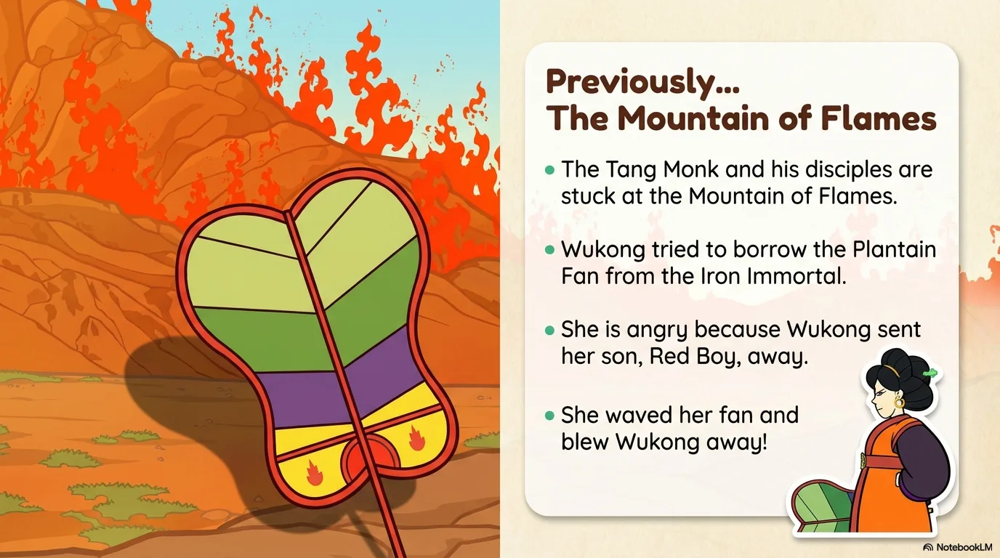
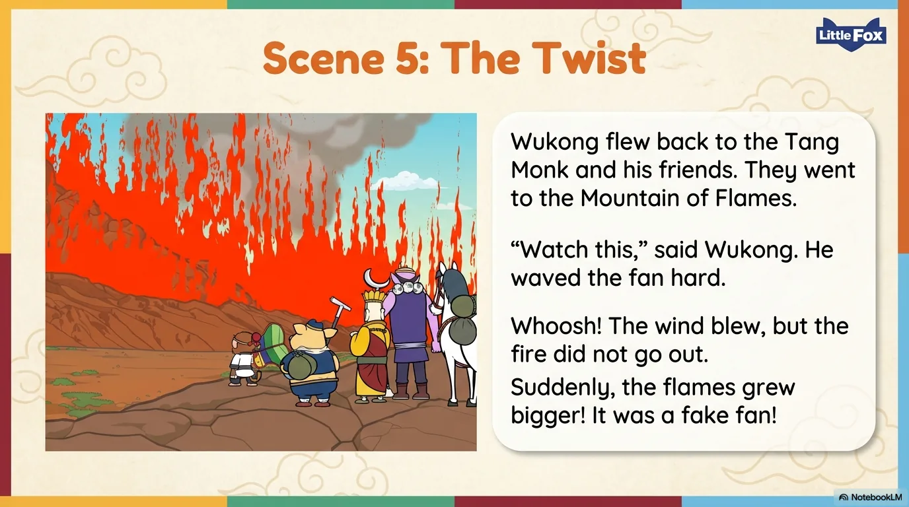

# 豆豆龙英语 · 第 77 集课件（EP077 草稿）

- 来源：`077_Journey to the West 77_The Magic Fan.pptx`（主课件，19 页）
- OCR：`blocked`（no local OCR provider importable (pytesseract missing): No module named 'pytesseract'）
- 分类：待人工审核（unknown）
- 审核状态：`unreviewed`

## Slide 001

- 来源：`ppt/media/image1.png`（relationship `rId2`）
- 尺寸：1376×768
- 源 SHA-256：`8a63b8ab5eb1f23e72b88cbcb42d65c82a92b6530a5103222c25acae38ec7cc4`
- 输出 SHA-256：`2752d10251a797cafd6707d83836f49e02f2159676edfe5666faf76699bfcf3e`
- 分类：unknown ｜ OCR：blocked ｜ 审核：unreviewed

## Slide 002

- 来源：`ppt/media/image3.png`（relationship `rId2`）
- 尺寸：1376×768
- 源 SHA-256：`4c6217845cbfd7b03fc2132e0f6dd4077b32316cdb7b6ec74d3523a4e5096350`
- 输出 SHA-256：`e67950800b15bd953c1a794f394c5fc5191dac9076d47efc35cbf42166017267`
- 分类：unknown ｜ OCR：blocked ｜ 审核：unreviewed

## Slide 003

- 来源：`ppt/media/image4.png`（relationship `rId2`）
- 尺寸：1376×768
- 源 SHA-256：`ba3c6dfa9b9de5ae015ee44024b2a0d5900501089bee678d80485ade9f0fa790`
- 输出 SHA-256：`edf7086e80c327a033fbd262e0c29d14827165a2961829250784e9f2b10f3ff4`
- 分类：unknown ｜ OCR：blocked ｜ 审核：unreviewed

## Slide 004

- 来源：`ppt/media/image5.png`（relationship `rId2`）
- 尺寸：1376×768
- 源 SHA-256：`5601b255b9d877aa54dcb2afe7228a5ba4c21ff33ac1f2d148fbd2665a7ba621`
- 输出 SHA-256：`23175e0329695aad662d12d2b64629c50cad42d78abf496b669927829506440a`
- 分类：unknown ｜ OCR：blocked ｜ 审核：unreviewed

## Slide 005

- 来源：`ppt/media/image6.png`（relationship `rId2`）
- 尺寸：1376×768
- 源 SHA-256：`e0b63e000c644107e0802da233b5dab2ac2c1b869076816755919362b27e391f`
- 输出 SHA-256：`9d0a1d874a09752472957ed5aeea768f12bb3919045679766571d17baad1e6df`
- 分类：unknown ｜ OCR：blocked ｜ 审核：unreviewed

## Slide 006

- 来源：`ppt/media/image7.png`（relationship `rId2`）
- 尺寸：1376×768
- 源 SHA-256：`d1c565f9029277986da9770dac072e178c3b91437cfe3b19c1975d68172465f7`
- 输出 SHA-256：`05fb114e653c5345143a1644c4227ebfe48e2680f297346cc833c6c9445e160f`
- 分类：unknown ｜ OCR：blocked ｜ 审核：unreviewed

## Slide 007

- 来源：`ppt/media/image8.png`（relationship `rId2`）
- 尺寸：1376×768
- 源 SHA-256：`89d6ec8d55fd455e2514b5c8bcf89801de1645029a6f026bc43ae6fb17f7a306`
- 输出 SHA-256：`ecacd30f887ba128c842e610396a261297aefd2f130fefaa497349ac1f009232`
- 分类：unknown ｜ OCR：blocked ｜ 审核：unreviewed

## Slide 008

- 来源：`ppt/media/image9.png`（relationship `rId2`）
- 尺寸：1376×768
- 源 SHA-256：`8b37eaeffc9c8fc629614e297e865b63050f7c1107915091944fd4ff31f05429`
- 输出 SHA-256：`1dc3724954cf5b2af2f0e6cf92e1d3d940ced17b8b160a21a20651bb8e4f86c2`
- 分类：unknown ｜ OCR：blocked ｜ 审核：unreviewed

## Slide 009

- 来源：`ppt/media/image10.png`（relationship `rId2`）
- 尺寸：1376×768
- 源 SHA-256：`325d083ddede86d53c30216b3782c3b633c24d2a208778d1797b278a88cdbab0`
- 输出 SHA-256：`c869e6b6dbcb16bd6ca0f9d8f87afdc1c1a0c87f40d711b63b9db76e7921eae2`
- 分类：unknown ｜ OCR：blocked ｜ 审核：unreviewed

## Slide 010

- 来源：`ppt/media/image11.png`（relationship `rId2`）
- 尺寸：1376×768
- 源 SHA-256：`93553de5f24947268142a44d0dbdcdc9aa6279f0518ab2e4e386c6e6f6c655b0`
- 输出 SHA-256：`4579f9a126783e2d6bf930a94d045eb263f217c4bdaf49fd8e2b91457e435bc7`
- 分类：unknown ｜ OCR：blocked ｜ 审核：unreviewed

## Slide 011

- 来源：`ppt/media/image12.png`（relationship `rId2`）
- 尺寸：1376×768
- 源 SHA-256：`208d9da27bad1de0f0c7bf79d7873e2a8ee0dfe573e17f3c771066543839210b`
- 输出 SHA-256：`6db7412768891f8b745487c7305e940eb6dadaf1601636cdf0f8530930576e5e`
- 分类：unknown ｜ OCR：blocked ｜ 审核：unreviewed

## Slide 012

- 来源：`ppt/media/image13.png`（relationship `rId2`）
- 尺寸：1376×768
- 源 SHA-256：`5888498bae7ba3c93c1d49defcbba13d91962d8415173b600e87af14b67785b4`
- 输出 SHA-256：`cc9a3446344df263616ec71fbffdc0f1aea5d04a69cc51175f0574411799ed81`
- 分类：unknown ｜ OCR：blocked ｜ 审核：unreviewed

## Slide 013

- 来源：`ppt/media/image14.png`（relationship `rId2`）
- 尺寸：1376×768
- 源 SHA-256：`f25b2b8f1989784b56887454dcba1e3ca9bfb5d0b46fb6d46efa2a2c0a705f43`
- 输出 SHA-256：`e63c2243934bb70ba459b048ed5d5db4b839ba7623db8b6a45c530d3d06390b9`
- 分类：unknown ｜ OCR：blocked ｜ 审核：unreviewed

## Slide 014

- 来源：`ppt/media/image15.png`（relationship `rId2`）
- 尺寸：1376×768
- 源 SHA-256：`c82e3819bd2d6e5a49af8f27bca25b78ed46cdb73b95e5d9aa2ce7f674a3c1a7`
- 输出 SHA-256：`2a5096c8b2941f30f167bcd5e2fa38b51b762a2ef35c17677b01a8c14acc10ff`
- 分类：unknown ｜ OCR：blocked ｜ 审核：unreviewed

## Slide 015

- 来源：`ppt/media/image16.png`（relationship `rId2`）
- 尺寸：1376×768
- 源 SHA-256：`8e9c0df7c2abbb7775ab66e25de5290e241a740af955c3adebd195c69072a0a6`
- 输出 SHA-256：`2bb119754b4a5c2fe8280fde96ab50da20ed4dc70174ea540b6af695785003f7`
- 分类：unknown ｜ OCR：blocked ｜ 审核：unreviewed

## Slide 016

- 来源：`ppt/media/image17.png`（relationship `rId2`）
- 尺寸：1376×768
- 源 SHA-256：`0078aae3cad24f06f18deffd139420cb34fb0e11923f13cf02b50e169018ca27`
- 输出 SHA-256：`305aa7796efd088b528af3fef907e01ef53016f265be5e20d5ab267c63a66102`
- 分类：unknown ｜ OCR：blocked ｜ 审核：unreviewed

## Slide 017

- 来源：`ppt/media/image18.png`（relationship `rId2`）
- 尺寸：1376×768
- 源 SHA-256：`3e50160cd56b2ddd18b59cd403537598d9a32f7f86f7cd184604b031fe10bdf5`
- 输出 SHA-256：`dae3f1175a51720bf419f819f56ec1fb3c0fde003f274c1f7f8b1bfc49ac2449`
- 分类：unknown ｜ OCR：blocked ｜ 审核：unreviewed

## Slide 018

- 来源：`ppt/media/image19.png`（relationship `rId2`）
- 尺寸：1376×768
- 源 SHA-256：`76958a4c2f8be6994e73b1e4288322e3532fad408f62f013ddfd29c8b249c2ed`
- 输出 SHA-256：`05d9fc1fc80f3e75d13f156be68ddcf52964e3f06c8e24ae2ebb27aebf229917`
- 分类：unknown ｜ OCR：blocked ｜ 审核：unreviewed

## Slide 019

- 来源：`ppt/media/image20.png`（relationship `rId2`）
- 尺寸：1376×768
- 源 SHA-256：`f584630230216d7f3534cfb9c2873df6e6cd21306e59c647081809e9fe25ffaa`
- 输出 SHA-256：`ee4af6c33577ae8aed7d87dc3aa658e4281e58e1a5692ab22b35692e7776a150`
- 分类：unknown ｜ OCR：blocked ｜ 审核：unreviewed
