# 豆豆龙英语 · 第 79 集课件（EP079 草稿）

- 来源：`079_Journey to the West 79_The Mountain of Flames.pptx`（主课件，20 页）
- OCR：`blocked`（no local OCR provider importable (pytesseract missing): No module named 'pytesseract'）
- 分类：待人工审核（unknown）
- 审核状态：`unreviewed`

## Slide 001

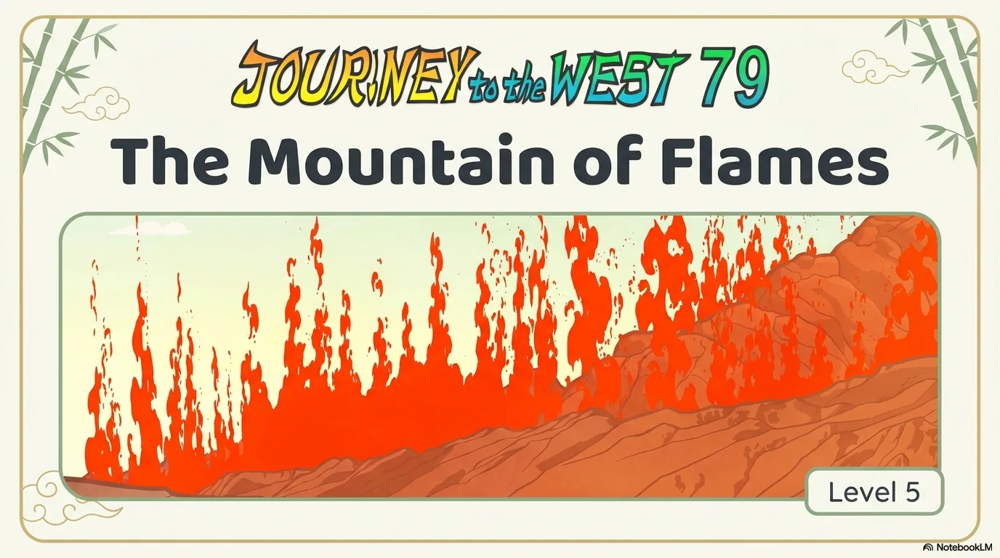

- 来源：`ppt/media/image1.png`（relationship `rId2`）
- 尺寸：1376×768
- 源 SHA-256：`98dc09524c5c256b5633cf102233183c44e658925e902bcfa2b0b42eb0ed6eab`
- 输出 SHA-256：`f969ac66cf04f589b6fb8b77157f21f6139515e2e2da49e04bc70eb46746a28f`
- 分类：unknown ｜ OCR：blocked ｜ 审核：unreviewed

## Slide 002

- 来源：`ppt/media/image3.png`（relationship `rId2`）
- 尺寸：1376×768
- 源 SHA-256：`0800cc7d0c6fce7338df8a3bd76d1457c90ccfd961e3382a1b91818bb198674c`
- 输出 SHA-256：`cac5b8ebd1910abe2e4a006041a4da5a978e334f1cc1a875aabccc2827d54101`
- 分类：unknown ｜ OCR：blocked ｜ 审核：unreviewed

## Slide 003

- 来源：`ppt/media/image4.png`（relationship `rId2`）
- 尺寸：1376×768
- 源 SHA-256：`6193f3ce6d4f65e8b9869abcd6c541b50f5b6b2726983d2481fd1a4bf023fc44`
- 输出 SHA-256：`72b051b8d3a1d2f1e254b875f8cd9b3294f90d2966a3c0045fd1312821a805eb`
- 分类：unknown ｜ OCR：blocked ｜ 审核：unreviewed

## Slide 004

- 来源：`ppt/media/image5.png`（relationship `rId2`）
- 尺寸：1376×768
- 源 SHA-256：`4e8797a2b306746a6f3b334cc91a27c44f34913a6901bbb2b04957cd20b6db6f`
- 输出 SHA-256：`63b558d78aaefd4bbc81f63a2c591fd77ded887bb58cb4f840fda04d0f7c1f3c`
- 分类：unknown ｜ OCR：blocked ｜ 审核：unreviewed

## Slide 005

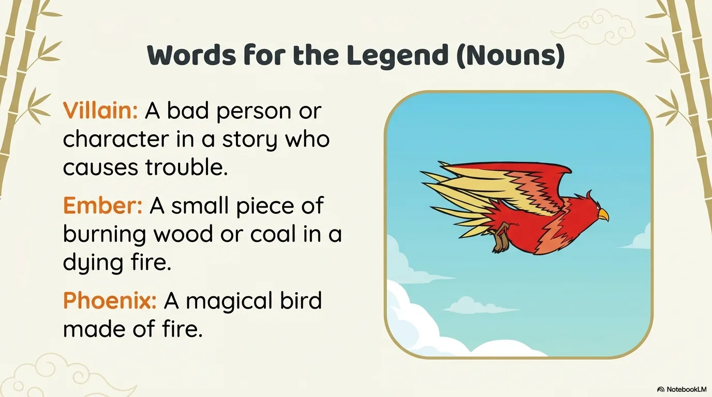

- 来源：`ppt/media/image6.png`（relationship `rId2`）
- 尺寸：1376×768
- 源 SHA-256：`927c149d9ac8b2cc10252dcb4c4e97b3bbb7181045a445b3b4215a964b1c7c96`
- 输出 SHA-256：`13279585cdfb8d6136024648fb924a4752f678914fbfbecef73aba917cc7432b`
- 分类：unknown ｜ OCR：blocked ｜ 审核：unreviewed

## Slide 006

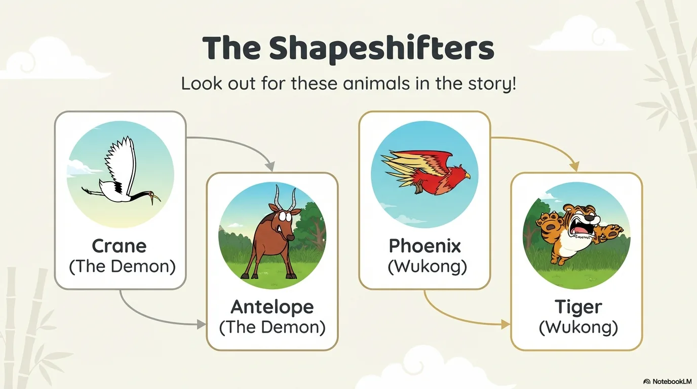

- 来源：`ppt/media/image7.png`（relationship `rId2`）
- 尺寸：1376×768
- 源 SHA-256：`41d26c2fb7e8332249b36fcc9c2e67a51934ac4fb434a79d24ae0450a95f92d1`
- 输出 SHA-256：`16ad52e6cbf9ed0ac13dec10e56fff98ad48d4b75aca900f5e1df6a5af12f542`
- 分类：unknown ｜ OCR：blocked ｜ 审核：unreviewed

## Slide 007

- 来源：`ppt/media/image8.png`（relationship `rId2`）
- 尺寸：1376×768
- 源 SHA-256：`bb9de08a00aa20dd6ca006d4cdb1f22bb2db83c0cfbfecbc5af28b85b6edf71a`
- 输出 SHA-256：`15bb3d48b3d535ccc6661f62be7ab4893a00c38ec0e425f45177b8a4039470b5`
- 分类：unknown ｜ OCR：blocked ｜ 审核：unreviewed

## Slide 008

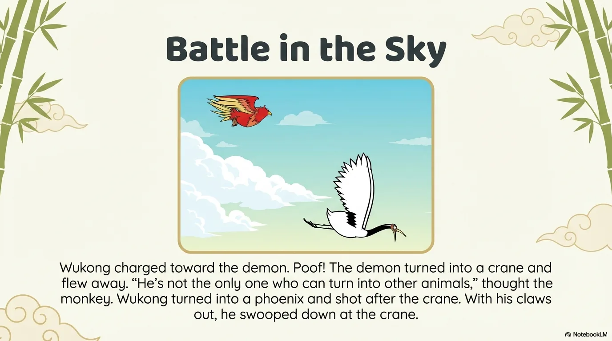

- 来源：`ppt/media/image9.png`（relationship `rId2`）
- 尺寸：1376×768
- 源 SHA-256：`05d0edafc51423b75582d639113c76eef38fe368629478e6e2c750d3ddebe78c`
- 输出 SHA-256：`d556b71daa0cce8049bffb6f6d1e6243ae030c13abb2b5b8078efe01e96e7c9c`
- 分类：unknown ｜ OCR：blocked ｜ 审核：unreviewed

## Slide 009

- 来源：`ppt/media/image10.png`（relationship `rId2`）
- 尺寸：1376×768
- 源 SHA-256：`7470594b1ad8b6ebb4dfd0bc950ff11c08682a366c5f3a27d39bb58ee4bc022f`
- 输出 SHA-256：`d42886562fd48dab6e6220ed01d438dc4789ceb9653bfccf9f76254b18b85041`
- 分类：unknown ｜ OCR：blocked ｜ 审核：unreviewed

## Slide 010

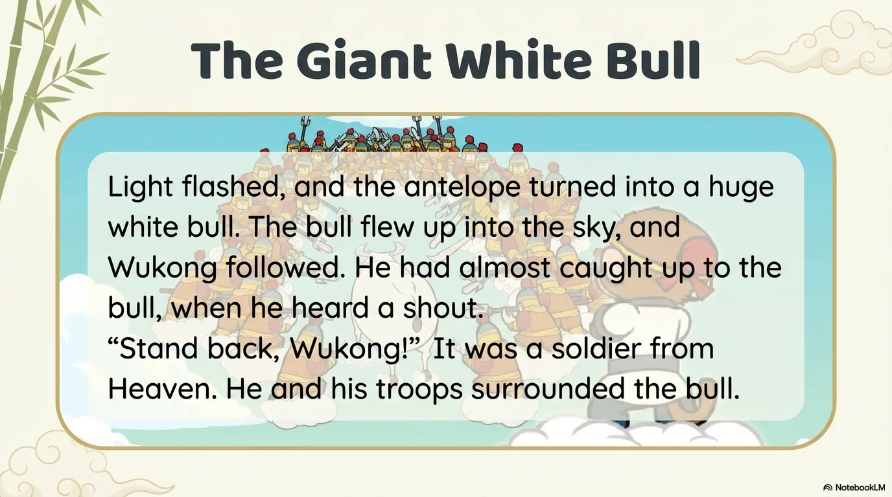

- 来源：`ppt/media/image11.png`（relationship `rId2`）
- 尺寸：1376×768
- 源 SHA-256：`aba1deae0c21aa2151107c0243ae2b836b0528178433032fe88572c2bbfe2e8c`
- 输出 SHA-256：`feda79e6fdd3ebc72ea48a1da7a77ee7a84f19eb70ea157b56c178d2553ed06f`
- 分类：unknown ｜ OCR：blocked ｜ 审核：unreviewed

## Slide 011

- 来源：`ppt/media/image12.png`（relationship `rId2`）
- 尺寸：1376×768
- 源 SHA-256：`188d86414baedee6450c0d1a2d8236626e1422becf0c5c0aa2bead82cf12ff89`
- 输出 SHA-256：`1b4f5b9ea19caccdf00ec1db9f12b47edeade96a3ccd4bb31c6359fa602d2ba3`
- 分类：unknown ｜ OCR：blocked ｜ 审核：unreviewed

## Slide 012

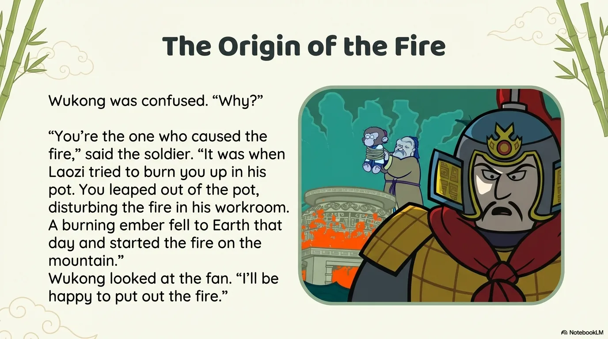

- 来源：`ppt/media/image13.png`（relationship `rId2`）
- 尺寸：1376×768
- 源 SHA-256：`b2ed980ff95cee4b5916092a6aadb3833fcd1d1f8ab06a304042ddcdd6a2fb16`
- 输出 SHA-256：`394f91eaf5553d167d6f452e71fba81cddbc152a4f3bd6011336aade2bf01ed2`
- 分类：unknown ｜ OCR：blocked ｜ 审核：unreviewed

## Slide 013

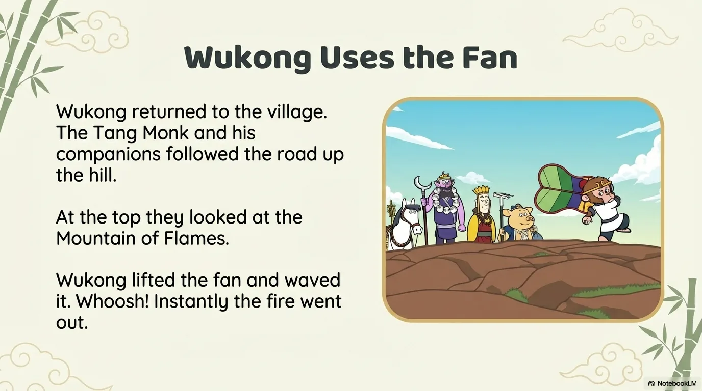

- 来源：`ppt/media/image14.png`（relationship `rId2`）
- 尺寸：1376×768
- 源 SHA-256：`730c4685a373650084504b8a5640fdd3dfe9ceb0975354abe0d9be02de34c279`
- 输出 SHA-256：`954227b934f6f324d9a7192b6a6e657596dc8ee93a4970fce875c420c96b3784`
- 分类：unknown ｜ OCR：blocked ｜ 审核：unreviewed

## Slide 014

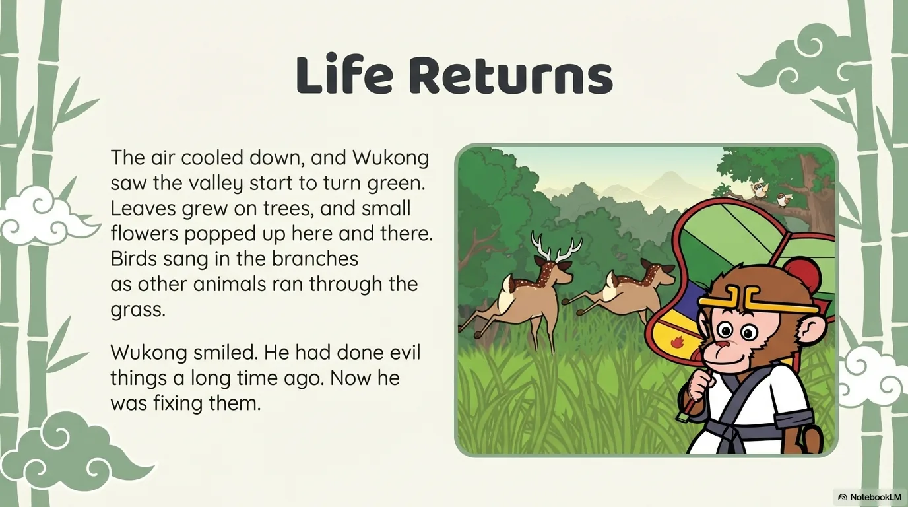

- 来源：`ppt/media/image15.png`（relationship `rId2`）
- 尺寸：1376×768
- 源 SHA-256：`feb653acb98f6649d89c8d4cf97da9cad14e1de8d8285f55b983b4f585755bdd`
- 输出 SHA-256：`c2f6201dff4dbc66f89b1b000a2b39d407145850269e4452ed58c4673221b2fa`
- 分类：unknown ｜ OCR：blocked ｜ 审核：unreviewed

## Slide 015

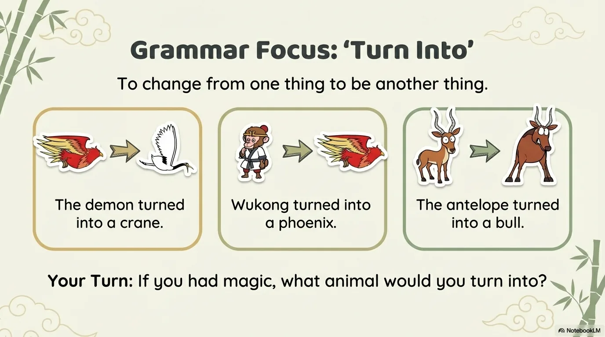

- 来源：`ppt/media/image16.png`（relationship `rId2`）
- 尺寸：1376×768
- 源 SHA-256：`4db16d3f63640f941e28643e008201798c64ce4541b6c4367039ca2916ed51de`
- 输出 SHA-256：`c52eddb4f4f035ae5cc9dfa3d90ba0660110b6bd4358dc4589004b113f5a6418`
- 分类：unknown ｜ OCR：blocked ｜ 审核：unreviewed

## Slide 016

- 来源：`ppt/media/image17.png`（relationship `rId2`）
- 尺寸：1376×768
- 源 SHA-256：`799b0aba288f2eab457ba1adea6982af5e4ec15517ba3e332cea767bd6050034`
- 输出 SHA-256：`b37dcf891b58b79e34ff2d58365f170b4fa3f4467a8b62d8fbdbd4dd14608716`
- 分类：unknown ｜ OCR：blocked ｜ 审核：unreviewed

## Slide 017

- 来源：`ppt/media/image18.png`（relationship `rId2`）
- 尺寸：1376×768
- 源 SHA-256：`76eb62d9e2e1fb1bb1c3237710d10658a71a487ce5177da5fde5e109a122b239`
- 输出 SHA-256：`959ca5c3ebc17621e9f0fefaf4892fba13baa0646914ca5dd5042351c34c0d19`
- 分类：unknown ｜ OCR：blocked ｜ 审核：unreviewed

## Slide 018

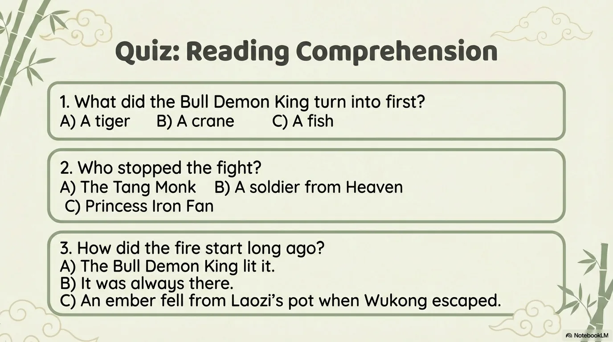

- 来源：`ppt/media/image19.png`（relationship `rId2`）
- 尺寸：1376×768
- 源 SHA-256：`8198706c900dd743bb54f269e38fde33bf4054c4df47945e519dd08f36a4abbc`
- 输出 SHA-256：`1ae895247b84d075355100bedc6fba628f50e62b14cb59f47e0525b7e1fae894`
- 分类：unknown ｜ OCR：blocked ｜ 审核：unreviewed

## Slide 019

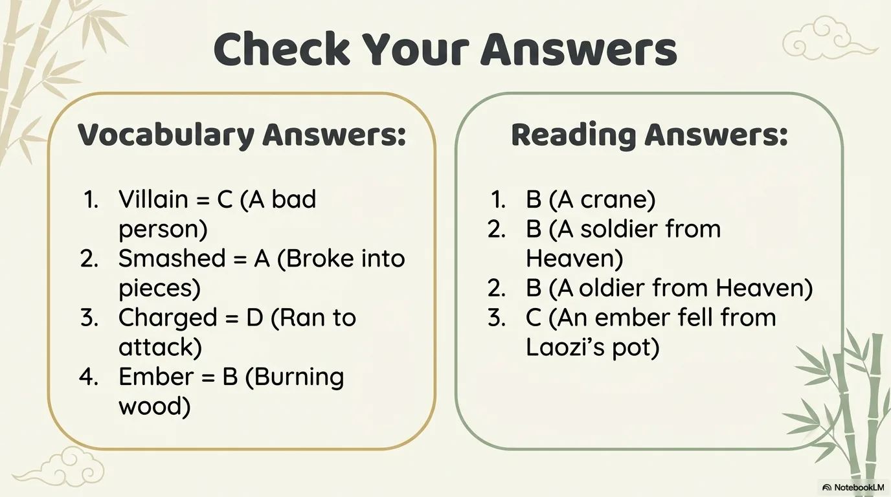

- 来源：`ppt/media/image20.png`（relationship `rId2`）
- 尺寸：1376×768
- 源 SHA-256：`5513225dc3cb9ca416a66ccb9bdeed5e31cce62d4fe96ff96aba89d2538e47a8`
- 输出 SHA-256：`883b06b176348eef910b57466c2cbfa4fcf69f5a9360c6d1bd8a4765da8450f4`
- 分类：unknown ｜ OCR：blocked ｜ 审核：unreviewed

## Slide 020

- 来源：`ppt/media/image21.png`（relationship `rId2`）
- 尺寸：1376×768
- 源 SHA-256：`9a729c7932c756846b303ec26490c9f5a8ea84a922925e4609ddaa050e88773a`
- 输出 SHA-256：`5d78c492ee2b65af52df8ace55dbadd79e8a9f2c4d36d1bb00676406dda7b35d`
- 分类：unknown ｜ OCR：blocked ｜ 审核：unreviewed
