# 豆豆龙英语 · 第 80 集课件（EP080 草稿）

- 来源：`080_Journey to the West 80_The Small Thunderclap Monastery.pptx`（主课件，20 页）
- OCR：`blocked`（no local OCR provider importable (pytesseract missing): No module named 'pytesseract'）
- 分类：待人工审核（unknown）
- 审核状态：`unreviewed`

## Slide 001

- 来源：`ppt/media/image1.png`（relationship `rId2`）
- 尺寸：1376×768
- 源 SHA-256：`02e0e92071e3681a85008c170daf1122db792e6fb6211fb066eda8f3fef08ef5`
- 输出 SHA-256：`5ebfbec905fa9032cfcc3168928157010177857adde7061946d29e719ad88910`
- 分类：unknown ｜ OCR：blocked ｜ 审核：unreviewed

## Slide 002

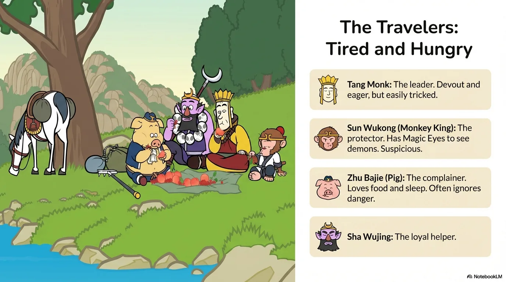

- 来源：`ppt/media/image3.png`（relationship `rId2`）
- 尺寸：1376×768
- 源 SHA-256：`79f16b271fcf54e6f92a243b366d571cc5765e8916e09a87e0e9f2e69ebc5460`
- 输出 SHA-256：`6c843559972c1f661eb312cd0f9211402b9f16bcf59b6e65a70a7f219ef16ae2`
- 分类：unknown ｜ OCR：blocked ｜ 审核：unreviewed

## Slide 003

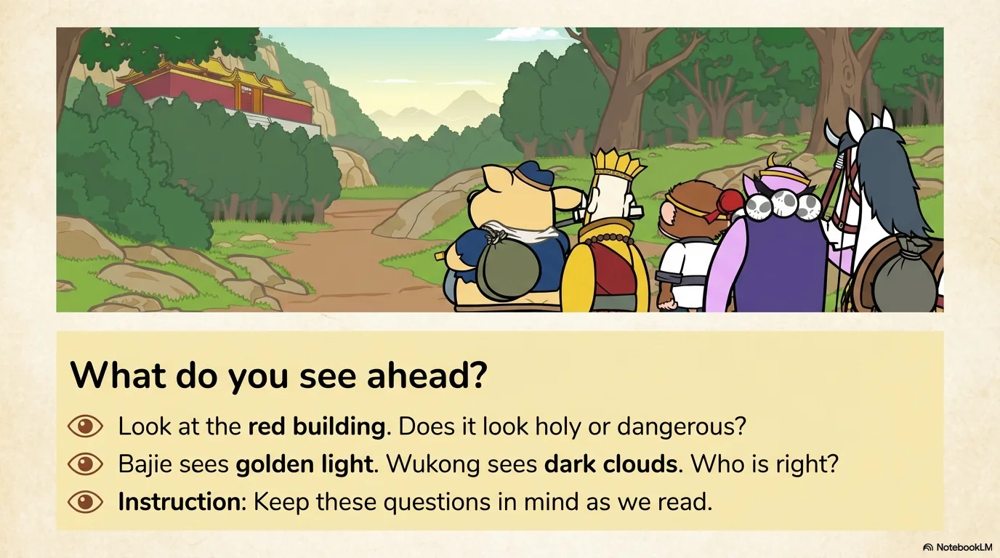

- 来源：`ppt/media/image4.png`（relationship `rId2`）
- 尺寸：1376×768
- 源 SHA-256：`b5566147a96b30e2cf686f621ddd293a7c2d412e4a03711eecdcd50c8fafc3b1`
- 输出 SHA-256：`9bc2202603306b18de8624c5288c9321ebd1771873801ada349584a71ebc4f79`
- 分类：unknown ｜ OCR：blocked ｜ 审核：unreviewed

## Slide 004

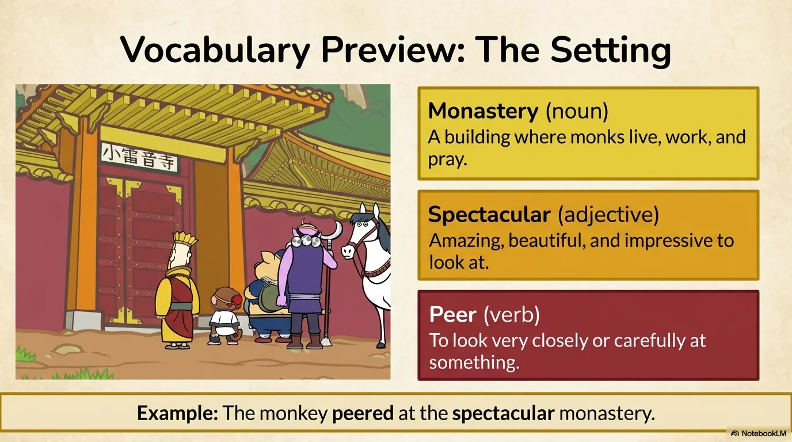

- 来源：`ppt/media/image5.png`（relationship `rId2`）
- 尺寸：1376×768
- 源 SHA-256：`d7ce35b32605946b409c6cbfcd89de9e3cdfbbb063e4d16092f2c6ad90b8037e`
- 输出 SHA-256：`b27652aadd84ad004511c282dc58d2d1a620ed18b977db282c52556d2999ba27`
- 分类：unknown ｜ OCR：blocked ｜ 审核：unreviewed

## Slide 005

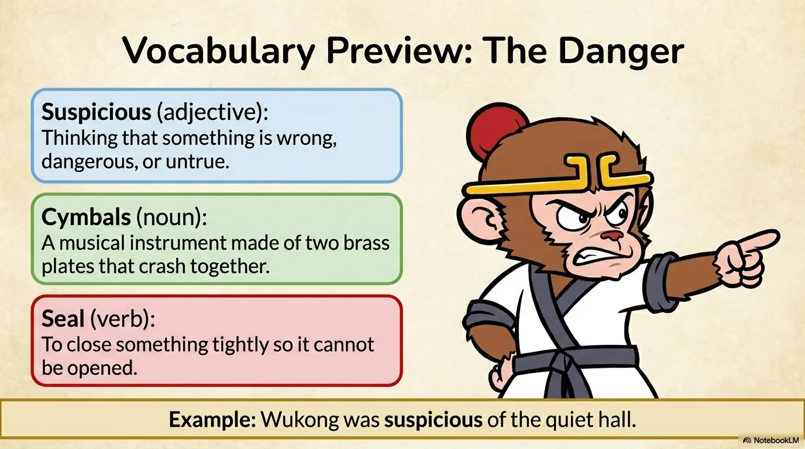

- 来源：`ppt/media/image6.png`（relationship `rId2`）
- 尺寸：1376×768
- 源 SHA-256：`86a8d6b0763805a9b7109e019d46677f7caff0e903cfd3c9d210cd9571579342`
- 输出 SHA-256：`3a4c84aa74cf35793732e74ce0bd9a27bf4fcaa8eb23b8d0ce96ba907a2c0750`
- 分类：unknown ｜ OCR：blocked ｜ 审核：unreviewed

## Slide 006

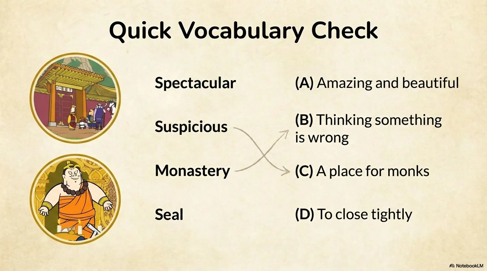

- 来源：`ppt/media/image7.png`（relationship `rId2`）
- 尺寸：1376×768
- 源 SHA-256：`d1cc29cb1f773d6929ab42e80a7b522d5f47aa6e47a7d61a468f91c22f165604`
- 输出 SHA-256：`90257adb6ec7deaa4d55a13e8ea870a7fcc9382759ab860399a5a92fd2275ed6`
- 分类：unknown ｜ OCR：blocked ｜ 审核：unreviewed

## Slide 007

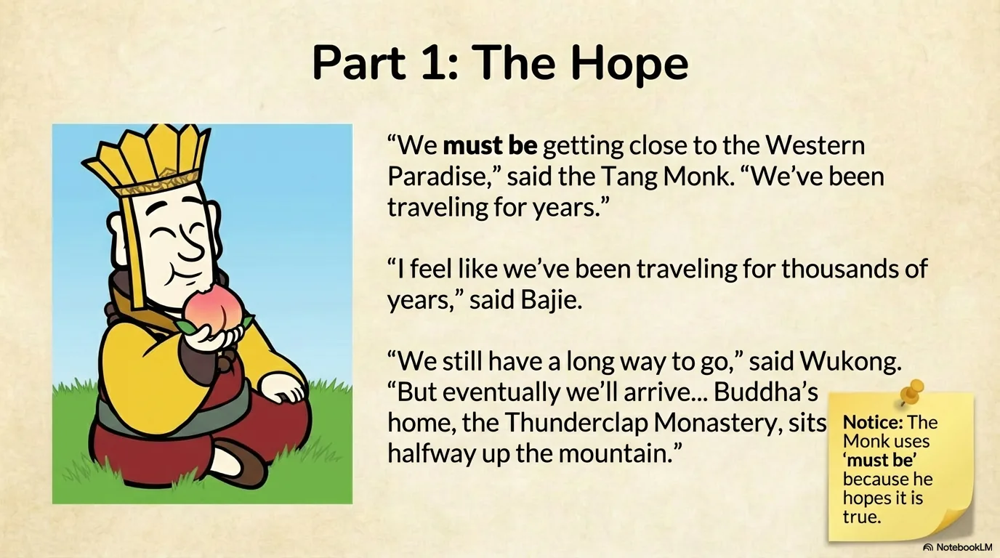

- 来源：`ppt/media/image8.png`（relationship `rId2`）
- 尺寸：1376×768
- 源 SHA-256：`cdde7cb970fadf06ece72f1332cb1ac5fc6e05823d8459fbb3d83437326aa44d`
- 输出 SHA-256：`a69db318a19ac7397ed119c11ccb6992afc396f2d02e384016e78c3d902ce881`
- 分类：unknown ｜ OCR：blocked ｜ 审核：unreviewed

## Slide 008

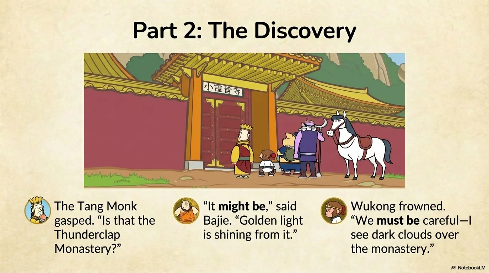

- 来源：`ppt/media/image9.png`（relationship `rId2`）
- 尺寸：1376×768
- 源 SHA-256：`f380d926683a8f174594cf7bf49a199ec3fb5e46ee041b3c978c7e8915d1ac42`
- 输出 SHA-256：`e91d1a236c871e40235a9df751abb8bfa48f5cd43f24d932877e729d38b0ebcf`
- 分类：unknown ｜ OCR：blocked ｜ 审核：unreviewed

## Slide 009

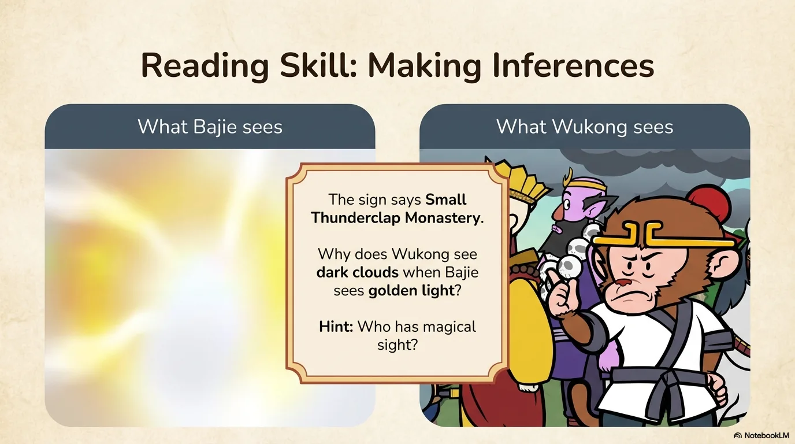

- 来源：`ppt/media/image10.png`（relationship `rId2`）
- 尺寸：1376×768
- 源 SHA-256：`c4598c5b72f48b16fb6b032b8bb409fe76bb22ffb6af278f8c25cdbd147db201`
- 输出 SHA-256：`0eed6bfe9e6c21db08ec98dc7067722f7bec252281c2210958887513101f42fc`
- 分类：unknown ｜ OCR：blocked ｜ 审核：unreviewed

## Slide 010

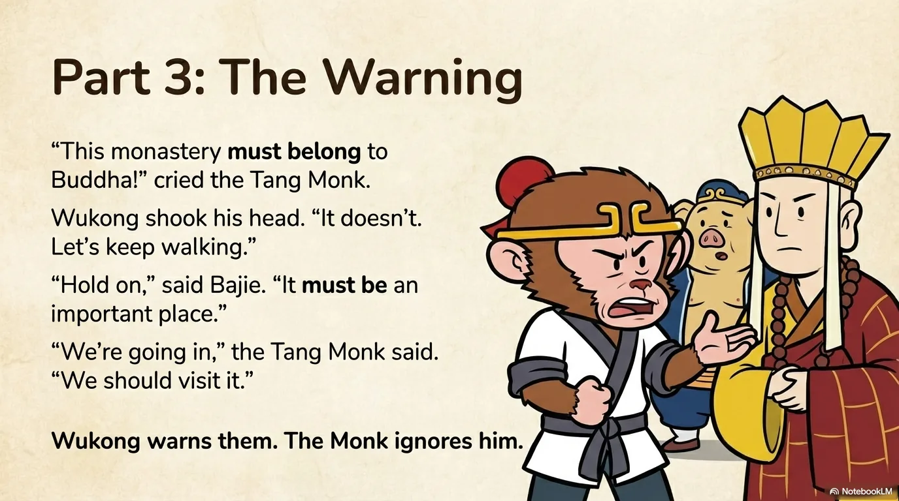

- 来源：`ppt/media/image11.png`（relationship `rId2`）
- 尺寸：1376×768
- 源 SHA-256：`ace23df31073053a4366ec08125bc6fb60bec951bb29bee61218c55fa80d84a8`
- 输出 SHA-256：`b73a1c63d4d52123a340045323cfb71009b326070aa7ad7e2e61a0c011b49c47`
- 分类：unknown ｜ OCR：blocked ｜ 审核：unreviewed

## Slide 011

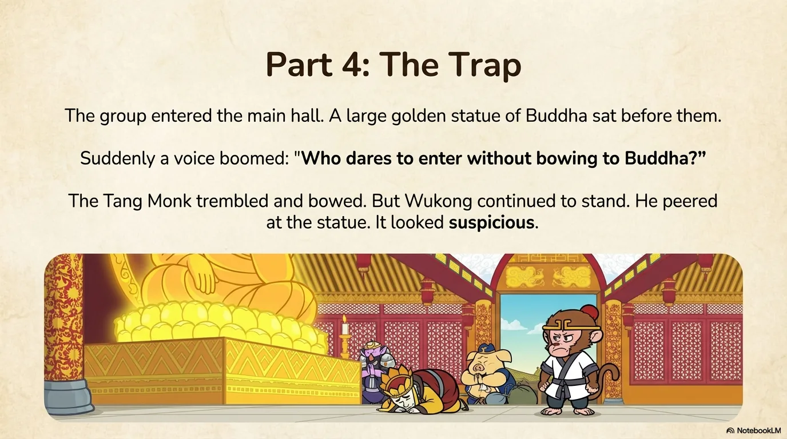

- 来源：`ppt/media/image12.png`（relationship `rId2`）
- 尺寸：1376×768
- 源 SHA-256：`3af88c4d37c9de271b93304173a5f9d09f239c51bfce8b01913f21e60db5373c`
- 输出 SHA-256：`d6ea3e069cd0a5fc47bb58abf759e204952731120d9b5e2c065671c6758dbddc`
- 分类：unknown ｜ OCR：blocked ｜ 审核：unreviewed

## Slide 012

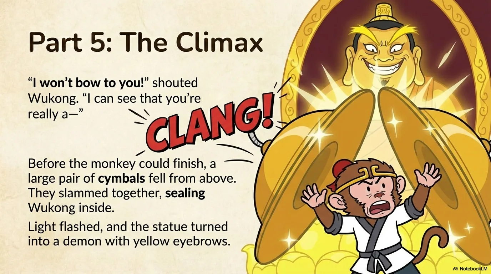

- 来源：`ppt/media/image13.png`（relationship `rId2`）
- 尺寸：1376×768
- 源 SHA-256：`43cfa14088bdabffb0193dfe2d28688eb9d34c5d26263cb2113d7ef51615644f`
- 输出 SHA-256：`e28b6a0767d2d5de448c8dc0127f586f76fc404110eb5763af538c5aa1bdfa24`
- 分类：unknown ｜ OCR：blocked ｜ 审核：unreviewed

## Slide 013

- 来源：`ppt/media/image14.png`（relationship `rId2`）
- 尺寸：1376×768
- 源 SHA-256：`c653826ed389c0af4b20e19b704b8162b869926eb06c3284df4c76569fb890bb`
- 输出 SHA-256：`61260df091b8c7d146675f0b061000c584c5450a5827e2473382cf165a22e8de`
- 分类：unknown ｜ OCR：blocked ｜ 审核：unreviewed

## Slide 014

- 来源：`ppt/media/image15.png`（relationship `rId2`）
- 尺寸：1376×768
- 源 SHA-256：`7914654e23d7b92c73ab6b8d4bfc5f8ec331cd8302c074973f05f936b06efe31`
- 输出 SHA-256：`96b4363659e78cfa14425f76ea756c7fd88afa1449bb6bb807923299e3e0a87e`
- 分类：unknown ｜ OCR：blocked ｜ 审核：unreviewed

## Slide 015

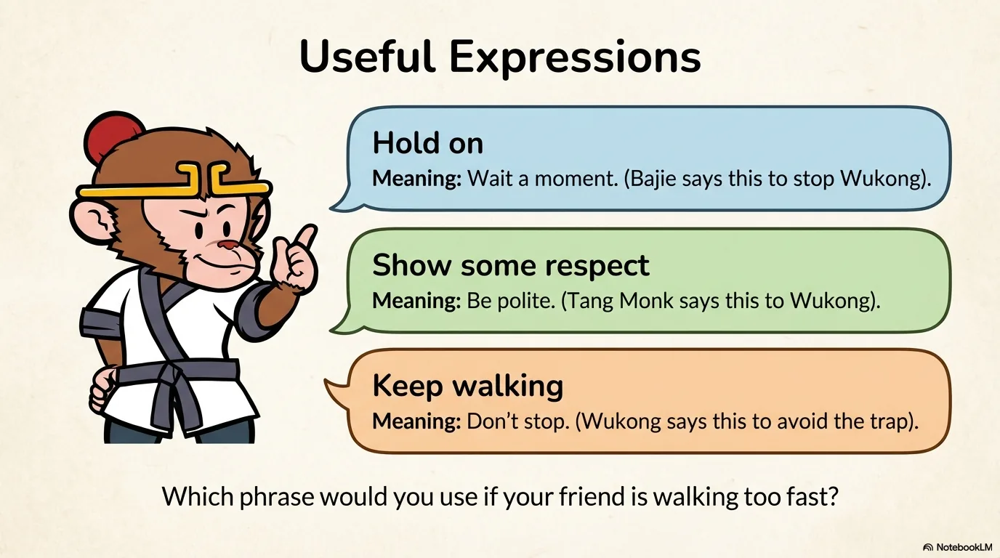

- 来源：`ppt/media/image16.png`（relationship `rId2`）
- 尺寸：1376×768
- 源 SHA-256：`f63e342798cb396912da7312108cc47b7ce6fbe404e4edd62e3c711af0ee3d87`
- 输出 SHA-256：`8372833049946ea45a2fb3f37869f1aaf8bc50bc5ab8965bdeb2c90d43cbe4bd`
- 分类：unknown ｜ OCR：blocked ｜ 审核：unreviewed

## Slide 016

- 来源：`ppt/media/image17.png`（relationship `rId2`）
- 尺寸：1376×768
- 源 SHA-256：`3a80d3351453a7e7d142557e622aa3e701c87e835261a64b7a45ea29c2d53c30`
- 输出 SHA-256：`368496440daacd82e4ac14c6b7bde2285a125c9ab431ddd71c5e9a37f9654bb1`
- 分类：unknown ｜ OCR：blocked ｜ 审核：unreviewed

## Slide 017

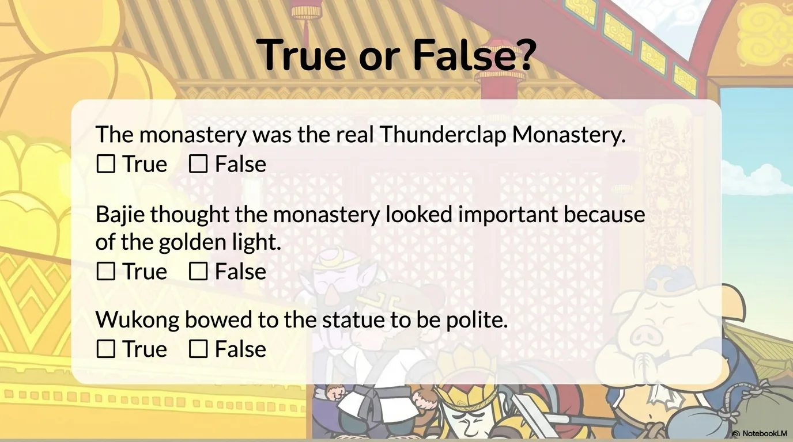

- 来源：`ppt/media/image18.png`（relationship `rId2`）
- 尺寸：1376×768
- 源 SHA-256：`f660e59c79998ec7d31cead8bccc98ce008a4e143ea186e51b1dc014299aa683`
- 输出 SHA-256：`c015723e0a5ef8f41a479099446c5c61590001f79f14691404f4790361a93c9f`
- 分类：unknown ｜ OCR：blocked ｜ 审核：unreviewed

## Slide 018

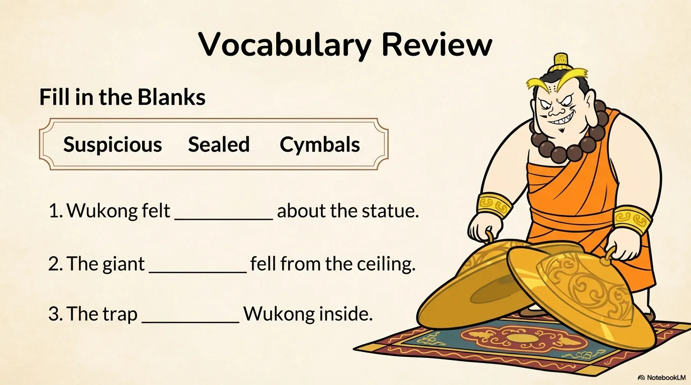

- 来源：`ppt/media/image19.png`（relationship `rId2`）
- 尺寸：1376×768
- 源 SHA-256：`d6768d4cb99485384a9e1e57a826c6c6a4e8fcea249b3f42598459e4c73c4d52`
- 输出 SHA-256：`4072cdd63d742cd687beccf4846e113fe08928d418235e26a59d38316df3ee3c`
- 分类：unknown ｜ OCR：blocked ｜ 审核：unreviewed

## Slide 019

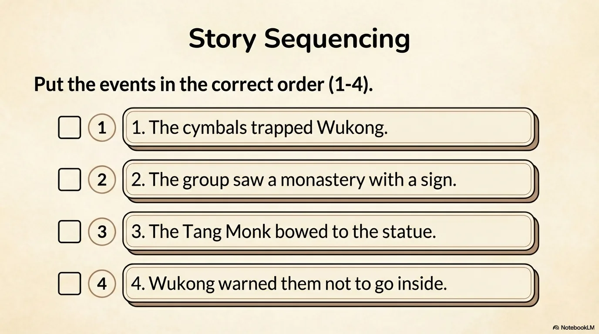

- 来源：`ppt/media/image20.png`（relationship `rId2`）
- 尺寸：1376×768
- 源 SHA-256：`9d34925800826491d9db0c284f1af3153e45db0001d4742da34984592ba29833`
- 输出 SHA-256：`4d4d0b71005a80e21fb91c2b8f312b8294b3b4454d424568ee1f38842efe65bc`
- 分类：unknown ｜ OCR：blocked ｜ 审核：unreviewed

## Slide 020

- 来源：`ppt/media/image21.png`（relationship `rId2`）
- 尺寸：1376×768
- 源 SHA-256：`bc7178a8d4f1287a321dd163fdd3d384ed8354a88b8543e2be24a6fcf9b77912`
- 输出 SHA-256：`d9710f8374f054478701607bcbe48aa91882e83105abc3ec53851a138fdd56ab`
- 分类：unknown ｜ OCR：blocked ｜ 审核：unreviewed
