# 豆豆龙英语 · 第 81 集课件（EP081 草稿）

- 来源：`081_Journey to the West 81_Help from a Dragon.pptx`（主课件，20 页）
- OCR：`blocked`（no local OCR provider importable (pytesseract missing): No module named 'pytesseract'）
- 分类：待人工审核（unknown）
- 审核状态：`unreviewed`

## Slide 001

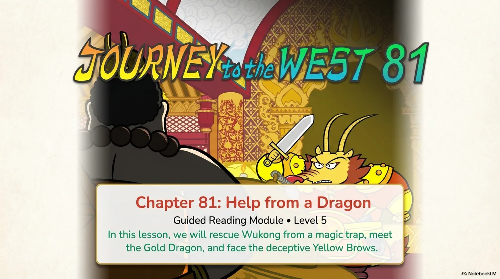

- 来源：`ppt/media/image1.png`（relationship `rId2`）
- 尺寸：1376×768
- 源 SHA-256：`b9ea2503eed7f077ae2973db471f96b683cef06fee75b63f00a2edabc108ecc9`
- 输出 SHA-256：`bcf327c9f961b303b168b11e731f63cfd8ad3cfebe883dc273248eb16b1e4e5f`
- 分类：unknown ｜ OCR：blocked ｜ 审核：unreviewed

## Slide 002

- 来源：`ppt/media/image3.png`（relationship `rId2`）
- 尺寸：1376×768
- 源 SHA-256：`419a68d9d9d67dbaa86fb6d120932692bc315a6e795b1bfdfd883e6ed46a2675`
- 输出 SHA-256：`f88740d502984ba87450d93232217a31bafb9d03f7db7b498d5d68f23b37d634`
- 分类：unknown ｜ OCR：blocked ｜ 审核：unreviewed

## Slide 003

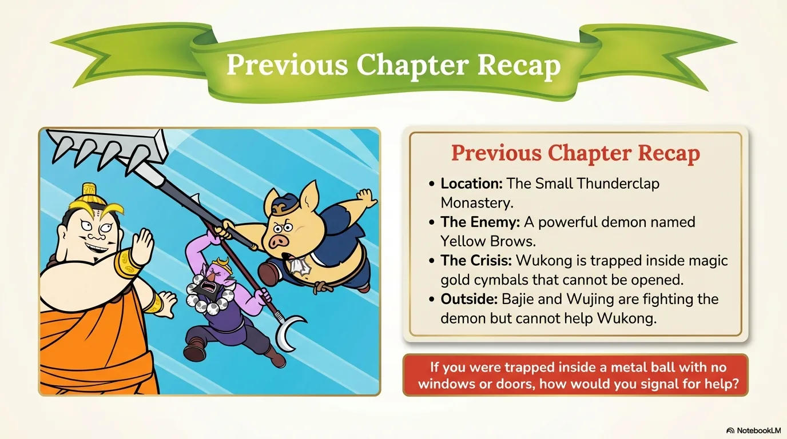

- 来源：`ppt/media/image4.png`（relationship `rId2`）
- 尺寸：1376×768
- 源 SHA-256：`ef30ed139f6775e3a0f547f66c5c3d25fc63c737cdebac949d2af69c6057a14b`
- 输出 SHA-256：`6f22e9f9bed0af46960df64ed9d4c3cfbabb7ecb53543b5c684dddb998bb016a`
- 分类：unknown ｜ OCR：blocked ｜ 审核：unreviewed

## Slide 004

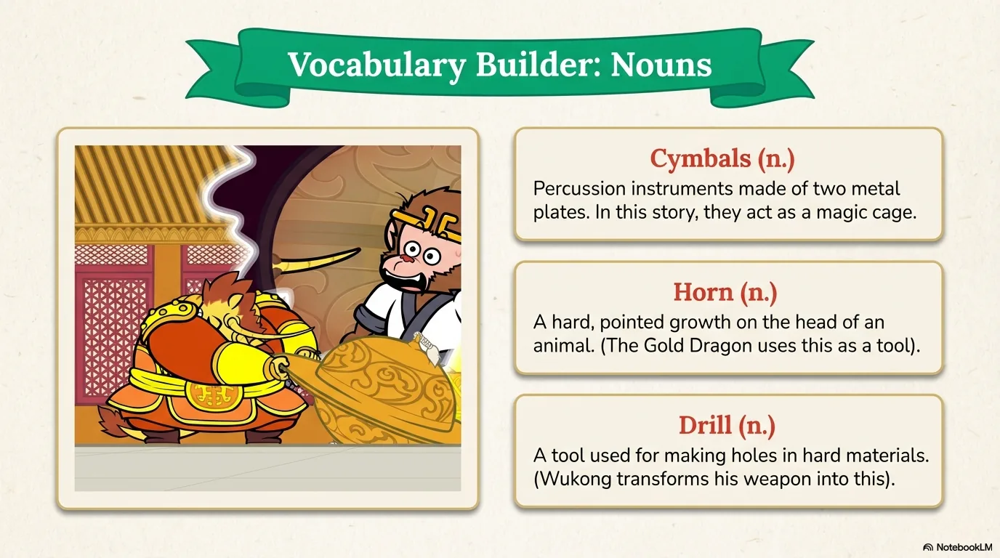

- 来源：`ppt/media/image5.png`（relationship `rId2`）
- 尺寸：1376×768
- 源 SHA-256：`02ea1c610dbc5744888afc684194cc088b7a55d786df83eb4146db1787d779e7`
- 输出 SHA-256：`1cac48bdff6e0572c50e28567c7effc9be60be8a94b5206a850f468cedda653c`
- 分类：unknown ｜ OCR：blocked ｜ 审核：unreviewed

## Slide 005

- 来源：`ppt/media/image6.png`（relationship `rId2`）
- 尺寸：1376×768
- 源 SHA-256：`0a05841a82d685ce643c3a746425922578d77da9ff2265b17449135f6ffd2d7d`
- 输出 SHA-256：`798ec4cd6ab0cf7ee5b9772a78d995c93c41647c74741569e2048ab854098027`
- 分类：unknown ｜ OCR：blocked ｜ 审核：unreviewed

## Slide 006

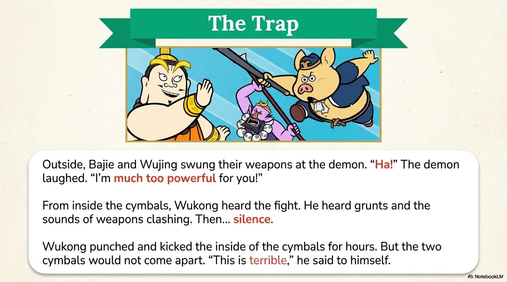

- 来源：`ppt/media/image7.png`（relationship `rId2`）
- 尺寸：1376×768
- 源 SHA-256：`7f35600548e861d493dec14fa7bdc0a1552a180d77eab21e49f1e6951b9d8e7e`
- 输出 SHA-256：`bcb028c6ba8a80733fb0b795ce281b1b75b82541f980ead62792f7a3fcab2c8d`
- 分类：unknown ｜ OCR：blocked ｜ 审核：unreviewed

## Slide 007

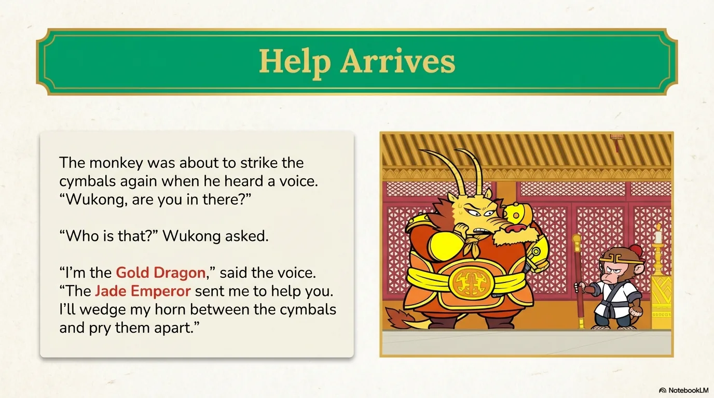

- 来源：`ppt/media/image8.png`（relationship `rId2`）
- 尺寸：1376×768
- 源 SHA-256：`9185394b90b8ae8a36084ac52a0fb06fb9d730bf7be54afaefecbea0cb24ef97`
- 输出 SHA-256：`4f9769cadc976884e4b6923c86ccadf4a81fe336f6531383b4da3363a25a5cb6`
- 分类：unknown ｜ OCR：blocked ｜ 审核：unreviewed

## Slide 008

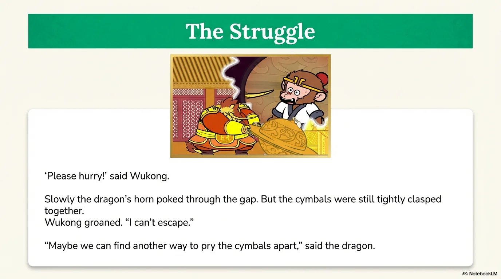

- 来源：`ppt/media/image9.png`（relationship `rId2`）
- 尺寸：1376×768
- 源 SHA-256：`971d44df7a8e3a59552590ec2a5d644febd591f1f4300bc96ef0785506108072`
- 输出 SHA-256：`8566d5fa4fb4ef76dfa95d4edc8d7fb0143e37eef6dc674dde56ae5170332dde`
- 分类：unknown ｜ OCR：blocked ｜ 审核：unreviewed

## Slide 009

- 来源：`ppt/media/image10.png`（relationship `rId2`）
- 尺寸：1376×768
- 源 SHA-256：`3076defa469374df2e255d84203a3fb13c45c3acee134aeae61e0ef55e1e25b9`
- 输出 SHA-256：`cae8e0e35f93d04e196a085e0015bfb3a1b3e4e225c21a9685bbb1a8976ecbf2`
- 分类：unknown ｜ OCR：blocked ｜ 审核：unreviewed

## Slide 010

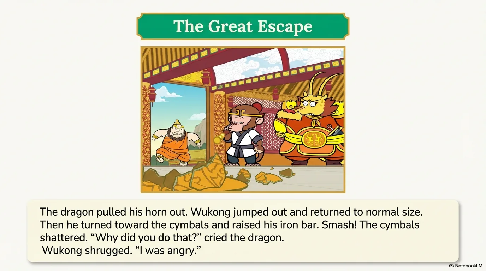

- 来源：`ppt/media/image11.png`（relationship `rId2`）
- 尺寸：1376×768
- 源 SHA-256：`5684a30656a9e9e7534f5dab85d1c1cae812effeb33d900fa0e6b61d9091eddf`
- 输出 SHA-256：`19e186b51d76594085530d7dada216df7ea1233ec08426527c99089c0ded08db`
- 分类：unknown ｜ OCR：blocked ｜ 审核：unreviewed

## Slide 011

- 来源：`ppt/media/image12.png`（relationship `rId2`）
- 尺寸：1376×768
- 源 SHA-256：`4a99ca0c7f7349529042e60ca957debed1f1085f7a335a52b5c335e5da7a508d`
- 输出 SHA-256：`068db0f4e1d8772ea5633fcf197423354a66d62de2eed40cf434a0f6183afbbb`
- 分类：unknown ｜ OCR：blocked ｜ 审核：unreviewed

## Slide 012

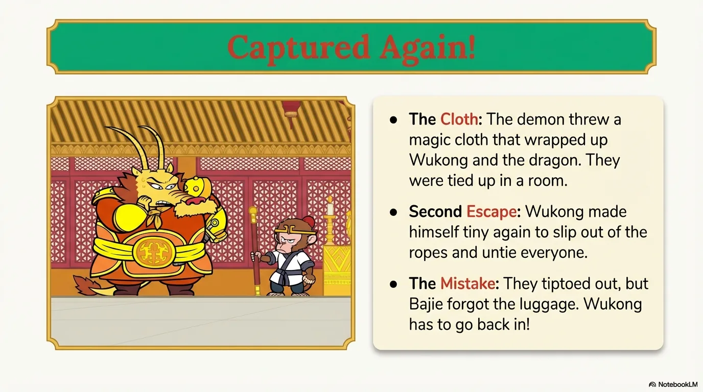

- 来源：`ppt/media/image13.png`（relationship `rId2`）
- 尺寸：1376×768
- 源 SHA-256：`d1627069953ef7056eafdc963b559bbb41d92ea8520a1387aa4eecc42d4dbee2`
- 输出 SHA-256：`aec32f6d47374d6874e7d685877068ce7d517c1735d6e987c122637ab58e0355`
- 分类：unknown ｜ OCR：blocked ｜ 审核：unreviewed

## Slide 013

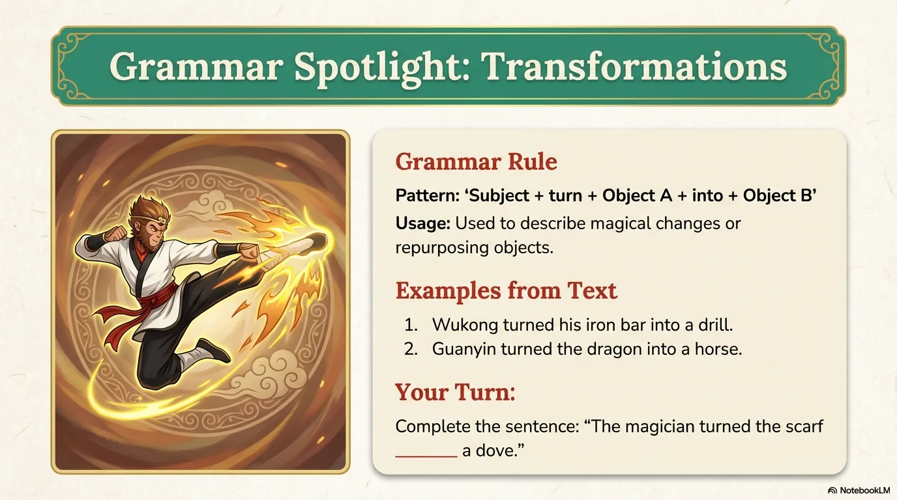

- 来源：`ppt/media/image14.png`（relationship `rId2`）
- 尺寸：1376×768
- 源 SHA-256：`ab5163aa6ce432866fc21b238cb919dded39b5962f3e08bd9e985a9d419a59eb`
- 输出 SHA-256：`e1a04f45d202696a1c043ebecb634113d8c297b9ef6cc842e59dfda643968641`
- 分类：unknown ｜ OCR：blocked ｜ 审核：unreviewed

## Slide 014

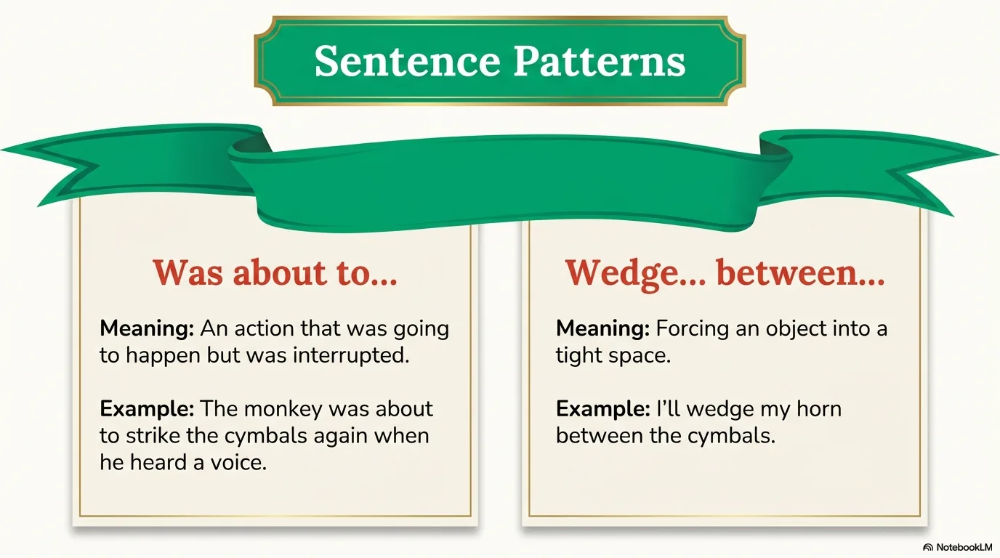

- 来源：`ppt/media/image15.png`（relationship `rId2`）
- 尺寸：1376×768
- 源 SHA-256：`8d3856bb28826572083532f8a90c646bdd93aa4a3e342ac814c0f7a954619fd3`
- 输出 SHA-256：`bf99d3cbd95eddca7e24aa2f7b5e93eb7adea84546c07971288c778e47e41942`
- 分类：unknown ｜ OCR：blocked ｜ 审核：unreviewed

## Slide 015

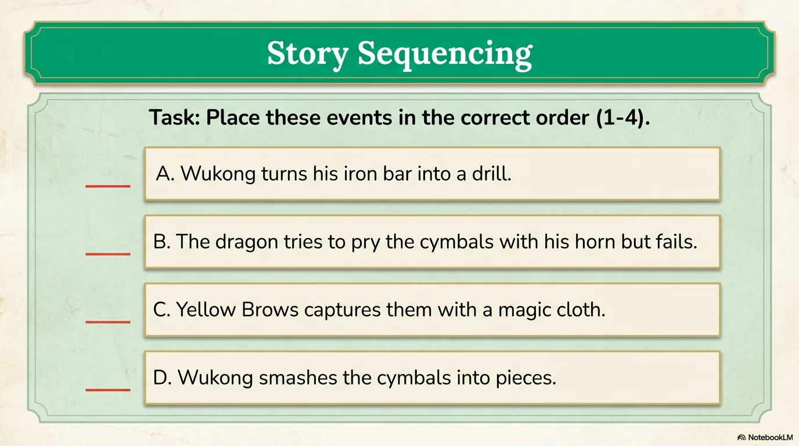

- 来源：`ppt/media/image16.png`（relationship `rId2`）
- 尺寸：1376×768
- 源 SHA-256：`da7198660e8823167a425eb9d9cf131fc412f257aa11d4cb4aba03a094d7831a`
- 输出 SHA-256：`2062f585b0f2d59a0ebe33bbac85b24e0537653f6287868c576944f8fe4b17fd`
- 分类：unknown ｜ OCR：blocked ｜ 审核：unreviewed

## Slide 016

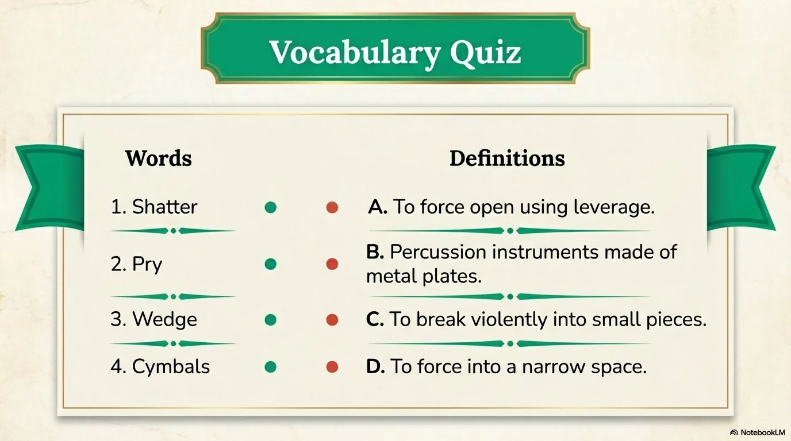

- 来源：`ppt/media/image17.png`（relationship `rId2`）
- 尺寸：1376×768
- 源 SHA-256：`b235fa636ad1cb4bfe010f99d6ce30cfa1a9fd61fa7fee9f1324411f9d8438a2`
- 输出 SHA-256：`a0841254fc0be7ccfb7e3eb68dda0f2e05c672f1305aa8f271f94de0dc6b3fba`
- 分类：unknown ｜ OCR：blocked ｜ 审核：unreviewed

## Slide 017

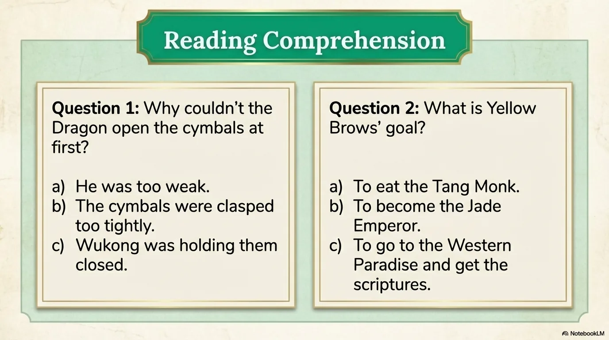

- 来源：`ppt/media/image18.png`（relationship `rId2`）
- 尺寸：1376×768
- 源 SHA-256：`6bc49b23fef1acfea45ef1421f8dd3e6b8a0c7798303b8d4be26f23c817c073f`
- 输出 SHA-256：`25baadc0e6ae37d03e82d379cdb1babbd98f42c2f58f4e440f0eb7c8d747a017`
- 分类：unknown ｜ OCR：blocked ｜ 审核：unreviewed

## Slide 018

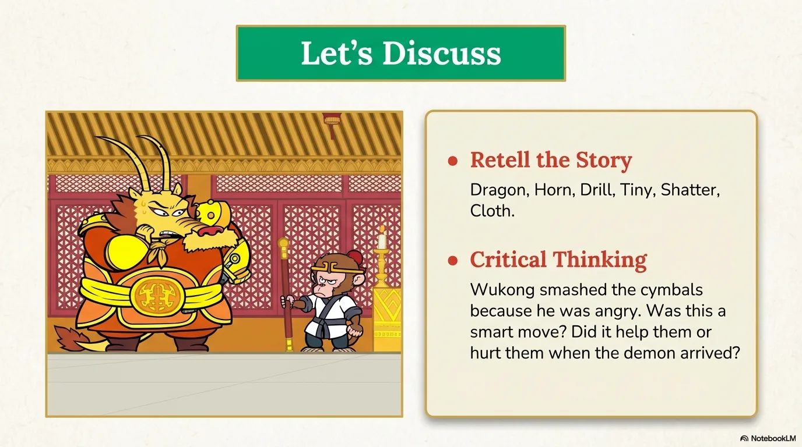

- 来源：`ppt/media/image19.png`（relationship `rId2`）
- 尺寸：1376×768
- 源 SHA-256：`bb5af9d22cbce72b7ab16d77fd9aaefc56b9601b7f2ff8c28028312ee9e6b9de`
- 输出 SHA-256：`dd17abd69d1e3e379b0de5993b75105bd9e04f7b08631bf0bfbc64bf0d020476`
- 分类：unknown ｜ OCR：blocked ｜ 审核：unreviewed

## Slide 019

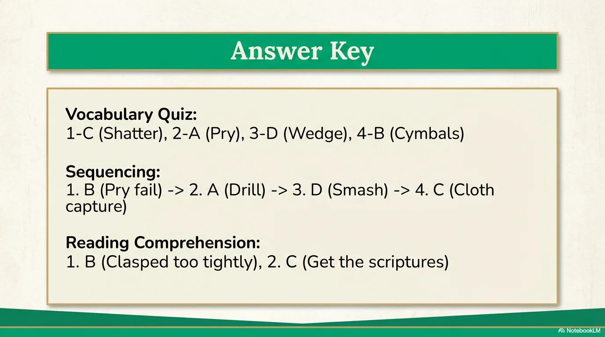

- 来源：`ppt/media/image20.png`（relationship `rId2`）
- 尺寸：1376×768
- 源 SHA-256：`2793e254acbc152adfd92578c933ca7000697742d5f6d73c412035cd02bb331c`
- 输出 SHA-256：`6cfd2183407fe2fa939a9c020aed28d1ec8df1e78e45949f4dbb5ef5ef27c682`
- 分类：unknown ｜ OCR：blocked ｜ 审核：unreviewed

## Slide 020

- 来源：`ppt/media/image21.png`（relationship `rId2`）
- 尺寸：1376×768
- 源 SHA-256：`0e7d35f3d02740e8fecefeda28d2dd78b3f41f63e7300c96f5ca21a8da28a8e8`
- 输出 SHA-256：`e894c4340fa15e9ca93767651dc37db16330a56d649fa818a9065d8346c57c23`
- 分类：unknown ｜ OCR：blocked ｜ 审核：unreviewed
