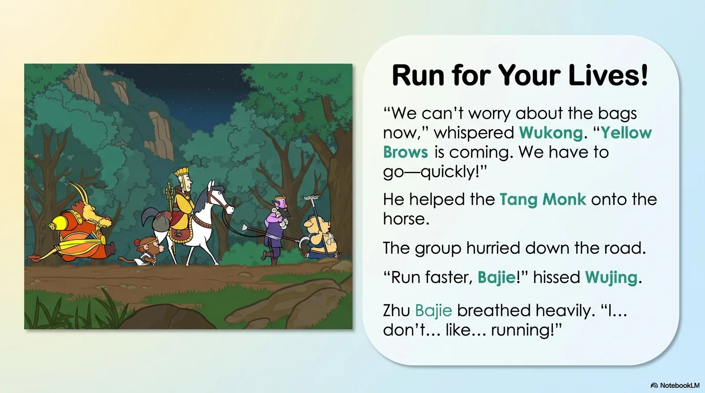
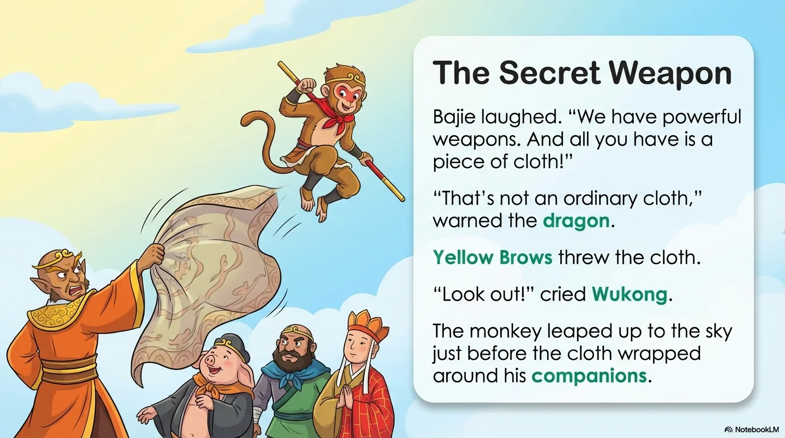
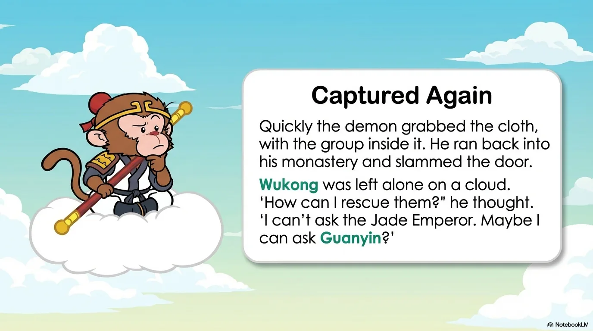
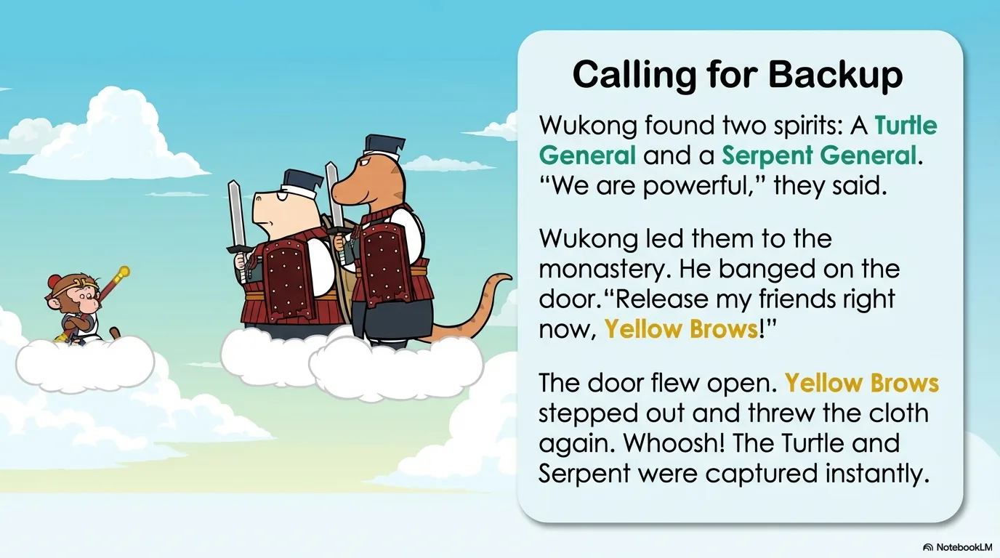
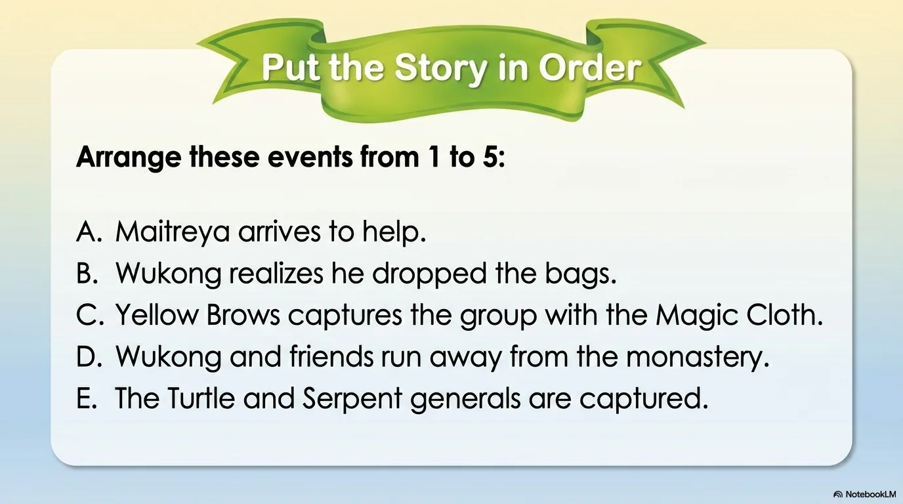
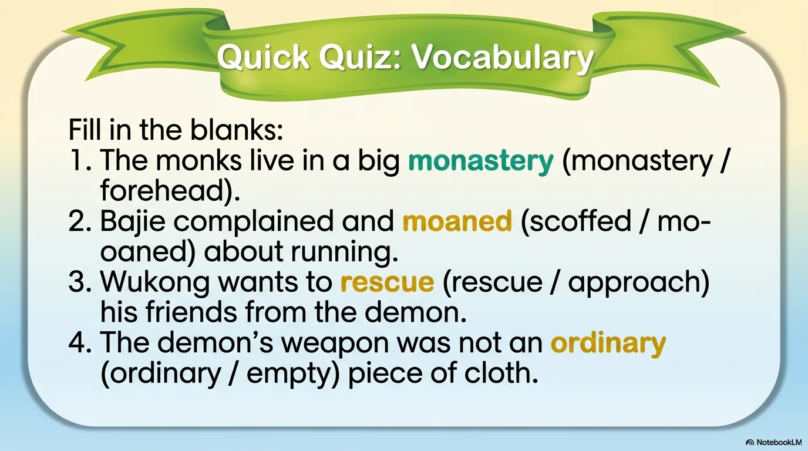
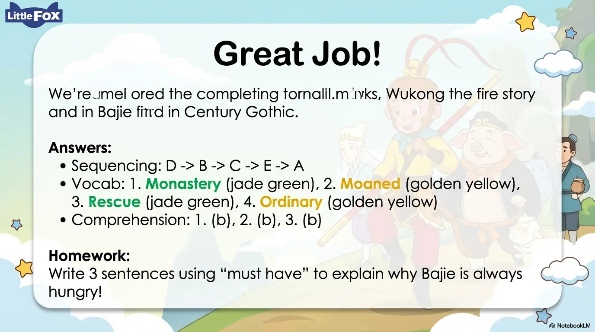

# 豆豆龙英语 · 第 82 集课件（EP082 草稿）

- 来源：`082_Journey to the West 82_The Magic Cloth.pptx`（主课件，20 页）
- OCR：`blocked`（no local OCR provider importable (pytesseract missing): No module named 'pytesseract'）
- 分类：待人工审核（unknown）
- 审核状态：`unreviewed`

## Slide 001

- 来源：`ppt/media/image1.png`（relationship `rId2`）
- 尺寸：1376×768
- 源 SHA-256：`3e313d1039fd63a672d01fca73c17d0b1dbdb899c66fdf8019c9a8f00a5714a2`
- 输出 SHA-256：`83ce410bc3d4109fd2495fb0a8d47eadae3e4a04e7cea0b0d8e4261945973a0a`
- 分类：unknown ｜ OCR：blocked ｜ 审核：unreviewed

## Slide 002

- 来源：`ppt/media/image3.png`（relationship `rId2`）
- 尺寸：1376×768
- 源 SHA-256：`8e16fcb78eeab30665a1fcd9f951ef15aa7bd76473a4264225156a17721b95c8`
- 输出 SHA-256：`3d3dbca572f1a8b94b34f948ad7699aa711edf39022a0070690c222574ceb7fa`
- 分类：unknown ｜ OCR：blocked ｜ 审核：unreviewed

## Slide 003

- 来源：`ppt/media/image4.png`（relationship `rId2`）
- 尺寸：1376×768
- 源 SHA-256：`f515d4cdbbcdda5a8754ecfe57fc20c6859f7db8d513716281724d6143302402`
- 输出 SHA-256：`3a035c8b14038c811857b5b069fd258a67bc8c69121a0d0becdb99e2f5b61d90`
- 分类：unknown ｜ OCR：blocked ｜ 审核：unreviewed

## Slide 004

- 来源：`ppt/media/image5.png`（relationship `rId2`）
- 尺寸：1376×768
- 源 SHA-256：`f0f4f7c27526d518d0db6739c93feec635a226dd2657a93b140ce7877745bb3e`
- 输出 SHA-256：`067b43851632988fa4fb7dba3de25737759717f0fcf0f6cc030985fad292c4e1`
- 分类：unknown ｜ OCR：blocked ｜ 审核：unreviewed

## Slide 005

- 来源：`ppt/media/image6.png`（relationship `rId2`）
- 尺寸：1376×768
- 源 SHA-256：`19690ee9f0336cfbe1bb548580d80c79741538fc3942e79f77c4c5243c04d1f6`
- 输出 SHA-256：`d739c41efae524ec75c3397006e68988801b3e12a409564e509c81f7aecaa4e7`
- 分类：unknown ｜ OCR：blocked ｜ 审核：unreviewed

## Slide 006

- 来源：`ppt/media/image7.png`（relationship `rId2`）
- 尺寸：1376×768
- 源 SHA-256：`6f38e3404e37092eb99f09a2f9eb0f33cab78d19e7d1346aee73c9d91d806349`
- 输出 SHA-256：`5df3a79b0959bd41bffc5544dc971daa5b007fa023b7cca13cb52b63cf02d4f4`
- 分类：unknown ｜ OCR：blocked ｜ 审核：unreviewed

## Slide 007

- 来源：`ppt/media/image8.png`（relationship `rId2`）
- 尺寸：1376×768
- 源 SHA-256：`d758a1e6760b6f3c9c5c7191a285b5c2229842276cc7a376adacc47ce9789896`
- 输出 SHA-256：`8ab169859b5c0d00b78feb6bf23139c5e9f6859938b0819735ebe7a44b3d9dbf`
- 分类：unknown ｜ OCR：blocked ｜ 审核：unreviewed

## Slide 008

- 来源：`ppt/media/image9.png`（relationship `rId2`）
- 尺寸：1376×768
- 源 SHA-256：`05449b7774d00a4dc196c98380d49ce424d1610513f5de262884edc5e54c7b3a`
- 输出 SHA-256：`367160f4a9a8f249c583e3b56a691d8ca7b5eef272e82b4c0a5379986ad474d8`
- 分类：unknown ｜ OCR：blocked ｜ 审核：unreviewed

## Slide 009

- 来源：`ppt/media/image10.png`（relationship `rId2`）
- 尺寸：1376×768
- 源 SHA-256：`10aa2db25a573b85a68b34c8b21b809243b71936485523f7853cdd8e6f08d361`
- 输出 SHA-256：`276025398aac18dd676539634f941af47487de9a475c388da62d785cf5c6e253`
- 分类：unknown ｜ OCR：blocked ｜ 审核：unreviewed

## Slide 010

- 来源：`ppt/media/image11.png`（relationship `rId2`）
- 尺寸：1376×768
- 源 SHA-256：`93679b584e988623e5b24a3907047d6bff5ba259b2f6a0139fb0608fd8c047b7`
- 输出 SHA-256：`1180d824d694c7266a3fc4eae320ffcd0c12ff542808f828fdffd05668aa39c7`
- 分类：unknown ｜ OCR：blocked ｜ 审核：unreviewed

## Slide 011

- 来源：`ppt/media/image12.png`（relationship `rId2`）
- 尺寸：1376×768
- 源 SHA-256：`30112417e3d8635ed20b84f0facfac72d132bcc909b801050b8ecc7e567067a4`
- 输出 SHA-256：`84d14cc4375d3ad207db8f669094fd551b5d08870ce639fb88fd83bae68511d6`
- 分类：unknown ｜ OCR：blocked ｜ 审核：unreviewed

## Slide 012

- 来源：`ppt/media/image13.png`（relationship `rId2`）
- 尺寸：1376×768
- 源 SHA-256：`2734bf487cc29fadffb120f20c2e89bd8ab7bd8b38ab50720183e2b42b77a601`
- 输出 SHA-256：`4e39bbbe29250bc8c763ba119269a5dfb19b6eca88c6a334ca54359b24e6123c`
- 分类：unknown ｜ OCR：blocked ｜ 审核：unreviewed

## Slide 013

- 来源：`ppt/media/image14.png`（relationship `rId2`）
- 尺寸：1376×768
- 源 SHA-256：`a8794fd2cde5adab7be6414ac6111d7a7e7f01325443c42d465ae277dc9247b5`
- 输出 SHA-256：`bc567a215db5828f75bebe6ee73b309c5810083eecc59569ed499412b099eb6e`
- 分类：unknown ｜ OCR：blocked ｜ 审核：unreviewed

## Slide 014

- 来源：`ppt/media/image15.png`（relationship `rId2`）
- 尺寸：1376×768
- 源 SHA-256：`1b1d7d7999a58d0fbe0e6e09d0f2d1c2f3e730d5ad38dccff333e979fe5c0330`
- 输出 SHA-256：`50e14ee92720e10cece91a196aeca7eaec841534b2ad96fe90ddc7a53e9a02ff`
- 分类：unknown ｜ OCR：blocked ｜ 审核：unreviewed

## Slide 015

- 来源：`ppt/media/image16.png`（relationship `rId2`）
- 尺寸：1376×768
- 源 SHA-256：`ed0598fde7bf130c899b95c01da225514c0344edc320d441ff85a6c0e4c52b74`
- 输出 SHA-256：`ac4828b33e447a7f4a434be8e868498ad0d7e2dc3186cb503ef3d01688d5a608`
- 分类：unknown ｜ OCR：blocked ｜ 审核：unreviewed

## Slide 016

- 来源：`ppt/media/image17.png`（relationship `rId2`）
- 尺寸：1376×768
- 源 SHA-256：`251d331c44c3131d4b1495515f432e860dd5bf7262c81efcb5096a5a102f3205`
- 输出 SHA-256：`a68ce7534d9404e220ee01cfb43bacc2953d06d84433b9a08c0ac61c28de9512`
- 分类：unknown ｜ OCR：blocked ｜ 审核：unreviewed

## Slide 017

- 来源：`ppt/media/image18.png`（relationship `rId2`）
- 尺寸：1376×768
- 源 SHA-256：`217b79fdaab49db929f9c04309ac9a8c212ab45abf785e4ead00269a7448d5ca`
- 输出 SHA-256：`9f40449794ed07a3d5efcc92c741e7ef8b4ac9e3fa774b657dc382d0a33fc5d4`
- 分类：unknown ｜ OCR：blocked ｜ 审核：unreviewed

## Slide 018

- 来源：`ppt/media/image19.png`（relationship `rId2`）
- 尺寸：1376×768
- 源 SHA-256：`1c18141901203f7a0b3f357ea7e990efb3622df3c71e2c0b3d5fa4ea06eeb49f`
- 输出 SHA-256：`0789ce21865e65aa520e6d519c765c8d14df981fc306c7e053672117a6cfc2b3`
- 分类：unknown ｜ OCR：blocked ｜ 审核：unreviewed

## Slide 019

- 来源：`ppt/media/image20.png`（relationship `rId2`）
- 尺寸：1376×768
- 源 SHA-256：`f72f3b9f78f2182274cc1f90cde14ae322e24c3f2ab1ce474871f11c9586d12d`
- 输出 SHA-256：`32c53394f0759a73a038611444ecb2dce961900c89604bd721a7887bd29a4605`
- 分类：unknown ｜ OCR：blocked ｜ 审核：unreviewed

## Slide 020

- 来源：`ppt/media/image21.png`（relationship `rId2`）
- 尺寸：1376×768
- 源 SHA-256：`1f9e45b51531744322674db9897e1050f051a64d6fc3609cd63fe2aa7598095c`
- 输出 SHA-256：`159e689609afa4b98c898c15e2187af77005ffae39cfbd079484d8a4865351cc`
- 分类：unknown ｜ OCR：blocked ｜ 审核：unreviewed
