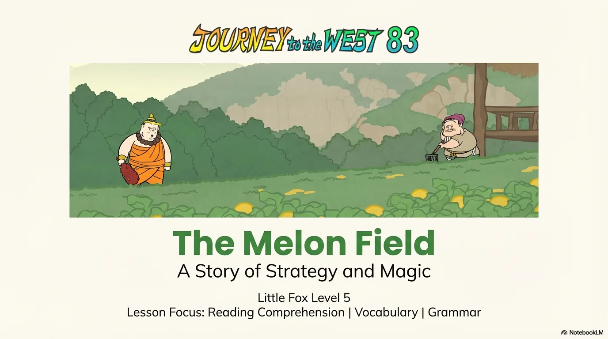
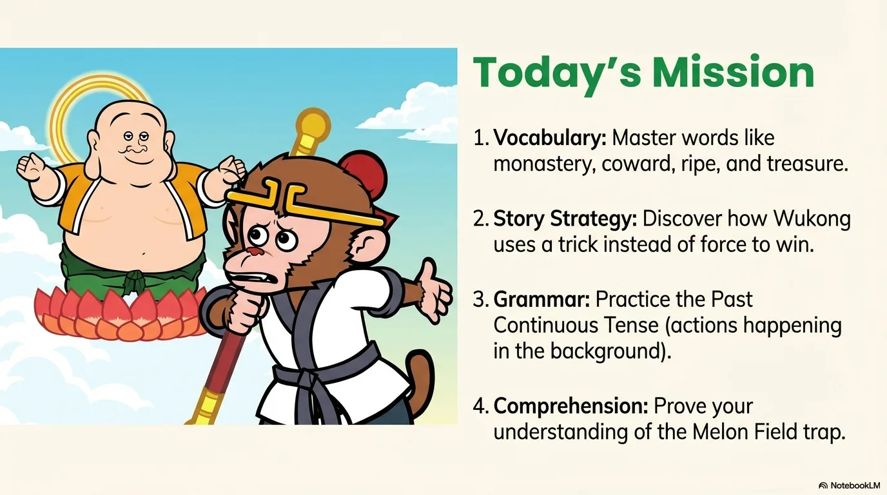
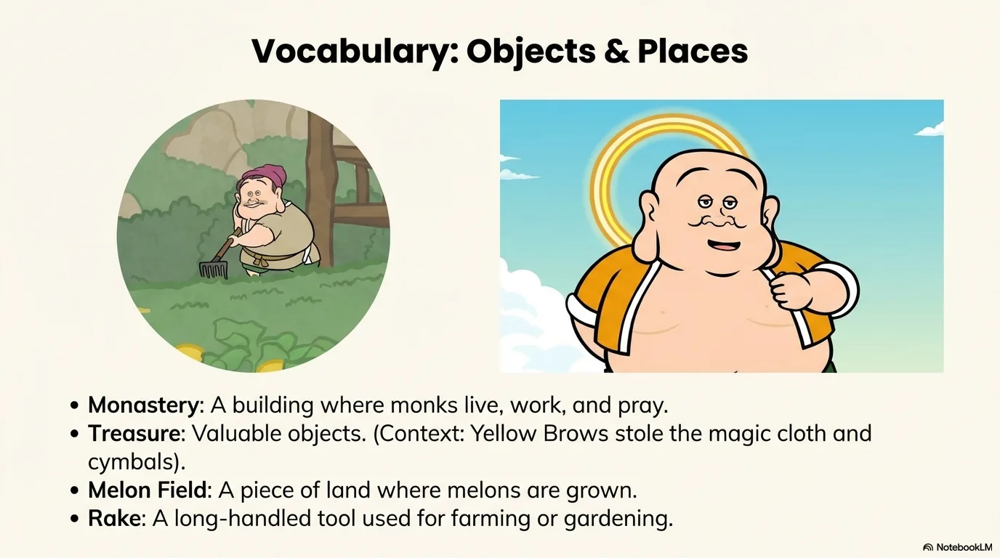
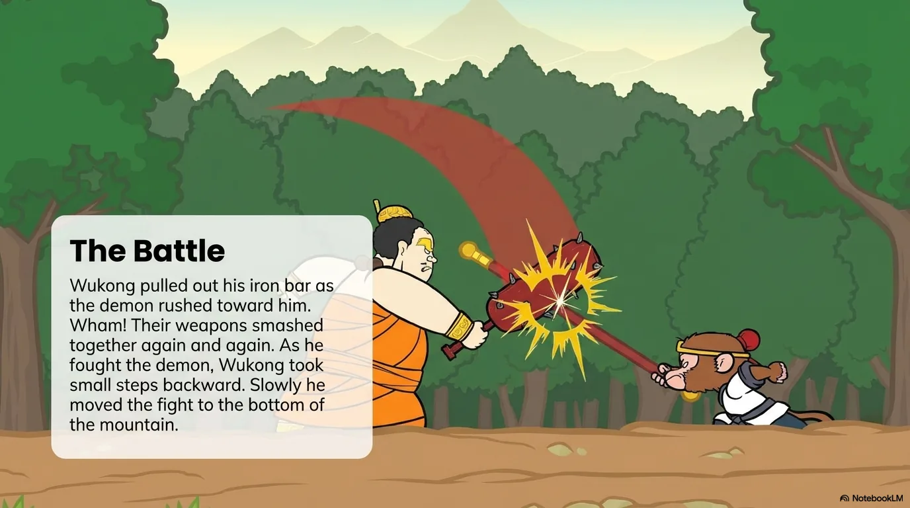
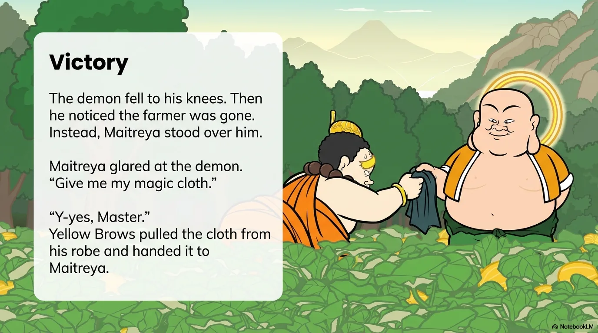
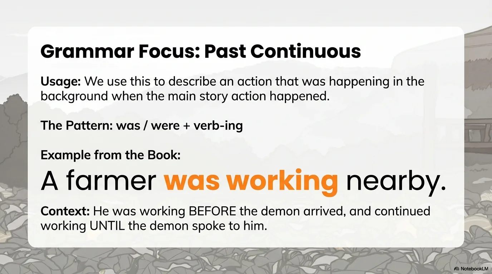
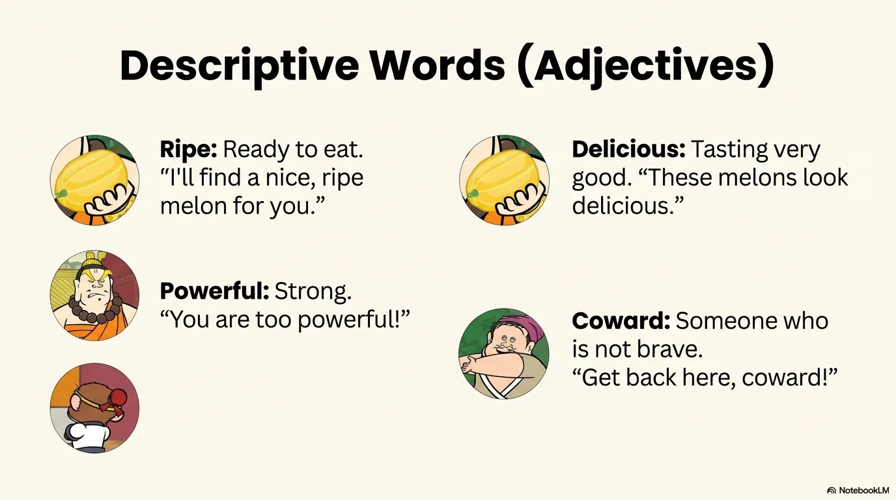
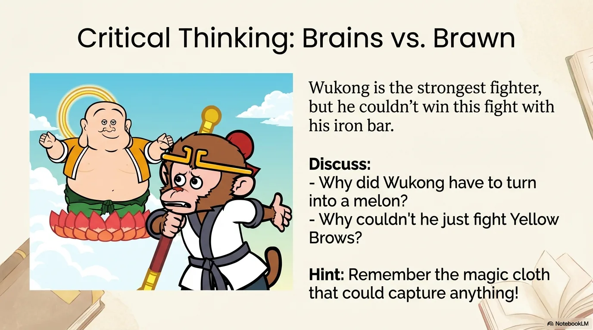
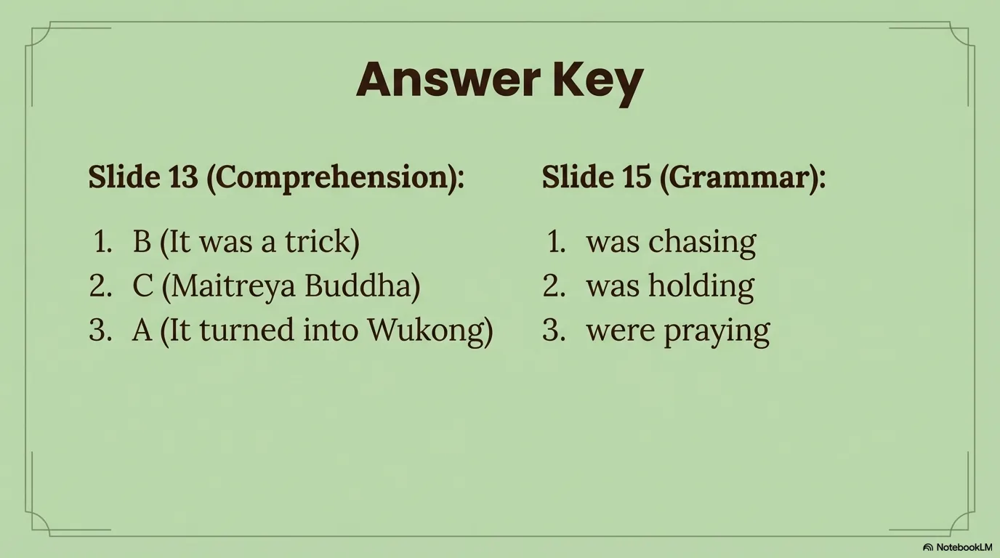

# 豆豆龙英语 · 第 83 集课件（EP083 草稿）

- 来源：`083_Journey to the West 83_The Melon Field.pptx`（主课件，20 页）
- OCR：`blocked`（no local OCR provider importable (pytesseract missing): No module named 'pytesseract'）
- 分类：待人工审核（unknown）
- 审核状态：`unreviewed`

## Slide 001

- 来源：`ppt/media/image1.png`（relationship `rId2`）
- 尺寸：1376×768
- 源 SHA-256：`caccd92ba6428074106ae444c0336d00e7e0aaa4f5dee292a08ade47f216701b`
- 输出 SHA-256：`eddc3b843cab6d712a71cc651b8f6a36ce60edbab8d5715d292b32a18aef7717`
- 分类：unknown ｜ OCR：blocked ｜ 审核：unreviewed

## Slide 002

- 来源：`ppt/media/image3.png`（relationship `rId2`）
- 尺寸：1376×768
- 源 SHA-256：`83d3bed17835aa63d3bdd42154e54691d43b2c648cff583211d3977b0aa49967`
- 输出 SHA-256：`39f2e808b9097c0f14daf69cc0d258ff25d8b70d0f2991e8a9b6f0f341d38da8`
- 分类：unknown ｜ OCR：blocked ｜ 审核：unreviewed

## Slide 003

- 来源：`ppt/media/image4.png`（relationship `rId2`）
- 尺寸：1376×768
- 源 SHA-256：`fca3d1f1d110621b80f88ce81fcb8d1a130885c3cf4f55aa86fc9ed6ba6a9f4d`
- 输出 SHA-256：`198ecaba72e4131ede72d32a553dac3899828526d45fc674cb2752ec16c791ea`
- 分类：unknown ｜ OCR：blocked ｜ 审核：unreviewed

## Slide 004

- 来源：`ppt/media/image5.png`（relationship `rId2`）
- 尺寸：1376×768
- 源 SHA-256：`16134fa4239f341249e7c5bded8449791e364862b90c2d929ae1e050dbaa1ad8`
- 输出 SHA-256：`fd56c426ac50670352cfb2517946f8f90c2657423a407278eae1fa0b40294b3d`
- 分类：unknown ｜ OCR：blocked ｜ 审核：unreviewed

## Slide 005

- 来源：`ppt/media/image6.png`（relationship `rId2`）
- 尺寸：1376×768
- 源 SHA-256：`af5ca57723aa9f0460469f209cea545be0e36d2a656feb7a983cbc79f0ece77d`
- 输出 SHA-256：`737b3b1a029709da07a2a7731dba4a75b4f1028f2ca6f696194453a0824aaaa3`
- 分类：unknown ｜ OCR：blocked ｜ 审核：unreviewed

## Slide 006

- 来源：`ppt/media/image7.png`（relationship `rId2`）
- 尺寸：1376×768
- 源 SHA-256：`c99e7e91a4bb06477b03996563426972753a03545205c0ee3e1c4cbe6624e0a6`
- 输出 SHA-256：`20709f863da9add2ee5d852c7022599326ceb179f6f357a5ba031af547f6e7d7`
- 分类：unknown ｜ OCR：blocked ｜ 审核：unreviewed

## Slide 007

- 来源：`ppt/media/image8.png`（relationship `rId2`）
- 尺寸：1376×768
- 源 SHA-256：`4c124f5682db7b20e43ce4fa7ecdc1e17743a295c8e6450e7b3e078100e0d1ce`
- 输出 SHA-256：`e28b9ff289ae39c05c0938a4186a04bcfd86be88cc4940357ea114679a474702`
- 分类：unknown ｜ OCR：blocked ｜ 审核：unreviewed

## Slide 008

- 来源：`ppt/media/image9.png`（relationship `rId2`）
- 尺寸：1376×768
- 源 SHA-256：`8fd0ea359012895915ae3162146058422474fce2c549f52ac6e35f494d0f1917`
- 输出 SHA-256：`527582c22a05869e81422582d3947d0d9bf035b94f9ce941ab344a2435d9ff54`
- 分类：unknown ｜ OCR：blocked ｜ 审核：unreviewed

## Slide 009

- 来源：`ppt/media/image10.png`（relationship `rId2`）
- 尺寸：1376×768
- 源 SHA-256：`b7d46a295f844f8368c8802f31fbeb2df0caafeb56c3791d4c3f8587d2a7e2cd`
- 输出 SHA-256：`37acd2185c63e1fb3b0f4f175c773ee1243c5a029f6b531a7afa231e4b6b3219`
- 分类：unknown ｜ OCR：blocked ｜ 审核：unreviewed

## Slide 010

- 来源：`ppt/media/image11.png`（relationship `rId2`）
- 尺寸：1376×768
- 源 SHA-256：`444707b3b695616f28f45e9c875f8042378e1d4575ff718cb247ed81035ef6da`
- 输出 SHA-256：`92d5ac21b4e354d2485f3c89e39d480f5fa08c70d5fa2a7fe110273fa2d926c7`
- 分类：unknown ｜ OCR：blocked ｜ 审核：unreviewed

## Slide 011

- 来源：`ppt/media/image12.png`（relationship `rId2`）
- 尺寸：1376×768
- 源 SHA-256：`b8b3e6a7fd437d0530023abb05ab14241b1fd7a9751aa7de67ff3f47d148b8a2`
- 输出 SHA-256：`1f2373d2e8067c53e5a6b70f02a25d20d6e52297745ab975445dffbdf5753a51`
- 分类：unknown ｜ OCR：blocked ｜ 审核：unreviewed

## Slide 012

- 来源：`ppt/media/image13.png`（relationship `rId2`）
- 尺寸：1376×768
- 源 SHA-256：`05cc7e64d5597c58382c2dd583dec610e6607e087358fcea2b1951d741ad92ad`
- 输出 SHA-256：`ea9a871873675f499de48f46e2a980450438a63811723071c08b5a0e113346c5`
- 分类：unknown ｜ OCR：blocked ｜ 审核：unreviewed

## Slide 013

- 来源：`ppt/media/image14.png`（relationship `rId2`）
- 尺寸：1376×768
- 源 SHA-256：`a061a86cbadc527288dfbe467ab13d5edccec7811f5fe3951f7cdbdcfd3f3028`
- 输出 SHA-256：`d9de9283347ed7417726dec8cd344c6316e360e44e3909f72f3985e07c70f1af`
- 分类：unknown ｜ OCR：blocked ｜ 审核：unreviewed

## Slide 014

- 来源：`ppt/media/image15.png`（relationship `rId2`）
- 尺寸：1376×768
- 源 SHA-256：`8ad296927d972956f712a132a1f37dfda7f36cca268598f9ced3f079c1d193c1`
- 输出 SHA-256：`3d9f10fa0be66a06beea786dcde188b80aa707563a2685b3836f2218098e4432`
- 分类：unknown ｜ OCR：blocked ｜ 审核：unreviewed

## Slide 015

- 来源：`ppt/media/image16.png`（relationship `rId2`）
- 尺寸：1376×768
- 源 SHA-256：`558dd88cdc4322467206ae6e60755b552cd8e52ab3f0ee8119538da57e997993`
- 输出 SHA-256：`6c6cf7bad5a17373a349e1e92e59fadbd4465b6fd500ea5a971527e3f591018a`
- 分类：unknown ｜ OCR：blocked ｜ 审核：unreviewed

## Slide 016

- 来源：`ppt/media/image17.png`（relationship `rId2`）
- 尺寸：1376×768
- 源 SHA-256：`1f56449cb86f4dd8580d473b1832a4eec7d87b7f30f9df00238cf92707bb60b8`
- 输出 SHA-256：`bcb29ce21be6c80148842c8882f746400106fd7b5552333b5487115828fcbec4`
- 分类：unknown ｜ OCR：blocked ｜ 审核：unreviewed

## Slide 017

- 来源：`ppt/media/image18.png`（relationship `rId2`）
- 尺寸：1376×768
- 源 SHA-256：`9e02b099737f88648cfa91820750ad14a74eaa6bcb92b70116b31f614d74e6c1`
- 输出 SHA-256：`4729ad00bcd72f56c87af84a4aeaf105a94c54232ad05a5dec260f49cba4c1f7`
- 分类：unknown ｜ OCR：blocked ｜ 审核：unreviewed

## Slide 018

- 来源：`ppt/media/image19.png`（relationship `rId2`）
- 尺寸：1376×768
- 源 SHA-256：`f642cd5512d47bdfaf6d3086b5f3b981f07acd43b26a272ecff14b6210be7d18`
- 输出 SHA-256：`42bc3c75ab1bec01ef252f899e2dacb83855b0e86701a5aa5da47f48c4505513`
- 分类：unknown ｜ OCR：blocked ｜ 审核：unreviewed

## Slide 019

- 来源：`ppt/media/image20.png`（relationship `rId2`）
- 尺寸：1376×768
- 源 SHA-256：`8d8f7db6b66e572784b7dffff3f5e02388349a60cb81d9e92ea2e5e75441bb58`
- 输出 SHA-256：`8a899f42793eecb56347bdad4fac6d9a22890585836d0f44eb5edf41dedc1f90`
- 分类：unknown ｜ OCR：blocked ｜ 审核：unreviewed

## Slide 020

- 来源：`ppt/media/image21.png`（relationship `rId2`）
- 尺寸：1376×768
- 源 SHA-256：`2183a752cd5949f65df75b8dd6126db530080f7cedabb9be5a640dd126b17a30`
- 输出 SHA-256：`b3362254880122a61f1b52d2b6515f1887360d9c35139c6ba4481fe3a08de822`
- 分类：unknown ｜ OCR：blocked ｜ 审核：unreviewed
