# 豆豆龙英语 · 第 84 集课件（EP084 草稿）

- 来源：`084_Journey to the West 84_The Sad King.pptx`（主课件，20 页）
- OCR：`blocked`（no local OCR provider importable (pytesseract missing): No module named 'pytesseract'）
- 分类：待人工审核（unknown）
- 审核状态：`unreviewed`

## Slide 001

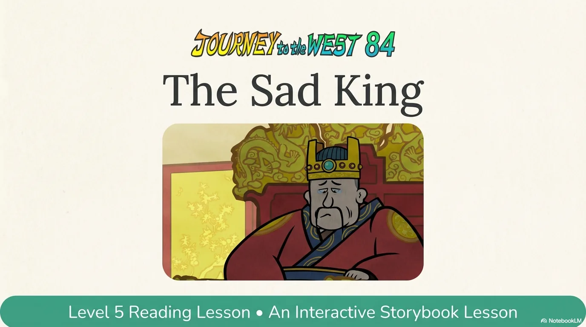

- 来源：`ppt/media/image1.png`（relationship `rId2`）
- 尺寸：1376×768
- 源 SHA-256：`11e84127f889b49215b985f70cd2f532953de15dbb05dce7a2cad82e97ade091`
- 输出 SHA-256：`b8afa4cc0bb2fddce03d16fcf795d87303175e77cd806d5e9a5b6cd20ed8fd94`
- 分类：unknown ｜ OCR：blocked ｜ 审核：unreviewed

## Slide 002

- 来源：`ppt/media/image3.png`（relationship `rId2`）
- 尺寸：1376×768
- 源 SHA-256：`05c64636ba265baa0bd86ae9ce3e4a1bd0de1320e787b8bfb9fc60182ad16a4b`
- 输出 SHA-256：`a7cc824164ab51a13d1a3639b03c161b08953b40dfa5fc97bb448b4f662054b4`
- 分类：unknown ｜ OCR：blocked ｜ 审核：unreviewed

## Slide 003

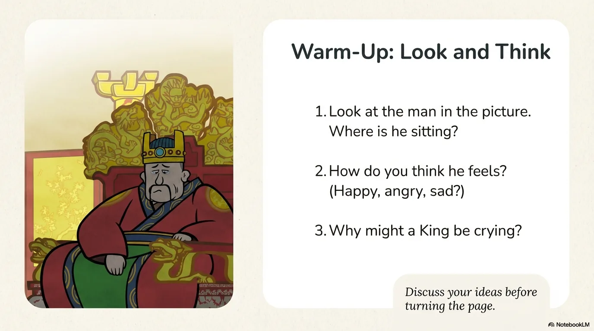

- 来源：`ppt/media/image4.png`（relationship `rId2`）
- 尺寸：1376×768
- 源 SHA-256：`013c3c41cd02c044a642d5b393595d0dee0a5c75f0cf97702951c4ee9c0cee88`
- 输出 SHA-256：`8f10cb55d7da48af7cc6566c7a9ddfe9036ff0770dda6f80d66f5bd9e01fa6f6`
- 分类：unknown ｜ OCR：blocked ｜ 审核：unreviewed

## Slide 004

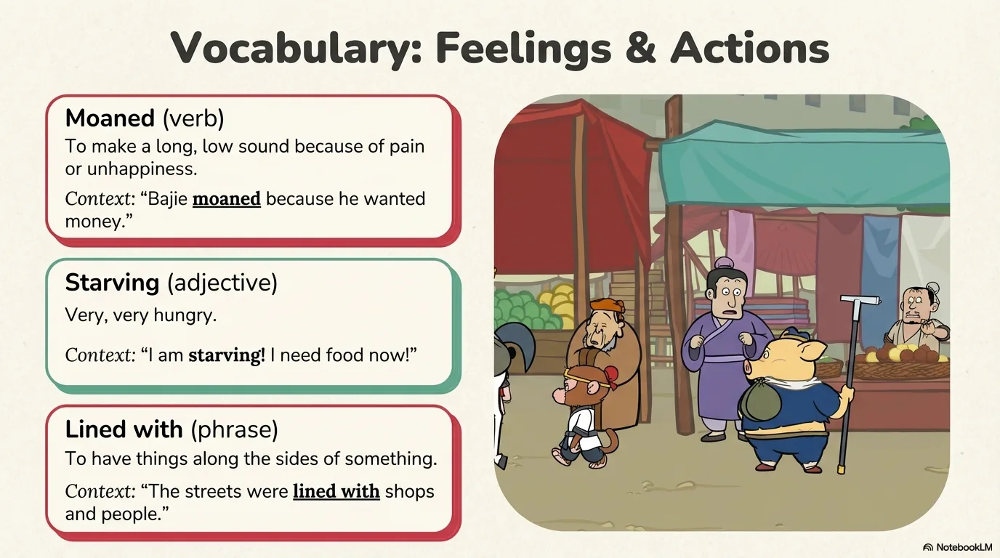

- 来源：`ppt/media/image5.png`（relationship `rId2`）
- 尺寸：1376×768
- 源 SHA-256：`764418609b90bcc519a90533aeaf2299bf6d569d4a32c2b0f047311dc87e62a1`
- 输出 SHA-256：`0aaadb4fe30da6d282007ad1245bec5be6acc0b74b995e3c19b30caa270975a3`
- 分类：unknown ｜ OCR：blocked ｜ 审核：unreviewed

## Slide 005

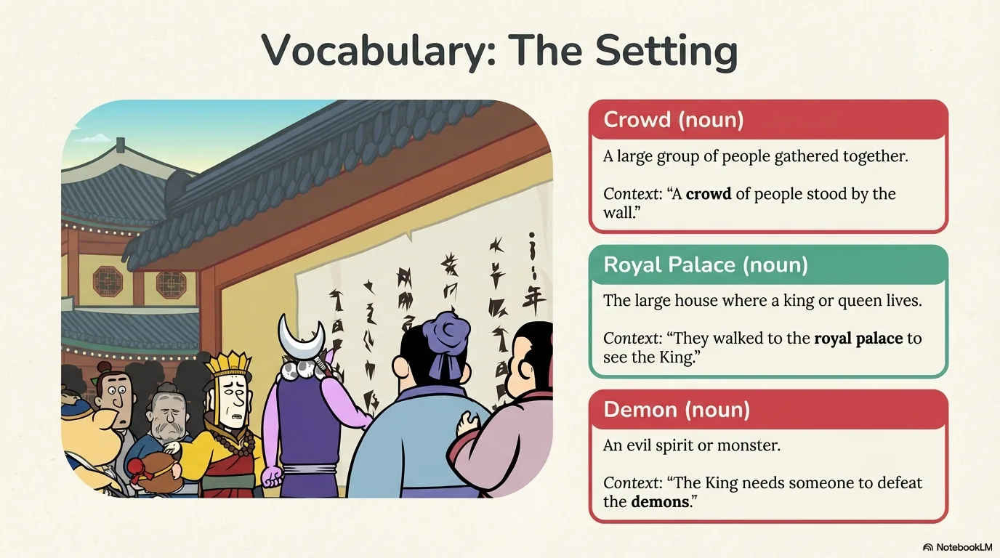

- 来源：`ppt/media/image6.png`（relationship `rId2`）
- 尺寸：1376×768
- 源 SHA-256：`1348910a17b4817f42389a92159d429060adff1458210188e45e791fc7d8b06a`
- 输出 SHA-256：`4db28bd624d400f062261de4a8a3480f3e6aa580c73e87c9eae3d73bf33dca21`
- 分类：unknown ｜ OCR：blocked ｜ 审核：unreviewed

## Slide 006

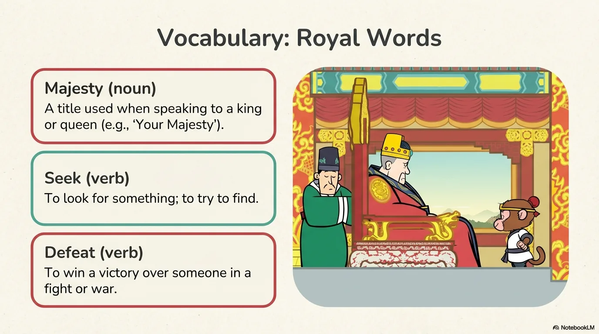

- 来源：`ppt/media/image7.png`（relationship `rId2`）
- 尺寸：1376×768
- 源 SHA-256：`4c7831ff305b3fd793522376194cba72289e875c533c0dd5b73c157cee234838`
- 输出 SHA-256：`f4a34df7bf6dcf947a16f56c7a27ecae4eff241c8d9d2aede77a808882e9cbc0`
- 分类：unknown ｜ OCR：blocked ｜ 审核：unreviewed

## Slide 007

- 来源：`ppt/media/image8.png`（relationship `rId2`）
- 尺寸：1376×768
- 源 SHA-256：`26c9bb22ac3beb4028b8ce4d8464bd0bc5a9f422f10049e6ac9ffdb48f9ce17b`
- 输出 SHA-256：`7fb0cf0569822ca3d09ca88c2b93f08c6c33376406c1364f329855a1777305d0`
- 分类：unknown ｜ OCR：blocked ｜ 审核：unreviewed

## Slide 008

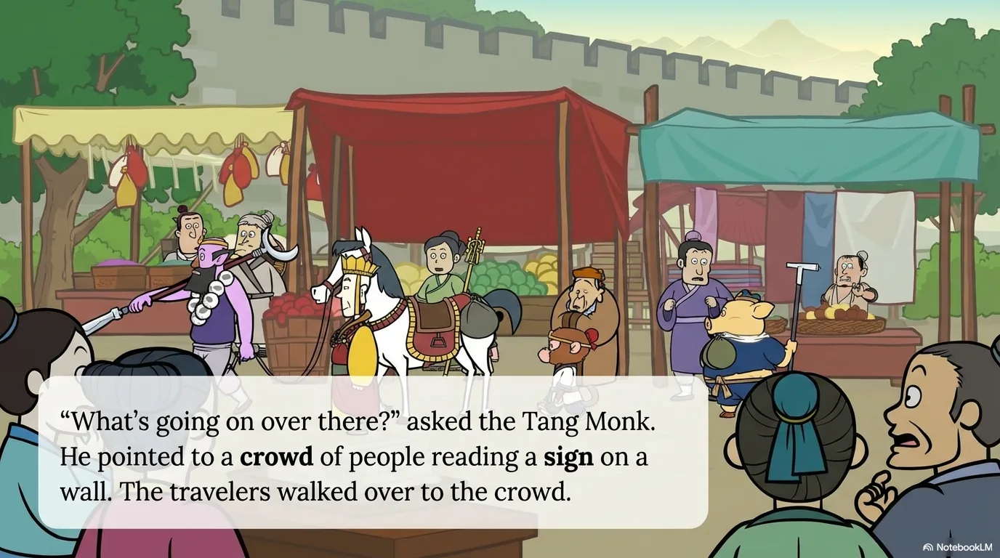

- 来源：`ppt/media/image9.png`（relationship `rId2`）
- 尺寸：1376×768
- 源 SHA-256：`9cdef6dae839e81ecc4f0278f72fdab89e4c1111500ec9d5f5c8957b0bd786d9`
- 输出 SHA-256：`b9ad6085ecb9a2ac8d60a7e7510a3e323feae1abd7ea7bbf44acf92c814ee3f4`
- 分类：unknown ｜ OCR：blocked ｜ 审核：unreviewed

## Slide 009

- 来源：`ppt/media/image10.png`（relationship `rId2`）
- 尺寸：1376×768
- 源 SHA-256：`220604577fcf5830976399ce4f78c6169bf76024fc8adbe7f474c5f147ef20d0`
- 输出 SHA-256：`c072ff6f1c1b1662c5366d81f4c6c96964c632954e44527cfe0439a99385deba`
- 分类：unknown ｜ OCR：blocked ｜ 审核：unreviewed

## Slide 010

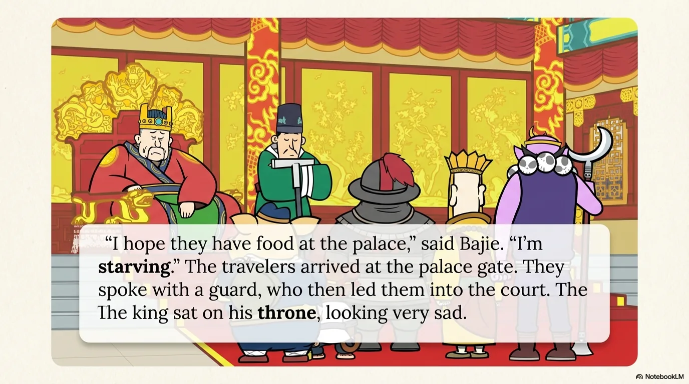

- 来源：`ppt/media/image11.png`（relationship `rId2`）
- 尺寸：1376×768
- 源 SHA-256：`59e58332f9a5fe361b6e6f99f03e708d3903c723731ed39c3a4081c2b84bedb1`
- 输出 SHA-256：`5ef68b038403bfe3da0ef79f3fb84091683279099d2c90c458d67d3ddbbec990`
- 分类：unknown ｜ OCR：blocked ｜ 审核：unreviewed

## Slide 011

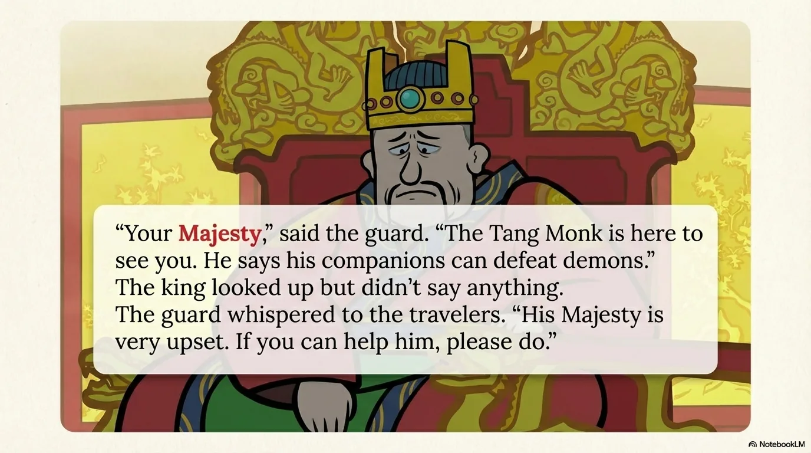

- 来源：`ppt/media/image12.png`（relationship `rId2`）
- 尺寸：1376×768
- 源 SHA-256：`2733cd37d07847b712d7794ac8511812788631787ddd261cb86d4c2f233be37e`
- 输出 SHA-256：`0f6e1e3db595a860bf629351acb9d808b79edfc468dd504f1760acfc9061b02c`
- 分类：unknown ｜ OCR：blocked ｜ 审核：unreviewed

## Slide 012

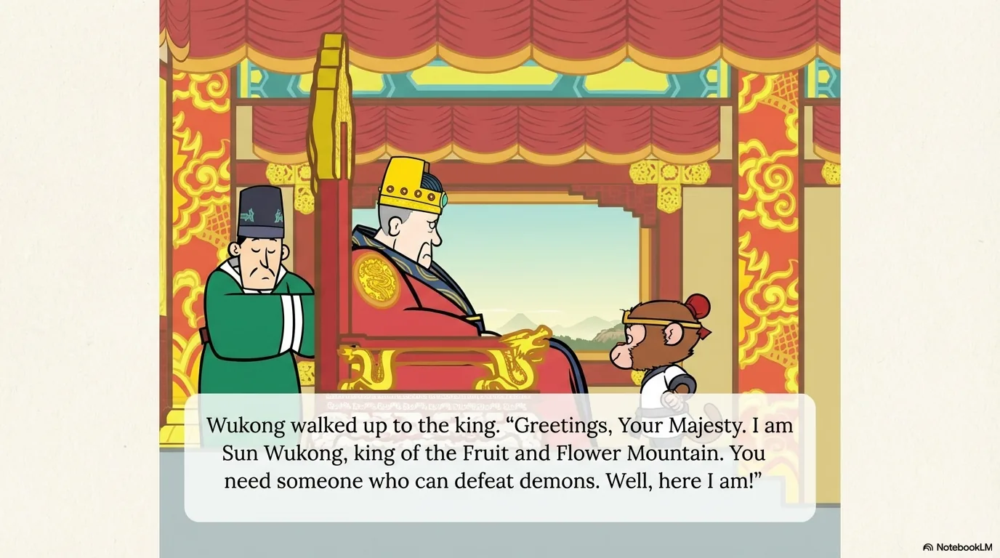

- 来源：`ppt/media/image13.png`（relationship `rId2`）
- 尺寸：1376×768
- 源 SHA-256：`a2a91c7e1b40e0d309a6a1dda5c7caf5c31ff786eaf216c402d3ea5db216eb0b`
- 输出 SHA-256：`f1f94cc3255a43514c9ab27b3467ca26b032a7cc8580222c535acfaaecc0cc1d`
- 分类：unknown ｜ OCR：blocked ｜ 审核：unreviewed

## Slide 013

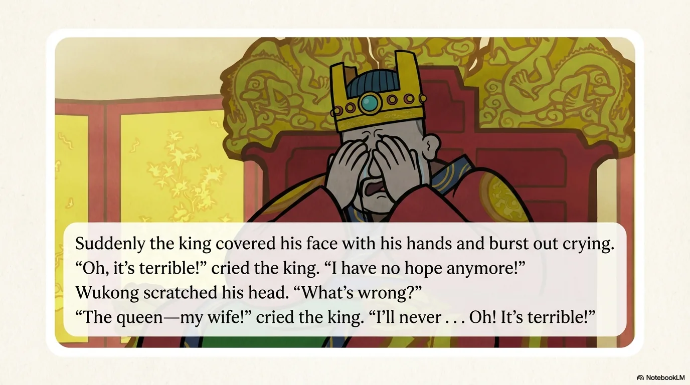

- 来源：`ppt/media/image14.png`（relationship `rId2`）
- 尺寸：1376×768
- 源 SHA-256：`5ca545a0202f0e3e43dad4246e6a92063bf138dac747668d2a98198ead343144`
- 输出 SHA-256：`8e1613a21963d85b1a46b0b71bf365dc3709b58567ce4f14484dd464a975a6d6`
- 分类：unknown ｜ OCR：blocked ｜ 审核：unreviewed

## Slide 014

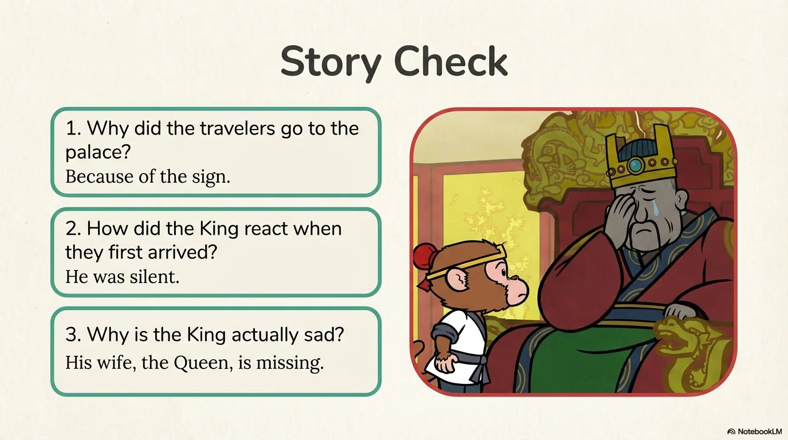

- 来源：`ppt/media/image15.png`（relationship `rId2`）
- 尺寸：1376×768
- 源 SHA-256：`a555e262e8c24b821e0cfabcbae36bc25ed6b08bd1dcee5892a3f7946005114e`
- 输出 SHA-256：`f35030317a1d760a50013e86645003d9a66f30deba7beeab022297b480f0dd71`
- 分类：unknown ｜ OCR：blocked ｜ 审核：unreviewed

## Slide 015

- 来源：`ppt/media/image16.png`（relationship `rId2`）
- 尺寸：1376×768
- 源 SHA-256：`a1487c17dd7fece410f2a836edf954b1fbe8c1fba50c2f4cd6f361f280d31bc5`
- 输出 SHA-256：`3c230f92896bbd4e3c9c7a407b6e31e85541d23fc9d04fd329c4a587c916bc08`
- 分类：unknown ｜ OCR：blocked ｜ 审核：unreviewed

## Slide 016

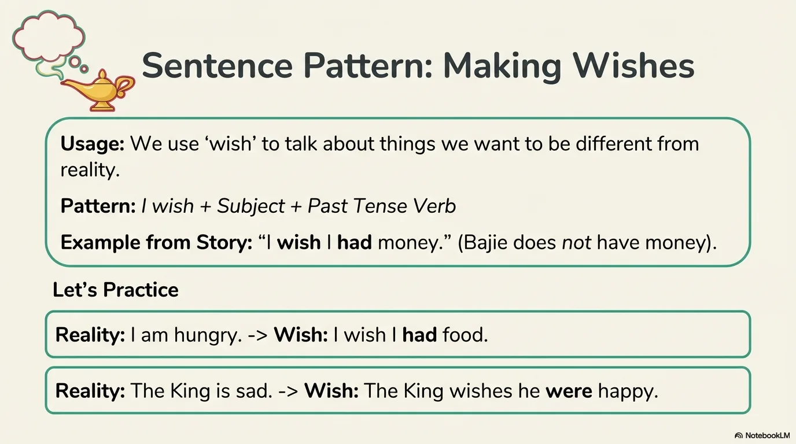

- 来源：`ppt/media/image17.png`（relationship `rId2`）
- 尺寸：1376×768
- 源 SHA-256：`eb1b6644b2b5cf31c65b02571bf500099b5c76ef47853db3017674eb1232fff4`
- 输出 SHA-256：`609c94bd908647f9f226780aadf92bbc85006163bdf25759ea9be67c0408e321`
- 分类：unknown ｜ OCR：blocked ｜ 审核：unreviewed

## Slide 017

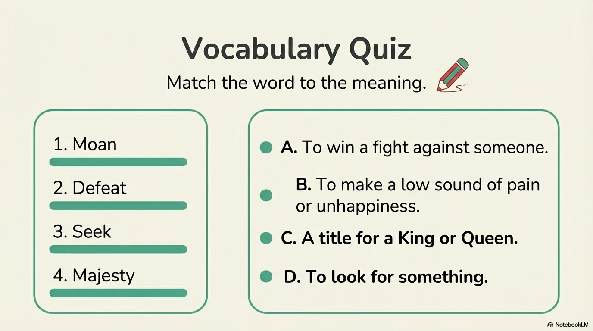

- 来源：`ppt/media/image18.png`（relationship `rId2`）
- 尺寸：1376×768
- 源 SHA-256：`8ab49a6b8f3a189e8c58c28524f47a1af1eccae4bb6f0f6ae09132d831eac4a1`
- 输出 SHA-256：`b7ff63376245f220ac15a506830aa98b05f63e557a7bc8c95817c0b5366535a1`
- 分类：unknown ｜ OCR：blocked ｜ 审核：unreviewed

## Slide 018

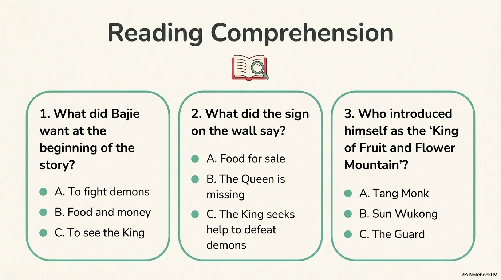

- 来源：`ppt/media/image19.png`（relationship `rId2`）
- 尺寸：1376×768
- 源 SHA-256：`d4c97db800e4e4e9f8534e42f6e6641e333bee63f2c7185f01ee831f1bb220a8`
- 输出 SHA-256：`db13ba783b67fb42642252135236182c7ca66c7a695331513d5d313f87cccc11`
- 分类：unknown ｜ OCR：blocked ｜ 审核：unreviewed

## Slide 019

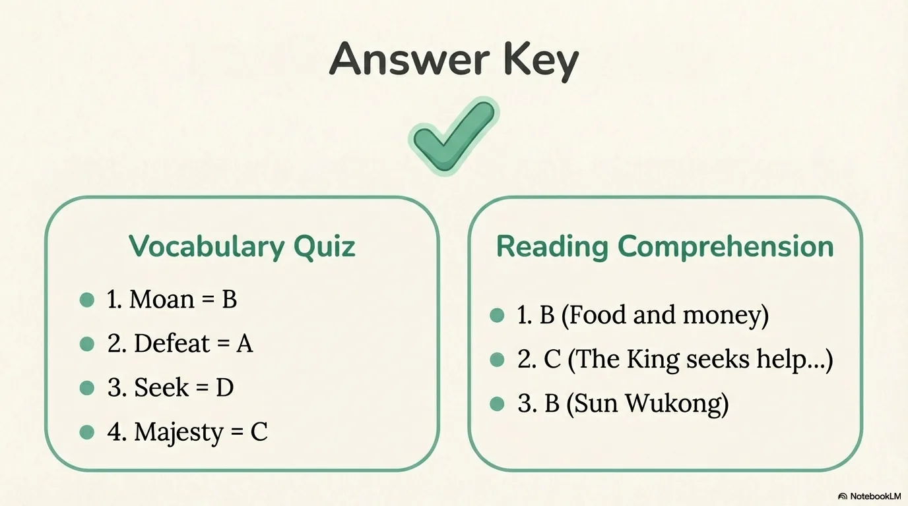

- 来源：`ppt/media/image20.png`（relationship `rId2`）
- 尺寸：1376×768
- 源 SHA-256：`0ff8d43e05836139a41536a81d02fd4ed1e032bfe4b54a6f4f965af48a0326df`
- 输出 SHA-256：`2d3b426a6f2b94f775edaf64e3833d78240f3a53717c14b87136a9ed9fb92f6a`
- 分类：unknown ｜ OCR：blocked ｜ 审核：unreviewed

## Slide 020

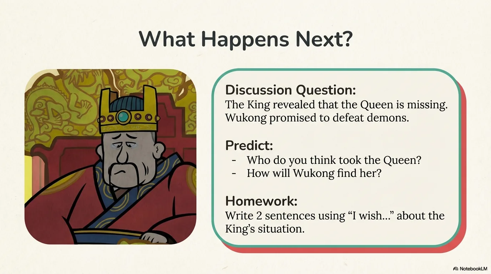

- 来源：`ppt/media/image21.png`（relationship `rId2`）
- 尺寸：1376×768
- 源 SHA-256：`68d06a97412d2a0e4bb2354f2f8caa0897044a52a84806589246d1cc6eae5669`
- 输出 SHA-256：`1897d7893838b61c747babed779874557cd49400c5e4904d6a050ef7557c2147`
- 分类：unknown ｜ OCR：blocked ｜ 审核：unreviewed
