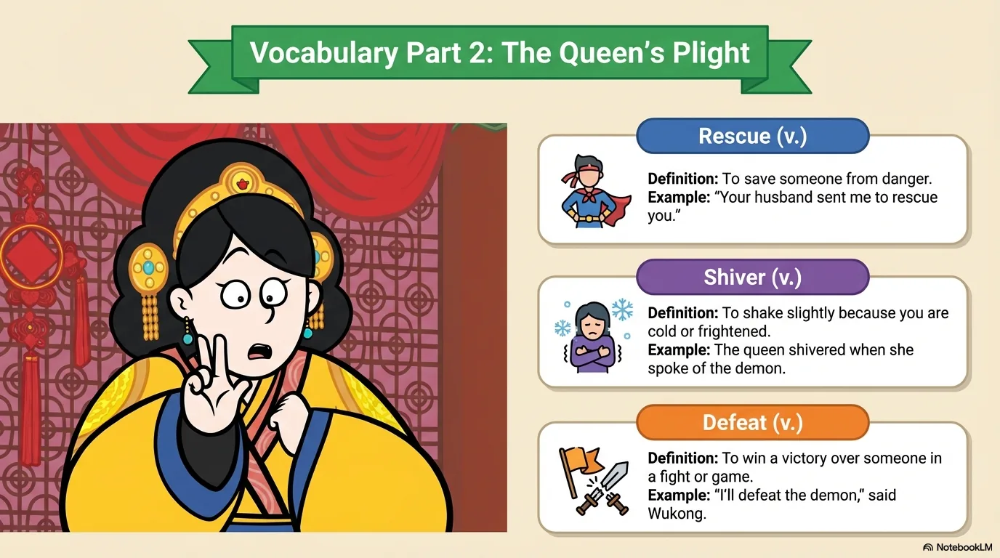
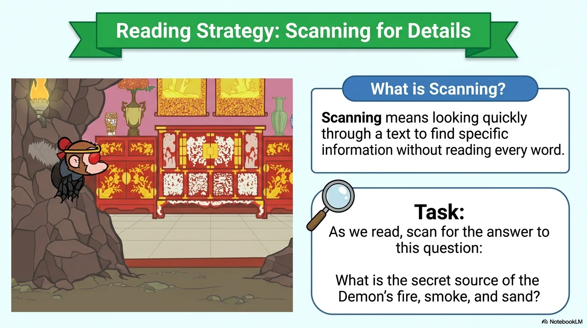
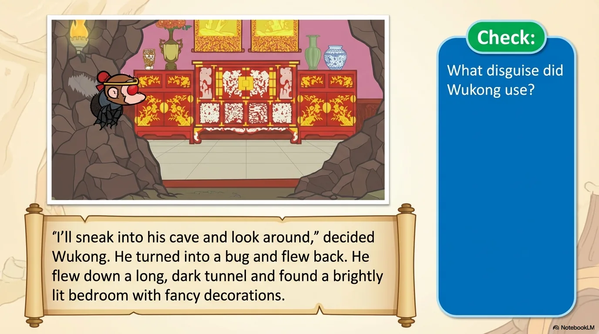
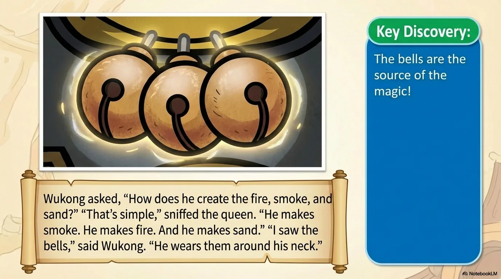
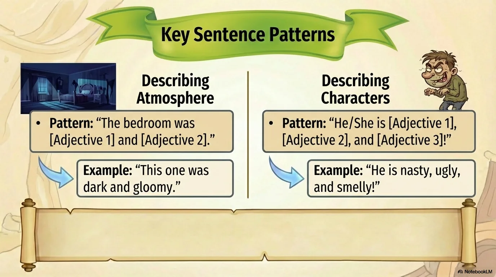
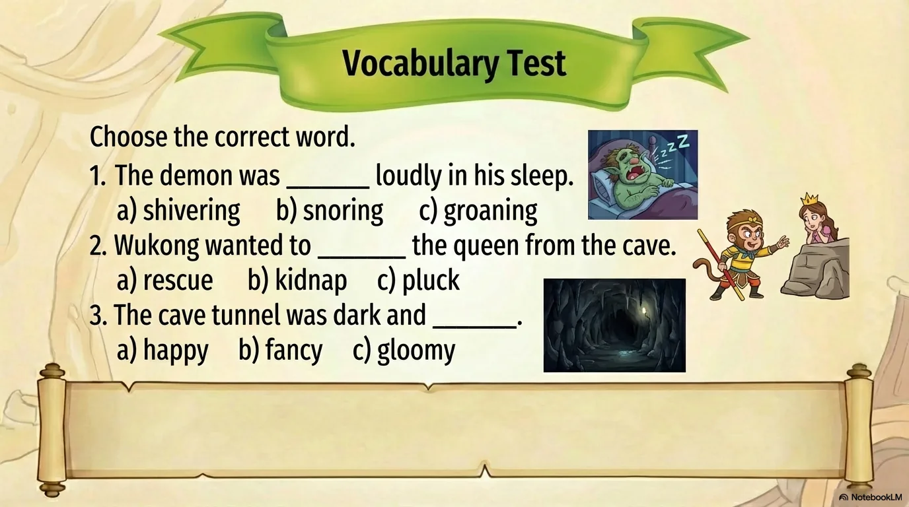
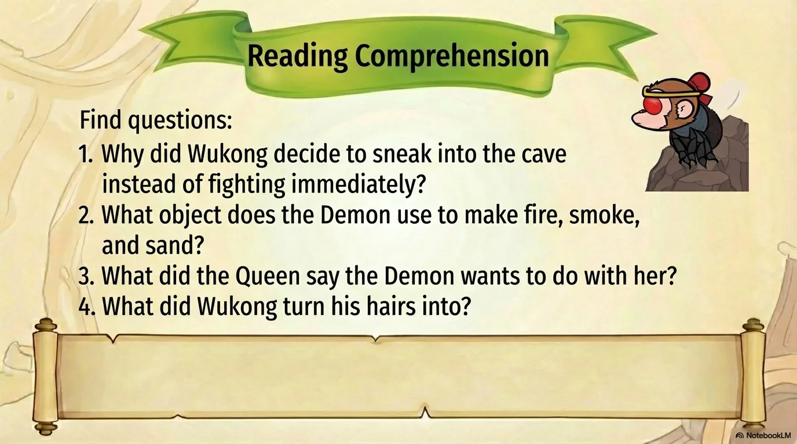
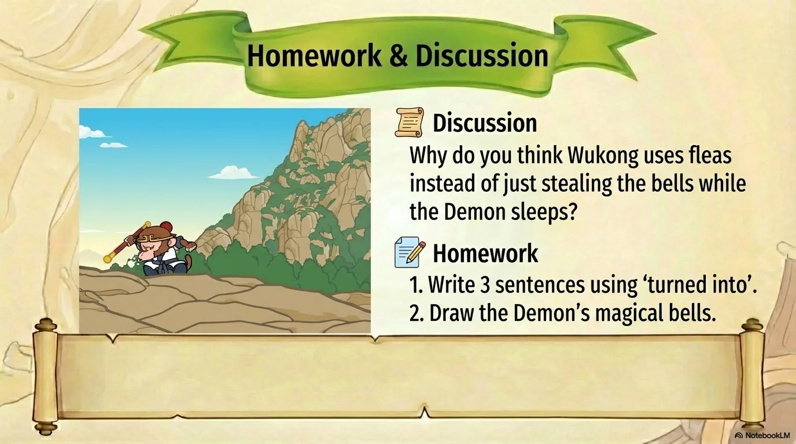
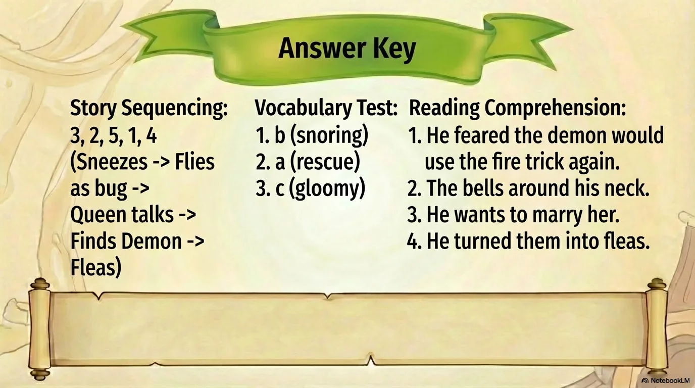

# 豆豆龙英语 · 第 85 集课件（EP085 草稿）

- 来源：`085_Journey to the West 85_Fire, Smoke, and Sand.pptx`（主课件，20 页）
- OCR：`blocked`（no local OCR provider importable (pytesseract missing): No module named 'pytesseract'）
- 分类：待人工审核（unknown）
- 审核状态：`unreviewed`

## Slide 001

- 来源：`ppt/media/image1.png`（relationship `rId2`）
- 尺寸：1376×768
- 源 SHA-256：`a51a6a3f5179e2c1bd8c23f7e4d019b63baeecc28072fbb9eb6c0d2eb8c53c2a`
- 输出 SHA-256：`2836072c4a185d6963e3aea4946b8269ddf1849abb00b4d1cc183b8f58e56909`
- 分类：unknown ｜ OCR：blocked ｜ 审核：unreviewed

## Slide 002

- 来源：`ppt/media/image3.png`（relationship `rId2`）
- 尺寸：1376×768
- 源 SHA-256：`4d18fd25ad58c0246387faefa9bcbbb27de1e4cd6c71a8ebd7a1388e16cc517d`
- 输出 SHA-256：`3f48c1f404e7a185a3ea7654f65fa1555b4d78599d3fec1e7ca2c5a33faa52ea`
- 分类：unknown ｜ OCR：blocked ｜ 审核：unreviewed

## Slide 003

- 来源：`ppt/media/image4.png`（relationship `rId2`）
- 尺寸：1376×768
- 源 SHA-256：`6c6f9570a88acd044dbd2bbf86a091053602b6c11c2850e82fc82b0d1c5e2850`
- 输出 SHA-256：`21fc741162ee302dcd98aa5977724433babc2ee60c1f54efc9a522836d110f5d`
- 分类：unknown ｜ OCR：blocked ｜ 审核：unreviewed

## Slide 004

- 来源：`ppt/media/image5.png`（relationship `rId2`）
- 尺寸：1376×768
- 源 SHA-256：`69062fd4a274bfce7ecfd4a15e579331c5d010bd9028fe73a1876fba0e480a99`
- 输出 SHA-256：`9efa5356d0be0f52e8570ab8ac6ff84e35ba731fb08a3fb234ab37f9efbcbbb8`
- 分类：unknown ｜ OCR：blocked ｜ 审核：unreviewed

## Slide 005

- 来源：`ppt/media/image6.png`（relationship `rId2`）
- 尺寸：1376×768
- 源 SHA-256：`6eb6f7f31e483d0a9b8e18ae4582094f349bd715856bf111bdc9c62b4763332f`
- 输出 SHA-256：`c276d74ed84fe757d23a6545c5db3fc83cdb95bff9499c959903f1f5f2ac6598`
- 分类：unknown ｜ OCR：blocked ｜ 审核：unreviewed

## Slide 006

- 来源：`ppt/media/image7.png`（relationship `rId2`）
- 尺寸：1376×768
- 源 SHA-256：`657e30fd2f100da0217eccd919a6e7cb29d58d4f20651b2c5639252b01a98f73`
- 输出 SHA-256：`715b78666226466e019c57f604004133b24d55460371c9c4e1e31adbb0f4efb1`
- 分类：unknown ｜ OCR：blocked ｜ 审核：unreviewed

## Slide 007

- 来源：`ppt/media/image8.png`（relationship `rId2`）
- 尺寸：1376×768
- 源 SHA-256：`17abad808804f3b65eb6c3b7997f0255d14319ca74651a6b5604b8a4785429f8`
- 输出 SHA-256：`a6831863d47e4d48f6a792106d6cefd5bd71be3be6e3e9e4f4b57253d57ff474`
- 分类：unknown ｜ OCR：blocked ｜ 审核：unreviewed

## Slide 008

- 来源：`ppt/media/image9.png`（relationship `rId2`）
- 尺寸：1376×768
- 源 SHA-256：`76f676ce0571a6454246c9595b35109ec0a74c578c35a58448b0587ec1ffa089`
- 输出 SHA-256：`01222b9ea4acb760b15994c2df683a32ada0b4296431caf7b85e68cc05b37f88`
- 分类：unknown ｜ OCR：blocked ｜ 审核：unreviewed

## Slide 009

- 来源：`ppt/media/image10.png`（relationship `rId2`）
- 尺寸：1376×768
- 源 SHA-256：`3afc8937a6d49bcfc9faca5ea6c519ae137c8220c9407faa26a86a07613757a9`
- 输出 SHA-256：`9c0a01c86141232cda91885647285136248968c704f315aa745621c4e679e286`
- 分类：unknown ｜ OCR：blocked ｜ 审核：unreviewed

## Slide 010

- 来源：`ppt/media/image11.png`（relationship `rId2`）
- 尺寸：1376×768
- 源 SHA-256：`6711398ca22a6816698df6dd2b256c58b0bc119c26a4dc53a83cd6a41ce13aab`
- 输出 SHA-256：`6187aa203a8ad4504a25313ad00ee1cf3f2419b453bec2245fddc5c59ae08775`
- 分类：unknown ｜ OCR：blocked ｜ 审核：unreviewed

## Slide 011

- 来源：`ppt/media/image12.png`（relationship `rId2`）
- 尺寸：1376×768
- 源 SHA-256：`27e159bed177202177e3ad41da6de2ac94eab81742ac132b595ada9001f401a2`
- 输出 SHA-256：`069f5dc3ec36187fb435cf2f51af703313eed470880948560565b7bfe1d1e6aa`
- 分类：unknown ｜ OCR：blocked ｜ 审核：unreviewed

## Slide 012

- 来源：`ppt/media/image13.png`（relationship `rId2`）
- 尺寸：1376×768
- 源 SHA-256：`697bf446a5454a0ac3867b19fee5e7be4874b66628cd496e74e3b10f0514bf53`
- 输出 SHA-256：`39c003fb1ea5b9d17792d712abef10741c3124c0bc2c9450f1e6d02fcc29072f`
- 分类：unknown ｜ OCR：blocked ｜ 审核：unreviewed

## Slide 013

- 来源：`ppt/media/image14.png`（relationship `rId2`）
- 尺寸：1376×768
- 源 SHA-256：`67acd2a67cf0e6fc8b4b285b6c11df087406e34f1cde1725fe6958e0cc91cb52`
- 输出 SHA-256：`c6c53f5cbd2ca378a76642f136ffd42a2e5f1942465bb6072a7d17686706956a`
- 分类：unknown ｜ OCR：blocked ｜ 审核：unreviewed

## Slide 014

- 来源：`ppt/media/image15.png`（relationship `rId2`）
- 尺寸：1376×768
- 源 SHA-256：`aa7bda99dbc18999c50a19347c7ed4f03de51526eb3842e73562bea19edaaab2`
- 输出 SHA-256：`3ef3351cfb06289c01c3ef1f4bcb5c3692e76b7d96fe8e3ceda84bf51d927458`
- 分类：unknown ｜ OCR：blocked ｜ 审核：unreviewed

## Slide 015

- 来源：`ppt/media/image16.png`（relationship `rId2`）
- 尺寸：1376×768
- 源 SHA-256：`0a949d895e01e0d5f07a332afdb35497fc1a345bd9b1e097ce63545a8e4f5e63`
- 输出 SHA-256：`26cb152d6a6f5e39368433f810a7e5994c489ec91c7750e0dd6bb8e7b1455b4f`
- 分类：unknown ｜ OCR：blocked ｜ 审核：unreviewed

## Slide 016

- 来源：`ppt/media/image17.png`（relationship `rId2`）
- 尺寸：1376×768
- 源 SHA-256：`11f995a67b98e06faed047ce783358174ec0ba6eb62f2ff28dd446f3cf8ca8d7`
- 输出 SHA-256：`8f2c57475022968afbf51084d47f15d6751e33f6937f2ece30c5c72d01b56f72`
- 分类：unknown ｜ OCR：blocked ｜ 审核：unreviewed

## Slide 017

- 来源：`ppt/media/image18.png`（relationship `rId2`）
- 尺寸：1376×768
- 源 SHA-256：`8cd4a8df738b9f917c35fa596a0083e213b5ee5d2057c7336f3d5188817d556d`
- 输出 SHA-256：`8895c055713b1ea8929b8d2244c7aa0742f61a733de2408b2b1bf0d06e5cdc4c`
- 分类：unknown ｜ OCR：blocked ｜ 审核：unreviewed

## Slide 018

- 来源：`ppt/media/image19.png`（relationship `rId2`）
- 尺寸：1376×768
- 源 SHA-256：`8ff08af36b11e7470e592f3c64f0499041541c5e960677cb29d06b0f57f7ee76`
- 输出 SHA-256：`1ad08ff1ba06399003c5708f82028bbd10e238e674c51985732ea91a51713fcb`
- 分类：unknown ｜ OCR：blocked ｜ 审核：unreviewed

## Slide 019

- 来源：`ppt/media/image20.png`（relationship `rId2`）
- 尺寸：1376×768
- 源 SHA-256：`aef387acf10c4fbabdeedf2d5091a55e56611817cec64155676d5dbc68ac4623`
- 输出 SHA-256：`dc72071960f6c86cc9715c1dba12b7ce5e250e6d2767145e03af970cd544dbef`
- 分类：unknown ｜ OCR：blocked ｜ 审核：unreviewed

## Slide 020

- 来源：`ppt/media/image21.png`（relationship `rId2`）
- 尺寸：1376×768
- 源 SHA-256：`96a95d2739b5f38c38fcb2745b195b382b70011adae785e7c2fc8565da637fdf`
- 输出 SHA-256：`99b7d1e126d20b803705989d923ef47c1932fb691ed749777d5d70a8ed4ea329`
- 分类：unknown ｜ OCR：blocked ｜ 审核：unreviewed
