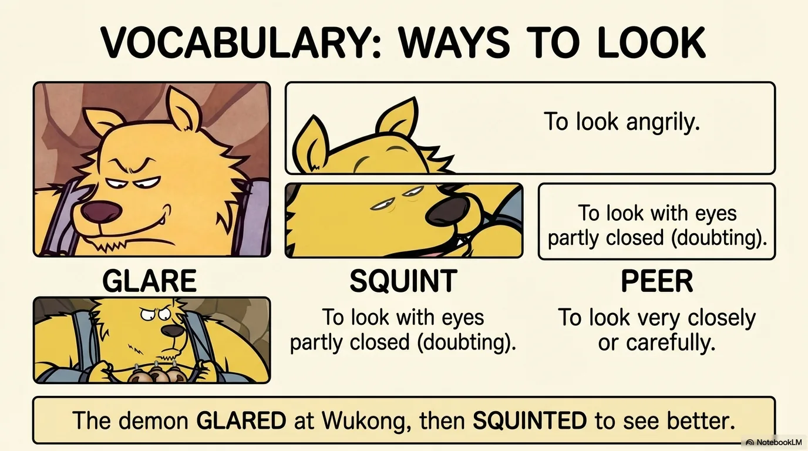
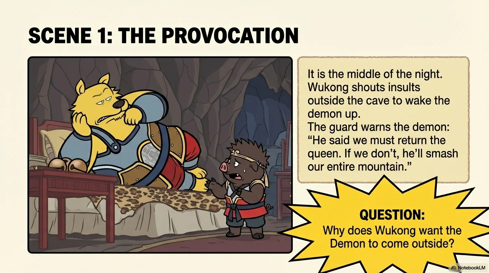
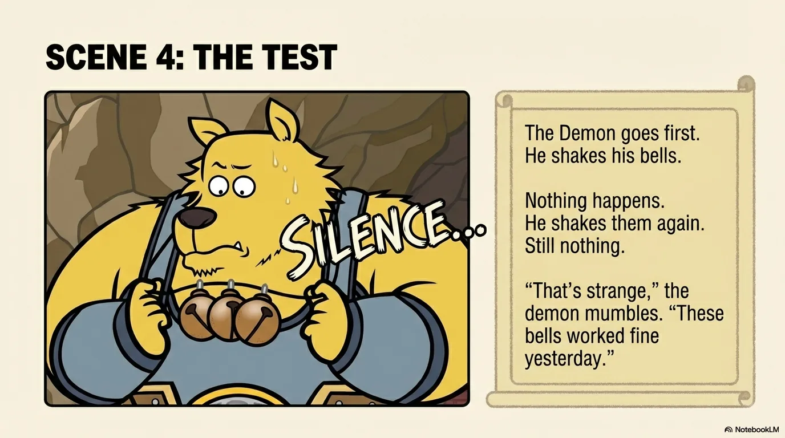
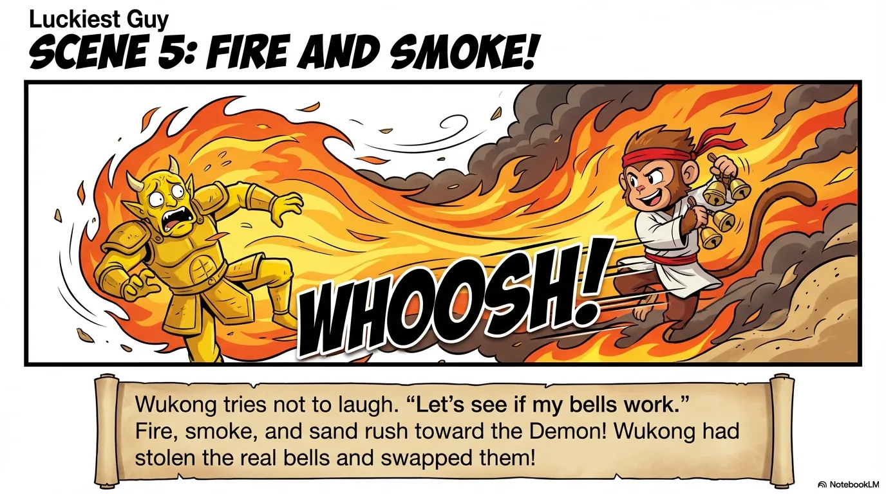
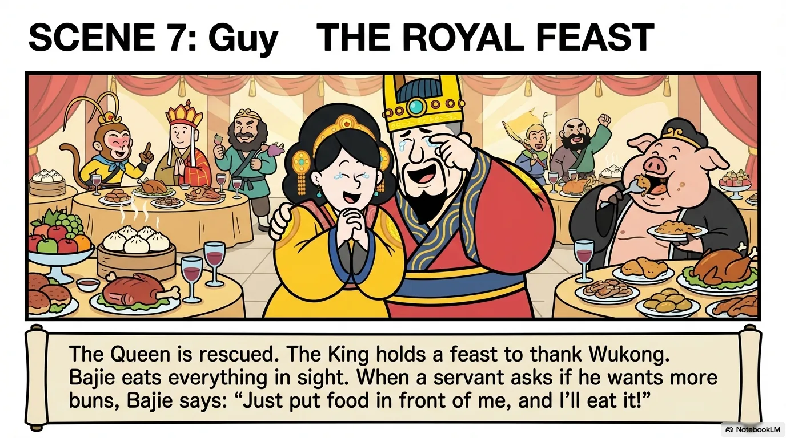
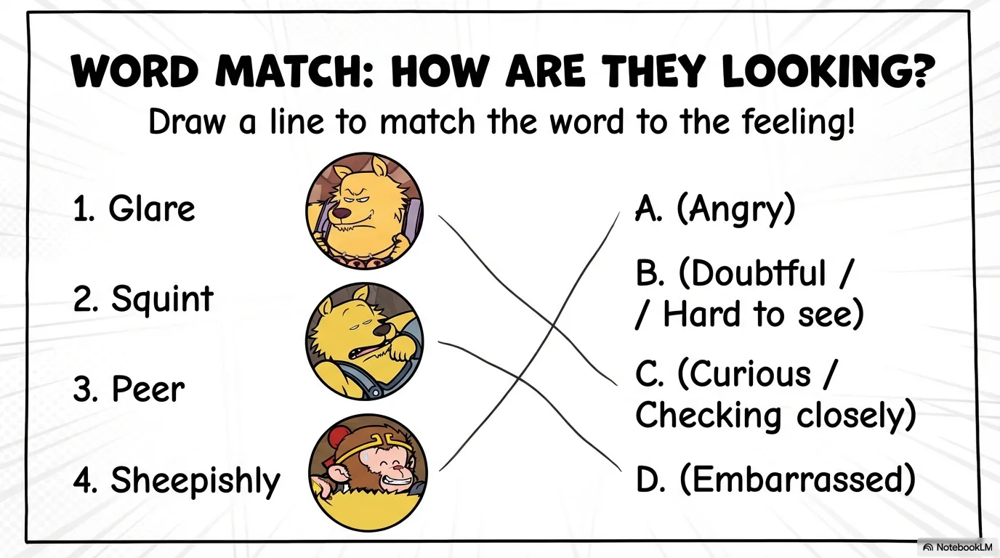
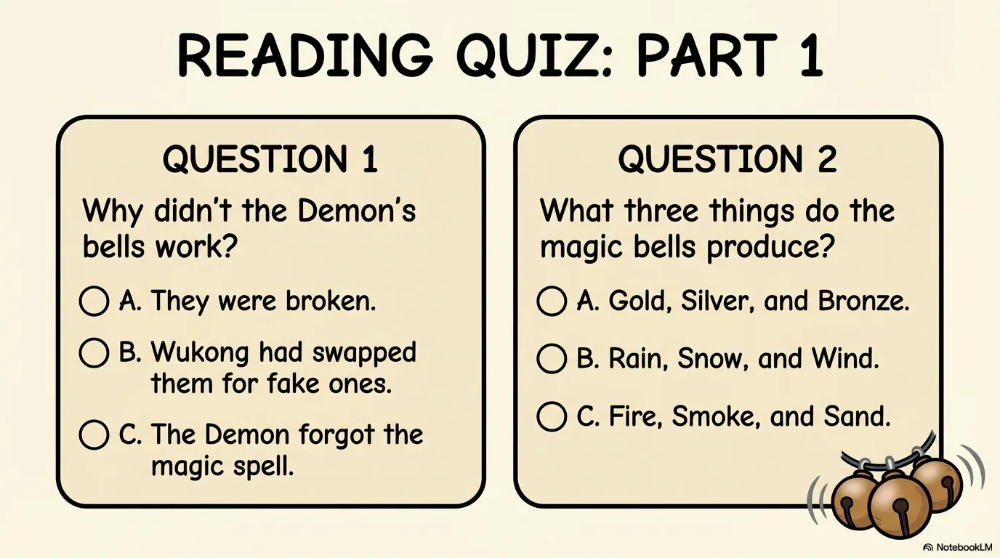
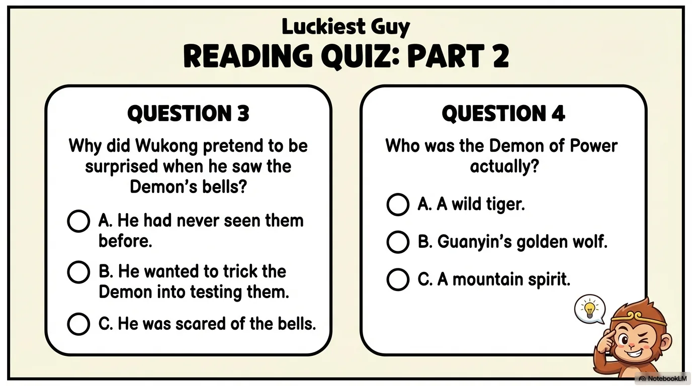
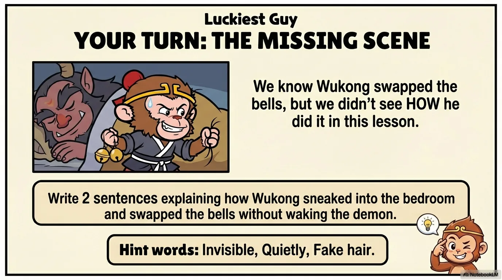

# 豆豆龙英语 · 第 86 集课件（EP086 草稿）

- 来源：`086_Journey to the West 86_Magic Bells.pptx`（主课件，20 页）
- OCR：`blocked`（no local OCR provider importable (pytesseract missing): No module named 'pytesseract'）
- 分类：待人工审核（unknown）
- 审核状态：`unreviewed`

## Slide 001

- 来源：`ppt/media/image1.png`（relationship `rId2`）
- 尺寸：1376×768
- 源 SHA-256：`7d068a713b4417bc1f5897a1599e82081819a36f7b5977b816ae90761615ba40`
- 输出 SHA-256：`f3c20ee75cb2f195fe9c32089d04c8d568e015b4d43a6b877d9abdb2263e42a1`
- 分类：unknown ｜ OCR：blocked ｜ 审核：unreviewed

## Slide 002

- 来源：`ppt/media/image3.png`（relationship `rId2`）
- 尺寸：1376×768
- 源 SHA-256：`43ea65922a1bb93512db7f8f77a26cea7b79e795d3bbd5fe9297840e8677946d`
- 输出 SHA-256：`503f5689bfcd1da43374b716ba8b304207416c8f753d9391f878ff275bd43805`
- 分类：unknown ｜ OCR：blocked ｜ 审核：unreviewed

## Slide 003

- 来源：`ppt/media/image4.png`（relationship `rId2`）
- 尺寸：1376×768
- 源 SHA-256：`89e9ba981f482ee535113b889282ebf066a8d79031b5e0332aa47c361ec0b17c`
- 输出 SHA-256：`b92e52e7083b665f136703310030bd381171fd7f4a8918f22865025327920528`
- 分类：unknown ｜ OCR：blocked ｜ 审核：unreviewed

## Slide 004

- 来源：`ppt/media/image5.png`（relationship `rId2`）
- 尺寸：1376×768
- 源 SHA-256：`312858b3897fcdf84c17111fbdbcf3f6dc28917c38b9d09eb5c3f8c01a46a0b4`
- 输出 SHA-256：`d676d088036520dac4d77d5c74a47c59596e1b34bc1ecf342351f3aab348b901`
- 分类：unknown ｜ OCR：blocked ｜ 审核：unreviewed

## Slide 005

- 来源：`ppt/media/image6.png`（relationship `rId2`）
- 尺寸：1376×768
- 源 SHA-256：`cf0839761c5ff9b2b0ae19e8ccc3f34b52a3aac560176c167225b734f3d6dd9b`
- 输出 SHA-256：`2bd0426aa405c73a714ae607302b293a7f1a692acf709ef6dd7980cbc140d290`
- 分类：unknown ｜ OCR：blocked ｜ 审核：unreviewed

## Slide 006

- 来源：`ppt/media/image7.png`（relationship `rId2`）
- 尺寸：1376×768
- 源 SHA-256：`d00be9a5806e4cb6711be4669e840edb053fe6fc4ed6056b0f3efaaf093b7019`
- 输出 SHA-256：`3cd86b1ddd686da50d226a7ffa868b91a42ddc3cbf83e72aeed0af75f112f9f9`
- 分类：unknown ｜ OCR：blocked ｜ 审核：unreviewed

## Slide 007

- 来源：`ppt/media/image8.png`（relationship `rId2`）
- 尺寸：1376×768
- 源 SHA-256：`da09c4a1f6d29345b7c52683b0ee7ed4ef6ca2e6fc0628076e1e6f7f15d4818f`
- 输出 SHA-256：`f7abf79950b957acadfe02355f9712047d42c221098649f79ae87deee484c68b`
- 分类：unknown ｜ OCR：blocked ｜ 审核：unreviewed

## Slide 008

- 来源：`ppt/media/image9.png`（relationship `rId2`）
- 尺寸：1376×768
- 源 SHA-256：`92ac66511a966d9bed7bbbd0352f01cffc871c9b0ea787b7a6c4e251a6eece8d`
- 输出 SHA-256：`109dbe45feaa4eb7862a8875e00516e16b519cd863587791f5ede825bc3b30dc`
- 分类：unknown ｜ OCR：blocked ｜ 审核：unreviewed

## Slide 009

- 来源：`ppt/media/image10.png`（relationship `rId2`）
- 尺寸：1376×768
- 源 SHA-256：`db40124e82a3041b4e36586d275c7ade47b71dcffae1ffca35090112cd517535`
- 输出 SHA-256：`b648ab0bcef3b5dc8e8880ee600b6fd884082ac2df01d668a3664cb2a0529729`
- 分类：unknown ｜ OCR：blocked ｜ 审核：unreviewed

## Slide 010

- 来源：`ppt/media/image11.png`（relationship `rId2`）
- 尺寸：1376×768
- 源 SHA-256：`dcba2427e3e8e7aaa524fa5cdf17e5d746f70b052175f096d072b82cc5658960`
- 输出 SHA-256：`f3a74ea170cb1e9198ac82d5f6c43e80985e954414c84453e47b2f1c60bd3f78`
- 分类：unknown ｜ OCR：blocked ｜ 审核：unreviewed

## Slide 011

- 来源：`ppt/media/image12.png`（relationship `rId2`）
- 尺寸：1376×768
- 源 SHA-256：`aa9c2e5631e6f135c154a7ccc1eed10963d18724e2575d8c1fc964a66cc2fbea`
- 输出 SHA-256：`7fd9f62125a1eeda9efe2ef834df7122de574bd80fbeace284e54ff0a7ccced2`
- 分类：unknown ｜ OCR：blocked ｜ 审核：unreviewed

## Slide 012

- 来源：`ppt/media/image13.png`（relationship `rId2`）
- 尺寸：1376×768
- 源 SHA-256：`a5769876d058dec04cb02a17f3883493d6940c41c85dcddbb08a0d5a890c848d`
- 输出 SHA-256：`ecc71dda050d68dfe2b2578ed5fe002d95c262ed8588325fefded2e422151735`
- 分类：unknown ｜ OCR：blocked ｜ 审核：unreviewed

## Slide 013

- 来源：`ppt/media/image14.png`（relationship `rId2`）
- 尺寸：1376×768
- 源 SHA-256：`37642f4ff0dca65d17d2d0b036860982a392a3e1d41964b1dca8187c012182f0`
- 输出 SHA-256：`78992ddd577a0569650ef5b6cd48c8e57b25ce6d1865f65a4d2d94ceffdff785`
- 分类：unknown ｜ OCR：blocked ｜ 审核：unreviewed

## Slide 014

- 来源：`ppt/media/image15.png`（relationship `rId2`）
- 尺寸：1376×768
- 源 SHA-256：`117f3d4f5d4069c8469a294f84a35f58a26fd62c9d9c45c8c7d52d9928105fac`
- 输出 SHA-256：`1ac5adedd912ad2608e5c7ac8e0561dd95ad89e177a0f762f22dd43d007b42cf`
- 分类：unknown ｜ OCR：blocked ｜ 审核：unreviewed

## Slide 015

- 来源：`ppt/media/image16.png`（relationship `rId2`）
- 尺寸：1376×768
- 源 SHA-256：`9d950b607af9b79d391b882dd9ad3128d4c9ccbed0379b66f9d0d4304bebf6fa`
- 输出 SHA-256：`247e5897b6da78cd74a4bb01dd208f51235c72b3ed7896de95b0e23cd3ed38ce`
- 分类：unknown ｜ OCR：blocked ｜ 审核：unreviewed

## Slide 016

- 来源：`ppt/media/image17.png`（relationship `rId2`）
- 尺寸：1376×768
- 源 SHA-256：`3939708a4b0de043784c28f501f85e5ebad375fc34cb990811fd4429e0001e88`
- 输出 SHA-256：`5217aa7d90cbb400c7ea6eadbe50795fb9679110f4a6e5fcdf8762d416023c27`
- 分类：unknown ｜ OCR：blocked ｜ 审核：unreviewed

## Slide 017

- 来源：`ppt/media/image18.png`（relationship `rId2`）
- 尺寸：1376×768
- 源 SHA-256：`325fed0c1114ad577a8eef8dfb4cd8cc9b247104235c7a4d40307add9b351db8`
- 输出 SHA-256：`b690e00cf77f4dbbc049ee0bb7168374ea8f494d3c75dd51305f0b00e686e67b`
- 分类：unknown ｜ OCR：blocked ｜ 审核：unreviewed

## Slide 018

- 来源：`ppt/media/image19.png`（relationship `rId2`）
- 尺寸：1376×768
- 源 SHA-256：`dece55bcf9faad728f261d61844f3e65bd753bd08021183ef8845247a599d6ff`
- 输出 SHA-256：`c7c24268c8d58804d64884b5d107b5c50b2a45d269a2adc390ad8a8872e21702`
- 分类：unknown ｜ OCR：blocked ｜ 审核：unreviewed

## Slide 019

- 来源：`ppt/media/image20.png`（relationship `rId2`）
- 尺寸：1376×768
- 源 SHA-256：`f6f5ba4067b377933033ca3a7a337de6e6338ec326116d55bbf34c8dd0ec62d8`
- 输出 SHA-256：`a343e8cac291c622ef69e60ae5e46c59d14b9ad128bf31b11579970f74b99764`
- 分类：unknown ｜ OCR：blocked ｜ 审核：unreviewed

## Slide 020

- 来源：`ppt/media/image21.png`（relationship `rId2`）
- 尺寸：1376×768
- 源 SHA-256：`c94630c783630a1c2db4f6a91895e3a9faa7dc8cd2d7d2b367571af42cd708e3`
- 输出 SHA-256：`e62ca3116d78b38449c5d5ef94f2a9826c5013e580701defd08e4abe073b1681`
- 分类：unknown ｜ OCR：blocked ｜ 审核：unreviewed
