# 豆豆龙英语 · 第 87 集课件（EP087 草稿）

- 来源：`087_Journey to the West 87_The Three Young Women.pptx`（主课件，20 页）
- OCR：`blocked`（no local OCR provider importable (pytesseract missing): No module named 'pytesseract'）
- 分类：待人工审核（unknown）
- 审核状态：`unreviewed`

## Slide 001

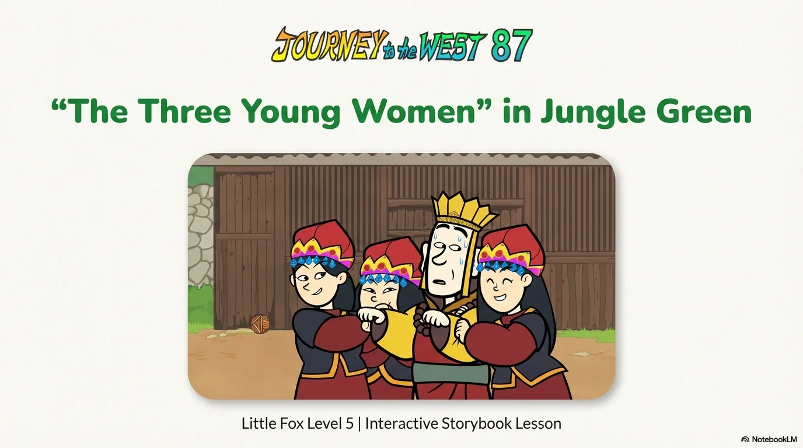

- 来源：`ppt/media/image1.png`（relationship `rId2`）
- 尺寸：1376×768
- 源 SHA-256：`5e069dddf4590c526fec6702477425c673cee4be6d7b3430763b05a7ebf3be4a`
- 输出 SHA-256：`339c0cef96811cd19c159b3abb5f8b8f448bc3103e886694add5a929d42b413c`
- 分类：unknown ｜ OCR：blocked ｜ 审核：unreviewed

## Slide 002

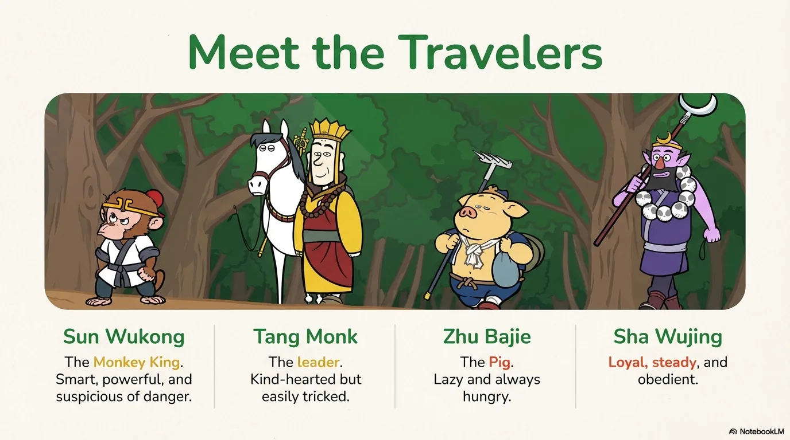

- 来源：`ppt/media/image3.png`（relationship `rId2`）
- 尺寸：1376×768
- 源 SHA-256：`21648d4e71abbf6ccdd45f26d14bfaa8ab189528568a6d3b7131bee2f3454129`
- 输出 SHA-256：`68c151d866b6c3a5cbe82a18bc34610689371cd1d61abccb3a42b01a094065ad`
- 分类：unknown ｜ OCR：blocked ｜ 审核：unreviewed

## Slide 003

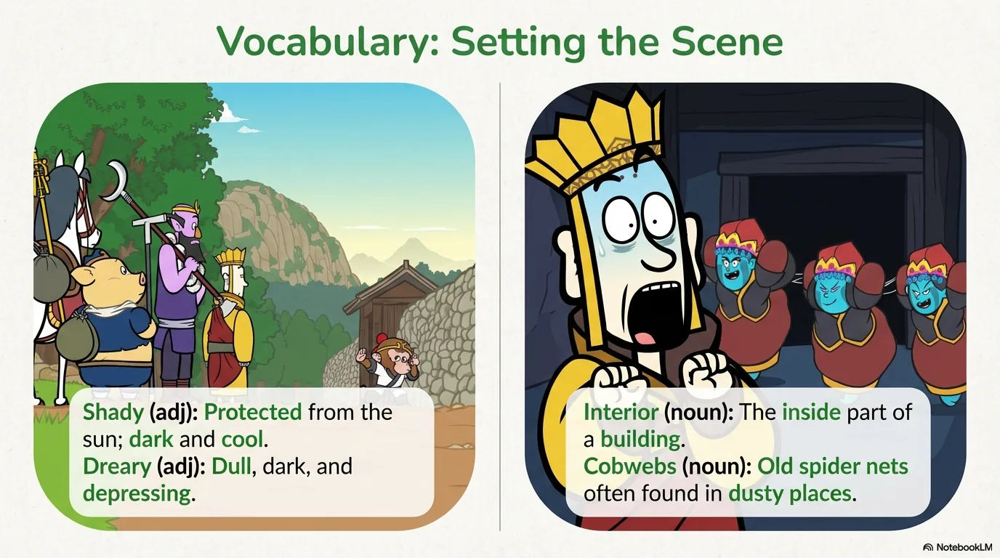

- 来源：`ppt/media/image4.png`（relationship `rId2`）
- 尺寸：1376×768
- 源 SHA-256：`8cfe9cebb53d541f422893d23a0d6e03619c1a0a64af097aeb8b95676ade2723`
- 输出 SHA-256：`7ffd9e3d4a217c5198c33570ede5c897f8405767a997ec63b5e7f7cba2919538`
- 分类：unknown ｜ OCR：blocked ｜ 审核：unreviewed

## Slide 004

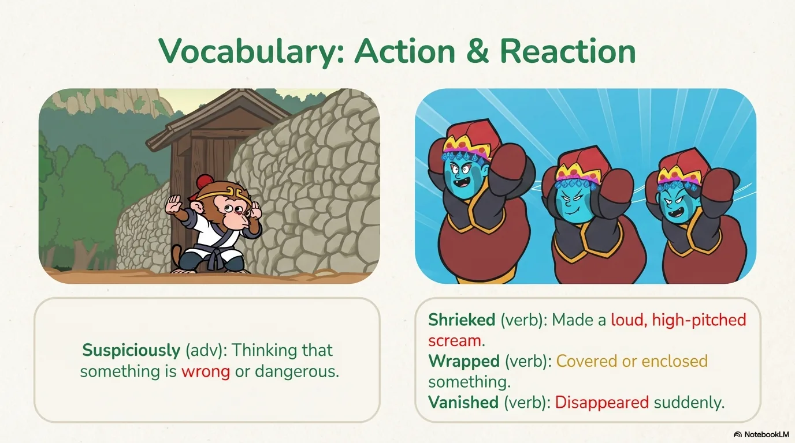

- 来源：`ppt/media/image5.png`（relationship `rId2`）
- 尺寸：1376×768
- 源 SHA-256：`8b2edc337d52443a82bf112c400ba597e4f5ffd61ad36975f3327019a4ab1dcf`
- 输出 SHA-256：`752f38e6614c60a571a108b9223ce713c13c7404eea58aaa2a19b7c922ea6693`
- 分类：unknown ｜ OCR：blocked ｜ 审核：unreviewed

## Slide 005

- 来源：`ppt/media/image6.png`（relationship `rId2`）
- 尺寸：1376×768
- 源 SHA-256：`eacd351edef295c28d12855a3e1740a74218650f7700010cf2199d545d5abe8c`
- 输出 SHA-256：`e8a5b1210c9974a7572f4e9941541c86f2a55065ca9af8f5937bbe0bc21e1c4c`
- 分类：unknown ｜ OCR：blocked ｜ 审核：unreviewed

## Slide 006

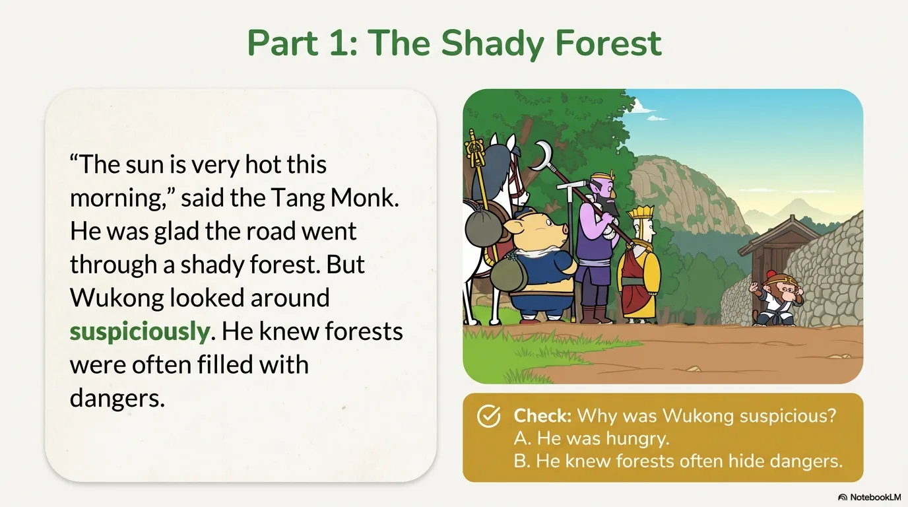

- 来源：`ppt/media/image7.png`（relationship `rId2`）
- 尺寸：1376×768
- 源 SHA-256：`735833cd1922725f77190a98bcbb9a518787350d802222d82d237410c14681f0`
- 输出 SHA-256：`2137e1a0a859ce2176f920f3ee3de87213021be922727161cf3cf834429a0d9c`
- 分类：unknown ｜ OCR：blocked ｜ 审核：unreviewed

## Slide 007

- 来源：`ppt/media/image8.png`（relationship `rId2`）
- 尺寸：1376×768
- 源 SHA-256：`f8344ebcb3b4b61739c42b273059602e196eac6eaff9e68989edc7a5324919d3`
- 输出 SHA-256：`4caa8ef1439422b29dec4ba94453e77e63ef9fff055e81c89a57352c9578de7f`
- 分类：unknown ｜ OCR：blocked ｜ 审核：unreviewed

## Slide 008

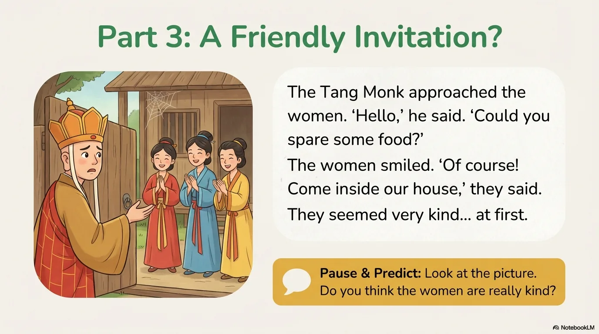

- 来源：`ppt/media/image9.png`（relationship `rId2`）
- 尺寸：1376×768
- 源 SHA-256：`37bb106d9b404ed00e26845c76fd59338e3cee840c5620157765bffa8d987770`
- 输出 SHA-256：`f722cf9ae0fa94df6ca9c947dc50185f8e0a975a1e69704df7ee6f29dd4f8d0d`
- 分类：unknown ｜ OCR：blocked ｜ 审核：unreviewed

## Slide 009

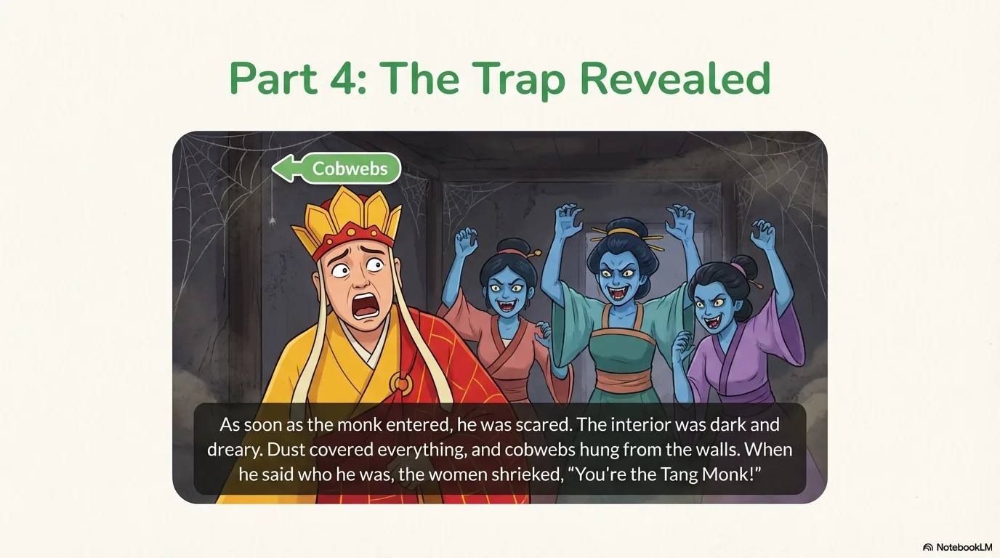

- 来源：`ppt/media/image10.png`（relationship `rId2`）
- 尺寸：1376×768
- 源 SHA-256：`a78a0d424a100c9ba23d2fa03636d68e8aae129906cf6bfc3a8b23b0822176e4`
- 输出 SHA-256：`1a00cca416bbaf0d29bbb0c4e53694affa6495ea9e150e5e9ee6a93084d84537`
- 分类：unknown ｜ OCR：blocked ｜ 审核：unreviewed

## Slide 010

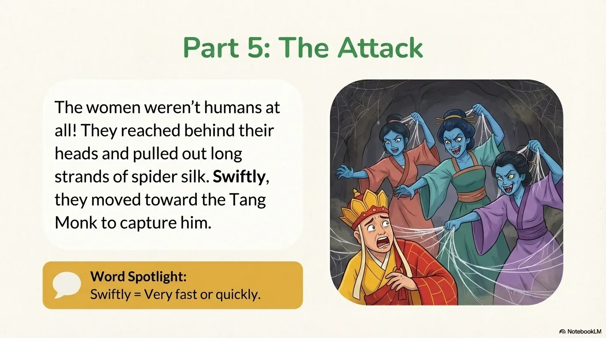

- 来源：`ppt/media/image11.png`（relationship `rId2`）
- 尺寸：1376×768
- 源 SHA-256：`c83b897b0a786e3b822dfdbd9cf8af6b4868d3348737a9b70dc2b2b249f488c0`
- 输出 SHA-256：`bad5493516025be2f5557f6e99465e9b91c91588233e9a96622053c5b7b6941d`
- 分类：unknown ｜ OCR：blocked ｜ 审核：unreviewed

## Slide 011

- 来源：`ppt/media/image12.png`（relationship `rId2`）
- 尺寸：1376×768
- 源 SHA-256：`e789e24d6e3b58964d01901b3c4238c7db4d297ee53c3152529b65e3d59b4450`
- 输出 SHA-256：`7d983e9a2a98e2785f2328d0d1fb60dd25fd80abf5d6e95608c796478ef7f794`
- 分类：unknown ｜ OCR：blocked ｜ 审核：unreviewed

## Slide 012

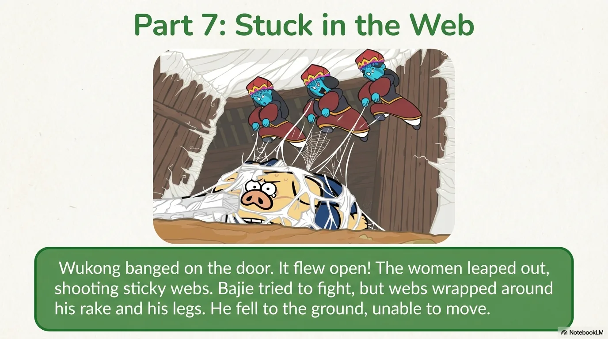

- 来源：`ppt/media/image13.png`（relationship `rId2`）
- 尺寸：1376×768
- 源 SHA-256：`a005f9b9943f20e62ada43e64fb720d6cb8c677cac07f158456992d7eb3bf124`
- 输出 SHA-256：`2b9230d6d01cbab2017b1f835a1845b8efc572febc00b5ac188f28f61aa2e977`
- 分类：unknown ｜ OCR：blocked ｜ 审核：unreviewed

## Slide 013

- 来源：`ppt/media/image14.png`（relationship `rId2`）
- 尺寸：1376×768
- 源 SHA-256：`b39b3b9b204327c22ce65a6f5892aff98e496ac949116b4b8e8def96c9a6be49`
- 输出 SHA-256：`919e2bdf52995ff24207fcf1df6712d591897275731426a5910c22d7aea634a3`
- 分类：unknown ｜ OCR：blocked ｜ 审核：unreviewed

## Slide 014

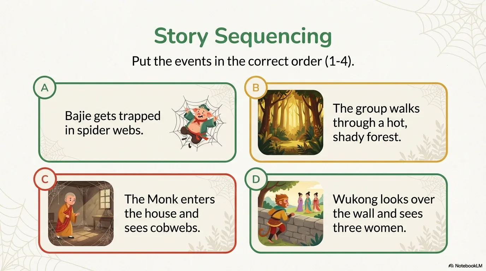

- 来源：`ppt/media/image15.png`（relationship `rId2`）
- 尺寸：1376×768
- 源 SHA-256：`e67f3e9899b5aa3a11917700f35d5b0f2472ef1c04df70b5d8cb9cb64fc3dd73`
- 输出 SHA-256：`dc1eaf0a7bcf67310b747998cd640d53ee85fd549ca09314f0c5990dccc3e69a`
- 分类：unknown ｜ OCR：blocked ｜ 审核：unreviewed

## Slide 015

- 来源：`ppt/media/image16.png`（relationship `rId2`）
- 尺寸：1376×768
- 源 SHA-256：`31538239e5ce9383b86e22243427b9fc08414c62ce7f048f3bcc676a68f6ea75`
- 输出 SHA-256：`af14461d87c33505a67d23951ae2ffd609479e8cf306e21c5c1f1c94f7661e88`
- 分类：unknown ｜ OCR：blocked ｜ 审核：unreviewed

## Slide 016

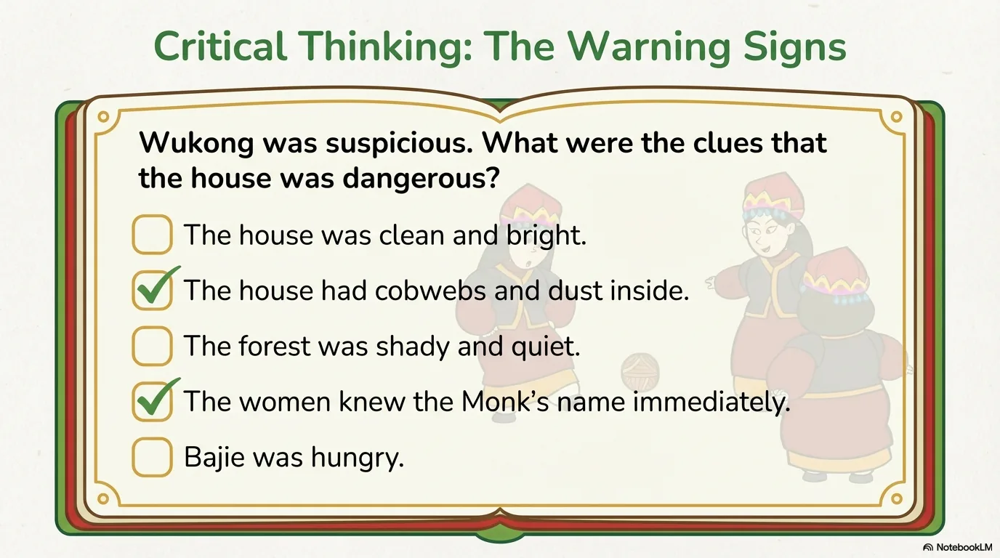

- 来源：`ppt/media/image17.png`（relationship `rId2`）
- 尺寸：1376×768
- 源 SHA-256：`a96ba1f3613dcb24513177993a242119a8d0271da470060c2c16d88a170f699f`
- 输出 SHA-256：`5bfef7c845ec6d38d960dc0af06035bc10a3acef6d5e80510fc0d1313e7a4a3c`
- 分类：unknown ｜ OCR：blocked ｜ 审核：unreviewed

## Slide 017

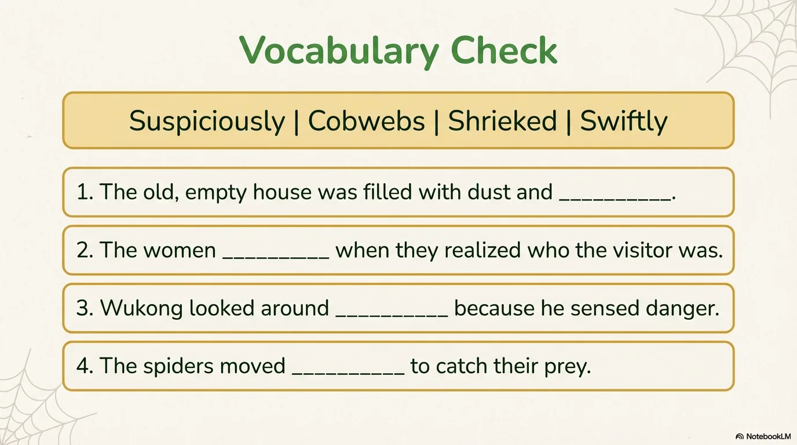

- 来源：`ppt/media/image18.png`（relationship `rId2`）
- 尺寸：1376×768
- 源 SHA-256：`d3da28d56f3c2b30ab4f35d7bc74490c25dff1dce7a90c1514b727aa13182d3c`
- 输出 SHA-256：`0579ce8bc2d9a2fad93b78ee0349a19d13023da7420e7ec4e500273ad5bc0893`
- 分类：unknown ｜ OCR：blocked ｜ 审核：unreviewed

## Slide 018

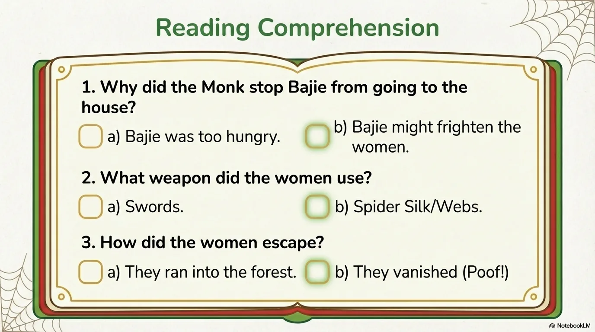

- 来源：`ppt/media/image19.png`（relationship `rId2`）
- 尺寸：1376×768
- 源 SHA-256：`42fe82207835fd94befd9c82d8e2e1337c4c988c63dc80428cbef92e7757af8b`
- 输出 SHA-256：`80da6ce290c5ebcda888ca53708e1571244b0946b52d7234704945761ef01328`
- 分类：unknown ｜ OCR：blocked ｜ 审核：unreviewed

## Slide 019

- 来源：`ppt/media/image20.png`（relationship `rId2`）
- 尺寸：1376×768
- 源 SHA-256：`0264a1db122d932e19375e6b72c9e1a8517cf0561b8a42b7097c520d6ab87f8f`
- 输出 SHA-256：`a2f5bd0ed1b8cc6a073435018c5149793987fb15a5ec3c9887196eeb155ec4d4`
- 分类：unknown ｜ OCR：blocked ｜ 审核：unreviewed

## Slide 020

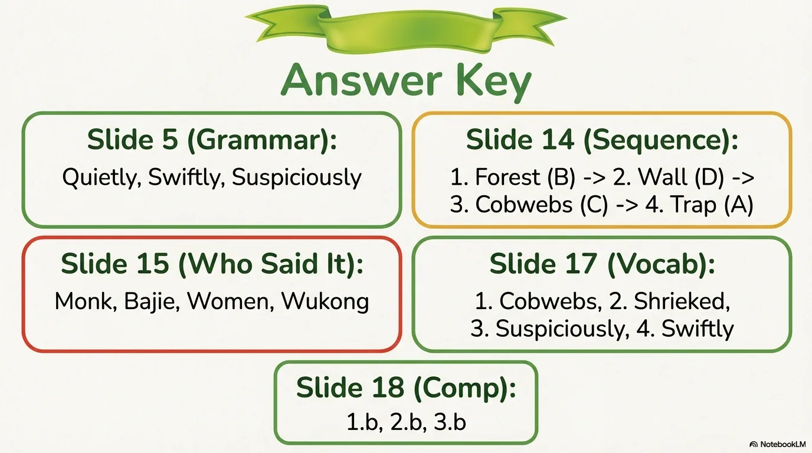

- 来源：`ppt/media/image21.png`（relationship `rId2`）
- 尺寸：1376×768
- 源 SHA-256：`34bb49cd497fcf671fee0b82bb86d70936aa0ed4a4cfa3a9b56c6dd563463e7e`
- 输出 SHA-256：`750305bcd18cb22710b50fb66a845be4af83fce7349396f37ad3bf3d8e142d48`
- 分类：unknown ｜ OCR：blocked ｜ 审核：unreviewed
