# 豆豆龙英语 · 第 88 集课件（EP088 草稿）

- 来源：`088_Journey to the West 88_The Priest's Plan.pptx`（主课件，20 页）
- OCR：`blocked`（no local OCR provider importable (pytesseract missing): No module named 'pytesseract'）
- 分类：待人工审核（unknown）
- 审核状态：`unreviewed`

## Slide 001

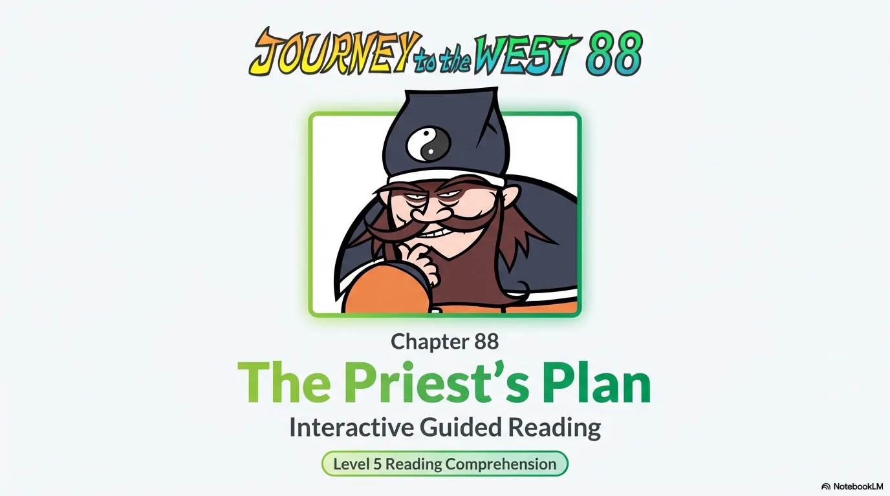

- 来源：`ppt/media/image1.png`（relationship `rId2`）
- 尺寸：1376×768
- 源 SHA-256：`4e6bb116ffeaae387f81b66a8fdbf68647fbf6cfd4bc78fbc9e3c831b5d81580`
- 输出 SHA-256：`76f9507db1f81b2d73af5986f774c22c7ceb91acb47fc50f3a8b1ce21724a9c7`
- 分类：unknown ｜ OCR：blocked ｜ 审核：unreviewed

## Slide 002

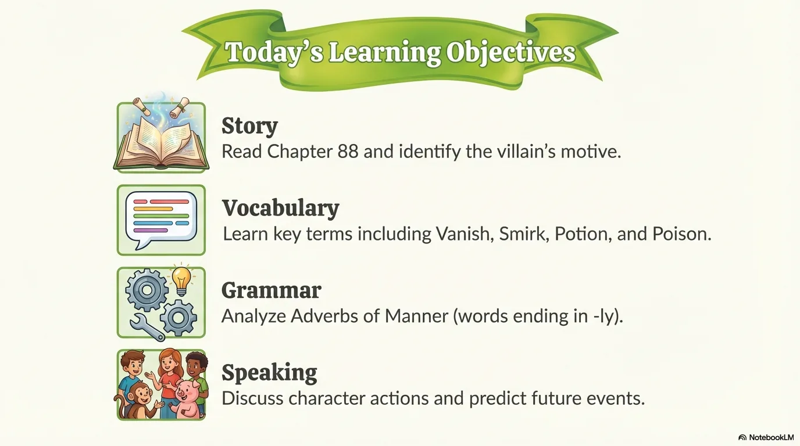

- 来源：`ppt/media/image3.png`（relationship `rId2`）
- 尺寸：1376×768
- 源 SHA-256：`23d5f0c9eb7568eb763b8befdf9ad129464f7214aae0663b0c3bbd1e4a4d5c16`
- 输出 SHA-256：`3097a59fa978d744dd657b2a0ade3e5ff9b2ab850b1675f9760916d75eb6f5cf`
- 分类：unknown ｜ OCR：blocked ｜ 审核：unreviewed

## Slide 003

- 来源：`ppt/media/image4.png`（relationship `rId2`）
- 尺寸：1376×768
- 源 SHA-256：`dbc0f3ca424c16dce837002d4bb66ec6ccea95845bab51c5eba951be561f841b`
- 输出 SHA-256：`2f77280a1d33e7d7eb8cd95ca71945c162ffd8f512180c971d877244dd677b7d`
- 分类：unknown ｜ OCR：blocked ｜ 审核：unreviewed

## Slide 004

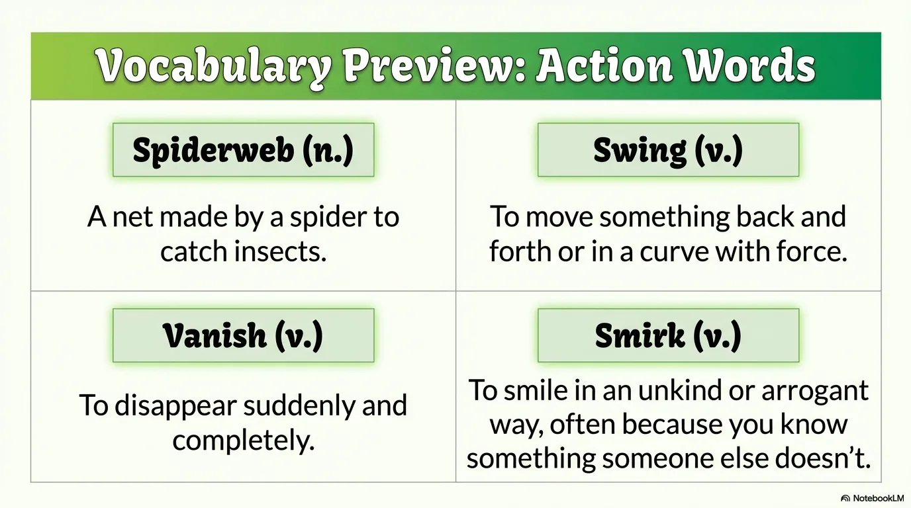

- 来源：`ppt/media/image5.png`（relationship `rId2`）
- 尺寸：1376×768
- 源 SHA-256：`df9a8cb2c9025595c510d82fb5541f662ed10a8dc56ad3cb0b28e90e25968f64`
- 输出 SHA-256：`6b76fa9e6363701f4cda83ac2dfb90d97edcf146737a2ab8aecc9e221f1761d3`
- 分类：unknown ｜ OCR：blocked ｜ 审核：unreviewed

## Slide 005

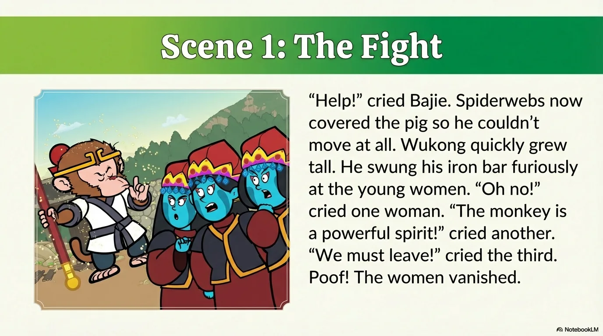

- 来源：`ppt/media/image6.png`（relationship `rId2`）
- 尺寸：1376×768
- 源 SHA-256：`c463f78b7b398363e602851530020d14da0820db50b5d25d5e54ad631c96e071`
- 输出 SHA-256：`6e95ea4f1a8bcf090f2143888df1916f6c6ee86bdc34eb69ff214022e9876e53`
- 分类：unknown ｜ OCR：blocked ｜ 审核：unreviewed

## Slide 006

- 来源：`ppt/media/image7.png`（relationship `rId2`）
- 尺寸：1376×768
- 源 SHA-256：`9e4e9798cd75e9889431696902ed3714f65f5eeb59ca04a9719dd69060ee8565`
- 输出 SHA-256：`67f54586de39dcec45e415e1af866fc8f235f7e9b33eb97665bc6574199ca124`
- 分类：unknown ｜ OCR：blocked ｜ 审核：unreviewed

## Slide 007

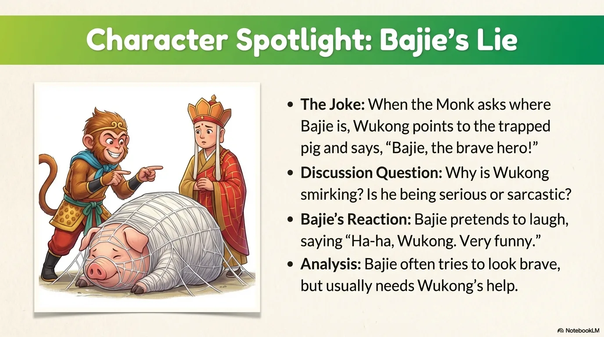

- 来源：`ppt/media/image8.png`（relationship `rId2`）
- 尺寸：1376×768
- 源 SHA-256：`bf36ca8e436dc5e5974bb7b3a81adde021f72bfb5187e68c461a45702a826912`
- 输出 SHA-256：`314e1d36eed529b93a24fde31a8d8e7f228df08f183c7c9bcba7e6a7b002d822`
- 分类：unknown ｜ OCR：blocked ｜ 审核：unreviewed

## Slide 008

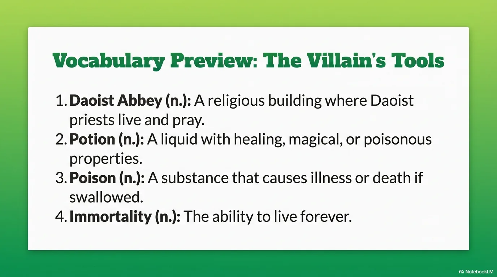

- 来源：`ppt/media/image9.png`（relationship `rId2`）
- 尺寸：1376×768
- 源 SHA-256：`04cddcdf6c7654193c18b5b2f1f16051a39380a4ec94cf3d5a1dd9ee93e34f25`
- 输出 SHA-256：`4669912946a5c4a1e92f263ae301d1472e1eeb4752e06f0ab6bac99feb4dbccf`
- 分类：unknown ｜ OCR：blocked ｜ 审核：unreviewed

## Slide 009

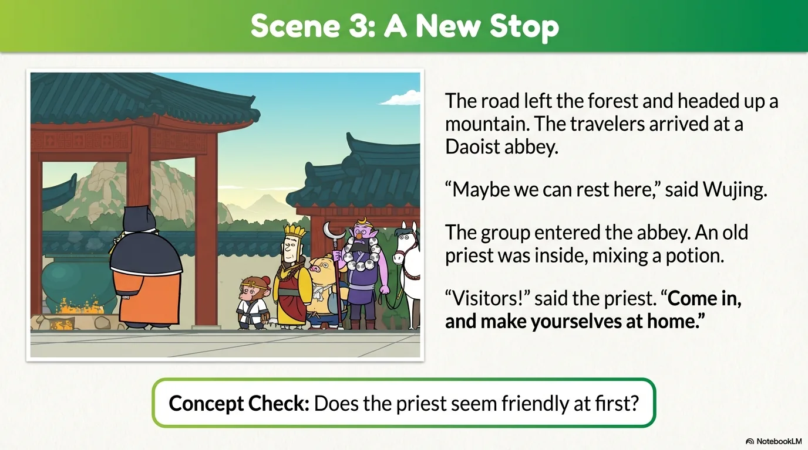

- 来源：`ppt/media/image10.png`（relationship `rId2`）
- 尺寸：1376×768
- 源 SHA-256：`93162625e344d6b5ae656f821087c23c8e854e8b1ea0216ca08cb31fd2fcd531`
- 输出 SHA-256：`b9ff9e0d00b03fa8ab2f51acccc314bebaa3ee6985bcf58a913da86ca6992366`
- 分类：unknown ｜ OCR：blocked ｜ 审核：unreviewed

## Slide 010

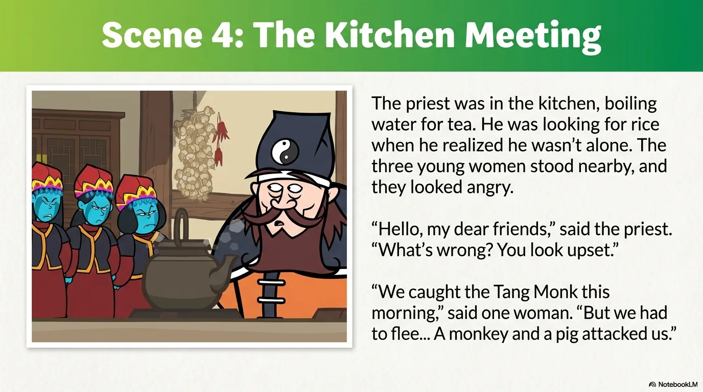

- 来源：`ppt/media/image11.png`（relationship `rId2`）
- 尺寸：1376×768
- 源 SHA-256：`96d63a3b998028e8919922647a4c57cf9250af21bd07573cdef40f68de2cab79`
- 输出 SHA-256：`8083e7f490522632f104d5772d5caa589aa094c4b26c48a22571c987f71323c5`
- 分类：unknown ｜ OCR：blocked ｜ 审核：unreviewed

## Slide 011

- 来源：`ppt/media/image12.png`（relationship `rId2`）
- 尺寸：1376×768
- 源 SHA-256：`ad2b4c50e0ad89bf28acc4931da72e2c8582dbe22501a2e843943c462b614b21`
- 输出 SHA-256：`f1578fe9839e5cd57511fbbfb6421d1aa56e2dae0dbb166daf0f028d9f07df3a`
- 分类：unknown ｜ OCR：blocked ｜ 审核：unreviewed

## Slide 012

- 来源：`ppt/media/image13.png`（relationship `rId2`）
- 尺寸：1376×768
- 源 SHA-256：`43af87015307472b3b43e8877497be8ea91b283a9e196c118e53d58a2e6a1b74`
- 输出 SHA-256：`c426d7a87c4cf994d160084f359397aff2d1a33b0be07d9d1c831bef2ead2fa0`
- 分类：unknown ｜ OCR：blocked ｜ 审核：unreviewed

## Slide 013

- 来源：`ppt/media/image14.png`（relationship `rId2`）
- 尺寸：1376×768
- 源 SHA-256：`b2eafeec2295b77e94d7858e05ca0ec5bfcda896d9d305b18f2bc18e370e17ab`
- 输出 SHA-256：`146db979e1fd79be3cffa78c0ab59a2320f66ffabfb813a4c1908bae20443ccc`
- 分类：unknown ｜ OCR：blocked ｜ 审核：unreviewed

## Slide 014

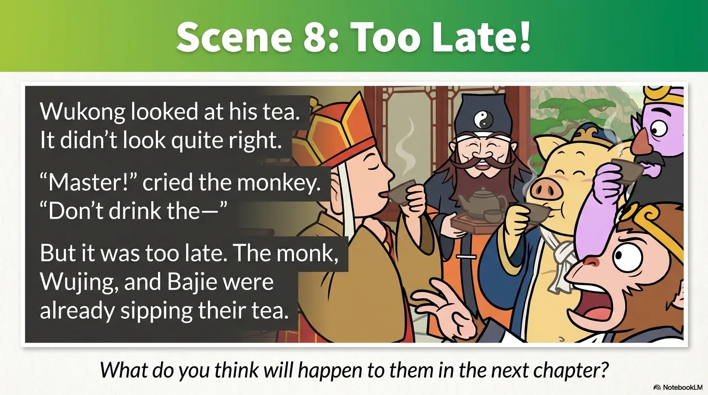

- 来源：`ppt/media/image15.png`（relationship `rId2`）
- 尺寸：1376×768
- 源 SHA-256：`57754d92d71711ef1ec4b3f63b7138600b6c5efc053c3ff9d8684f5178aec6d8`
- 输出 SHA-256：`e20b72c8dea48d73ad888f48cdf00e454bfed6607d0657a6878224287af70d96`
- 分类：unknown ｜ OCR：blocked ｜ 审核：unreviewed

## Slide 015

- 来源：`ppt/media/image16.png`（relationship `rId2`）
- 尺寸：1376×768
- 源 SHA-256：`c8cd55b1c3265ad5aaf9a71cb57a0b0ef06db91328323decef58e5b3f594de2a`
- 输出 SHA-256：`2effc8381a19de183eb4f046ac32e35b72c7d02f1422ab77abfa2184b4b0e4a0`
- 分类：unknown ｜ OCR：blocked ｜ 审核：unreviewed

## Slide 016

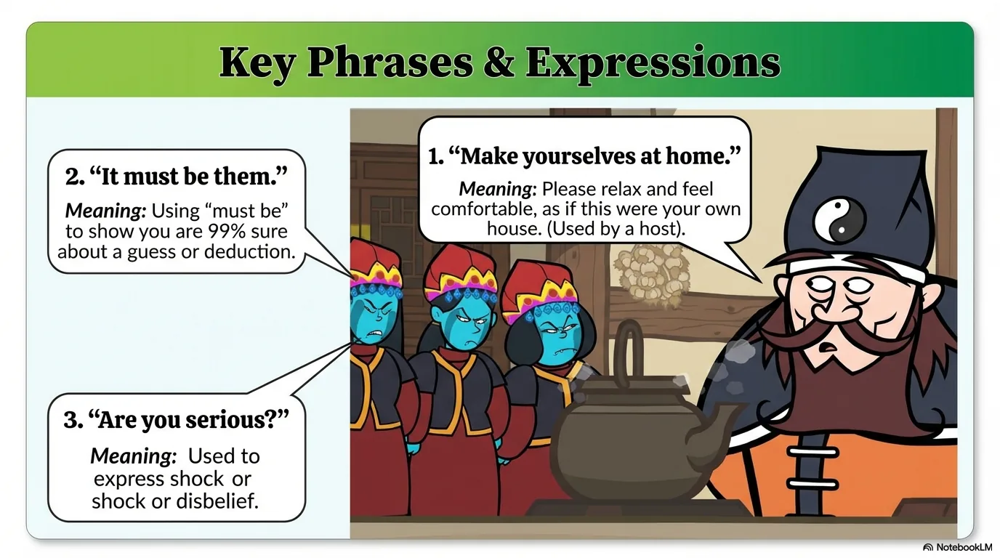

- 来源：`ppt/media/image17.png`（relationship `rId2`）
- 尺寸：1376×768
- 源 SHA-256：`26672cb4189e65f7d37633a2ad531eb8345fd975d6bad7c7a1dc0360354197d6`
- 输出 SHA-256：`493c677e20e1d02c4a473c4435aaf5635d4bae9f22e1cc105c58450ed9ab5996`
- 分类：unknown ｜ OCR：blocked ｜ 审核：unreviewed

## Slide 017

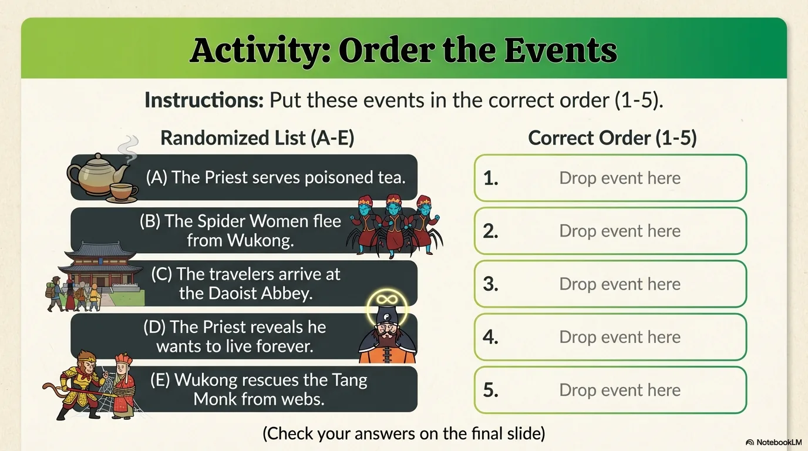

- 来源：`ppt/media/image18.png`（relationship `rId2`）
- 尺寸：1376×768
- 源 SHA-256：`8c63a384780900994ba9941902eb92a0bf009a4d77e496fcdd0e23272ec0dd0b`
- 输出 SHA-256：`5c145c01b6f219b5ba254fa956eda4dc08bc8565539e933c797c10ff19d11bd4`
- 分类：unknown ｜ OCR：blocked ｜ 审核：unreviewed

## Slide 018

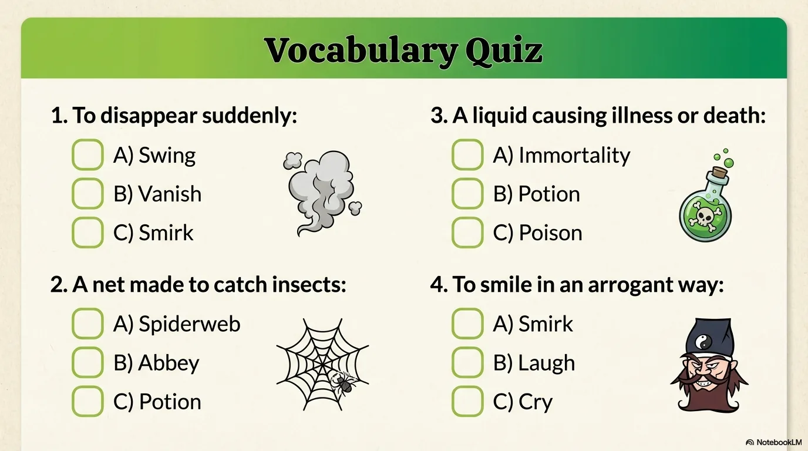

- 来源：`ppt/media/image19.png`（relationship `rId2`）
- 尺寸：1376×768
- 源 SHA-256：`84d988d17095782ecf5345b41546bbe5a6cffbdea6fa24c5971f83ed39bdf2cf`
- 输出 SHA-256：`15845625da424edb0f0239c0fecfd22c65dcb011180a9ab6416e1626db33243a`
- 分类：unknown ｜ OCR：blocked ｜ 审核：unreviewed

## Slide 019

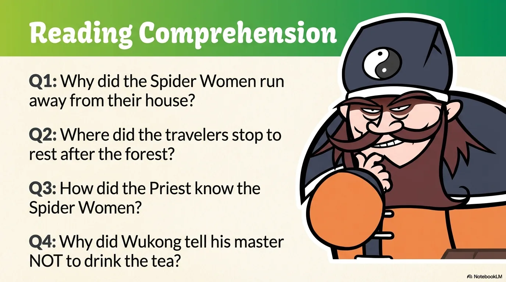

- 来源：`ppt/media/image20.png`（relationship `rId2`）
- 尺寸：1376×768
- 源 SHA-256：`ea344dbcd888157f6fe177b053606735378ae5503da56cf548eb281c7a6b707b`
- 输出 SHA-256：`9b4286448822fd507d6e1ba0c98b5cde0cee656efd2463168674e085fceca616`
- 分类：unknown ｜ OCR：blocked ｜ 审核：unreviewed

## Slide 020

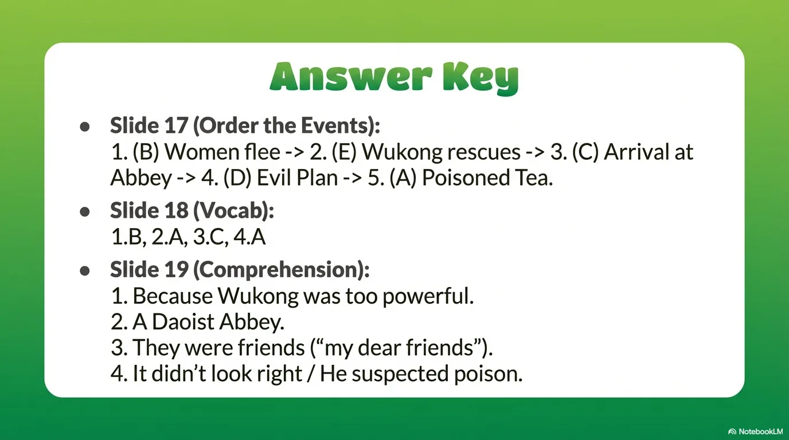

- 来源：`ppt/media/image21.png`（relationship `rId2`）
- 尺寸：1376×768
- 源 SHA-256：`65ca2e4c109a53b080dadf241d171e03e869393be8fcb43cef6044c6ddf4eb86`
- 输出 SHA-256：`56c7d360e9780a6fb02972e7753d303b97d2ecde79f02e8862b8c5c059acd9ce`
- 分类：unknown ｜ OCR：blocked ｜ 审核：unreviewed
