# 豆豆龙英语 · 第 89 集课件（EP089 草稿）

- 来源：`089_Journey to the West 89_Many Eyes.pptx`（主课件，20 页）
- OCR：`blocked`（no local OCR provider importable (pytesseract missing): No module named 'pytesseract'）
- 分类：待人工审核（unknown）
- 审核状态：`unreviewed`

## Slide 001

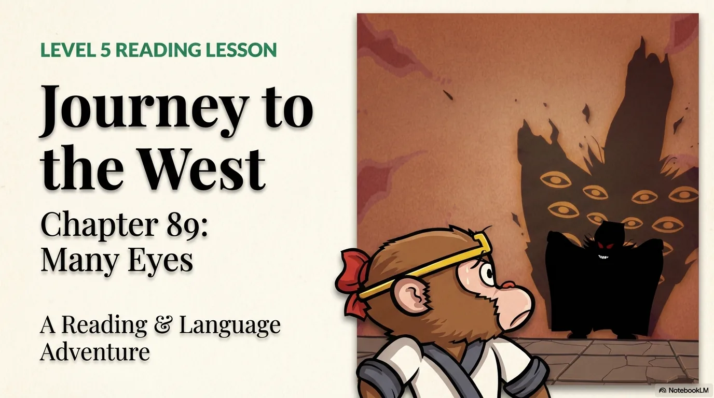

- 来源：`ppt/media/image1.png`（relationship `rId2`）
- 尺寸：1376×768
- 源 SHA-256：`895b8de317adf1abed35c474a25449797a62de87733d372cbab6ed533c9da2f7`
- 输出 SHA-256：`3b23f0b8d4686de9b9ba5ae064b9b543940d61b1592f2e6b8ef07c377acbc7f0`
- 分类：unknown ｜ OCR：blocked ｜ 审核：unreviewed

## Slide 002

- 来源：`ppt/media/image3.png`（relationship `rId2`）
- 尺寸：1376×768
- 源 SHA-256：`7b1dc595718d5a1f3583c6b5e53e69f92454b7904a9aed59c4eeff97f0e76a6b`
- 输出 SHA-256：`505e3bc8ca46b304a443eed6da1f4811b0704db16ddb8f2c8081e74b5350e6da`
- 分类：unknown ｜ OCR：blocked ｜ 审核：unreviewed

## Slide 003

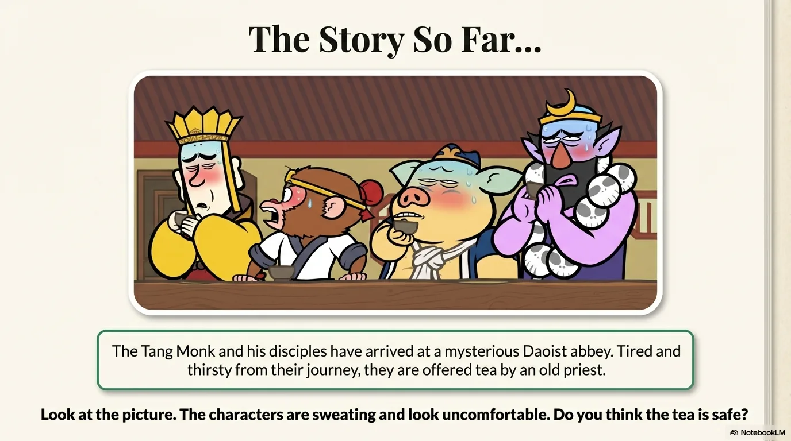

- 来源：`ppt/media/image4.png`（relationship `rId2`）
- 尺寸：1376×768
- 源 SHA-256：`d2d1c7fe38fa242ab38cba5014776c86a0354d5781d82e4c451375fcc8ff2ab8`
- 输出 SHA-256：`5ed2085859c636a2a37db35f07e0447599febdce1feed6e9a1b4d0004a81afbe`
- 分类：unknown ｜ OCR：blocked ｜ 审核：unreviewed

## Slide 004

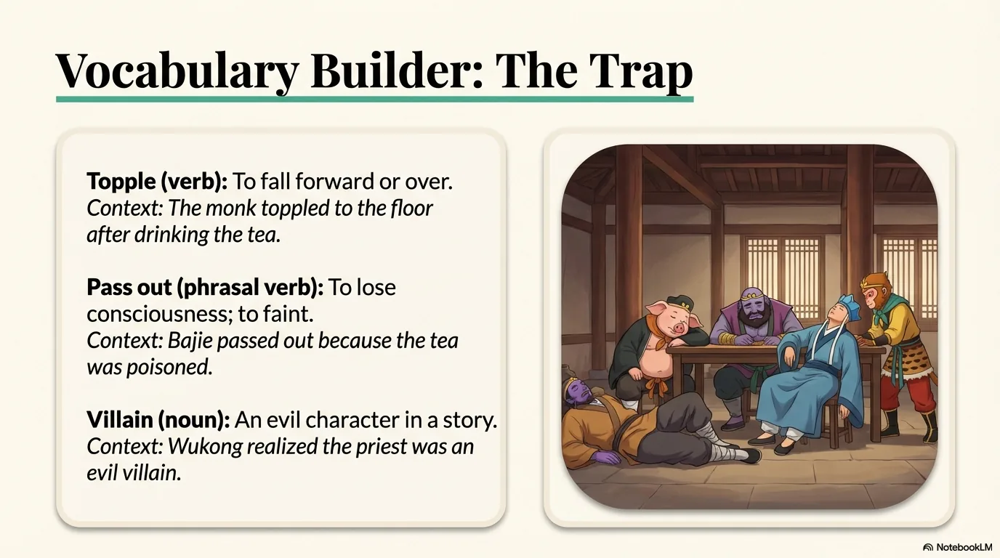

- 来源：`ppt/media/image5.png`（relationship `rId2`）
- 尺寸：1376×768
- 源 SHA-256：`761c90835e4e69632234f8b5f84a22ef6a7b4c94d111828700b7712675cb20de`
- 输出 SHA-256：`c6633322a75886902c0e93e2f179fb41b345378560c980c42bbd58d1e4a26072`
- 分类：unknown ｜ OCR：blocked ｜ 审核：unreviewed

## Slide 005

- 来源：`ppt/media/image6.png`（relationship `rId2`）
- 尺寸：1376×768
- 源 SHA-256：`365138da47272e3988cac593aa2513cf39ba128c9cddc94450ce2a571f980b0d`
- 输出 SHA-256：`1667d109eb41e41748989e37a2baf8183ff4af521b4e4fac3a404717943b1cee`
- 分类：unknown ｜ OCR：blocked ｜ 审核：unreviewed

## Slide 006

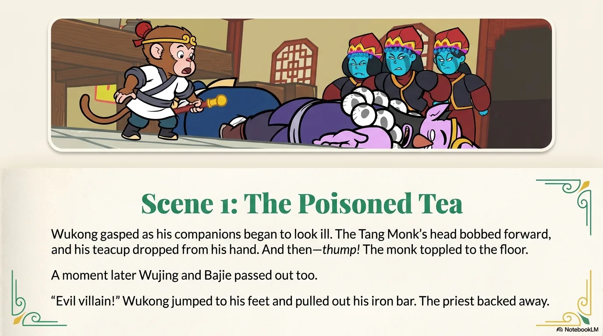

- 来源：`ppt/media/image7.png`（relationship `rId2`）
- 尺寸：1376×768
- 源 SHA-256：`5f087832ba77caa6a351d71fd9d483c1a5ffa6c05f43b933fd1b4dfef95120e0`
- 输出 SHA-256：`2c4111b6714e4964b150b7271bdf4503ce6428e9b06f66df57261889020ca671`
- 分类：unknown ｜ OCR：blocked ｜ 审核：unreviewed

## Slide 007

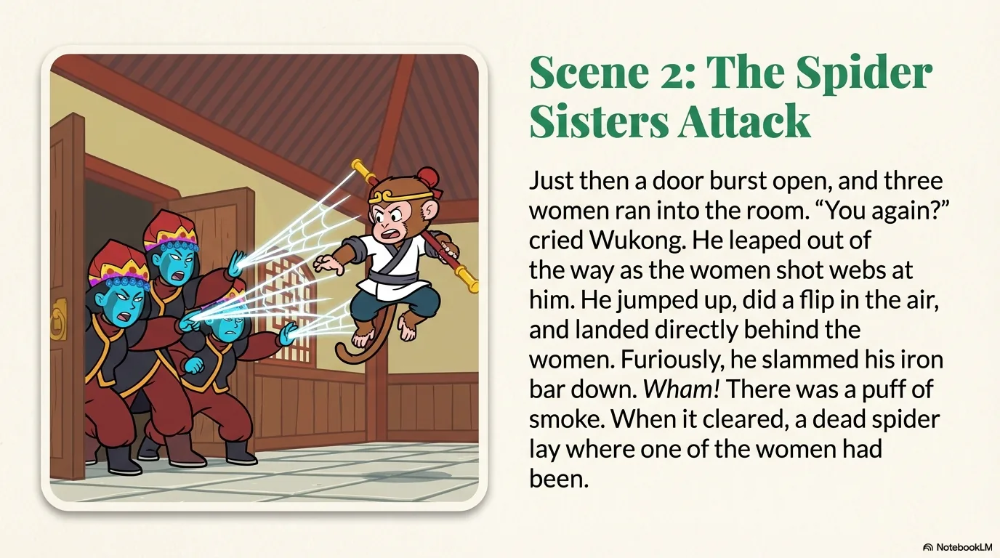

- 来源：`ppt/media/image8.png`（relationship `rId2`）
- 尺寸：1376×768
- 源 SHA-256：`3480ba38230281a53e31ec6de8e28fa2c78793cb46b5f74fac677e98f60a363b`
- 输出 SHA-256：`367969225c61cd35ed3d5e8d9fee1c9e10f124ecc74b945897be8368945af57a`
- 分类：unknown ｜ OCR：blocked ｜ 审核：unreviewed

## Slide 008

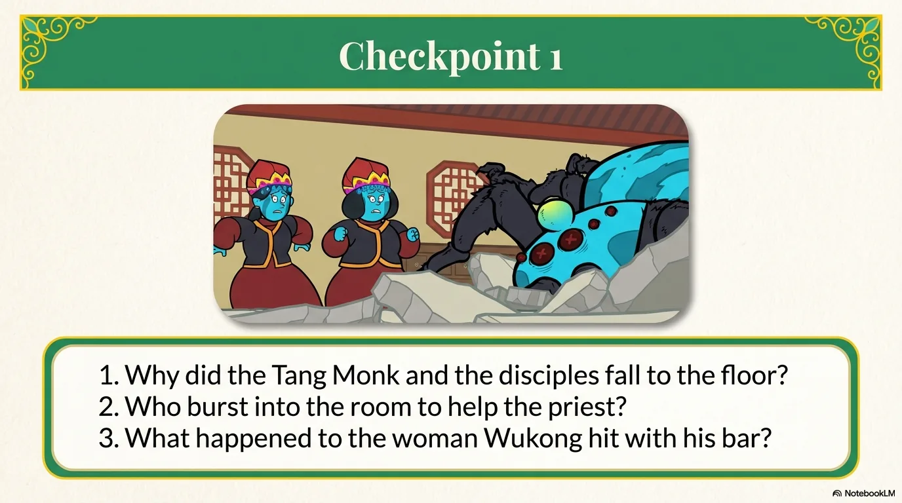

- 来源：`ppt/media/image9.png`（relationship `rId2`）
- 尺寸：1376×768
- 源 SHA-256：`479d8e2861d6c22e15190d3114cd04e1d472df8998d26632208c62f75fb6983e`
- 输出 SHA-256：`f8f83cb5ff5b7bcc4a30b4987689de478f83f17fcb6e95f91c898ee10fb56d84`
- 分类：unknown ｜ OCR：blocked ｜ 审核：unreviewed

## Slide 009

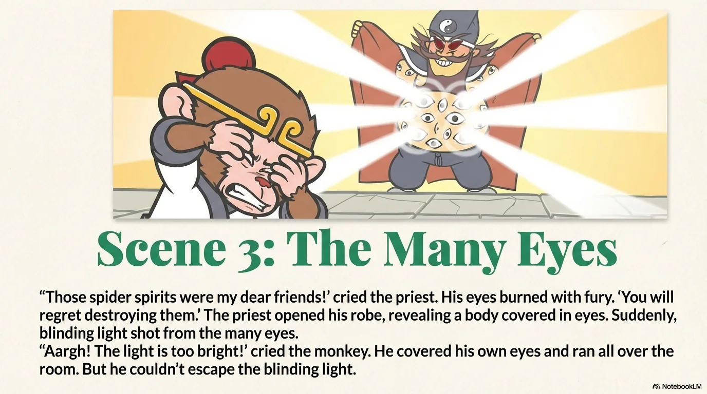

- 来源：`ppt/media/image10.png`（relationship `rId2`）
- 尺寸：1376×768
- 源 SHA-256：`9d7078eabcf219d05db134fe3af04bc02ccd34c754611d9f69fdb59690361af5`
- 输出 SHA-256：`19711b1afebd0eeef05ed2826d8017daae73409d9684fc8ca8c9d5c75afaa7e3`
- 分类：unknown ｜ OCR：blocked ｜ 审核：unreviewed

## Slide 010

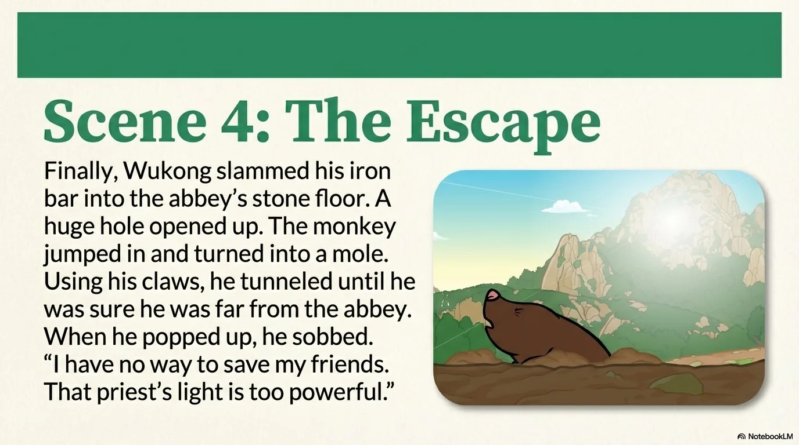

- 来源：`ppt/media/image11.png`（relationship `rId2`）
- 尺寸：1376×768
- 源 SHA-256：`a42d418cad4b027d9bcf9776545b51e93c2b5ee9fa442222a7597fad9b478a55`
- 输出 SHA-256：`f2844461d189c1311c5749fa90a103f22f4f3925a3d0fd50c061c6433cb8d83e`
- 分类：unknown ｜ OCR：blocked ｜ 审核：unreviewed

## Slide 011

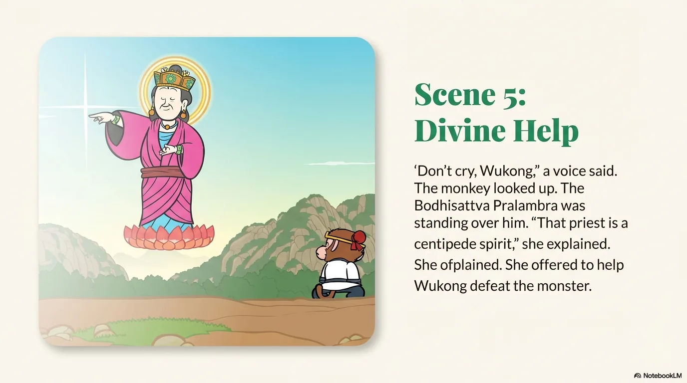

- 来源：`ppt/media/image12.png`（relationship `rId2`）
- 尺寸：1376×768
- 源 SHA-256：`6aef36b1bd6ff46f06fa209e6e1542d1109e9952fd85dee03ce95c70b54971dd`
- 输出 SHA-256：`a51fd68766b913cbf476dd4f077c5c7c59df8a3b0ae6910de4f988bd79ed3e63`
- 分类：unknown ｜ OCR：blocked ｜ 审核：unreviewed

## Slide 012

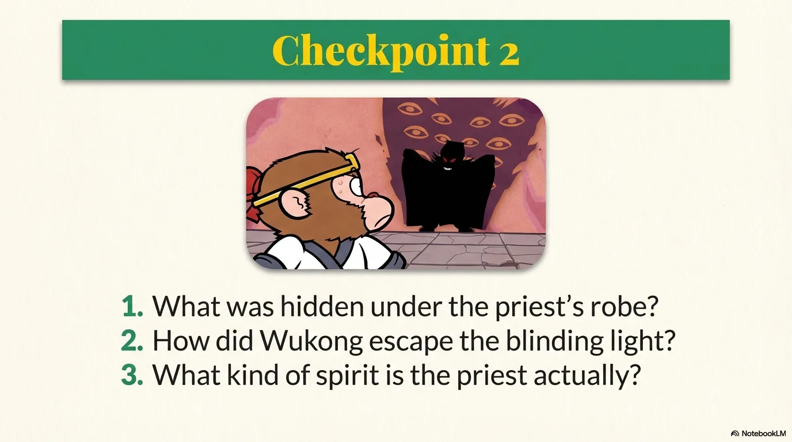

- 来源：`ppt/media/image13.png`（relationship `rId2`）
- 尺寸：1376×768
- 源 SHA-256：`05e1084687825bdf53bdd32abe0375c4655338765f436b650628692a706c5c17`
- 输出 SHA-256：`d1d7c73be54a2ab3ca111a6d57a19ffe5b983c8abb1713241c948f90a1696b91`
- 分类：unknown ｜ OCR：blocked ｜ 审核：unreviewed

## Slide 013

- 来源：`ppt/media/image14.png`（relationship `rId2`）
- 尺寸：1376×768
- 源 SHA-256：`268811c9acdd77b97a4763d6c92b7d8afb72e6dd3046f50731d19b8e8c10d748`
- 输出 SHA-256：`a5d0f386dbb53ce28577aa0c58ee015a50bf5cd850589515db11dcc08c6ebed8`
- 分类：unknown ｜ OCR：blocked ｜ 审核：unreviewed

## Slide 014

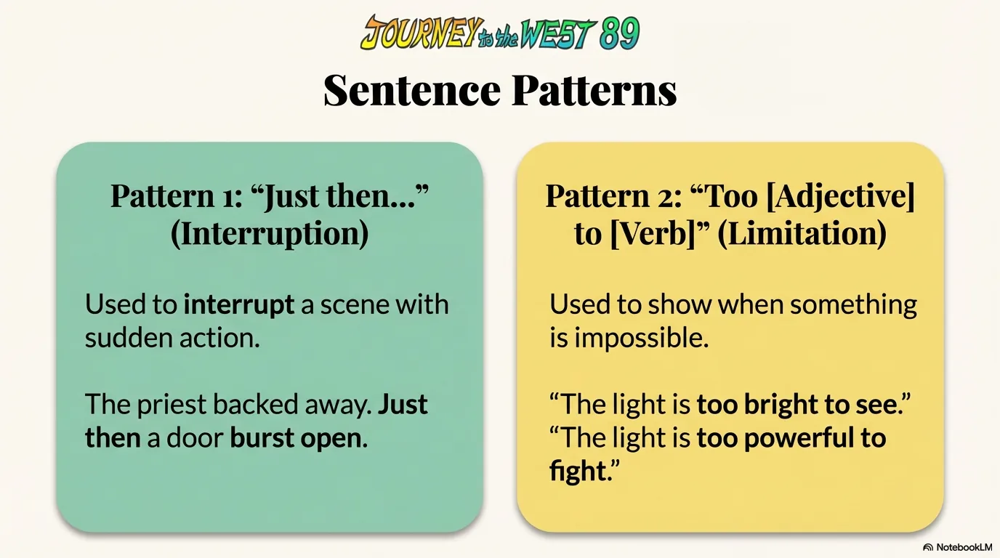

- 来源：`ppt/media/image15.png`（relationship `rId2`）
- 尺寸：1376×768
- 源 SHA-256：`79680c93e969be17773060c81dbe7219819548676c8a872484eed5f5a544742d`
- 输出 SHA-256：`75a2fca7d32b854257282f7651929a450f502839a79668465db53b39be7a30b4`
- 分类：unknown ｜ OCR：blocked ｜ 审核：unreviewed

## Slide 015

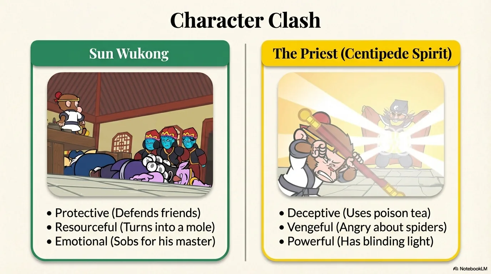

- 来源：`ppt/media/image16.png`（relationship `rId2`）
- 尺寸：1376×768
- 源 SHA-256：`b970d129e2f5398a945a002c1bc8c251dc0c34e3bf8ea777cd3ee6dc0e0e77f6`
- 输出 SHA-256：`47cfe67a5acbbc08e91cf6dcd433bbc37850f62a797527d45e0720cbed271c9d`
- 分类：unknown ｜ OCR：blocked ｜ 审核：unreviewed

## Slide 016

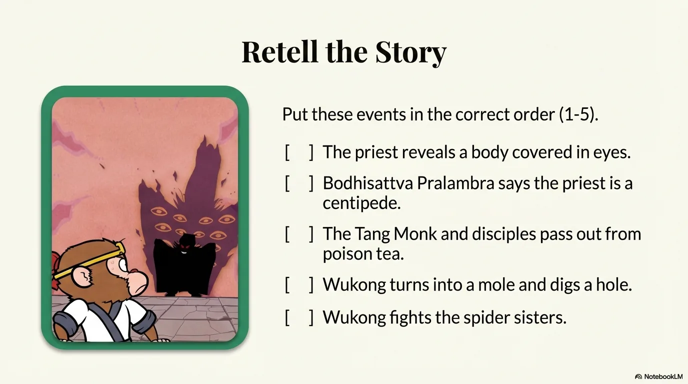

- 来源：`ppt/media/image17.png`（relationship `rId2`）
- 尺寸：1376×768
- 源 SHA-256：`22454a265806d74852292c881be72d04c23ffe498d6310f027f96ec0d5e229c6`
- 输出 SHA-256：`ed21f85a1b6033d5d59b4e49b1679833fba75f140d7083bb3cc1ac105d261dbd`
- 分类：unknown ｜ OCR：blocked ｜ 审核：unreviewed

## Slide 017

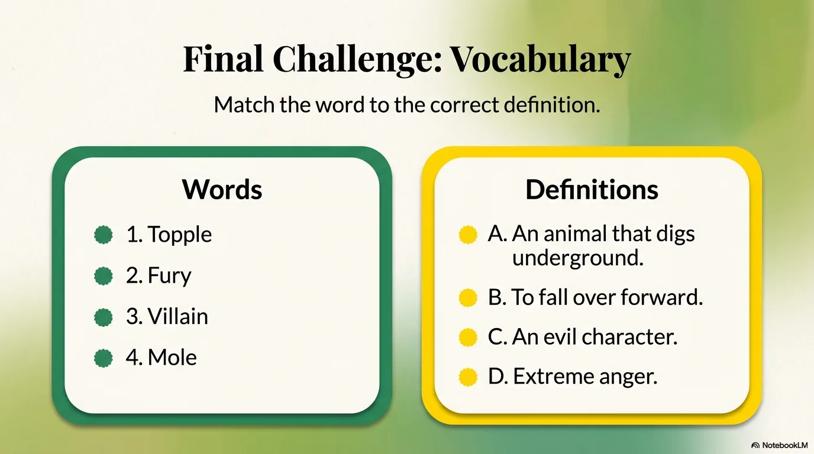

- 来源：`ppt/media/image18.png`（relationship `rId2`）
- 尺寸：1376×768
- 源 SHA-256：`0abb0477860ea0ac39a58226f8384b2e03964182e063f71aedd6eff33c8eaf83`
- 输出 SHA-256：`2d5d906b44b94af0e1c79cce4f90a655698bcb1a6648737331eba835bb8a90e5`
- 分类：unknown ｜ OCR：blocked ｜ 审核：unreviewed

## Slide 018

- 来源：`ppt/media/image19.png`（relationship `rId2`）
- 尺寸：1376×768
- 源 SHA-256：`64f5abd1a7ca5e05d5b17685ba86f2f6c80e26a0d1c55ae6feb4736f93ca9d87`
- 输出 SHA-256：`ea3d8b0e025464ddf8c6515d3fce2facdcfebee1e4018a46d14e9adb13320373`
- 分类：unknown ｜ OCR：blocked ｜ 审核：unreviewed

## Slide 019

- 来源：`ppt/media/image20.png`（relationship `rId2`）
- 尺寸：1376×768
- 源 SHA-256：`b6b8539b0476f0a04fa00cdf66872b67d5665d6a9e2b57747e98f8ab7722d887`
- 输出 SHA-256：`6d43b5839629d2dde1e149ab3a472e52e8a9115e8cd3f386d022d8a08fb06dad`
- 分类：unknown ｜ OCR：blocked ｜ 审核：unreviewed

## Slide 020

- 来源：`ppt/media/image21.png`（relationship `rId2`）
- 尺寸：1376×768
- 源 SHA-256：`f20114c57302a35520bbb2d39c12dcb8fca8d984b89ac2fdb4b6c33ddfe98a47`
- 输出 SHA-256：`6d48bb3d517dd7b9eee9c2eb4de97e8e8eab75fe80ae047d28b02df4f2f61a83`
- 分类：unknown ｜ OCR：blocked ｜ 审核：unreviewed
