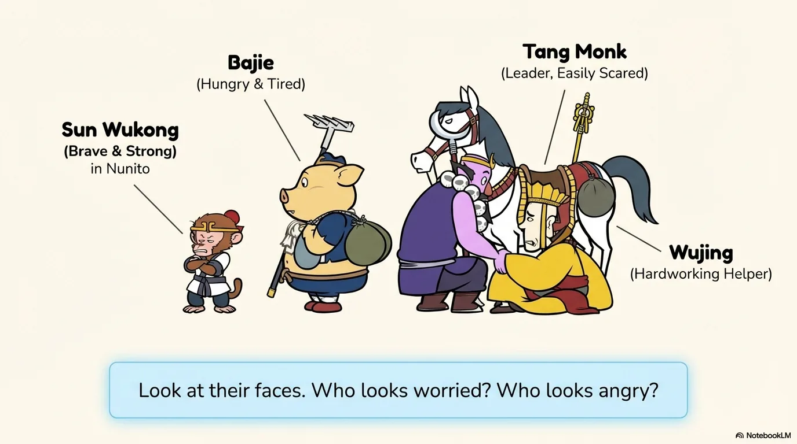
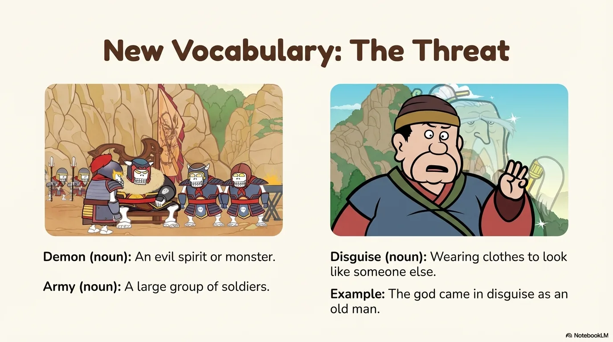
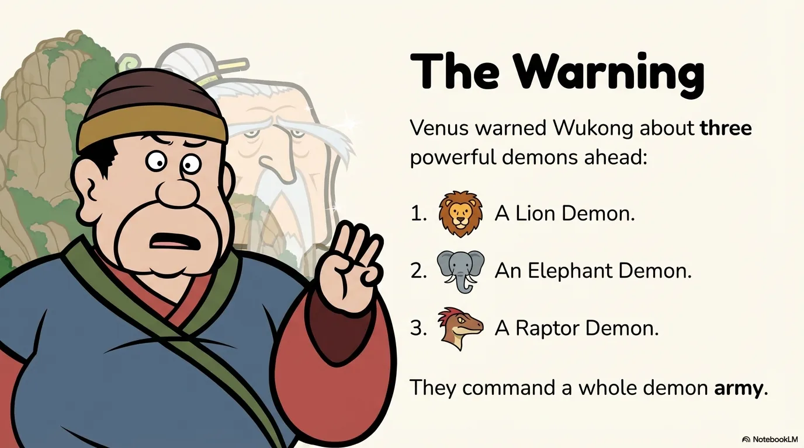
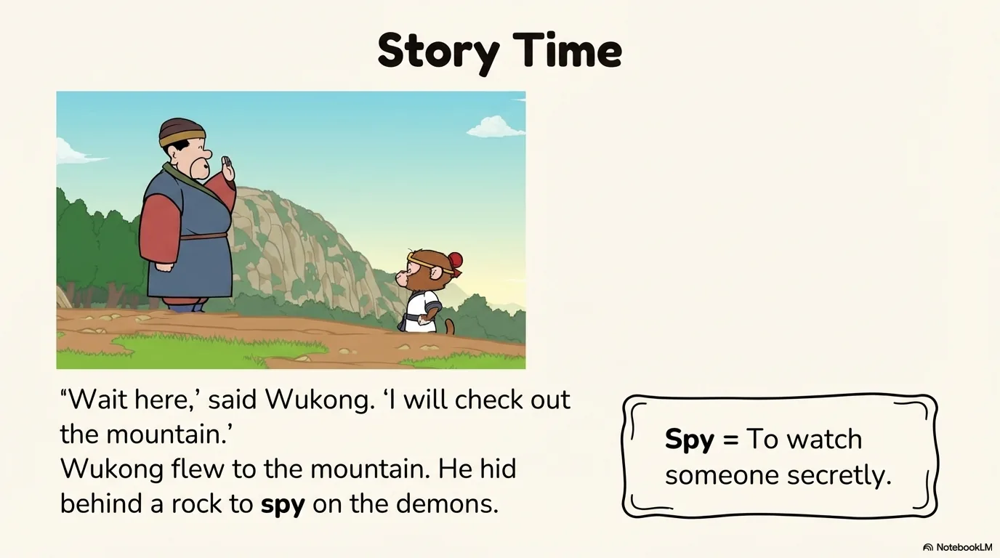
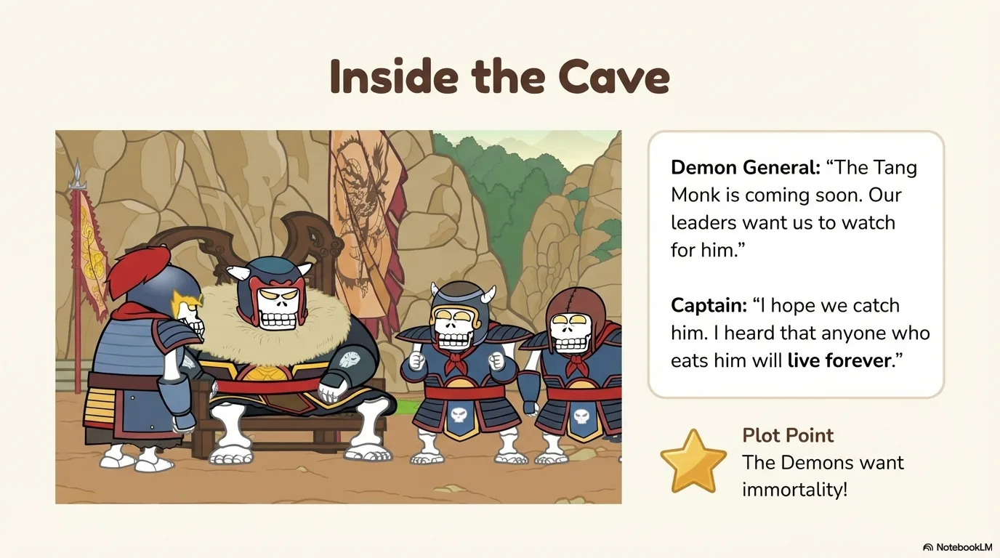
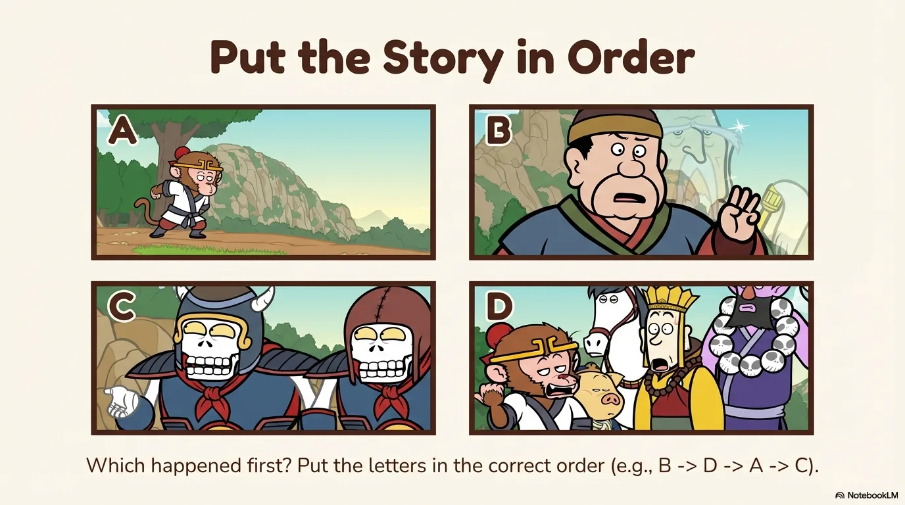
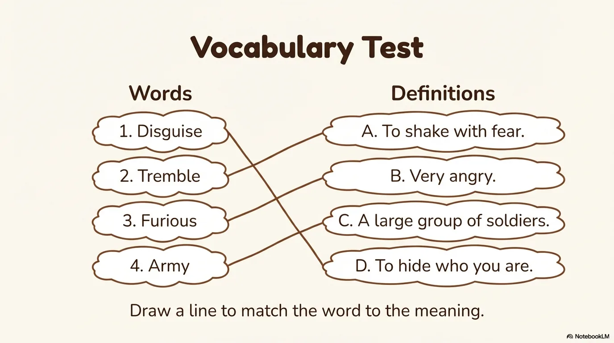
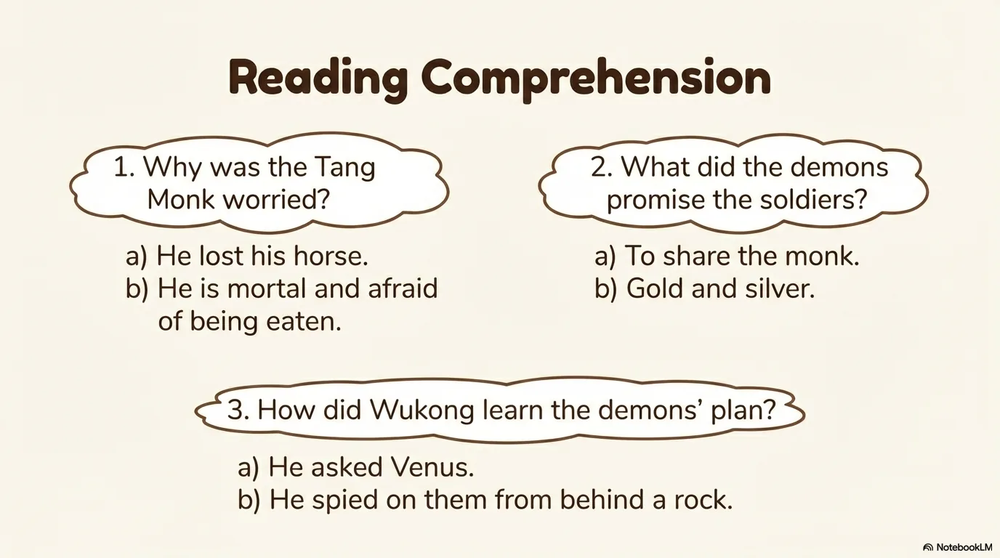
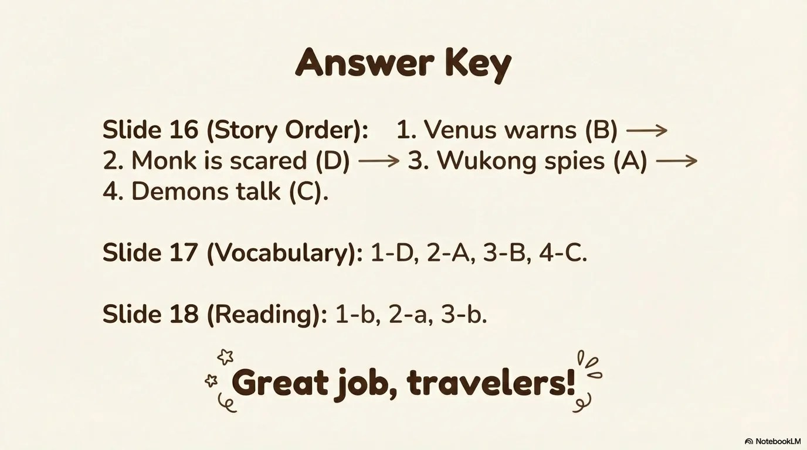

# 豆豆龙英语 · 第 90 集课件（EP090 草稿）

- 来源：`090_Journey to the West 90_The Demons' Plan.pptx`（主课件，20 页）
- OCR：`blocked`（no local OCR provider importable (pytesseract missing): No module named 'pytesseract'）
- 分类：待人工审核（unknown）
- 审核状态：`unreviewed`

## Slide 001

- 来源：`ppt/media/image1.png`（relationship `rId2`）
- 尺寸：1376×768
- 源 SHA-256：`4c7ab8102388fe25c5125afb89c358604874cf18c4369b79b34fad26c50fdb5c`
- 输出 SHA-256：`61cad26f83ccc61c0b531c452b5e5cf9812b49eec86457b7488ecf59d800db56`
- 分类：unknown ｜ OCR：blocked ｜ 审核：unreviewed

## Slide 002

- 来源：`ppt/media/image3.png`（relationship `rId2`）
- 尺寸：1376×768
- 源 SHA-256：`0cdcd840d2a98187b044a36275aa05ef319d9965112c646829d443747cd88e20`
- 输出 SHA-256：`22b0a0dbdfb23c81d74c09adde0eeca8c9339705b0861a0fc6087f0987459acd`
- 分类：unknown ｜ OCR：blocked ｜ 审核：unreviewed

## Slide 003

- 来源：`ppt/media/image4.png`（relationship `rId2`）
- 尺寸：1376×768
- 源 SHA-256：`1e6858c71b2ba4986ee6db89b3155f28647acc6e13c1d44d10c43d87621073dd`
- 输出 SHA-256：`a473d30e71f7c2caad9d04171fa77def6728b52993f6cdda5dc0634c9d2cd140`
- 分类：unknown ｜ OCR：blocked ｜ 审核：unreviewed

## Slide 004

- 来源：`ppt/media/image5.png`（relationship `rId2`）
- 尺寸：1376×768
- 源 SHA-256：`6dc0b5ab3e9558fd1c536c07fbb2c1710b77dea487d12e26346243b709ec3026`
- 输出 SHA-256：`d600b504f52f8342f2110603e737d9546a46ca29110a02fed84ae0d8fadee317`
- 分类：unknown ｜ OCR：blocked ｜ 审核：unreviewed

## Slide 005

- 来源：`ppt/media/image6.png`（relationship `rId2`）
- 尺寸：1376×768
- 源 SHA-256：`7fc72c138effd7064bffbaeee26b7abfa9291c8559815ea3b0feccf5004e3f06`
- 输出 SHA-256：`2781e1de64e7087f689739e9e6664a7ae351ab18fd64e56a1c9ae1aee364715f`
- 分类：unknown ｜ OCR：blocked ｜ 审核：unreviewed

## Slide 006

- 来源：`ppt/media/image7.png`（relationship `rId2`）
- 尺寸：1376×768
- 源 SHA-256：`8a0c4dd411669ed67c5acafc32474975dbd3dd6d68c6396a6c308ea599437a2c`
- 输出 SHA-256：`4b756925b8ac249c8b8e1eb6f4bce7d644e7ffd5607aeeb44c2b2cc82b34945c`
- 分类：unknown ｜ OCR：blocked ｜ 审核：unreviewed

## Slide 007

- 来源：`ppt/media/image8.png`（relationship `rId2`）
- 尺寸：1376×768
- 源 SHA-256：`8609b82d8c986664df24d3244c117b149aff97cfc39bcb4e0c2c89feea828cce`
- 输出 SHA-256：`285a078e28eb56420acbc93979b35cad4e3ca4777226f96b3e1b09e673749abe`
- 分类：unknown ｜ OCR：blocked ｜ 审核：unreviewed

## Slide 008

- 来源：`ppt/media/image9.png`（relationship `rId2`）
- 尺寸：1376×768
- 源 SHA-256：`9e8e699dede5ec21ea47e56344c364e4120d7ce376c11d9320924fb8784ea059`
- 输出 SHA-256：`0dc643495c5c7066905b5353b8a75b30e619c66729cc8b5496be1f4e2ebf7b39`
- 分类：unknown ｜ OCR：blocked ｜ 审核：unreviewed

## Slide 009

- 来源：`ppt/media/image10.png`（relationship `rId2`）
- 尺寸：1376×768
- 源 SHA-256：`84aecbdb402f20a8268968a157bfb4a775e6218c2ae98a69724dd470ee00e28a`
- 输出 SHA-256：`218fac3f0ee193dd2b915eef4fe49fce97b9d107d60dc96ac157d95c053cd111`
- 分类：unknown ｜ OCR：blocked ｜ 审核：unreviewed

## Slide 010

- 来源：`ppt/media/image11.png`（relationship `rId2`）
- 尺寸：1376×768
- 源 SHA-256：`2eff548bfe659201b62fd66ab1f2b038f6ff1626340205413229a0c60fec5235`
- 输出 SHA-256：`003a68ea6c98d8ed865a705dd1e02230345d41e1f1999c00b62ab2362c22833c`
- 分类：unknown ｜ OCR：blocked ｜ 审核：unreviewed

## Slide 011

- 来源：`ppt/media/image12.png`（relationship `rId2`）
- 尺寸：1376×768
- 源 SHA-256：`4495e546aa2b11f5f70d3827cdfac33403580589466145458929978ff31e931d`
- 输出 SHA-256：`10ded3630fd1e6e60046f46208dd778c593557e4b9a78322aa55dfe3a4aa84ce`
- 分类：unknown ｜ OCR：blocked ｜ 审核：unreviewed

## Slide 012

- 来源：`ppt/media/image13.png`（relationship `rId2`）
- 尺寸：1376×768
- 源 SHA-256：`b1350b36c7afbfeaeb3df627cd6f61f86dab325d43ae92af727048067d49e098`
- 输出 SHA-256：`5c801c557ecfd57f0f83b9c82a817ccfc760a33a40431ad9f1b259789b1eb927`
- 分类：unknown ｜ OCR：blocked ｜ 审核：unreviewed

## Slide 013

- 来源：`ppt/media/image14.png`（relationship `rId2`）
- 尺寸：1376×768
- 源 SHA-256：`d30b0ab227ea4f483f0428fd831b170d8533504441878197c7177ea8096d68c4`
- 输出 SHA-256：`0bf6b52e9d0006458939ece4a4a6259b0cd4305a0b4420316cb560d2f9d75fef`
- 分类：unknown ｜ OCR：blocked ｜ 审核：unreviewed

## Slide 014

- 来源：`ppt/media/image15.png`（relationship `rId2`）
- 尺寸：1376×768
- 源 SHA-256：`1dd531a8613f4c53d8eb08f0b8df1643dda397ac7a8c7e060fa419243eaec600`
- 输出 SHA-256：`b5b71e7d618edff20fbb6ebdbfcf510e10ebe670ed42457609577c87f2b4e0ab`
- 分类：unknown ｜ OCR：blocked ｜ 审核：unreviewed

## Slide 015

- 来源：`ppt/media/image16.png`（relationship `rId2`）
- 尺寸：1376×768
- 源 SHA-256：`cb1765e018a3cc852273ccb4fa68d116150394db3b1f8a4263b0fd81ab8248df`
- 输出 SHA-256：`2ff8710cf97e92ee7bb763edce6ce498279399fe505439fe4bce2d4076cc5265`
- 分类：unknown ｜ OCR：blocked ｜ 审核：unreviewed

## Slide 016

- 来源：`ppt/media/image17.png`（relationship `rId2`）
- 尺寸：1376×768
- 源 SHA-256：`1ccc89867e20713286839f4039f600057e684a6f39620c9b7154fe6f6b1b4cad`
- 输出 SHA-256：`e280a3bafbc301cd3a005251ce09761c077efaaa50eea2438b24510fe75a10df`
- 分类：unknown ｜ OCR：blocked ｜ 审核：unreviewed

## Slide 017

- 来源：`ppt/media/image18.png`（relationship `rId2`）
- 尺寸：1376×768
- 源 SHA-256：`c5db8d5e344777698c355116deb2f02fcb1acadfc7304d023860c61d0b3281e5`
- 输出 SHA-256：`0ae6ca9e796ad44534d7a58a9c83e5bb26a4e7b06ac4242ee8fd0a6ee5860246`
- 分类：unknown ｜ OCR：blocked ｜ 审核：unreviewed

## Slide 018

- 来源：`ppt/media/image19.png`（relationship `rId2`）
- 尺寸：1376×768
- 源 SHA-256：`1a65d5696d9ef6f369dea76f856d6a183f9e0ffad045620c2fd6c77228db4242`
- 输出 SHA-256：`4755ca692bacf04ac430f49da2460a16ed314324496e7f09a560c421e2ff8d3d`
- 分类：unknown ｜ OCR：blocked ｜ 审核：unreviewed

## Slide 019

- 来源：`ppt/media/image20.png`（relationship `rId2`）
- 尺寸：1376×768
- 源 SHA-256：`b12553fb89eb2c9c947e6bfdb49ab48238cd8b7c376e311138d44c533145fdf2`
- 输出 SHA-256：`20d5e3aad95d638cd30b537a01bb921a8abfd222caa61ed0e4a13e924fe7c02f`
- 分类：unknown ｜ OCR：blocked ｜ 审核：unreviewed

## Slide 020

- 来源：`ppt/media/image21.png`（relationship `rId2`）
- 尺寸：1376×768
- 源 SHA-256：`3a9233bdb206410bda2f66b70a5e5687ebf8b85c39a02060e8c5d9a7c58a0416`
- 输出 SHA-256：`df446eb8370d69eac4ec41ccc41d63c6aa7aab85624695bfb9554bc7a0f118f2`
- 分类：unknown ｜ OCR：blocked ｜ 审核：unreviewed
