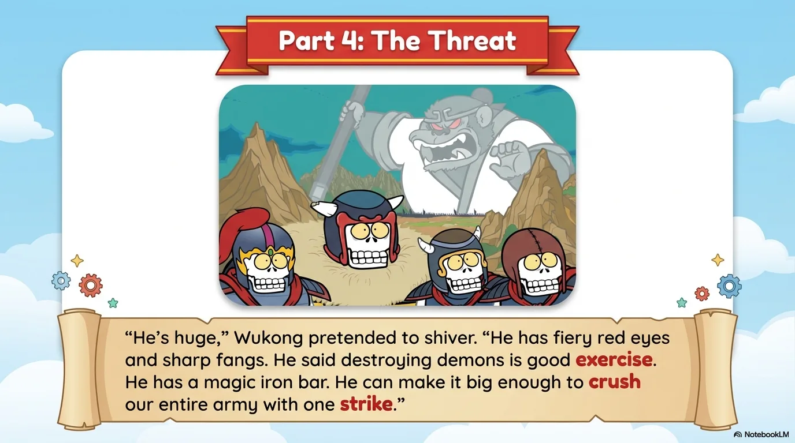
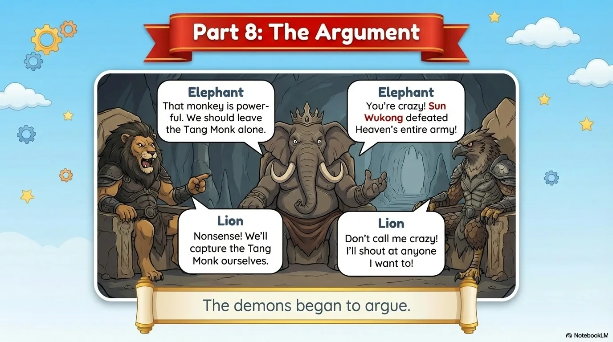

# 豆豆龙英语 · 第 91 集课件（EP091 草稿）

- 来源：`091_Journey to the West 91_The Demon Officers.pptx`（主课件，20 页）
- OCR：`blocked`（no local OCR provider importable (pytesseract missing): No module named 'pytesseract'）
- 分类：待人工审核（unknown）
- 审核状态：`unreviewed`

## Slide 001

- 来源：`ppt/media/image1.png`（relationship `rId2`）
- 尺寸：1376×768
- 源 SHA-256：`59003d452dc1df586f7a629ccac19fe631f96752719a10ea285a7b73c9ddcd42`
- 输出 SHA-256：`64b096efdd67666fcd866681ce10e7b68e8e6b66cf00a0d9ea99bd297535f6e5`
- 分类：unknown ｜ OCR：blocked ｜ 审核：unreviewed

## Slide 002

- 来源：`ppt/media/image3.png`（relationship `rId2`）
- 尺寸：1376×768
- 源 SHA-256：`dee05ed89ed907f1d15b8df5855ba102b5a957db5f09e4ad91388955cddb383f`
- 输出 SHA-256：`eb87c625e1eff3dfcecd67805a673595de2481a675f40d08f50997a5760e0628`
- 分类：unknown ｜ OCR：blocked ｜ 审核：unreviewed

## Slide 003

- 来源：`ppt/media/image4.png`（relationship `rId2`）
- 尺寸：1376×768
- 源 SHA-256：`b4ee15149a3d794da7d478f8fa3e371486554688b56110c353024bfd42f9693d`
- 输出 SHA-256：`0d399203920f4a72a412b763f57c0308010b982b7128296f06534ec0c41472a6`
- 分类：unknown ｜ OCR：blocked ｜ 审核：unreviewed

## Slide 004

- 来源：`ppt/media/image5.png`（relationship `rId2`）
- 尺寸：1376×768
- 源 SHA-256：`74b407b66569186fcc0a8b62e4fd892812d193265d58e272f8c99d0c0feefbb8`
- 输出 SHA-256：`71fd181988e3ffa1803d5a2732be7816b58bdbd0d0629002e745545d550df24a`
- 分类：unknown ｜ OCR：blocked ｜ 审核：unreviewed

## Slide 005

- 来源：`ppt/media/image6.png`（relationship `rId2`）
- 尺寸：1376×768
- 源 SHA-256：`8c586db17cab5b786c692a11c18abfa312c09ab98621fc761ee5bdc93f384ee8`
- 输出 SHA-256：`c08262ff839bc693081538fd0ded0ddd8fc2b3aaf0e0ad3b265a99664fc9e6c3`
- 分类：unknown ｜ OCR：blocked ｜ 审核：unreviewed

## Slide 006

- 来源：`ppt/media/image7.png`（relationship `rId2`）
- 尺寸：1376×768
- 源 SHA-256：`feb9223ad2eb710dd42b9d6ef283091169be8d65050108e6dfae1f57a98d83fa`
- 输出 SHA-256：`a1a3aa35c8c6d6256d49eb9ebb2003ab1b3ce984fd46609bc55e897dc7ad8402`
- 分类：unknown ｜ OCR：blocked ｜ 审核：unreviewed

## Slide 007

- 来源：`ppt/media/image8.png`（relationship `rId2`）
- 尺寸：1376×768
- 源 SHA-256：`f7a7186d47aab05767d861540eaf79be7cc5f4578a04409eb1307865e6411c15`
- 输出 SHA-256：`1b626666555acb9e991e9746a06b9d6474a22beaf5ce49c2a6c26f9dd18a2557`
- 分类：unknown ｜ OCR：blocked ｜ 审核：unreviewed

## Slide 008

- 来源：`ppt/media/image9.png`（relationship `rId2`）
- 尺寸：1376×768
- 源 SHA-256：`286d63095306df6afe344f91c7a024287d3d8f006854aa4979b82632854794fe`
- 输出 SHA-256：`a2076f59b881f576ea5598127e4911c4d41df7741d23eed21255e905c4288af0`
- 分类：unknown ｜ OCR：blocked ｜ 审核：unreviewed

## Slide 009

- 来源：`ppt/media/image10.png`（relationship `rId2`）
- 尺寸：1376×768
- 源 SHA-256：`4cc9d177990f22cc3b155a3cbb0fe606b29e73601e4309ee79c8abb5009a467b`
- 输出 SHA-256：`511d928efb011f0aaa1ef9b828ea11969b4f3cb65df3c88a41a73e15d9eaf8ef`
- 分类：unknown ｜ OCR：blocked ｜ 审核：unreviewed

## Slide 010

- 来源：`ppt/media/image11.png`（relationship `rId2`）
- 尺寸：1376×768
- 源 SHA-256：`2cb2a66ebdf8f44666ba30aa2c9ce670ce8d70bcb75237d735cbdbfe406bf3a6`
- 输出 SHA-256：`d4e0cb5cf39eaa4585ad6c8b74059a58e2a2441a1ddff6fc43a8eb2d99d218cb`
- 分类：unknown ｜ OCR：blocked ｜ 审核：unreviewed

## Slide 011

- 来源：`ppt/media/image12.png`（relationship `rId2`）
- 尺寸：1376×768
- 源 SHA-256：`8b5aa40ffca32056ba8815fe16aa535dae9bf2d307b5b1d0a4a915d667a418bc`
- 输出 SHA-256：`bc8cc5aa30ae643b039e0d1f325dc74534c19049100eeb68a0c32617b757f4ac`
- 分类：unknown ｜ OCR：blocked ｜ 审核：unreviewed

## Slide 012

- 来源：`ppt/media/image13.png`（relationship `rId2`）
- 尺寸：1376×768
- 源 SHA-256：`b0cb75416f2611b43575e1240420cad09212e051505eebb6dc3b09c82850db58`
- 输出 SHA-256：`7ea621522ba09f5acdcf2895fbf6f3f8faf05f34ec220c3231be1ed37ab4ee96`
- 分类：unknown ｜ OCR：blocked ｜ 审核：unreviewed

## Slide 013

- 来源：`ppt/media/image14.png`（relationship `rId2`）
- 尺寸：1376×768
- 源 SHA-256：`e4b121406a9605562b76fc39bbf436f3458953e24bee360b05bdb85570d4b54d`
- 输出 SHA-256：`aba0902d2438dcc974b6791f7d1e86dd3743ff00b36c57fcaefcdcd5f6094c92`
- 分类：unknown ｜ OCR：blocked ｜ 审核：unreviewed

## Slide 014

- 来源：`ppt/media/image15.png`（relationship `rId2`）
- 尺寸：1376×768
- 源 SHA-256：`3c86055a5471eb26370f7dec780c51d53a82ebe2398294090320af56411836b4`
- 输出 SHA-256：`6142d536e3d63aaa206a2cd7e8f0b888ab448a863506774c23679d2a2c527959`
- 分类：unknown ｜ OCR：blocked ｜ 审核：unreviewed

## Slide 015

- 来源：`ppt/media/image16.png`（relationship `rId2`）
- 尺寸：1376×768
- 源 SHA-256：`40c0e1b6f5b0b8c0796b351387b450d156f0e61879d83ef2fb4f6942fa00f8aa`
- 输出 SHA-256：`863ca7998d4d03ce2bfba6b614dcd574c0b1b04eefc48c5c418f930756e884a2`
- 分类：unknown ｜ OCR：blocked ｜ 审核：unreviewed

## Slide 016

- 来源：`ppt/media/image17.png`（relationship `rId2`）
- 尺寸：1376×768
- 源 SHA-256：`41a8d2920db469b2a93418bbb38380c6a30376c37fa7c46e7ece3a1aca848e01`
- 输出 SHA-256：`16ef5cacf42defa6425557613c0ee1a32a5095fc96b0890d9d01887a9cc202e4`
- 分类：unknown ｜ OCR：blocked ｜ 审核：unreviewed

## Slide 017

- 来源：`ppt/media/image18.png`（relationship `rId2`）
- 尺寸：1376×768
- 源 SHA-256：`ebb0a1750f15d4368c8dba90b394bddb28e78307c40f6d76e5206affaf09b0e7`
- 输出 SHA-256：`c7ed3f71b8d4fd89b47ea292f669951cf19b72b847f92e7ac1b19b4ee3415ed0`
- 分类：unknown ｜ OCR：blocked ｜ 审核：unreviewed

## Slide 018

- 来源：`ppt/media/image19.png`（relationship `rId2`）
- 尺寸：1376×768
- 源 SHA-256：`3d4dafddbbc87daf4ee2900d75e0da6d59c81cab156ee39c5ddb3d9cb048c1f0`
- 输出 SHA-256：`cc79c24b78f79d99f46878d93989af72c7a7ae84018fac803432295e72fb65c3`
- 分类：unknown ｜ OCR：blocked ｜ 审核：unreviewed

## Slide 019

- 来源：`ppt/media/image20.png`（relationship `rId2`）
- 尺寸：1376×768
- 源 SHA-256：`572a4630b4274e64f50ccba9bc071bf9fc5131d911c8696ff6fc6eb888af10c5`
- 输出 SHA-256：`41ebf671d4ba9d929aef1d668f032e3b5e89f0049c78a366eb1eb950b3ae1c12`
- 分类：unknown ｜ OCR：blocked ｜ 审核：unreviewed

## Slide 020

- 来源：`ppt/media/image21.png`（relationship `rId2`）
- 尺寸：1376×768
- 源 SHA-256：`de63431d8369b0309e7d97b6ae97cb0712c9fc3b7ba46a9f69c401527c0d8045`
- 输出 SHA-256：`5a94957f48d85e95f9e1e3c77cb00a3f8249d99b2c3ec453c07e23baddc9dcda`
- 分类：unknown ｜ OCR：blocked ｜ 审核：unreviewed
