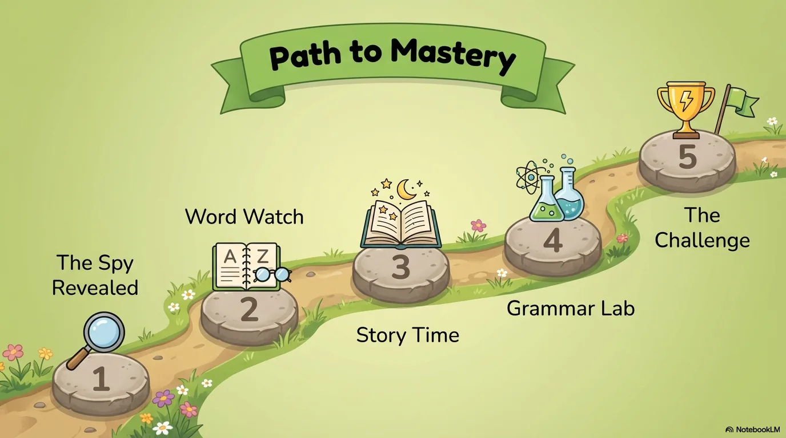
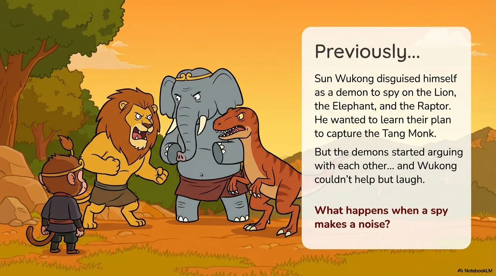
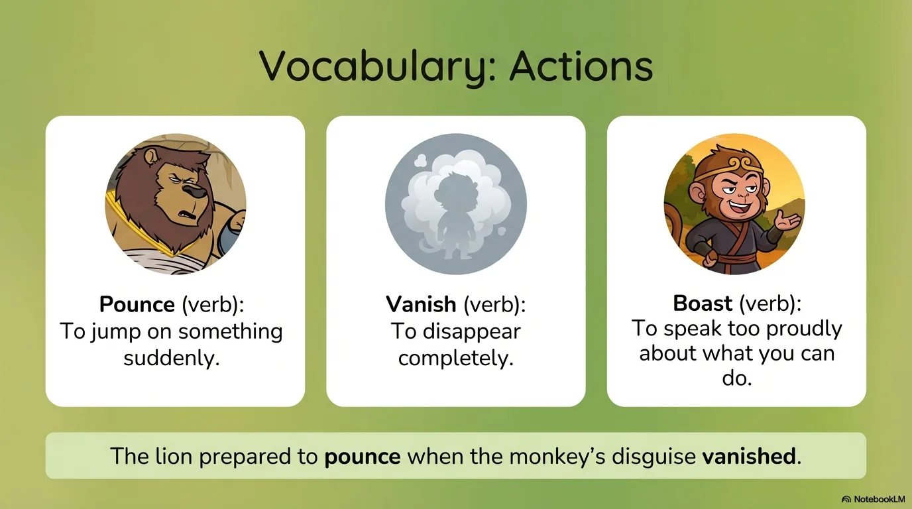
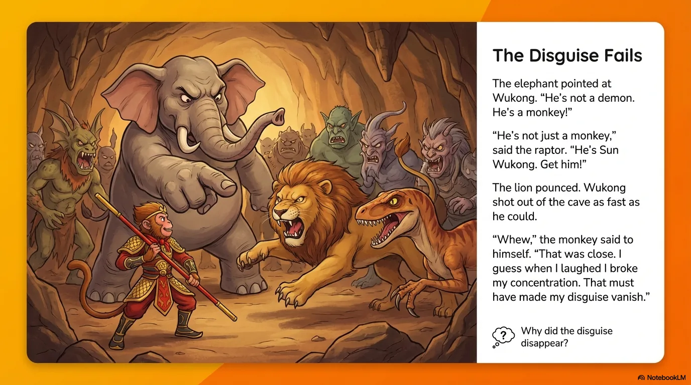
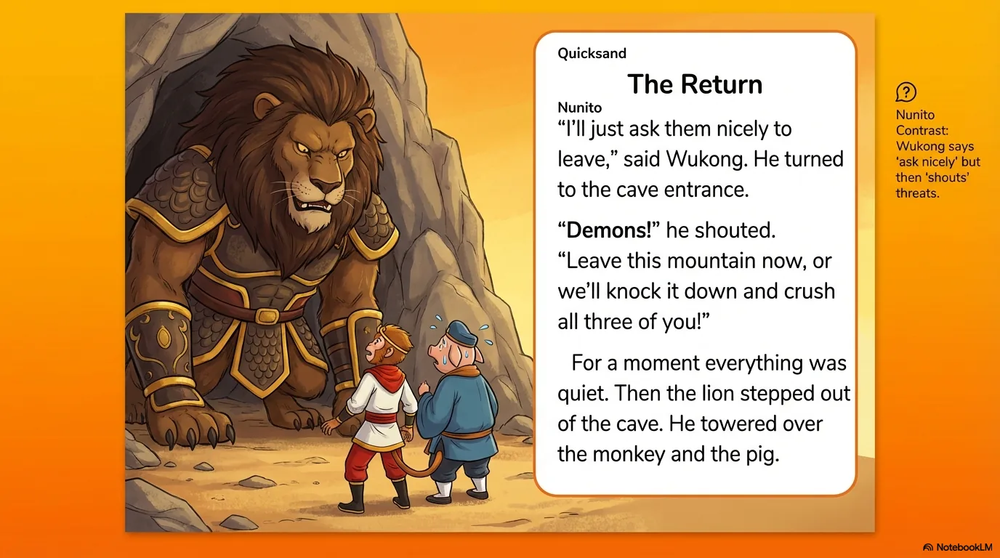
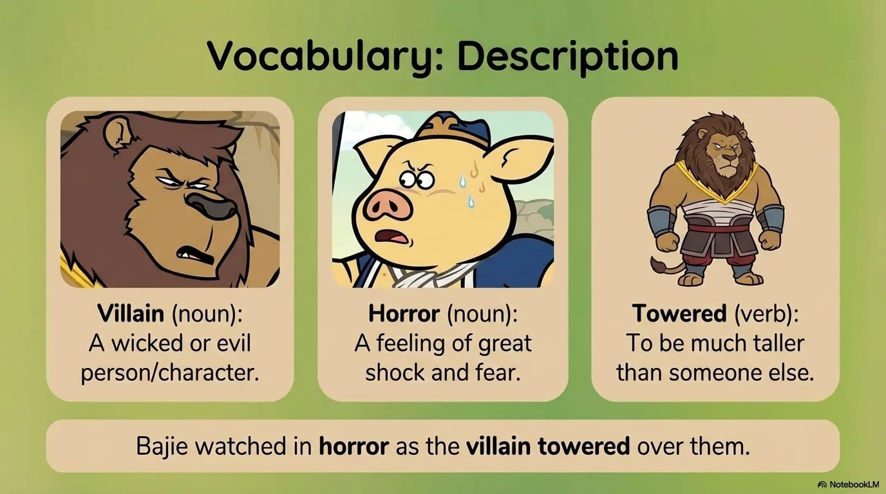
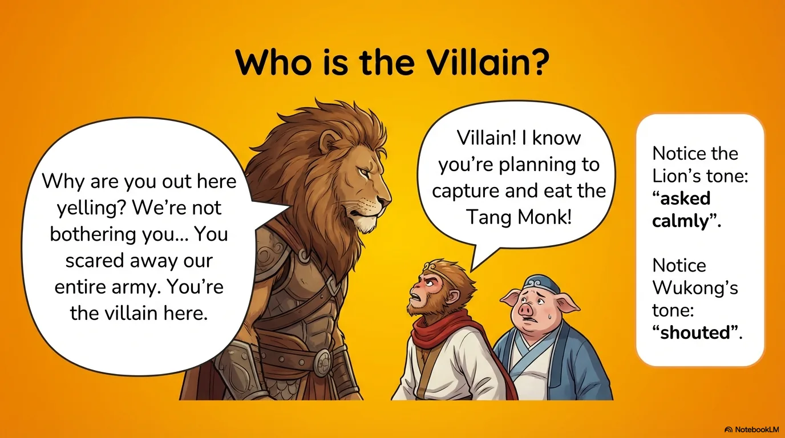
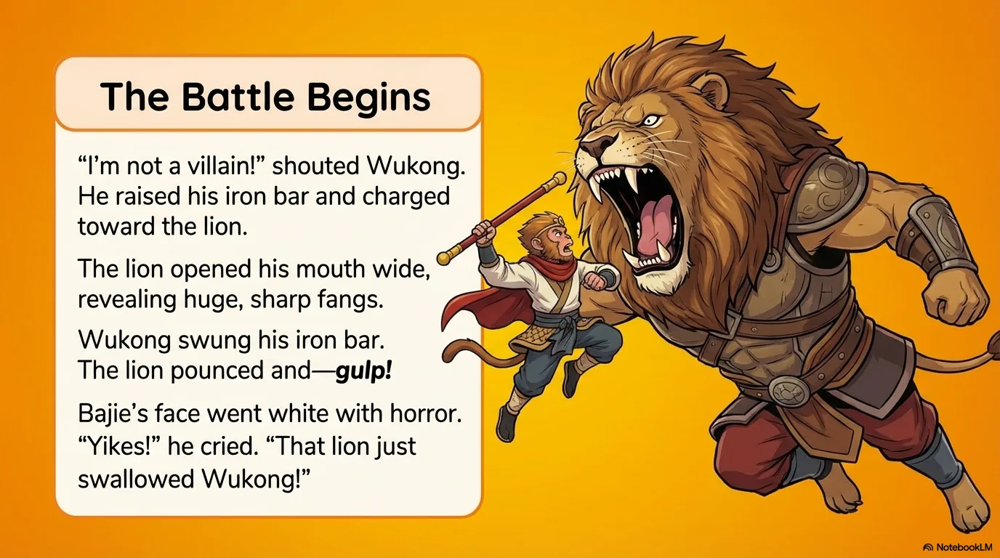
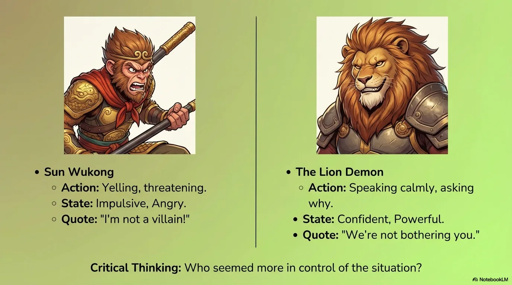
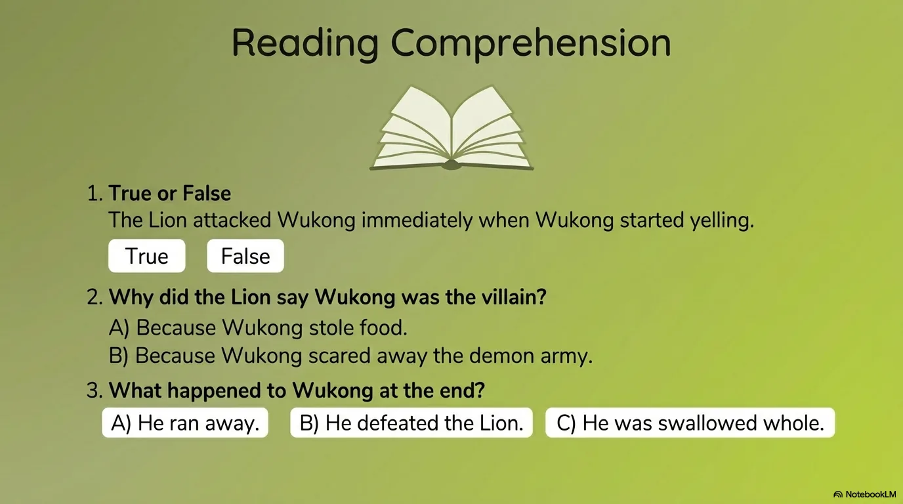

# 豆豆龙英语 · 第 92 集课件（EP092 草稿）

- 来源：`092_Journey to the West 92_The Lion Demon.pptx`（主课件，15 页）
- OCR：`blocked`（no local OCR provider importable (pytesseract missing): No module named 'pytesseract'）
- 分类：待人工审核（unknown）
- 审核状态：`unreviewed`

## Slide 001

- 来源：`ppt/media/image1.png`（relationship `rId2`）
- 尺寸：1376×768
- 源 SHA-256：`1e175c526b7414226ee99e2a60f0cd5c5cfb399b8015453112d31881aed6b5e8`
- 输出 SHA-256：`ad90401ffac899f9f05f15af442d57a2edd6534a9a352db35d0a55e1240a1056`
- 分类：unknown ｜ OCR：blocked ｜ 审核：unreviewed

## Slide 002

- 来源：`ppt/media/image3.png`（relationship `rId2`）
- 尺寸：1376×768
- 源 SHA-256：`4d1a4aa7b990c351720777b02510112c3af61f8a721bf0c1ab8c968093932e03`
- 输出 SHA-256：`b6cfc44145f615f0096540fdaf2fbb8e78890cf8b98df0c5a800fd0698c6db16`
- 分类：unknown ｜ OCR：blocked ｜ 审核：unreviewed

## Slide 003

- 来源：`ppt/media/image4.png`（relationship `rId2`）
- 尺寸：1376×768
- 源 SHA-256：`4142dcbfe7ea77b734094e6095750c8ab202f2039c41774d779eefa6b904b336`
- 输出 SHA-256：`db7e4219d23e4799d93f2827fae7a91edfa3409f0378f17fcd9eb2f0cefc8ddd`
- 分类：unknown ｜ OCR：blocked ｜ 审核：unreviewed

## Slide 004

- 来源：`ppt/media/image5.png`（relationship `rId2`）
- 尺寸：1376×768
- 源 SHA-256：`530f634b56f302fb89285a2b8a6f4e87b363f4598380564f12a2bc974684f9c5`
- 输出 SHA-256：`7d14f215a7b74de5455d0a6ab0114b950e1f905c43f443033b0ce7890ca78b6c`
- 分类：unknown ｜ OCR：blocked ｜ 审核：unreviewed

## Slide 005

- 来源：`ppt/media/image6.png`（relationship `rId2`）
- 尺寸：1376×768
- 源 SHA-256：`5f42c87f3df45f844ce253a6387b556a6b21325d49237d3bfef15d339d0a0a15`
- 输出 SHA-256：`29ce4a0bc2b8cb9e6d0553b6e59b6da43d31719f8cb26619ad2741c8fcdbc66f`
- 分类：unknown ｜ OCR：blocked ｜ 审核：unreviewed

## Slide 006

- 来源：`ppt/media/image7.png`（relationship `rId2`）
- 尺寸：1376×768
- 源 SHA-256：`13a73aa8d3e5879ed02ac0403de5cf3674d0e2936853b6422088cc5d8297a73b`
- 输出 SHA-256：`942971e263029c9da884bb610c5310895c04cc3853360f7f36197d6c0be369d6`
- 分类：unknown ｜ OCR：blocked ｜ 审核：unreviewed

## Slide 007

- 来源：`ppt/media/image8.png`（relationship `rId2`）
- 尺寸：1376×768
- 源 SHA-256：`834d0a4960fd49f295f4ccb63bfceabd79e8b4c74b5dc5fd118ac87b771237bb`
- 输出 SHA-256：`df2ff9e833a35375a2f4c3e4da9dc5cee5bc3893bfb09b7bd2b0368f3c6b99ef`
- 分类：unknown ｜ OCR：blocked ｜ 审核：unreviewed

## Slide 008

- 来源：`ppt/media/image9.png`（relationship `rId2`）
- 尺寸：1376×768
- 源 SHA-256：`c9d30e9d68fbe6c86539bc848ee5d5d2a84e5de12c766e3c2518b88196677937`
- 输出 SHA-256：`6922fd9fcfebdbbbef7c85f06ba9650c6c5a39ed54f1cb808814099f8b869a38`
- 分类：unknown ｜ OCR：blocked ｜ 审核：unreviewed

## Slide 009

- 来源：`ppt/media/image10.png`（relationship `rId2`）
- 尺寸：1376×768
- 源 SHA-256：`d575306b8904a9e8ce6b7b9f12f98298ad7d27c59ffd157524ba854e84d84523`
- 输出 SHA-256：`ad2a5c295d932107940bb5ebc830a15846cbf6be74e87bfe621c47e4670f3a67`
- 分类：unknown ｜ OCR：blocked ｜ 审核：unreviewed

## Slide 010

- 来源：`ppt/media/image11.png`（relationship `rId2`）
- 尺寸：1376×768
- 源 SHA-256：`5326cdafc25dd2c8447878c33a455e25681f6985196a2fa1d8845f9525a86023`
- 输出 SHA-256：`a2e2d4facd7ed8a6ffdf3084060bf1cf21e5e479a8feb7eb6d72fd7f5bee9e81`
- 分类：unknown ｜ OCR：blocked ｜ 审核：unreviewed

## Slide 011

- 来源：`ppt/media/image12.png`（relationship `rId2`）
- 尺寸：1376×768
- 源 SHA-256：`ec3d376770525ab014241b998f978671db809de8fe9d34fb469cebde3920b859`
- 输出 SHA-256：`6b2588f238e3e836cd517e9ae452669b559ba36ab0cf94c22cfc22c0ebac0114`
- 分类：unknown ｜ OCR：blocked ｜ 审核：unreviewed

## Slide 012

- 来源：`ppt/media/image13.png`（relationship `rId2`）
- 尺寸：1376×768
- 源 SHA-256：`1f208e101d4a71e52b55774422ee3dd0e7b874eaa964cbc241051a97b4a0794a`
- 输出 SHA-256：`07f09da1839fd8a2e46e206ea94f390556d182482d3a4d13f729677df2b4b810`
- 分类：unknown ｜ OCR：blocked ｜ 审核：unreviewed

## Slide 013

- 来源：`ppt/media/image14.png`（relationship `rId2`）
- 尺寸：1376×768
- 源 SHA-256：`4db1f25cd15a95c11a165a0082cb506555b6dcb5538be13eec0b98d52809130a`
- 输出 SHA-256：`a55783b3a412d681118459bf737464dcbdff8ccf6e64872ad749f1c8adbf47d8`
- 分类：unknown ｜ OCR：blocked ｜ 审核：unreviewed

## Slide 014

- 来源：`ppt/media/image15.png`（relationship `rId2`）
- 尺寸：1376×768
- 源 SHA-256：`fd9192c2420b349b69bf590a7d8c29b824d70a218c7cd776df4429a513d9d0c8`
- 输出 SHA-256：`e9152a2817044ab33c6e6843bdd70f46cb3ad6483a9b1d999fac37cb9ac3f926`
- 分类：unknown ｜ OCR：blocked ｜ 审核：unreviewed

## Slide 015

- 来源：`ppt/media/image16.png`（relationship `rId2`）
- 尺寸：1376×768
- 源 SHA-256：`a2885004a76ba346b990facb5228edd4ef956cf9128ed0119d7ee780d9914ad3`
- 输出 SHA-256：`5ffb916ceefcc35fb897529aeea70dbbbe17181c3ec35fcab1db531b8a0eb7bf`
- 分类：unknown ｜ OCR：blocked ｜ 审核：unreviewed
