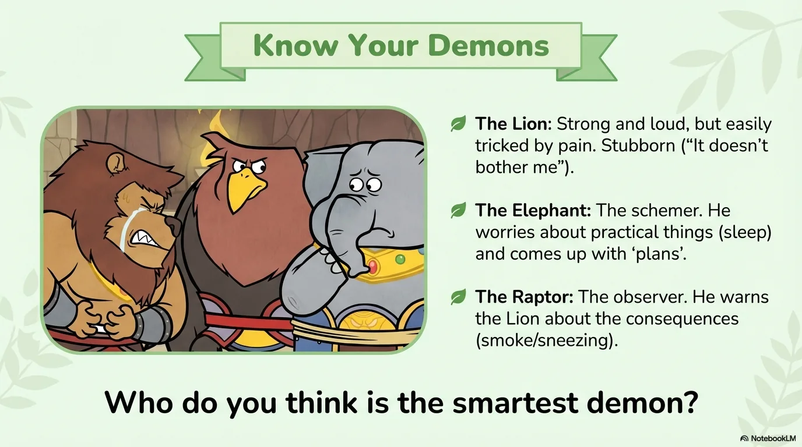
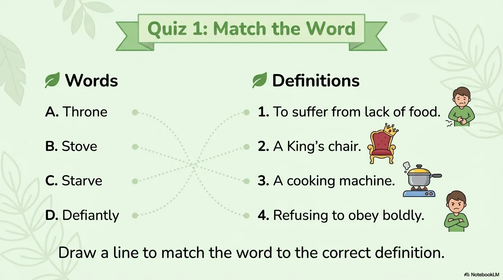
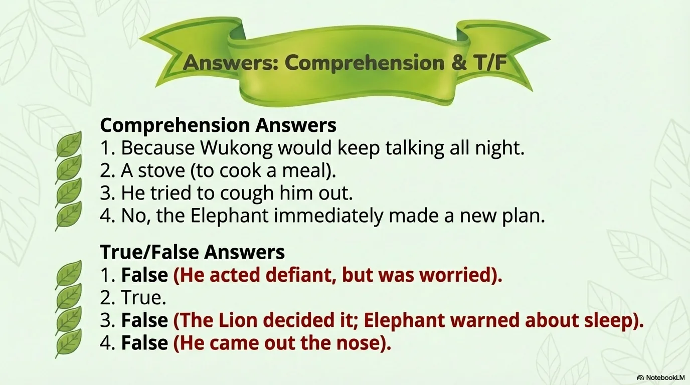

# 豆豆龙英语 · 第 93 集课件（EP093 草稿）

- 来源：`093_Journey to the West 93_A Problem for the Lion Demon.pptx`（主课件，20 页）
- OCR：`blocked`（no local OCR provider importable (pytesseract missing): No module named 'pytesseract'）
- 分类：待人工审核（unknown）
- 审核状态：`unreviewed`

## Slide 001

- 来源：`ppt/media/image1.png`（relationship `rId2`）
- 尺寸：1376×768
- 源 SHA-256：`f6558bef7e22054916360410e77ddde62425b26cdf714615db320f8aa1540942`
- 输出 SHA-256：`285f56f13e3fb699399a0e055389d025a68d9cfc4ca0b457b0ebc5deccd16688`
- 分类：unknown ｜ OCR：blocked ｜ 审核：unreviewed

## Slide 002

- 来源：`ppt/media/image3.png`（relationship `rId2`）
- 尺寸：1376×768
- 源 SHA-256：`1224a53f39498a5959da8d31ac9e5f579d57e729a40e7467cf6adf2c545153ab`
- 输出 SHA-256：`c44c23a7cdfb2308276c9ab616fbc855e956548ec955eda1aa7cb9644d2fedcd`
- 分类：unknown ｜ OCR：blocked ｜ 审核：unreviewed

## Slide 003

- 来源：`ppt/media/image4.png`（relationship `rId2`）
- 尺寸：1376×768
- 源 SHA-256：`53638efd3e2af25e8aeea0836128b0d025b6d2506464802aeaf813a17ebcf6cf`
- 输出 SHA-256：`2c310f1b2ca98d271064d91ad54bc57191f683922ad601b2b75dd078c9dc2fe7`
- 分类：unknown ｜ OCR：blocked ｜ 审核：unreviewed

## Slide 004

- 来源：`ppt/media/image5.png`（relationship `rId2`）
- 尺寸：1376×768
- 源 SHA-256：`16cab5cb8b245e537d58a4aeb6cf10ade359dafc64817e484761a45f180e9eea`
- 输出 SHA-256：`6e376e491d4b024d63f7c41acbbcf84db61aa18994fe6fc523b94c439ccae256`
- 分类：unknown ｜ OCR：blocked ｜ 审核：unreviewed

## Slide 005

- 来源：`ppt/media/image6.png`（relationship `rId2`）
- 尺寸：1376×768
- 源 SHA-256：`b20e9e5f95fee6eca005a5384303fa3ee791a525d3bf960a45e8d29e908cb608`
- 输出 SHA-256：`f4c664dbfa2d780143105e791cad748ef5e1b2ddfc7e1261c076138ff253786f`
- 分类：unknown ｜ OCR：blocked ｜ 审核：unreviewed

## Slide 006

- 来源：`ppt/media/image7.png`（relationship `rId2`）
- 尺寸：1376×768
- 源 SHA-256：`615f878e90ee457d3d69f4f5ddcdd44b9fb81dc34348834190574234d54764e5`
- 输出 SHA-256：`d7b55c4a7e9fbe534900cc4f20f8bb76f4c4b2296a2d22e95fef24e666c46531`
- 分类：unknown ｜ OCR：blocked ｜ 审核：unreviewed

## Slide 007

- 来源：`ppt/media/image8.png`（relationship `rId2`）
- 尺寸：1376×768
- 源 SHA-256：`b531a206e665323dca5023cefa90228102e3056516d502136f2119df7544920c`
- 输出 SHA-256：`4d29e00cfd2eef93b2fbf6a740698e8eb9233ad342251d6cfba067655678af05`
- 分类：unknown ｜ OCR：blocked ｜ 审核：unreviewed

## Slide 008

- 来源：`ppt/media/image9.png`（relationship `rId2`）
- 尺寸：1376×768
- 源 SHA-256：`62b2ab6f680d7538ad6ce1f0c7a5e4a28360dd5809067e2e8b3657a64e415fc3`
- 输出 SHA-256：`b04d54675428b62ece80350a656b4c5fc7b6faa43b291b79e139987e1c2a6225`
- 分类：unknown ｜ OCR：blocked ｜ 审核：unreviewed

## Slide 009

- 来源：`ppt/media/image10.png`（relationship `rId2`）
- 尺寸：1376×768
- 源 SHA-256：`74c9b886ab933fb54d45c9c5b66992a26a09e4726db4fd28ad8a284c21341d6d`
- 输出 SHA-256：`c455324e337ead5718b72b5af5b7c83e8c37e41891784a201474bde6c2cebcd4`
- 分类：unknown ｜ OCR：blocked ｜ 审核：unreviewed

## Slide 010

- 来源：`ppt/media/image11.png`（relationship `rId2`）
- 尺寸：1376×768
- 源 SHA-256：`558b06b8c0112a2129c6b38106a0c5db5d2837eb77f78eba089cc7e47c0de514`
- 输出 SHA-256：`46092c8fb0e2298d24ba1b443c9dad9fa381b438caf5622bccf6b42274b60ae4`
- 分类：unknown ｜ OCR：blocked ｜ 审核：unreviewed

## Slide 011

- 来源：`ppt/media/image12.png`（relationship `rId2`）
- 尺寸：1376×768
- 源 SHA-256：`ba03cebe19c2a8f65e998d752860bf629ac4ec341ce23a745d55a9b86d5fb84c`
- 输出 SHA-256：`9fdddcda6456821c06602cd3851cd7a9ce4c912421edcb2a4c14ed7393023d6c`
- 分类：unknown ｜ OCR：blocked ｜ 审核：unreviewed

## Slide 012

- 来源：`ppt/media/image13.png`（relationship `rId2`）
- 尺寸：1376×768
- 源 SHA-256：`0e7410e795b9be3b53bb0ee87591f2093135b272f2219081f754032319ce21c4`
- 输出 SHA-256：`ce6039afbb70f35c521494ebe66651c4703fda047c4859c995924e44d41ffd78`
- 分类：unknown ｜ OCR：blocked ｜ 审核：unreviewed

## Slide 013

- 来源：`ppt/media/image14.png`（relationship `rId2`）
- 尺寸：1376×768
- 源 SHA-256：`b404d917957ba4fa60da54d1567b7fe70c077abcca25bfaee0c26cafb0ce183a`
- 输出 SHA-256：`b0f6251e2f2a6febbfc2ba2d2242686cbfe7c1530aa8c12e19e85044d826f179`
- 分类：unknown ｜ OCR：blocked ｜ 审核：unreviewed

## Slide 014

- 来源：`ppt/media/image15.png`（relationship `rId2`）
- 尺寸：1376×768
- 源 SHA-256：`46c689b51507fc34cba4833916508aa3e553bd30209181fcc690a8d7a932caa7`
- 输出 SHA-256：`e3eb8b69e686ffec5341821546cabd7d26ecd29b0c6af60919a6743c9cfbc6e0`
- 分类：unknown ｜ OCR：blocked ｜ 审核：unreviewed

## Slide 015

- 来源：`ppt/media/image16.png`（relationship `rId2`）
- 尺寸：1376×768
- 源 SHA-256：`3678af8e9cede9a477f172c567af3003f777c16200785e784c0cc2ade045dbc9`
- 输出 SHA-256：`57904bd2f97312f1d94ce7080ec322a637027c8761ed4ec62c23674b1d0da4b3`
- 分类：unknown ｜ OCR：blocked ｜ 审核：unreviewed

## Slide 016

- 来源：`ppt/media/image17.png`（relationship `rId2`）
- 尺寸：1376×768
- 源 SHA-256：`c972fc4b54552f0cd6efe108de77b8f7b14399087596332474ced289e425abe0`
- 输出 SHA-256：`872f727171412d6ff2c191f02631becfcc494521eda55caaae6d5242b6b320b5`
- 分类：unknown ｜ OCR：blocked ｜ 审核：unreviewed

## Slide 017

- 来源：`ppt/media/image18.png`（relationship `rId2`）
- 尺寸：1376×768
- 源 SHA-256：`349a8d1750b3af18baf4192dc52f6c48a27dd5c285f2fcd92663e50884c55469`
- 输出 SHA-256：`61b378c573b0351517e1e7bb25df6bdcf5bfaf5b9aba7365724c13adaf072105`
- 分类：unknown ｜ OCR：blocked ｜ 审核：unreviewed

## Slide 018

- 来源：`ppt/media/image19.png`（relationship `rId2`）
- 尺寸：1376×768
- 源 SHA-256：`dbf6f1ae87bc35be7425ce1313ee531a6b3c2d15b99d5663f9c3baebf8db210c`
- 输出 SHA-256：`4459f079cec4465e44a98aad267052405de85fa86b989f853cb103f0180438e1`
- 分类：unknown ｜ OCR：blocked ｜ 审核：unreviewed

## Slide 019

- 来源：`ppt/media/image20.png`（relationship `rId2`）
- 尺寸：1376×768
- 源 SHA-256：`ebadea7ec079db1c46776a6a21ce47b9894d89e932b9c9d5d42e81eeed108531`
- 输出 SHA-256：`58d6c3a6b41850877b198df6b3a179a19c0c0dfba02c3e402850ec5db600e5ad`
- 分类：unknown ｜ OCR：blocked ｜ 审核：unreviewed

## Slide 020

- 来源：`ppt/media/image21.png`（relationship `rId2`）
- 尺寸：1376×768
- 源 SHA-256：`e8686de50f454ad6f3580fcac7aa8c8dbe68cb8848326590cb97bef4cc5b83f7`
- 输出 SHA-256：`8f7ff421592fea613e200d385fc919a322465aed6c12541755731cca758369a7`
- 分类：unknown ｜ OCR：blocked ｜ 审核：unreviewed
