# 豆豆龙英语 · 第 94 集课件（EP094 草稿）

- 来源：`094_Journey to the West 94_The Elephant Demon.pptx`（主课件，20 页）
- OCR：`blocked`（no local OCR provider importable (pytesseract missing): No module named 'pytesseract'）
- 分类：待人工审核（unknown）
- 审核状态：`unreviewed`

## Slide 001

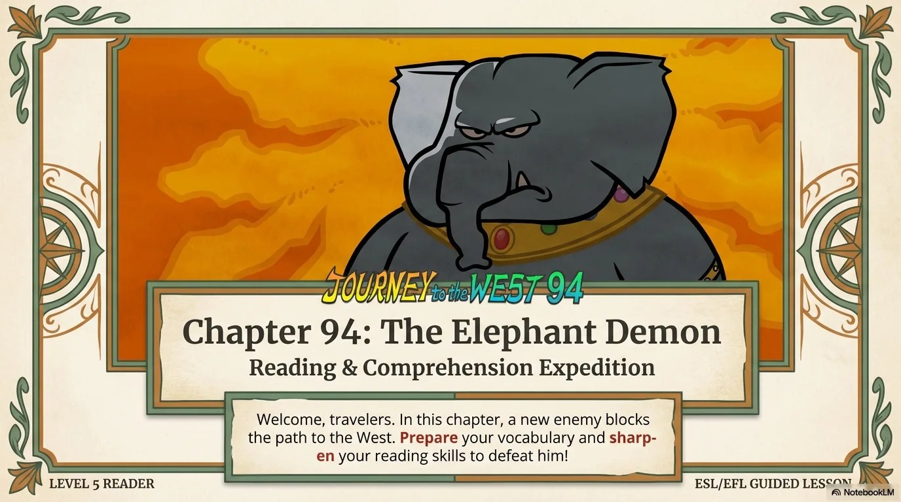

- 来源：`ppt/media/image1.png`（relationship `rId2`）
- 尺寸：1376×768
- 源 SHA-256：`82536dd1695c45ba13008b99b8b6399bde01d93286f5ad3a93fdb730c8ae5828`
- 输出 SHA-256：`877252332bc1dfd2435f0b7b37c732c124e0e185763f68a32cd977bacc54db37`
- 分类：unknown ｜ OCR：blocked ｜ 审核：unreviewed

## Slide 002

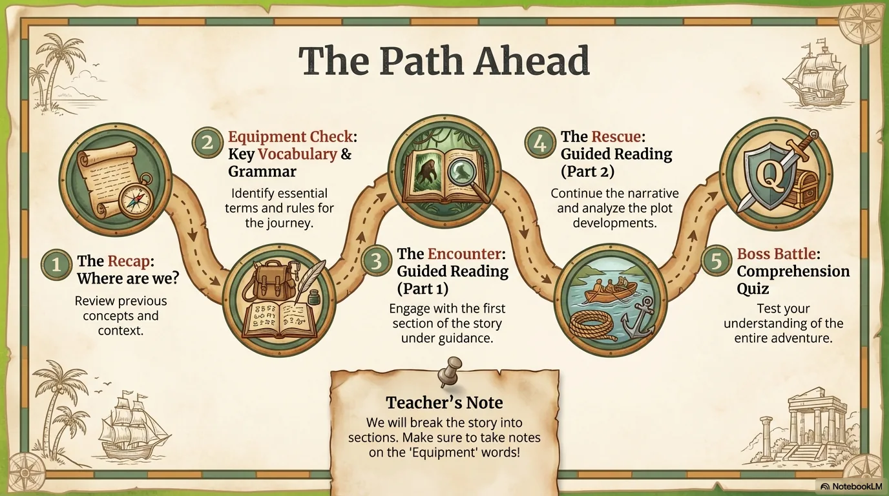

- 来源：`ppt/media/image3.png`（relationship `rId2`）
- 尺寸：1376×768
- 源 SHA-256：`e807ddec036b205ba67b201c6b3482f59475fd732881cf1d7a2a428a5afd574b`
- 输出 SHA-256：`01ea81571c93af1d3db65a05b0583a2d5846423bf256ba228acb5e89eefff1b5`
- 分类：unknown ｜ OCR：blocked ｜ 审核：unreviewed

## Slide 003

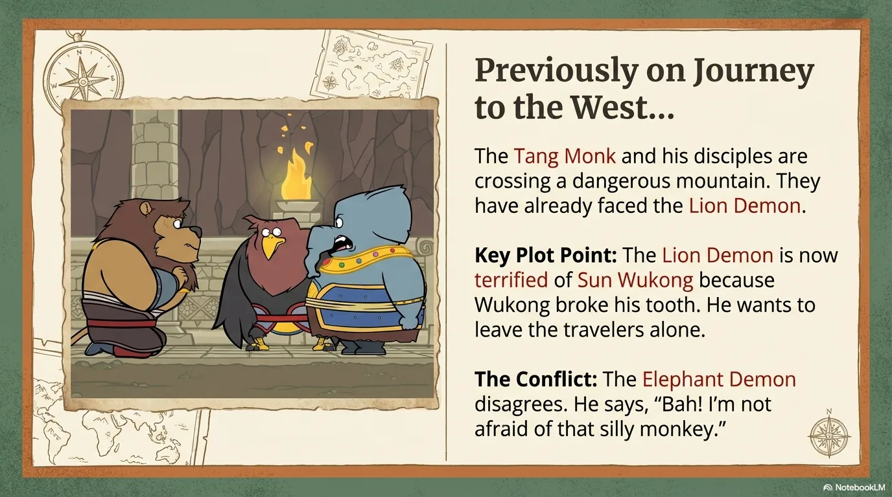

- 来源：`ppt/media/image4.png`（relationship `rId2`）
- 尺寸：1376×768
- 源 SHA-256：`b64eca242dea133c56be539214c987e17bf6734f1492a36dcdc6649b8fe22483`
- 输出 SHA-256：`35531c0d9defa1c9e0484a63be8a27a73fff7341d69e0e55c6a0f2cf442d4000`
- 分类：unknown ｜ OCR：blocked ｜ 审核：unreviewed

## Slide 004

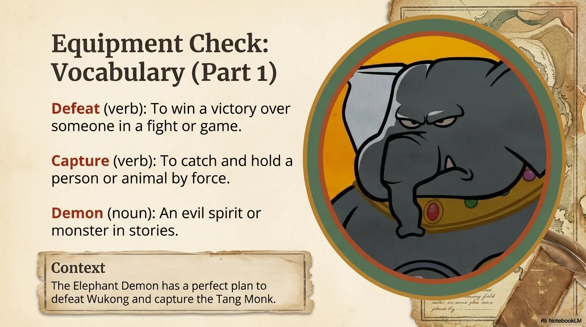

- 来源：`ppt/media/image5.png`（relationship `rId2`）
- 尺寸：1376×768
- 源 SHA-256：`f6c60deeb75840101ff3b900e088d561821f2714005beb9dc3ae57e0f4795cfa`
- 输出 SHA-256：`e2efefd725f320112c97dd36078abe290e7f07b0f0e1c968d9d2155f44912654`
- 分类：unknown ｜ OCR：blocked ｜ 审核：unreviewed

## Slide 005

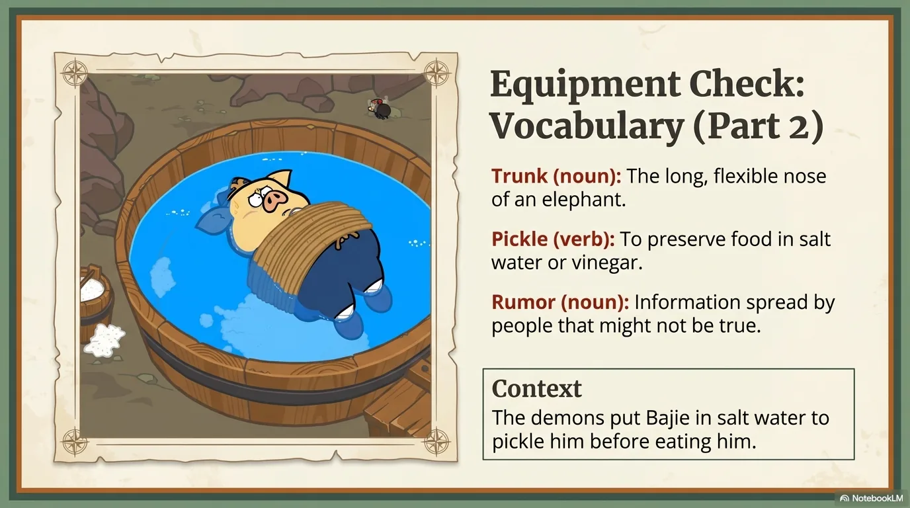

- 来源：`ppt/media/image6.png`（relationship `rId2`）
- 尺寸：1376×768
- 源 SHA-256：`28680aacc41b59c62132d66ec1850f32c11b2433fb7a3157096cd7a6bc4c3722`
- 输出 SHA-256：`234385387f22f7c4ff1d724df4611018be4929a4d67a3378dc83cbb81b11f663`
- 分类：unknown ｜ OCR：blocked ｜ 审核：unreviewed

## Slide 006

- 来源：`ppt/media/image7.png`（relationship `rId2`）
- 尺寸：1376×768
- 源 SHA-256：`b0f11f7bc4a3b9a021f1e1e4f7f32f49d5607631b16e0510fae60bdee694e875`
- 输出 SHA-256：`4f594895a714c16bc56675c7df1671a97ef7e84b7906fd97eceb106557992029`
- 分类：unknown ｜ OCR：blocked ｜ 审核：unreviewed

## Slide 007

- 来源：`ppt/media/image8.png`（relationship `rId2`）
- 尺寸：1376×768
- 源 SHA-256：`876fa76002ed6563eca69e6312c44626a3fd4cf94b396c646342cc727b8e1900`
- 输出 SHA-256：`148f7031a1438dfec8ee11a50d9ad5b946790f3b5c2106647c222a8beb05d77c`
- 分类：unknown ｜ OCR：blocked ｜ 审核：unreviewed

## Slide 008

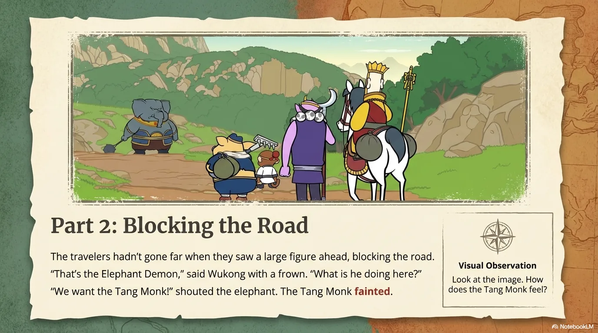

- 来源：`ppt/media/image9.png`（relationship `rId2`）
- 尺寸：1376×768
- 源 SHA-256：`bc0b891acaccfcd5fc80d65513e7e82ff6b115fc7ca768dd7b918dd65509792f`
- 输出 SHA-256：`28f8311b54e87f68913644a09a05560b66c5c70b9fe7f30cc7aa553fab8104e5`
- 分类：unknown ｜ OCR：blocked ｜ 审核：unreviewed

## Slide 009

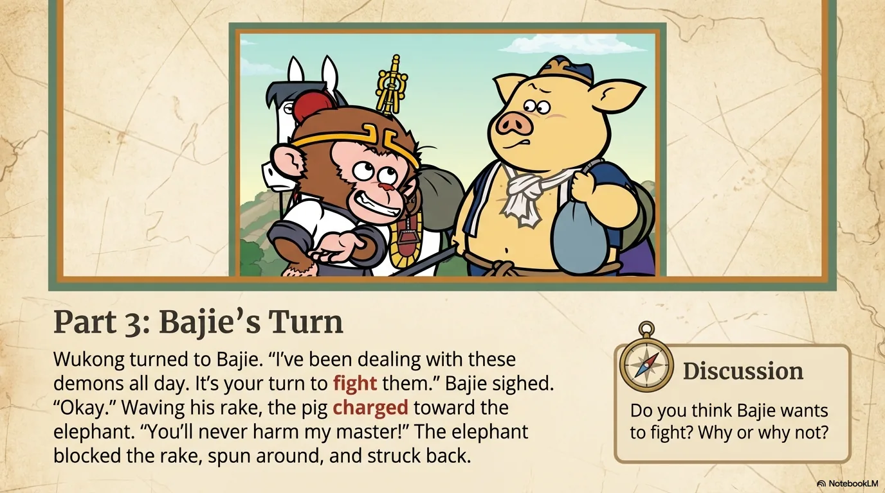

- 来源：`ppt/media/image10.png`（relationship `rId2`）
- 尺寸：1376×768
- 源 SHA-256：`85809cdde22b2b7a977097cb8b1e7cca80b2de32ed2b5feb8e4f8858a5d17b57`
- 输出 SHA-256：`aa0aade054fdbafe6d623f9eb0ec55b5e74240572fc05c6cb0cc149e763eb84d`
- 分类：unknown ｜ OCR：blocked ｜ 审核：unreviewed

## Slide 010

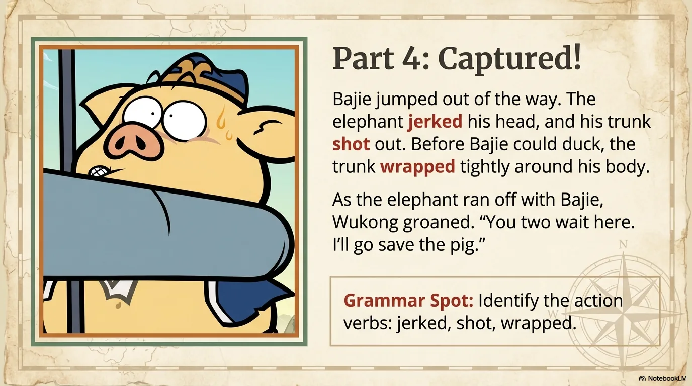

- 来源：`ppt/media/image11.png`（relationship `rId2`）
- 尺寸：1376×768
- 源 SHA-256：`900d20a878d71eefb07c8e8b52149cad4db1dfa8145bddb27b4aa763a3bd6413`
- 输出 SHA-256：`e4c3aa68bb9b8ca747a057678a9641fedcc7d2b02b7c5f11901e97e14e3ac981`
- 分类：unknown ｜ OCR：blocked ｜ 审核：unreviewed

## Slide 011

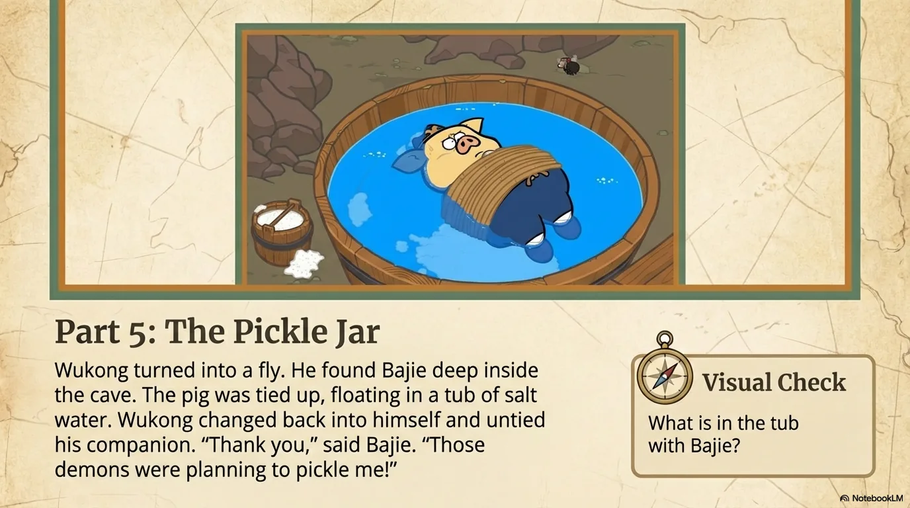

- 来源：`ppt/media/image12.png`（relationship `rId2`）
- 尺寸：1376×768
- 源 SHA-256：`db839fcca8e8af8ab30699c2b2d9285752df720c4bd1dc41acf9bd4993968f4e`
- 输出 SHA-256：`1de2dfdf8cb476106270eacb8cfa0559cd3a136544473bab31eddadd18dc7980`
- 分类：unknown ｜ OCR：blocked ｜ 审核：unreviewed

## Slide 012

- 来源：`ppt/media/image13.png`（relationship `rId2`）
- 尺寸：1376×768
- 源 SHA-256：`549609ebd08111c3abf3b8246997ad548a3af66f5a1114a144261466723f4aae`
- 输出 SHA-256：`e7fd12ee7014310204d4358fe0df329e1bdb9a346809a9030c9b0cf0ee602a9c`
- 分类：unknown ｜ OCR：blocked ｜ 审核：unreviewed

## Slide 013

- 来源：`ppt/media/image14.png`（relationship `rId2`）
- 尺寸：1376×768
- 源 SHA-256：`c9401eb7ee9727be5667a6202a0d9a8b51447b44f8b8d3fb238bdc66ff12ef16`
- 输出 SHA-256：`d42962612e7b2919d7c0814796b7d6cdc710580c08a5195db2b99a919d78a284`
- 分类：unknown ｜ OCR：blocked ｜ 审核：unreviewed

## Slide 014

- 来源：`ppt/media/image15.png`（relationship `rId2`）
- 尺寸：1376×768
- 源 SHA-256：`d836dad65d5ff6c7f2cc4a0d491772117fd348d57ef991e94979b2a23a1a12df`
- 输出 SHA-256：`55dba879eac7f31ae22cdc6fe99ff14638fa10a5ec4903dcee94c2c1754d77d4`
- 分类：unknown ｜ OCR：blocked ｜ 审核：unreviewed

## Slide 015

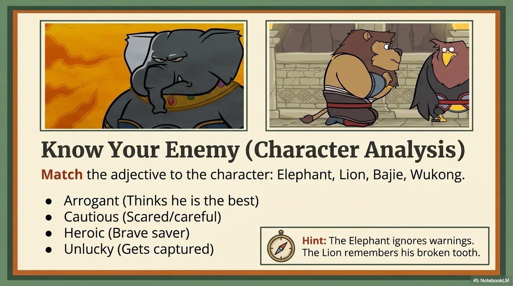

- 来源：`ppt/media/image16.png`（relationship `rId2`）
- 尺寸：1376×768
- 源 SHA-256：`36260d41a3adb7093f5e660c16c6c28bbc0bec8555ca3621a3b0c155bae77eed`
- 输出 SHA-256：`51cfe94e9f5fab3e852cb72ae1fca5603f8e1d1d6bb268cf1d71128e60893f67`
- 分类：unknown ｜ OCR：blocked ｜ 审核：unreviewed

## Slide 016

- 来源：`ppt/media/image17.png`（relationship `rId2`）
- 尺寸：1376×768
- 源 SHA-256：`d7ba0e899e2e385ec77b3e0ae1ea8ee309c8cc5cbee98bbaabf8f036061b3f6f`
- 输出 SHA-256：`b7ecc3cb81346d9de395243e87cc7c5be05b1fd7ab796d0858c727198cf1b4d9`
- 分类：unknown ｜ OCR：blocked ｜ 审核：unreviewed

## Slide 017

- 来源：`ppt/media/image18.png`（relationship `rId2`）
- 尺寸：1376×768
- 源 SHA-256：`3dd2c47c2358eb55ab7fe89d2cd8092a641c1afdc37c83934f5e112b2e29975d`
- 输出 SHA-256：`c9ba936752cd2abc84116273f4b4e41975196ba9ba1755f0fbbab8998998cf2e`
- 分类：unknown ｜ OCR：blocked ｜ 审核：unreviewed

## Slide 018

- 来源：`ppt/media/image19.png`（relationship `rId2`）
- 尺寸：1376×768
- 源 SHA-256：`8bb0cc44d374d64418f14dbb25c6ff7ca1e6af05dc07e967ab87592957776def`
- 输出 SHA-256：`403164c1cbf3a531a19aa73ed43146189deb55c93be74f19ded12c4ace45d5c2`
- 分类：unknown ｜ OCR：blocked ｜ 审核：unreviewed

## Slide 019

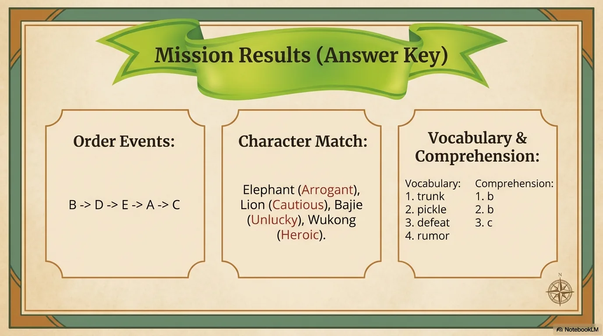

- 来源：`ppt/media/image20.png`（relationship `rId2`）
- 尺寸：1376×768
- 源 SHA-256：`65fabde4cc4d6b66e77ea2a70b38fe9be32a18f259293ee3bf67a40e009770da`
- 输出 SHA-256：`2d1e58b0f868b6a739088cb26a8e13266b2e10b0b4160d399d2db7d78b81d3eb`
- 分类：unknown ｜ OCR：blocked ｜ 审核：unreviewed

## Slide 020

- 来源：`ppt/media/image21.png`（relationship `rId2`）
- 尺寸：1376×768
- 源 SHA-256：`a76d392db5a36ef69b97b1b8329d1e3aad1007c6acfe8a2025fc4c8314ef6f71`
- 输出 SHA-256：`a70f1357d495583fb04d864e6db1534657908ced14ab698ce5c0215ab4dd0f4c`
- 分类：unknown ｜ OCR：blocked ｜ 审核：unreviewed
