# 豆豆龙英语 · 第 95 集课件（EP095 草稿）

- 来源：`095_Journey to the West 95_The Raptor Demon.pptx`（主课件，20 页）
- OCR：`blocked`（no local OCR provider importable (pytesseract missing): No module named 'pytesseract'）
- 分类：待人工审核（unknown）
- 审核状态：`unreviewed`

## Slide 001

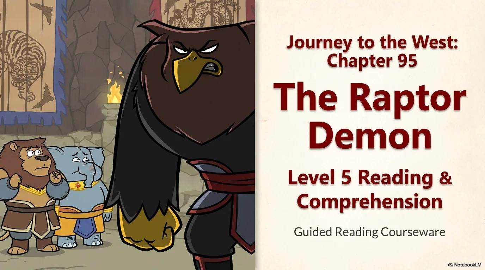

- 来源：`ppt/media/image1.png`（relationship `rId2`）
- 尺寸：1376×768
- 源 SHA-256：`bccb3ddd5cb8c22893da1af1cf428b5dad4c8973b85fe17af3190bd754bc8092`
- 输出 SHA-256：`b12f60a9f9f477f5722340c29415a97aeab8e3894981bdace44231aba2b4ba71`
- 分类：unknown ｜ OCR：blocked ｜ 审核：unreviewed

## Slide 002

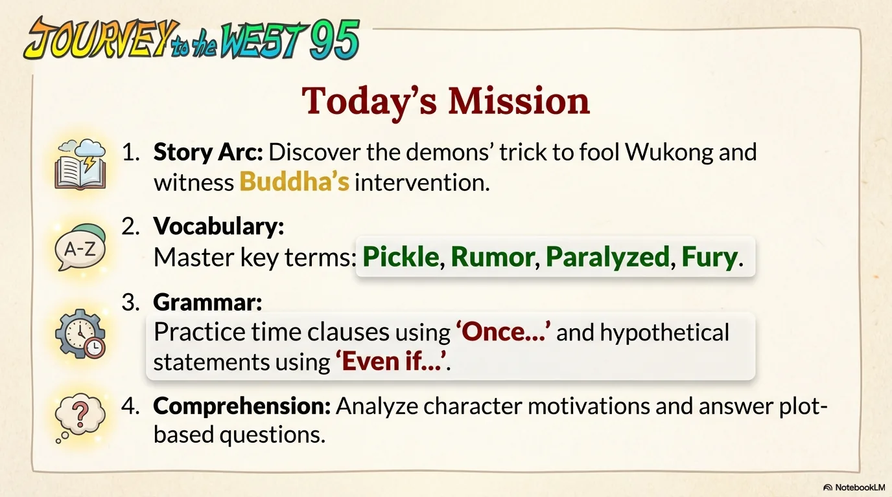

- 来源：`ppt/media/image3.png`（relationship `rId2`）
- 尺寸：1376×768
- 源 SHA-256：`42e0692692f47bcc5e4a5d3b972cfd623edc2519bdb29ae7954009f9e5e48353`
- 输出 SHA-256：`df085bc283eb74c0bda196b101b841967b89135d57bfae154208c8cb38eab539`
- 分类：unknown ｜ OCR：blocked ｜ 审核：unreviewed

## Slide 003

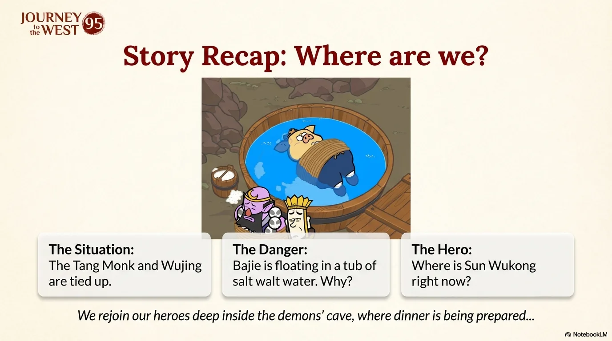

- 来源：`ppt/media/image4.png`（relationship `rId2`）
- 尺寸：1376×768
- 源 SHA-256：`0d915e6fbb4dfc966485b6ac0bea21e56a1befc7219a2284092ba356f790673f`
- 输出 SHA-256：`89aa9ed32ea00d045f039d494b23233478a8ad93afb0951b5f8d1cc1a409d06f`
- 分类：unknown ｜ OCR：blocked ｜ 审核：unreviewed

## Slide 004

- 来源：`ppt/media/image5.png`（relationship `rId2`）
- 尺寸：1376×768
- 源 SHA-256：`438c7604015912ef03c6f1fe3b8aa21c2459ce3bc5bbfaad3c9fe0da9662e2cf`
- 输出 SHA-256：`8772f4c75448c7754b14562fdb9400eae77a0f217fa30a2af41f726a7fdf5611`
- 分类：unknown ｜ OCR：blocked ｜ 审核：unreviewed

## Slide 005

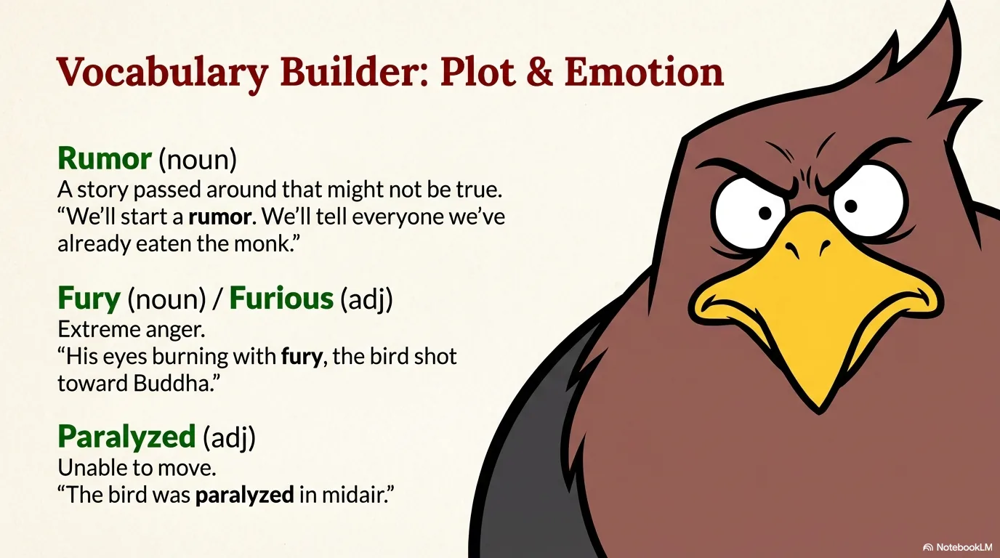

- 来源：`ppt/media/image6.png`（relationship `rId2`）
- 尺寸：1376×768
- 源 SHA-256：`e6d7f7caad8e9fd7388496482145ce4847dc3088625fdf525f23b00c2dcb62de`
- 输出 SHA-256：`4629c3e0f7c709914e9c135b32593560e7fa2a0419bc339f3d96b4246a1710b0`
- 分类：unknown ｜ OCR：blocked ｜ 审核：unreviewed

## Slide 006

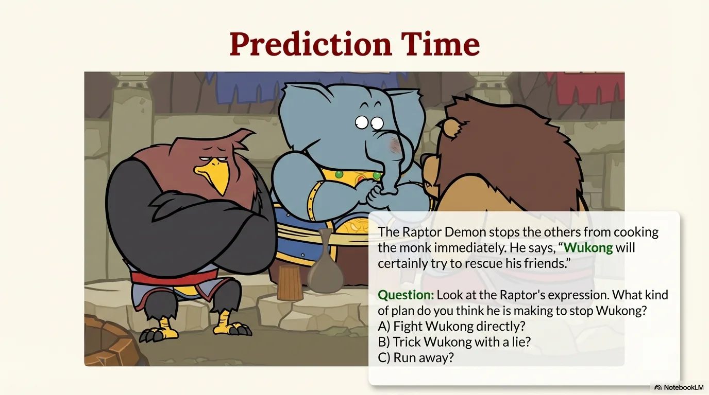

- 来源：`ppt/media/image7.png`（relationship `rId2`）
- 尺寸：1376×768
- 源 SHA-256：`e78b1aa2faa37e1336b6abc55bb426ebd9e7c177e6c5d8a6564e5d38880cc7c6`
- 输出 SHA-256：`6a5ab9662629d806e556e423c7c6e1e9769b46d7f555a1116900143ce7026a15`
- 分类：unknown ｜ OCR：blocked ｜ 审核：unreviewed

## Slide 007

- 来源：`ppt/media/image8.png`（relationship `rId2`）
- 尺寸：1376×768
- 源 SHA-256：`eff1fcdc43cd17a62839f55f85d79d0774fa01263e957136ef5e0f15df603b5a`
- 输出 SHA-256：`11962ea895fd8c84a3f9fd3b53018ddd82fd2ddc82bef509fe8f7c92926015be`
- 分类：unknown ｜ OCR：blocked ｜ 审核：unreviewed

## Slide 008

- 来源：`ppt/media/image9.png`（relationship `rId2`）
- 尺寸：1376×768
- 源 SHA-256：`aaf3ad7cab2b8103cd64039a747b97af77151ee85e1e87e8b18f7fcabc7af334`
- 输出 SHA-256：`007e6ef8c51b2125e1e0f07cf6027e1463817453dc97193a3069aa55cea65855`
- 分类：unknown ｜ OCR：blocked ｜ 审核：unreviewed

## Slide 009

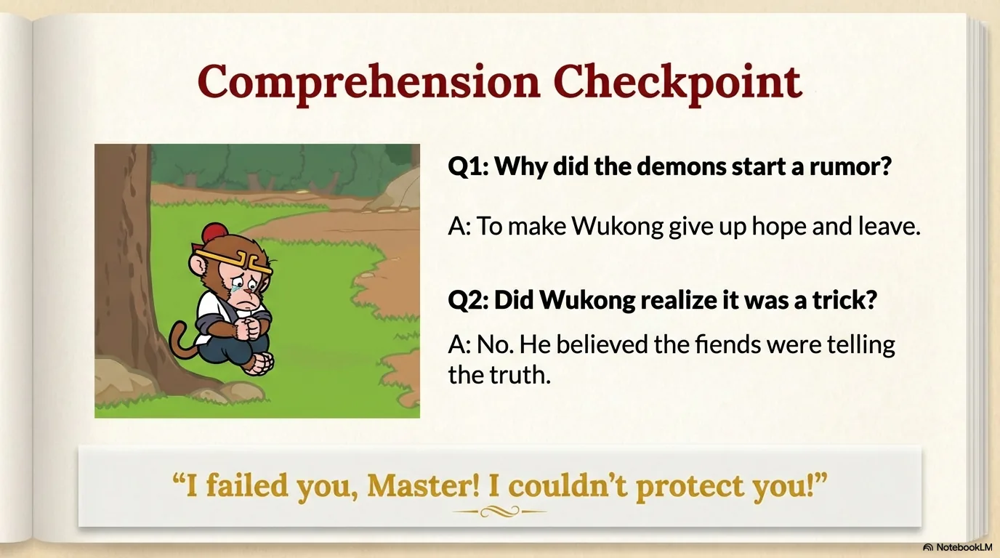

- 来源：`ppt/media/image10.png`（relationship `rId2`）
- 尺寸：1376×768
- 源 SHA-256：`3549770604987de1bc0b12b9e74b4c93f4498003b62675c2ee9c0e3ca2bb86c4`
- 输出 SHA-256：`9fc514017407a19b61f8c40ddf9e62ed4969a133768908ba32f3e5505531e23e`
- 分类：unknown ｜ OCR：blocked ｜ 审核：unreviewed

## Slide 010

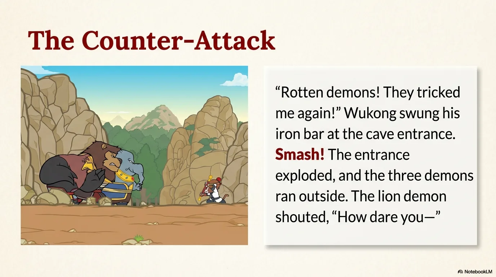

- 来源：`ppt/media/image11.png`（relationship `rId2`）
- 尺寸：1376×768
- 源 SHA-256：`ddc8830687999af1dfeaa1cb7a865f3d86c6e23a48514764ba9d7b98be4e7bbb`
- 输出 SHA-256：`5cbf2f232d751d529783bd2fe54a0a55fc847af04463bc8229d0439187c39218`
- 分类：unknown ｜ OCR：blocked ｜ 审核：unreviewed

## Slide 011

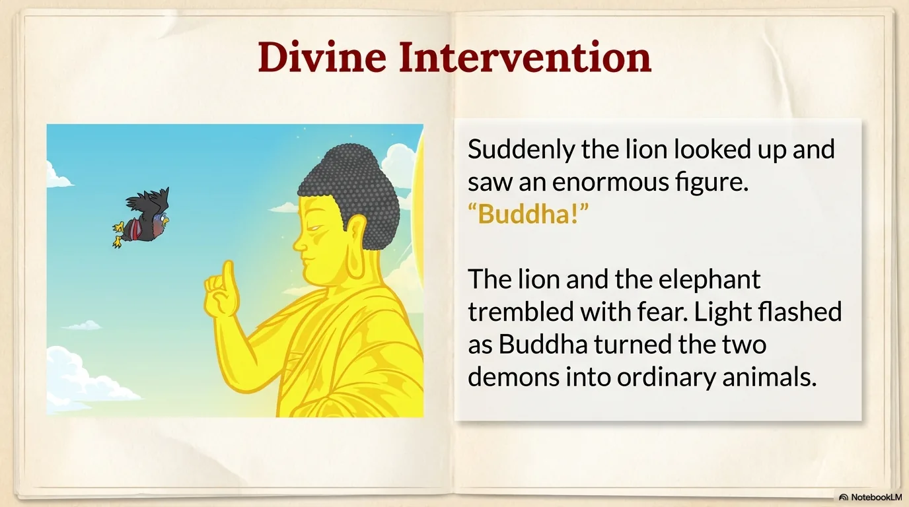

- 来源：`ppt/media/image12.png`（relationship `rId2`）
- 尺寸：1376×768
- 源 SHA-256：`e9a1d9852786c5c66a5f1861c0ec2ca92132826c26c3d56378d7391a595153e5`
- 输出 SHA-256：`eac0d1dce9c4320eb58b67ef8d3a5c69949843418523e1cc17846084c7c8dc1a`
- 分类：unknown ｜ OCR：blocked ｜ 审核：unreviewed

## Slide 012

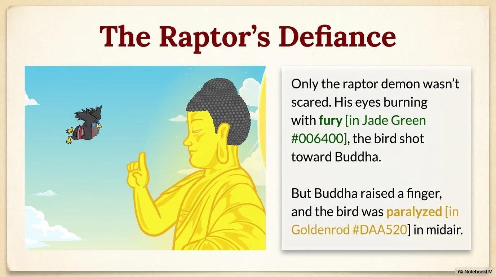

- 来源：`ppt/media/image13.png`（relationship `rId2`）
- 尺寸：1376×768
- 源 SHA-256：`2e07c9ec208d840df248f873d6de14ef4c881feb4e24f8f358928d9d9669b1f3`
- 输出 SHA-256：`fd658b1394f6170f3a272079f34d9dab7f00deace23251045e04254713b76857`
- 分类：unknown ｜ OCR：blocked ｜ 审核：unreviewed

## Slide 013

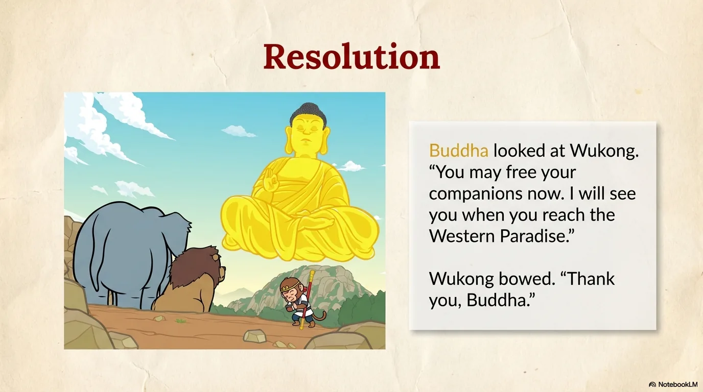

- 来源：`ppt/media/image14.png`（relationship `rId2`）
- 尺寸：1376×768
- 源 SHA-256：`7e6cfb88fb78a1fdc325cdf7ac8ccfdd61a5eb50cf90024983dffa6732a9747f`
- 输出 SHA-256：`6308c7db2e5c61ea52247d83a2277c2916a6fe39560aef16e3377c742c952cbb`
- 分类：unknown ｜ OCR：blocked ｜ 审核：unreviewed

## Slide 014

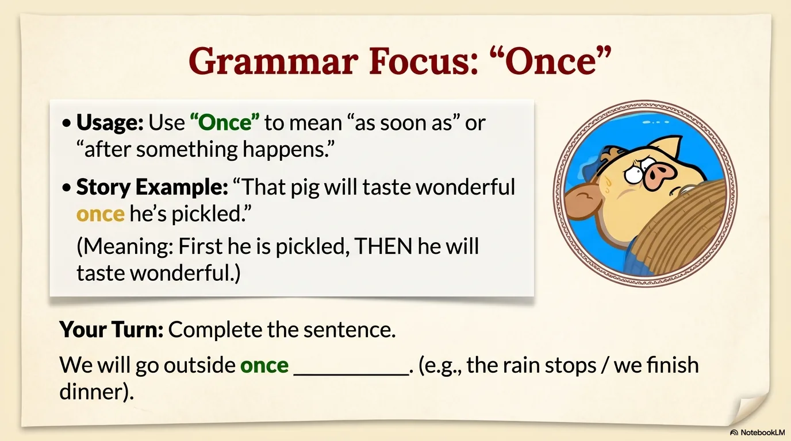

- 来源：`ppt/media/image15.png`（relationship `rId2`）
- 尺寸：1376×768
- 源 SHA-256：`6ba1a042c0127cc3590c12e38da2205e37d82421aa4c12cd71fc66c627d42727`
- 输出 SHA-256：`d10eb97da00a1bc460ef9958e706b54850e7db747bcd805762ad2b18e6a2e6bf`
- 分类：unknown ｜ OCR：blocked ｜ 审核：unreviewed

## Slide 015

- 来源：`ppt/media/image16.png`（relationship `rId2`）
- 尺寸：1376×768
- 源 SHA-256：`5517603e6644efdcd544f08503709ecf69bb5e2e7824d6332eaf93a2a6aae0a1`
- 输出 SHA-256：`8aa65d9905d2da9de0d20bbe0f41159102b7e02874148ae857a10c0bdeda8d2c`
- 分类：unknown ｜ OCR：blocked ｜ 审核：unreviewed

## Slide 016

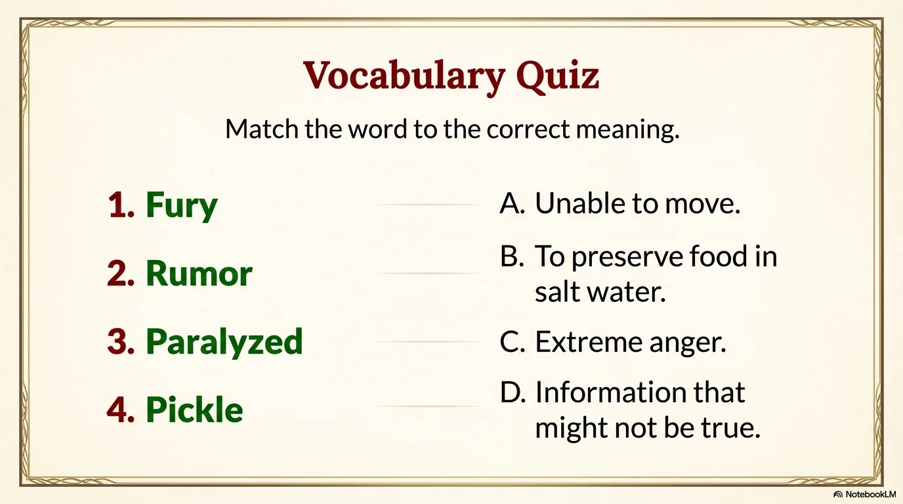

- 来源：`ppt/media/image17.png`（relationship `rId2`）
- 尺寸：1376×768
- 源 SHA-256：`4e5856d581928513df2be40d96a1e50b5ea292b0ab3af732d38c602b043653df`
- 输出 SHA-256：`1a9a3444a3e2477c4890bddf2ae5ca799d5201ca8b8533d4007371281275a3af`
- 分类：unknown ｜ OCR：blocked ｜ 审核：unreviewed

## Slide 017

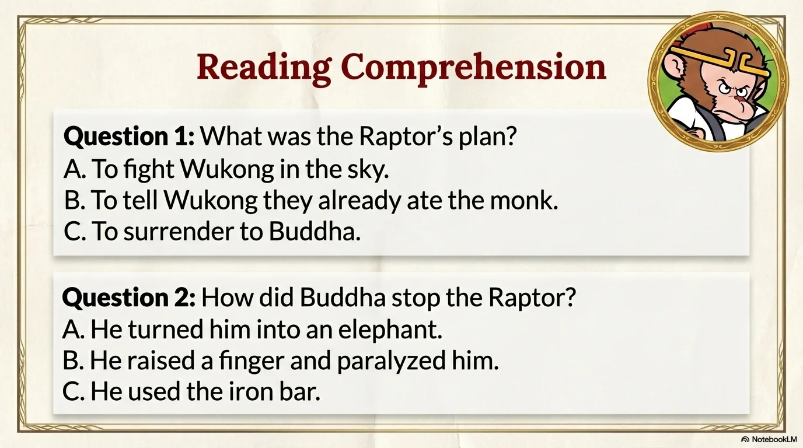

- 来源：`ppt/media/image18.png`（relationship `rId2`）
- 尺寸：1376×768
- 源 SHA-256：`cc5c5da20672997d9c2269fbc11b72ed8362d60b615e41fd5946376f0225679c`
- 输出 SHA-256：`123a2a0b4c1c7163a77ab22b518b61b7b640c745881775ff36fd8eb35a44b7cb`
- 分类：unknown ｜ OCR：blocked ｜ 审核：unreviewed

## Slide 018

- 来源：`ppt/media/image19.png`（relationship `rId2`）
- 尺寸：1376×768
- 源 SHA-256：`c608cdaa1fbfa87127d1bd54dc4338f110b79c0021107d43c75e063c49ce7085`
- 输出 SHA-256：`4cc3056fe21431e10bbf43847d10128b6a31aff8dd1382405c0f0b4142edb31c`
- 分类：unknown ｜ OCR：blocked ｜ 审核：unreviewed

## Slide 019

- 来源：`ppt/media/image20.png`（relationship `rId2`）
- 尺寸：1376×768
- 源 SHA-256：`4c980075a2fb8e36e27f6546e1006ce87e5702850786a163422b072211d6c013`
- 输出 SHA-256：`31554b36dc5ee58497cb2aaa9ca5122ad2a98a12b550261ed90913563d03811f`
- 分类：unknown ｜ OCR：blocked ｜ 审核：unreviewed

## Slide 020

- 来源：`ppt/media/image21.png`（relationship `rId2`）
- 尺寸：1376×768
- 源 SHA-256：`dc5252946e23b1404224cc253a7cd2516ff342b09bd7be7e896e55d025e1a5d2`
- 输出 SHA-256：`e33cf4ecc31f6789a117f76ced4a1373c79af26bec88610d5de06dcc74abb072`
- 分类：unknown ｜ OCR：blocked ｜ 审核：unreviewed
