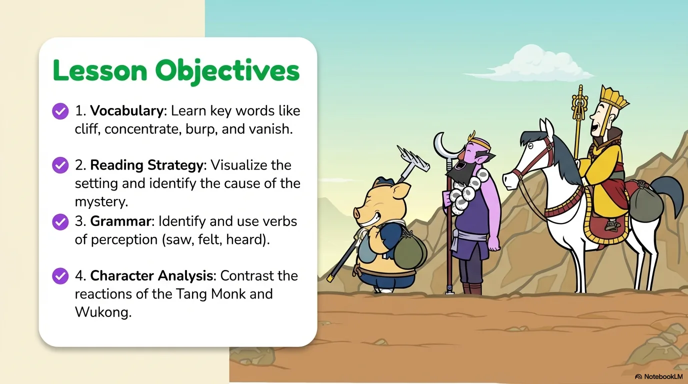
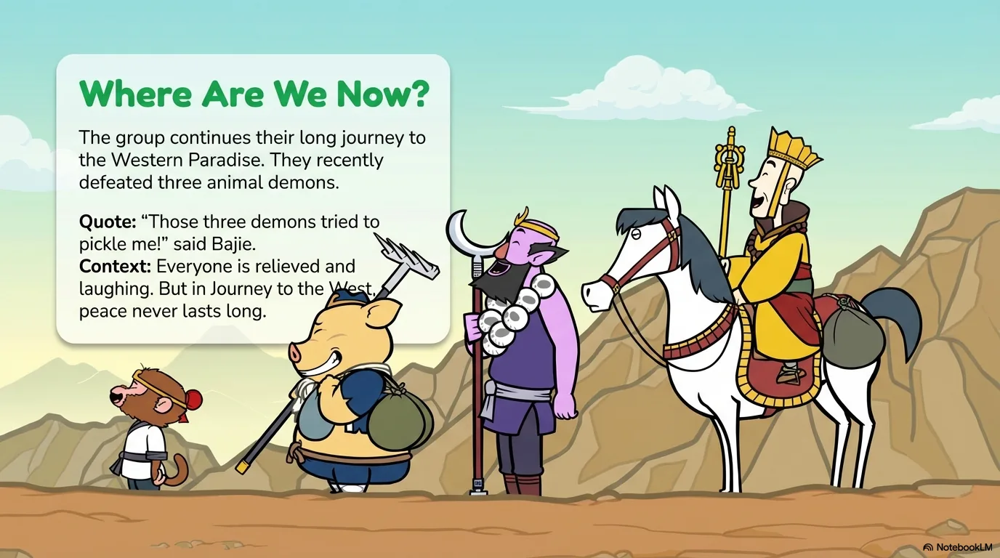
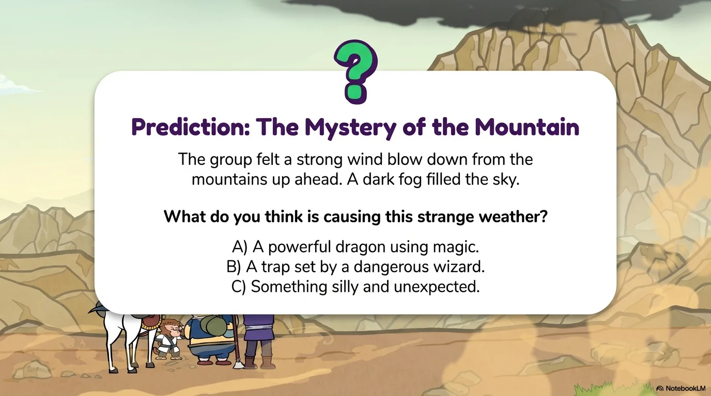
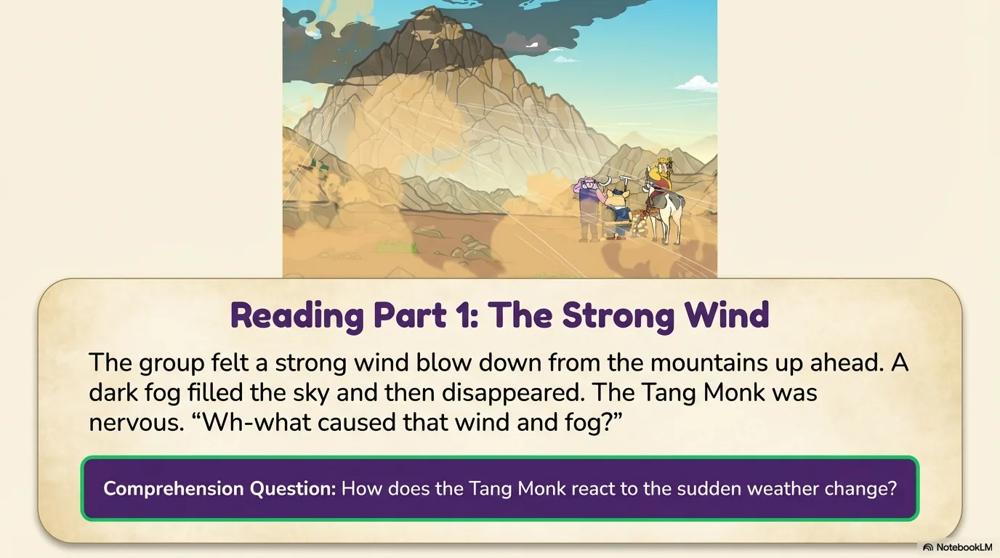
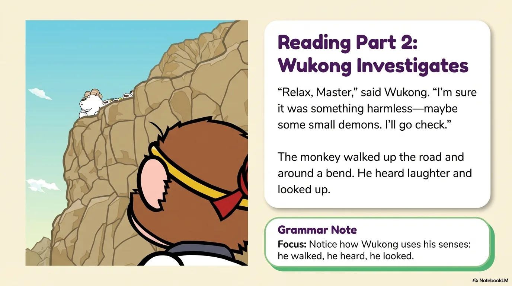
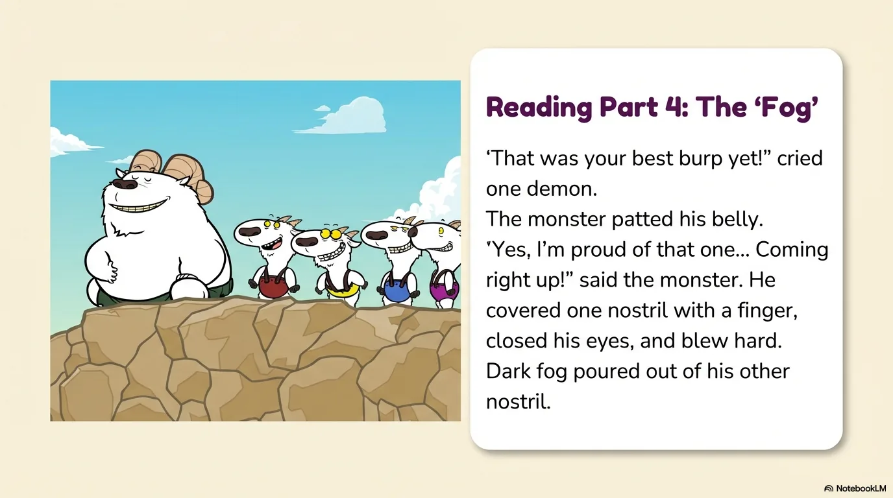
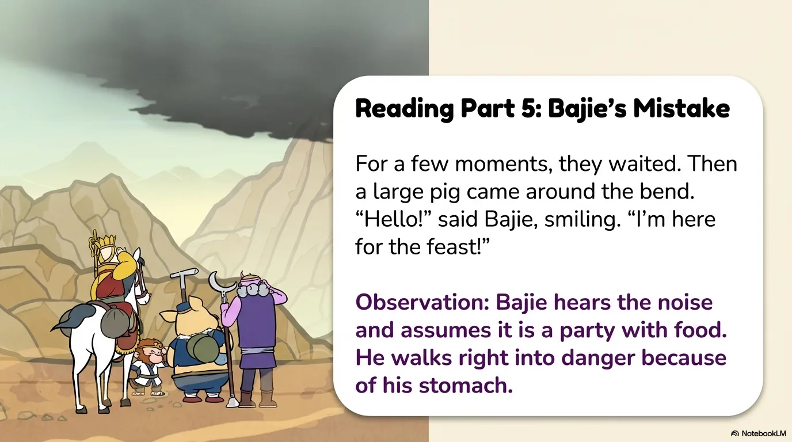
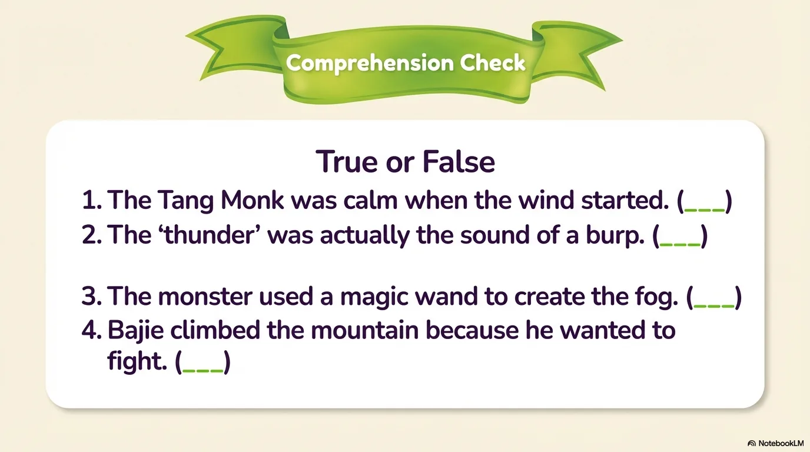
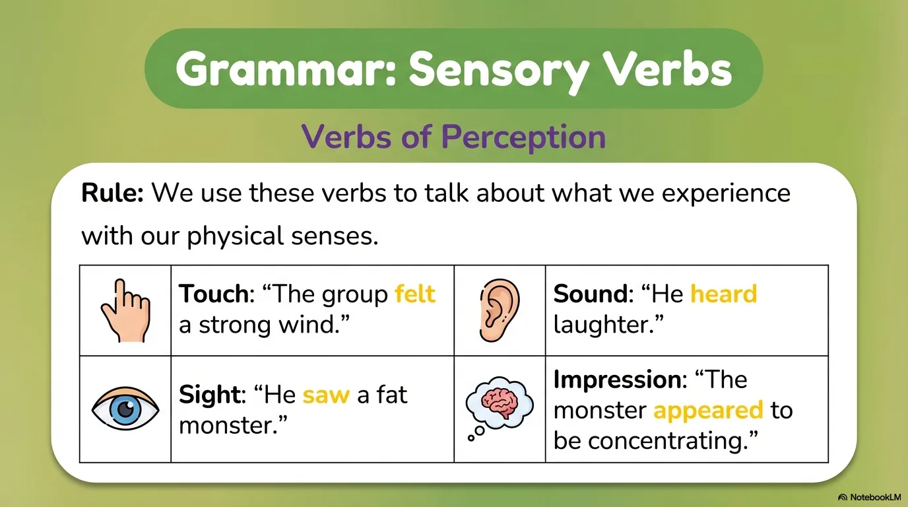
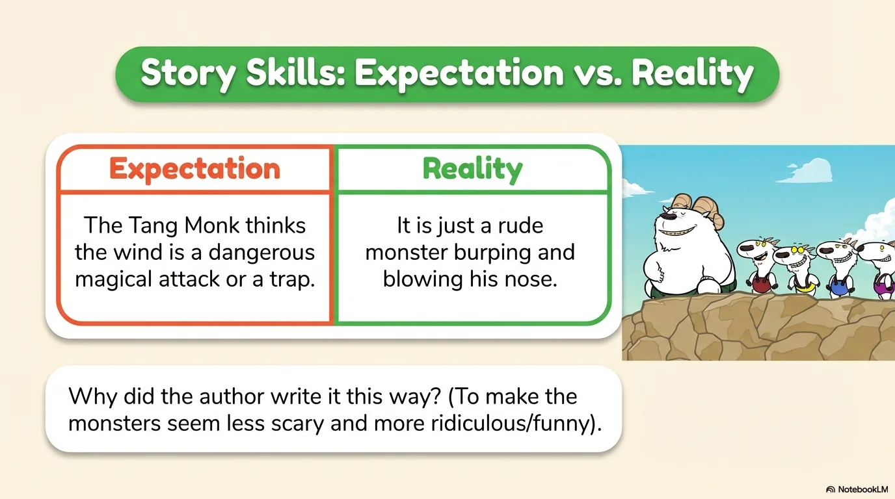

# 豆豆龙英语 · 第 96 集课件（EP096 草稿）

- 来源：`096_Journey to the West 96_Wind and Fog.pptx`（主课件，20 页）
- OCR：`blocked`（no local OCR provider importable (pytesseract missing): No module named 'pytesseract'）
- 分类：待人工审核（unknown）
- 审核状态：`unreviewed`

## Slide 001

- 来源：`ppt/media/image1.png`（relationship `rId2`）
- 尺寸：1376×768
- 源 SHA-256：`af4ef14c965d2e18eb6336c5ca271b1e7b06d21167e9099273bc5c09381b5121`
- 输出 SHA-256：`133efde3c8b147f6a94778fed5561c030bafcfa2792d545759066ec04b034e14`
- 分类：unknown ｜ OCR：blocked ｜ 审核：unreviewed

## Slide 002

- 来源：`ppt/media/image3.png`（relationship `rId2`）
- 尺寸：1376×768
- 源 SHA-256：`eba4dc8efa79b25d947022b9ddf3d2f1172455913e387b7b24c70942acb4f693`
- 输出 SHA-256：`e7df96ff36abefaa74f4b00a5a900ddc5232f59fd9af64777ddf9ed8f38f17dc`
- 分类：unknown ｜ OCR：blocked ｜ 审核：unreviewed

## Slide 003

- 来源：`ppt/media/image4.png`（relationship `rId2`）
- 尺寸：1376×768
- 源 SHA-256：`754099a5cbe8468ef78fd25652889ab979c6d09d7a92e0e5047188458bceec75`
- 输出 SHA-256：`638bba8510881f9c9e39bce9d13861885dcf0ac93603e39b14e084dec3646c42`
- 分类：unknown ｜ OCR：blocked ｜ 审核：unreviewed

## Slide 004

- 来源：`ppt/media/image5.png`（relationship `rId2`）
- 尺寸：1376×768
- 源 SHA-256：`35d90ba6fdd962a1d7e0c399698c344581de498eab4988c248e0d77177311ce0`
- 输出 SHA-256：`61a9e07ee22601273ce98714a94bcff2dcd536e0f1e9a22f1d3fb4dd115a2967`
- 分类：unknown ｜ OCR：blocked ｜ 审核：unreviewed

## Slide 005

- 来源：`ppt/media/image6.png`（relationship `rId2`）
- 尺寸：1376×768
- 源 SHA-256：`e70d1feedc7717fdbaa0603facf695e85810d79f3ad2ed277eb526f1ce367881`
- 输出 SHA-256：`9d97b27f7a93ba28619b11f5b1ab213340232ccadbb1a6f2c74b354ef9c04de3`
- 分类：unknown ｜ OCR：blocked ｜ 审核：unreviewed

## Slide 006

- 来源：`ppt/media/image7.png`（relationship `rId2`）
- 尺寸：1376×768
- 源 SHA-256：`ac140fc6143912b9696962b8bf0eb85de0cf5c63e333729a64b03b6e1ae1fd34`
- 输出 SHA-256：`9bb4d4aaf23f485bc470fcff37a91549a4474865fea55155d3220e246b6fdc23`
- 分类：unknown ｜ OCR：blocked ｜ 审核：unreviewed

## Slide 007

- 来源：`ppt/media/image8.png`（relationship `rId2`）
- 尺寸：1376×768
- 源 SHA-256：`1c43d2d8a339e5774d795081cfec745241d78e62e2fc54337b260155f23be891`
- 输出 SHA-256：`414d116301a97190f58c442be11346d919f484030090e427bca0d95de38d5b04`
- 分类：unknown ｜ OCR：blocked ｜ 审核：unreviewed

## Slide 008

- 来源：`ppt/media/image9.png`（relationship `rId2`）
- 尺寸：1376×768
- 源 SHA-256：`4dd0739f96932f63814b71f40539245f26105825a736f5a565e290dc0d266cd8`
- 输出 SHA-256：`673da95a12952caadc5077dc8207dc98af6fba37eca044b6dccfca09a1f3019b`
- 分类：unknown ｜ OCR：blocked ｜ 审核：unreviewed

## Slide 009

- 来源：`ppt/media/image10.png`（relationship `rId2`）
- 尺寸：1376×768
- 源 SHA-256：`e87a9cc585f9e22be4ab23282de490999f441bd638985171bb458b7053b6382f`
- 输出 SHA-256：`e9707a507e8192b76c4f8d273dc93cd08dfeaccc05c60a593faaa99d52762728`
- 分类：unknown ｜ OCR：blocked ｜ 审核：unreviewed

## Slide 010

- 来源：`ppt/media/image11.png`（relationship `rId2`）
- 尺寸：1376×768
- 源 SHA-256：`096c05b0089e9761dc314b44910aecbe9030794915ecd0fadaf3056900f2f968`
- 输出 SHA-256：`6fcd4289844fd049f1e910aead7245b0ca6e115d80880c94a7556b67569add39`
- 分类：unknown ｜ OCR：blocked ｜ 审核：unreviewed

## Slide 011

- 来源：`ppt/media/image12.png`（relationship `rId2`）
- 尺寸：1376×768
- 源 SHA-256：`a860bbd002f751137f1d95635156c32c70adb27fe8b1d43972e59f1be3449360`
- 输出 SHA-256：`b06d5985ba0e62b8cdf22571c1abef22bf3aef04a63957d323623d554b839252`
- 分类：unknown ｜ OCR：blocked ｜ 审核：unreviewed

## Slide 012

- 来源：`ppt/media/image13.png`（relationship `rId2`）
- 尺寸：1376×768
- 源 SHA-256：`fa879e1b5f2a90273567687137f049f94f3b22b0d443bf1cfb173b6adfeeea82`
- 输出 SHA-256：`113f0ae82df08ecc9a4483bceb4105625ab9385b479756c528c507c886f15dc3`
- 分类：unknown ｜ OCR：blocked ｜ 审核：unreviewed

## Slide 013

- 来源：`ppt/media/image14.png`（relationship `rId2`）
- 尺寸：1376×768
- 源 SHA-256：`5a58d7a0fc9471c5d75d689ddead5a1dc5b3fe80865e244c9c1921dad5e16522`
- 输出 SHA-256：`b7e5757aa3a6d119334901fcdc41ddb92207230f15dc8aa681178b7d4a48a474`
- 分类：unknown ｜ OCR：blocked ｜ 审核：unreviewed

## Slide 014

- 来源：`ppt/media/image15.png`（relationship `rId2`）
- 尺寸：1376×768
- 源 SHA-256：`8cf69f0c03c997d277dfaf4322dda4c7f5d44830e6743a5b38f66e8cb47e23c5`
- 输出 SHA-256：`0967c9889ea09e484bfd7d51d6f17e2a896c4ad6b895c65445dcd00830aca234`
- 分类：unknown ｜ OCR：blocked ｜ 审核：unreviewed

## Slide 015

- 来源：`ppt/media/image16.png`（relationship `rId2`）
- 尺寸：1376×768
- 源 SHA-256：`7420da6f40435a1a54faae0b83ff4ebdf3cae70f42f4c07259bd087f25d8a0c7`
- 输出 SHA-256：`c2889a844e7c1e626994214dc570c248c75d5a4ee7cb2466374628c705100325`
- 分类：unknown ｜ OCR：blocked ｜ 审核：unreviewed

## Slide 016

- 来源：`ppt/media/image17.png`（relationship `rId2`）
- 尺寸：1376×768
- 源 SHA-256：`bf1c9b21b7de77ed4f31a5d9914e157386b167eace2bda333efbbfafe3788452`
- 输出 SHA-256：`6103ef939c512028c655d10ba3b3f6180e1f0f0cad70ce95a956e7a4579aad97`
- 分类：unknown ｜ OCR：blocked ｜ 审核：unreviewed

## Slide 017

- 来源：`ppt/media/image18.png`（relationship `rId2`）
- 尺寸：1376×768
- 源 SHA-256：`68c603fd49108729262aa738ae64df474477345277d846b5ab67350e6fb8b616`
- 输出 SHA-256：`5e05e82dd9152866bcd1e8a723fccf3b91c0c1aeb3e7152321c7be017ba86438`
- 分类：unknown ｜ OCR：blocked ｜ 审核：unreviewed

## Slide 018

- 来源：`ppt/media/image19.png`（relationship `rId2`）
- 尺寸：1376×768
- 源 SHA-256：`b3f5dc0d77686de56a6568adc28d144cf9b2a7f5aa806e396da768d6c4debc70`
- 输出 SHA-256：`52b659c8037c42781f2f55e45b86e4ddf70c77e6e39e0f5987f6232a305dc5d0`
- 分类：unknown ｜ OCR：blocked ｜ 审核：unreviewed

## Slide 019

- 来源：`ppt/media/image20.png`（relationship `rId2`）
- 尺寸：1376×768
- 源 SHA-256：`ef08cd8058fdfebe23af38d2e4326cb49989ffcf657e13d510a48ce0c087c441`
- 输出 SHA-256：`62aa485b6ce41b2e2e81c5c0886b00257f811d3a6e34afbb257a4773ff40be49`
- 分类：unknown ｜ OCR：blocked ｜ 审核：unreviewed

## Slide 020

- 来源：`ppt/media/image21.png`（relationship `rId2`）
- 尺寸：1376×768
- 源 SHA-256：`771e73f31ee5e4dcc4590afaecdc97b3bb3bca3770a7d71105fcf799c1aeb15f`
- 输出 SHA-256：`56b8f549cd1c527730e74fa32368ae9032d8edd331c0016c8cde0afdb80c42f0`
- 分类：unknown ｜ OCR：blocked ｜ 审核：unreviewed
