# 豆豆龙英语 · 第 98 集课件（EP098 草稿）

- 来源：`098_Journey to the West 98_Three Fights.pptx`（主课件，20 页）
- OCR：`blocked`（no local OCR provider importable (pytesseract missing): No module named 'pytesseract'）
- 分类：待人工审核（unknown）
- 审核状态：`unreviewed`

## Slide 001

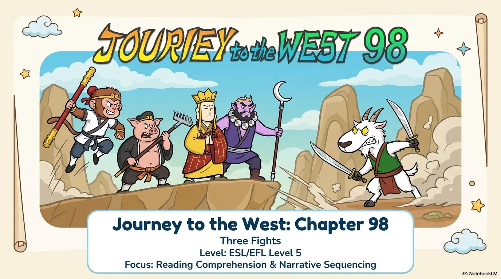

- 来源：`ppt/media/image1.png`（relationship `rId2`）
- 尺寸：1376×768
- 源 SHA-256：`be041008f3514937e493ad087922fed7c881bfc1de717875864ff26fb2acc916`
- 输出 SHA-256：`744b88787084dcdc148194670484b850f2452156525db28ad8e38dc42c116291`
- 分类：unknown ｜ OCR：blocked ｜ 审核：unreviewed

## Slide 002

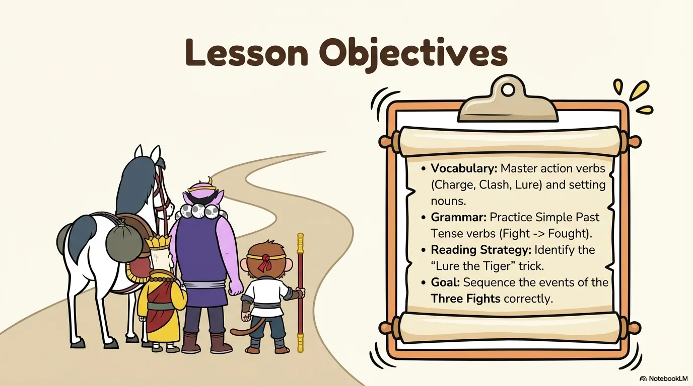

- 来源：`ppt/media/image3.png`（relationship `rId2`）
- 尺寸：1376×768
- 源 SHA-256：`e3b8e984dd8a53445779bf6baecd014e44b9ecb43336776781a7106b11845d3e`
- 输出 SHA-256：`51a7e965100cfe4c92d390c65b0c383c7a16d356ba763fa31a2c600236c1685f`
- 分类：unknown ｜ OCR：blocked ｜ 审核：unreviewed

## Slide 003

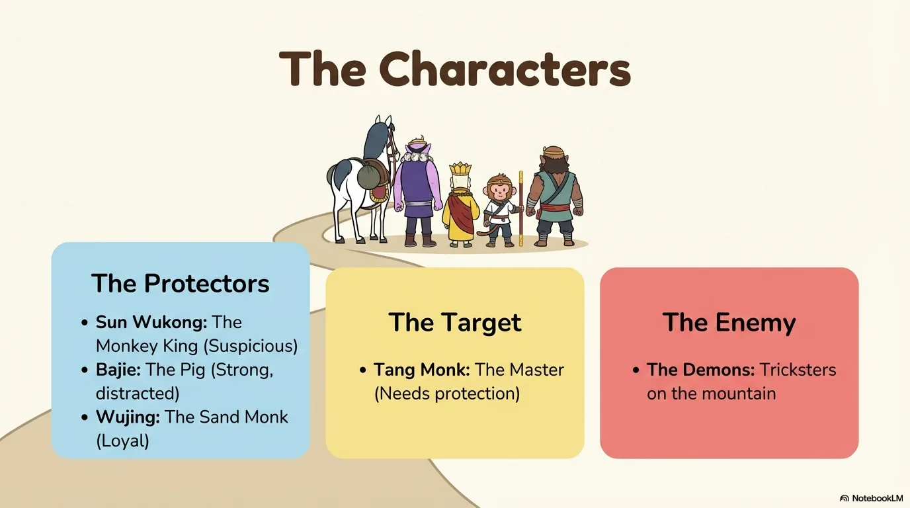

- 来源：`ppt/media/image4.png`（relationship `rId2`）
- 尺寸：1376×768
- 源 SHA-256：`9bf206153d8584a703e0da8183610f005ded5f8f2911a585bd289fde6656e333`
- 输出 SHA-256：`118ce6e01c062ef2e5b2ab25b65ec77a4831378cab90fe87aaa252adcd2d229c`
- 分类：unknown ｜ OCR：blocked ｜ 审核：unreviewed

## Slide 004

- 来源：`ppt/media/image5.png`（relationship `rId2`）
- 尺寸：1376×768
- 源 SHA-256：`c866ffb4fa2b716df9e2ed633cff61ae082f642e7864d3b148f7f56cce703a2c`
- 输出 SHA-256：`95663bf7a2c1889832d2dcef4ac9c7612f216ebae10501067893700f5ea23de7`
- 分类：unknown ｜ OCR：blocked ｜ 审核：unreviewed

## Slide 005

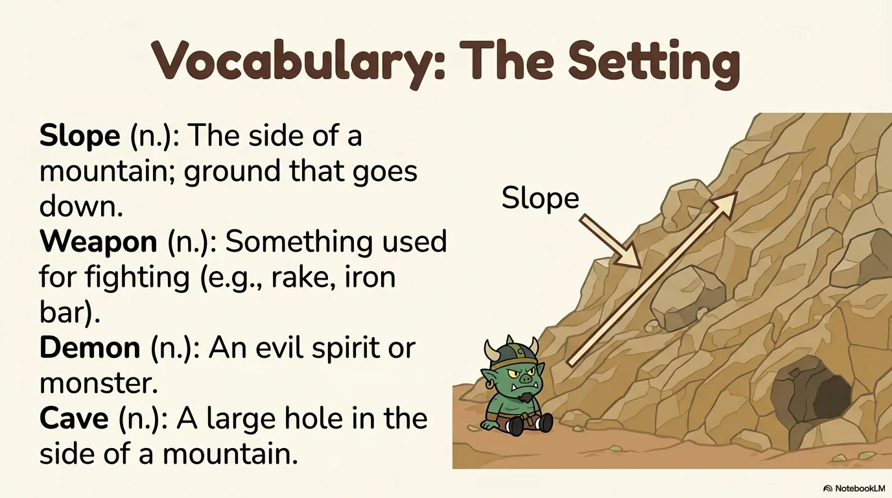

- 来源：`ppt/media/image6.png`（relationship `rId2`）
- 尺寸：1376×768
- 源 SHA-256：`066a36244462f51e9facb39c4180b493e0b481c9ca3e2842a24c2873e513c8b7`
- 输出 SHA-256：`ba5d9fa3d0843e45abd082a7e054d90607b0a318c689758d9f93b1e2411f0315`
- 分类：unknown ｜ OCR：blocked ｜ 审核：unreviewed

## Slide 006

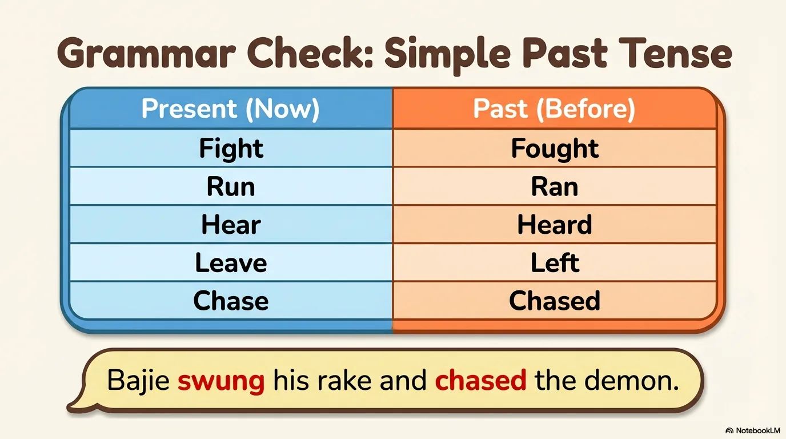

- 来源：`ppt/media/image7.png`（relationship `rId2`）
- 尺寸：1376×768
- 源 SHA-256：`1cd89b7fac47d7ce4537009299456ebcf2f923c74915e412467c676075edd2b5`
- 输出 SHA-256：`627b3394835e6185a1c9cdc198ee918d06b5444830042605f8f5ed7d45b45e05`
- 分类：unknown ｜ OCR：blocked ｜ 审核：unreviewed

## Slide 007

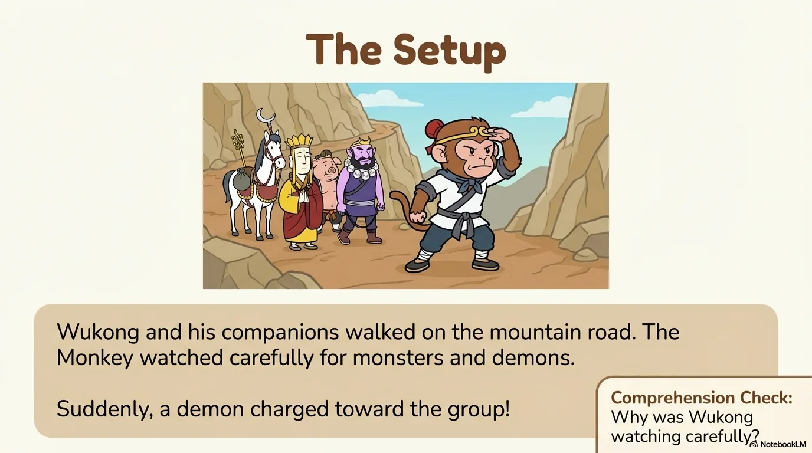

- 来源：`ppt/media/image8.png`（relationship `rId2`）
- 尺寸：1376×768
- 源 SHA-256：`5c3699df3ec78d4ca3124a321b1d2967b974875cf1775e603c7bdc90a6a96a8a`
- 输出 SHA-256：`4807228da533890c3ccbfe7f4ebb064888c86f12136261cbf9c6a58d588de73e`
- 分类：unknown ｜ OCR：blocked ｜ 审核：unreviewed

## Slide 008

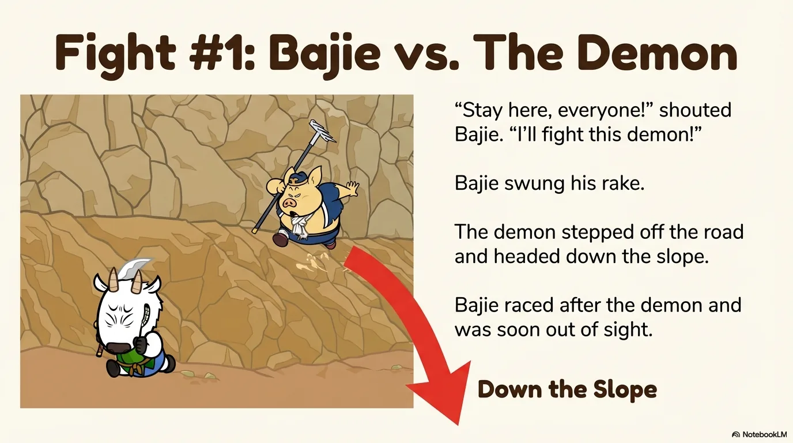

- 来源：`ppt/media/image9.png`（relationship `rId2`）
- 尺寸：1376×768
- 源 SHA-256：`3187b830714adcada82f3522e3d2d2ad1efd03a36dca64222acb9d4ea86cf30e`
- 输出 SHA-256：`6c662e5f843e5ec8478079f9bededfb5433b328f9275258988a81223d585bd6f`
- 分类：unknown ｜ OCR：blocked ｜ 审核：unreviewed

## Slide 009

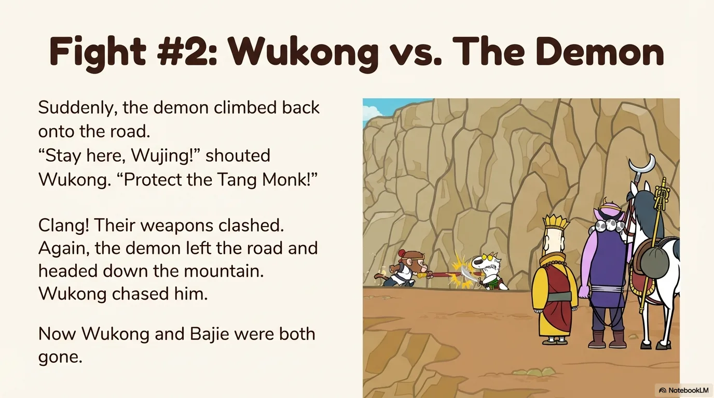

- 来源：`ppt/media/image10.png`（relationship `rId2`）
- 尺寸：1376×768
- 源 SHA-256：`ca3e5290634cc3a63b8ebddd0cddd095d42530bf650b516c27e2613975f1136b`
- 输出 SHA-256：`db1ca4686723ad594c6a6d08385548e04019a7a7ae6837f53b0250c250af50bf`
- 分类：unknown ｜ OCR：blocked ｜ 审核：unreviewed

## Slide 010

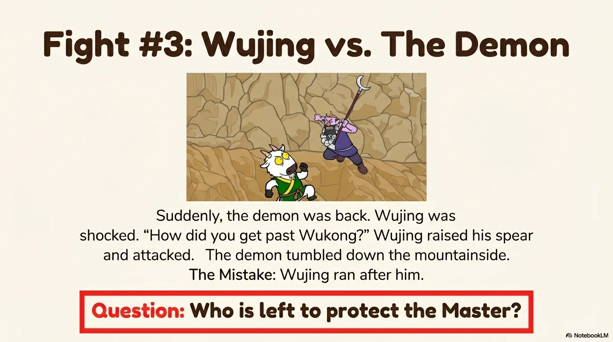

- 来源：`ppt/media/image11.png`（relationship `rId2`）
- 尺寸：1376×768
- 源 SHA-256：`4fd80ffc361677e6472892990cf63e7cfc33c341c06f815378f936649a9a0e24`
- 输出 SHA-256：`57dff730217415367dbd5a983c54893582dd4ede92ebb5c7c54773f404b74574`
- 分类：unknown ｜ OCR：blocked ｜ 审核：unreviewed

## Slide 011

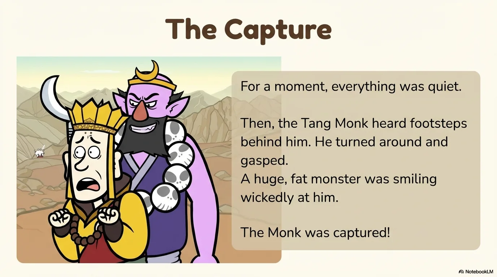

- 来源：`ppt/media/image12.png`（relationship `rId2`）
- 尺寸：1376×768
- 源 SHA-256：`d66ae03966837b392c86df925df987849559e2528c05fe98871ecf36a99879be`
- 输出 SHA-256：`f2bbe814a4d079fd251c17818fc32918b78917e455c4781fca11c0df6aac111c`
- 分类：unknown ｜ OCR：blocked ｜ 审核：unreviewed

## Slide 012

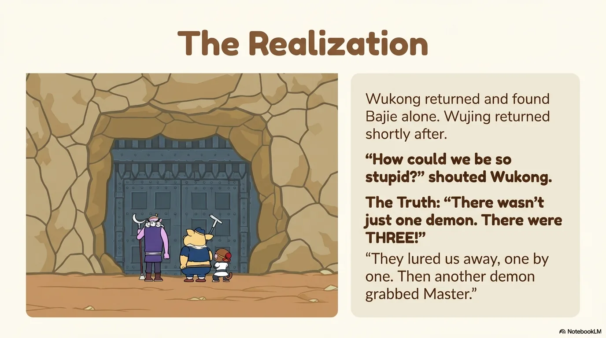

- 来源：`ppt/media/image13.png`（relationship `rId2`）
- 尺寸：1376×768
- 源 SHA-256：`4b2dc6517c2198da4a71207cfbd626bd53017e2bec11a61a29b818f8d9919481`
- 输出 SHA-256：`403957890117a980e1d20fc7a647cb0ac1b9378c3c6f780724ae25a0b1c41a5e`
- 分类：unknown ｜ OCR：blocked ｜ 审核：unreviewed

## Slide 013

- 来源：`ppt/media/image14.png`（relationship `rId2`）
- 尺寸：1376×768
- 源 SHA-256：`f4e4a2298a5124bba1a639af5b2c4f8b9553bdfbe8cad2f947fe39c3452f5757`
- 输出 SHA-256：`e8815bb59caaa45b13d68e3cc12edab42c356a4d9ea870732c2e8b7e919a3b35`
- 分类：unknown ｜ OCR：blocked ｜ 审核：unreviewed

## Slide 014

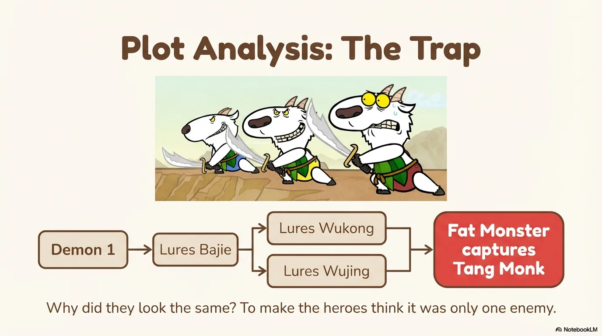

- 来源：`ppt/media/image15.png`（relationship `rId2`）
- 尺寸：1376×768
- 源 SHA-256：`516b5de4539491545a70b36c693669317140fbfdc884abbf77f318624d7ff6bb`
- 输出 SHA-256：`09bfec99851c9b761ce18341c03356608c5677f4ad190ee2b5678ff52bfe9e82`
- 分类：unknown ｜ OCR：blocked ｜ 审核：unreviewed

## Slide 015

- 来源：`ppt/media/image16.png`（relationship `rId2`）
- 尺寸：1376×768
- 源 SHA-256：`7c6250acf487c5d465749fb92ae3408ee04fdfd7d4eb37cdf37e78c01af08e44`
- 输出 SHA-256：`6b547cf5ee95e982d14fcca13b66195be385210039e9d053049c8850c6d3039f`
- 分类：unknown ｜ OCR：blocked ｜ 审核：unreviewed

## Slide 016

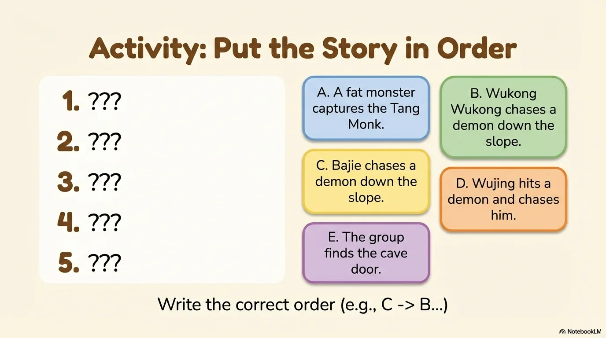

- 来源：`ppt/media/image17.png`（relationship `rId2`）
- 尺寸：1376×768
- 源 SHA-256：`7b7ff30765798850f327f809a53e3e137d01b698df7472c9061b4fd2449995f7`
- 输出 SHA-256：`b19d0b7f92fc25b955959a89c5f1ebd27b2f9804fabd4deb034333d38e836bfd`
- 分类：unknown ｜ OCR：blocked ｜ 审核：unreviewed

## Slide 017

- 来源：`ppt/media/image18.png`（relationship `rId2`）
- 尺寸：1376×768
- 源 SHA-256：`c7d91720375e3e52cd43f12d6ae5a8aa9f48c5d6021f27c6beb0a840aa7c618e`
- 输出 SHA-256：`00eb75317878ee14900b3da71029a836c1735a85f85d56d197c16764edaa4a94`
- 分类：unknown ｜ OCR：blocked ｜ 审核：unreviewed

## Slide 018

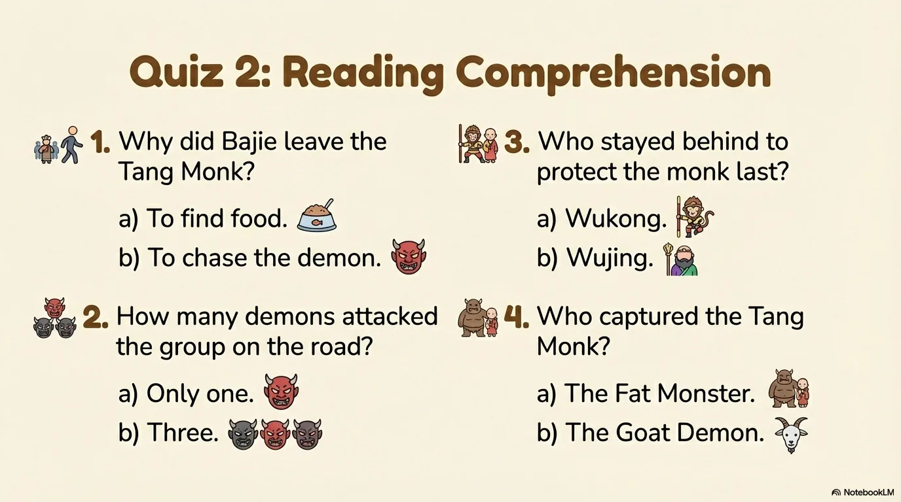

- 来源：`ppt/media/image19.png`（relationship `rId2`）
- 尺寸：1376×768
- 源 SHA-256：`7858151ff28b4a5440b373c769cb7361e1e15c055b093c99608e61794a73338d`
- 输出 SHA-256：`60d25ad2a3a1f8a17f477f033446758dfc58e6b26e7b73b7c652386ae2dffbae`
- 分类：unknown ｜ OCR：blocked ｜ 审核：unreviewed

## Slide 019

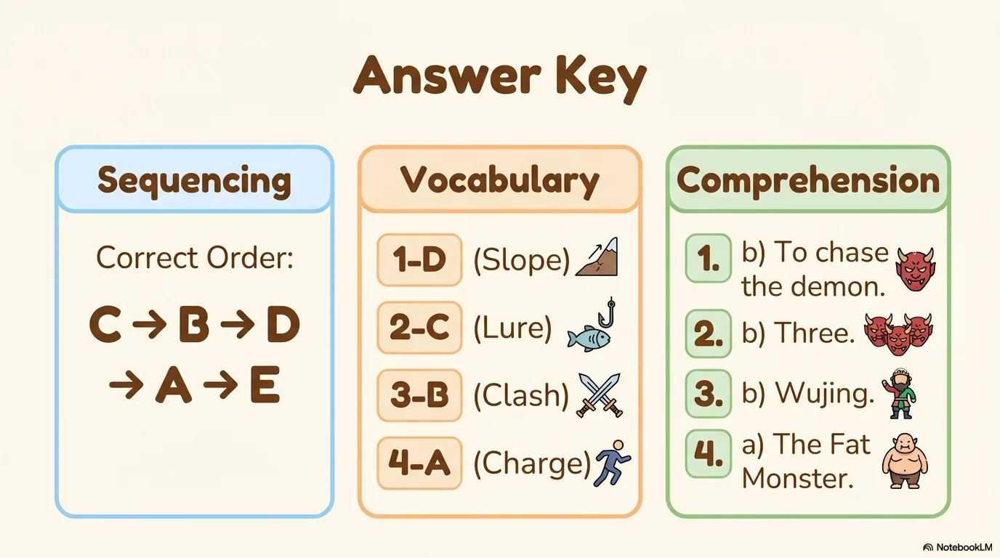

- 来源：`ppt/media/image20.png`（relationship `rId2`）
- 尺寸：1376×768
- 源 SHA-256：`0cfd1053f0ab1cc83d68528f053be9abba13c4b2df2146c78123be1621f5d47f`
- 输出 SHA-256：`2902b6c965b3511a0077e72be6a8bb9917343f3696934ceca14834ca81a0e6a7`
- 分类：unknown ｜ OCR：blocked ｜ 审核：unreviewed

## Slide 020

- 来源：`ppt/media/image21.png`（relationship `rId2`）
- 尺寸：1376×768
- 源 SHA-256：`e44b718c5c722b5ffb5a52b87fd10a722850293d3dba4b3f6a5227d8144f5764`
- 输出 SHA-256：`39607143ba5003092ff7f2ebe157632fb48b03fa8dcb51cb648ae4a14c7d098c`
- 分类：unknown ｜ OCR：blocked ｜ 审核：unreviewed
