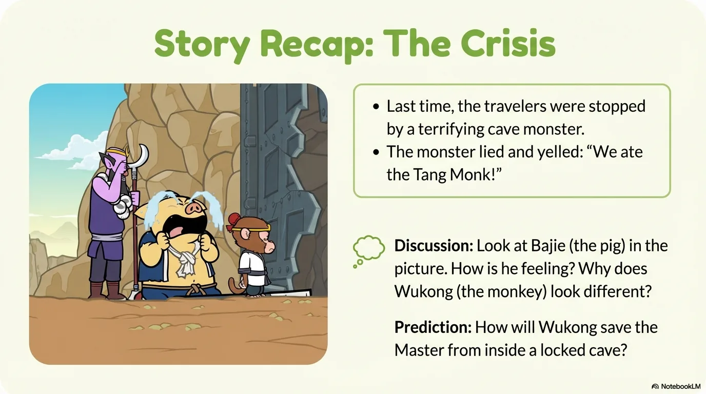
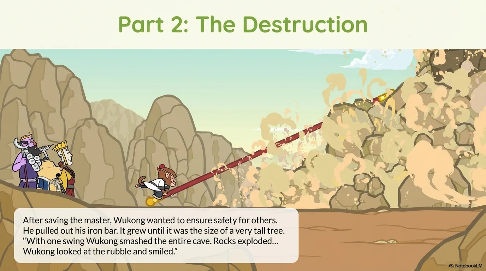
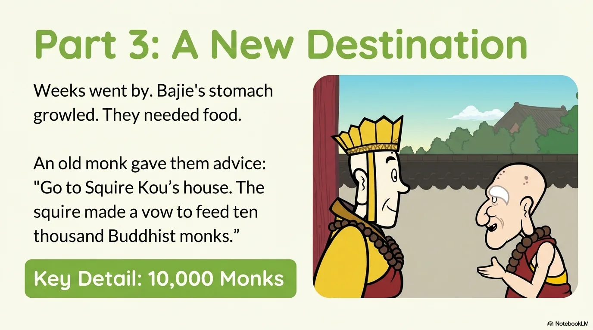
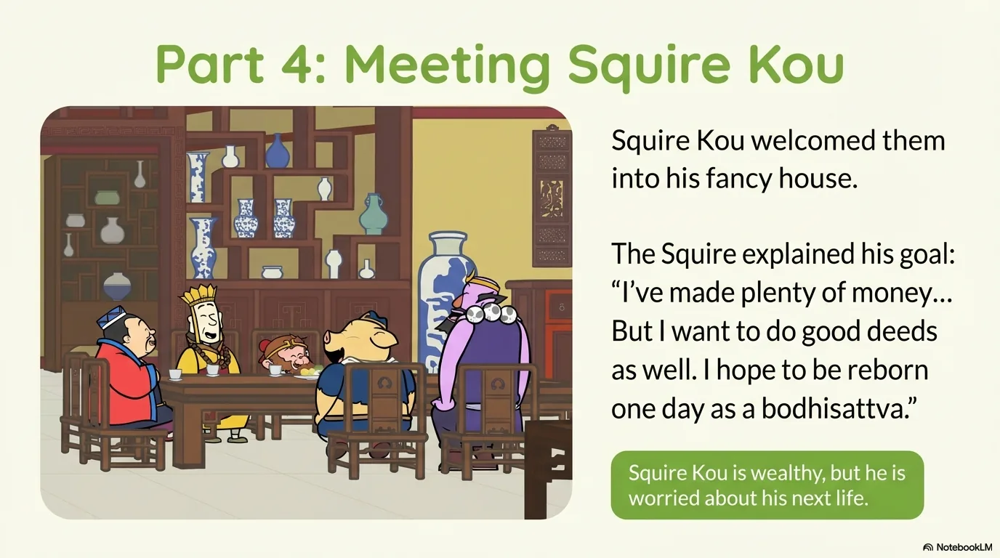
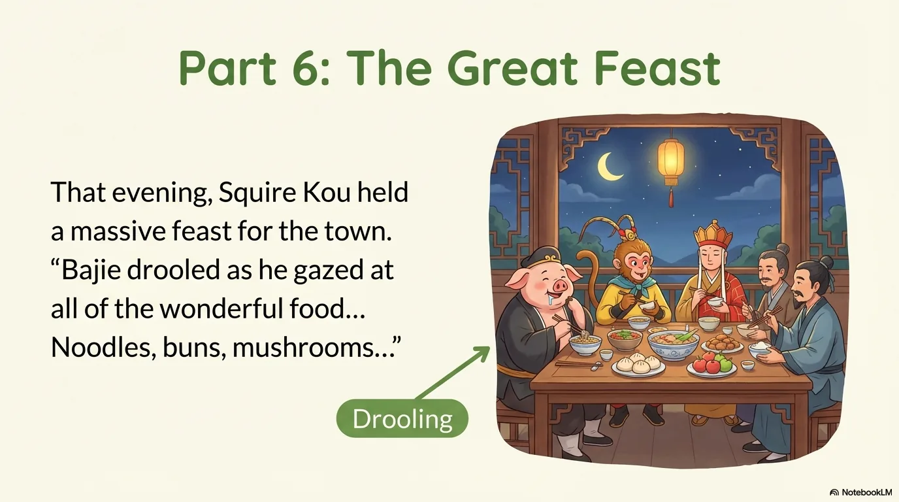
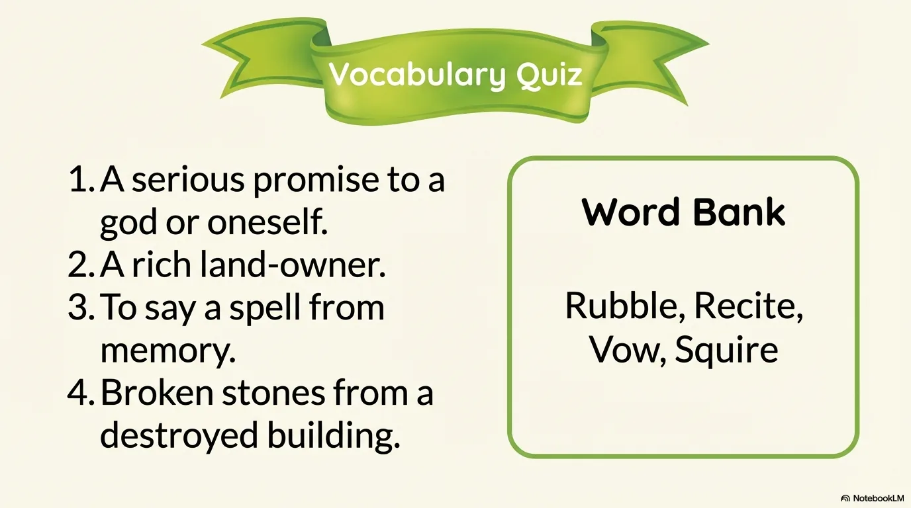
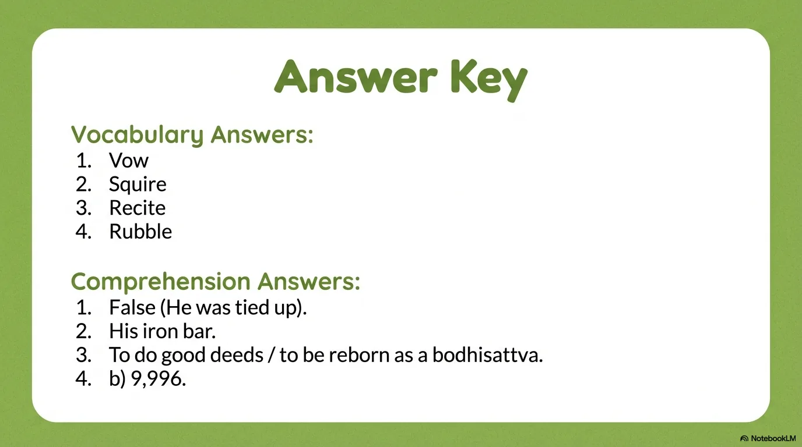
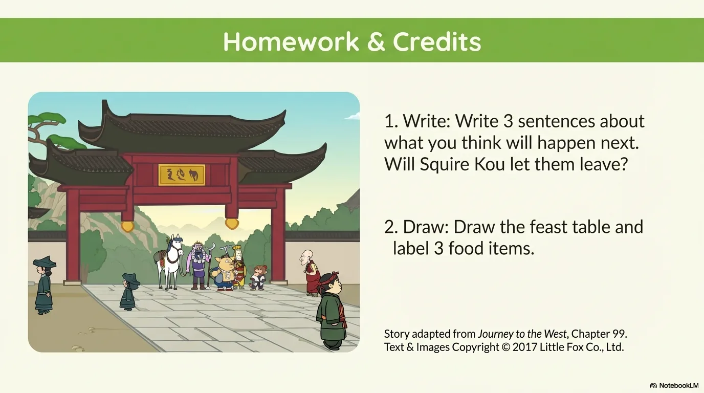

# 豆豆龙英语 · 第 99 集课件（EP099 草稿）

- 来源：`099_Journey to the West 99_Squire Kou's Vow.pptx`（主课件，20 页）
- OCR：`blocked`（no local OCR provider importable (pytesseract missing): No module named 'pytesseract'）
- 分类：待人工审核（unknown）
- 审核状态：`unreviewed`

## Slide 001

- 来源：`ppt/media/image1.png`（relationship `rId2`）
- 尺寸：1376×768
- 源 SHA-256：`dcb925bd29656a0a098a60ef0d78fda61adaa18ae2ff567ad642742b470ead32`
- 输出 SHA-256：`ef47c28775d294da7f97db1243d94dbfa6df3061be5638b8b37e4523b368dca2`
- 分类：unknown ｜ OCR：blocked ｜ 审核：unreviewed

## Slide 002

- 来源：`ppt/media/image3.png`（relationship `rId2`）
- 尺寸：1376×768
- 源 SHA-256：`f15684608e2fde7be8f63ccb03a5fb7d12ff28bd9fc8d018b7992ebbc475bf9e`
- 输出 SHA-256：`d619bc1c0ace2ddc6aa9758f1b0b67c170c04c8c36468afc2913cb57214558f9`
- 分类：unknown ｜ OCR：blocked ｜ 审核：unreviewed

## Slide 003

- 来源：`ppt/media/image4.png`（relationship `rId2`）
- 尺寸：1376×768
- 源 SHA-256：`e18796f26500d052f91063f323fae48a585448fd8ff34d73cecc36638373b634`
- 输出 SHA-256：`8e73b29dc74ab673f4016a6fe9ce8af15de2289dec7c1ce16e8cae37b634daf2`
- 分类：unknown ｜ OCR：blocked ｜ 审核：unreviewed

## Slide 004

- 来源：`ppt/media/image5.png`（relationship `rId2`）
- 尺寸：1376×768
- 源 SHA-256：`87d0c3d18d9ab72578caf9a18e093025c0adfb3182c80e3abc656172292d7d37`
- 输出 SHA-256：`d539fee8959cc6f25ff6ae211874b56f2eb544e0968dbde09de6b7dcba9869d9`
- 分类：unknown ｜ OCR：blocked ｜ 审核：unreviewed

## Slide 005

- 来源：`ppt/media/image6.png`（relationship `rId2`）
- 尺寸：1376×768
- 源 SHA-256：`60d0dea96bbcb2f7e3c7da347546e9607f4991f9e0f99d81ccc8bcc4dacb657a`
- 输出 SHA-256：`df14d3ae17b3738d9e4769701f5e891520c9764334b9c896e66aaaf4e9db36f2`
- 分类：unknown ｜ OCR：blocked ｜ 审核：unreviewed

## Slide 006

- 来源：`ppt/media/image7.png`（relationship `rId2`）
- 尺寸：1376×768
- 源 SHA-256：`cff659d186fc01283f19775e4d1bb8be3adc70f840cac016280f8b2b408cf06c`
- 输出 SHA-256：`40b4cb50321ed9223df5ce113696fbac0995aeef398c8f41250a071d1e373ef5`
- 分类：unknown ｜ OCR：blocked ｜ 审核：unreviewed

## Slide 007

- 来源：`ppt/media/image8.png`（relationship `rId2`）
- 尺寸：1376×768
- 源 SHA-256：`88af760a9c7203e8c3382f204ab5bc3d7988b63aa6443692cbe28586dfb33ba0`
- 输出 SHA-256：`674610b160e20561536370ead38a877b6f843db28b3681a8837b93776585f13d`
- 分类：unknown ｜ OCR：blocked ｜ 审核：unreviewed

## Slide 008

- 来源：`ppt/media/image9.png`（relationship `rId2`）
- 尺寸：1376×768
- 源 SHA-256：`06186e74f9de7a1517ca2ef2574445ad578523983647e1d328a688551dc50203`
- 输出 SHA-256：`56df52dbc3db06e41a612cb545cc3881bd660d5cd465125068699fab2ae64a14`
- 分类：unknown ｜ OCR：blocked ｜ 审核：unreviewed

## Slide 009

- 来源：`ppt/media/image10.png`（relationship `rId2`）
- 尺寸：1376×768
- 源 SHA-256：`529daae30cf750f763e670bd4040137df5759cbee13e6879c7256708b09e6327`
- 输出 SHA-256：`5065824c1795db672a3ce8f123d0bbb3e633633db4e8d9d784048c09d8b4a2a3`
- 分类：unknown ｜ OCR：blocked ｜ 审核：unreviewed

## Slide 010

- 来源：`ppt/media/image11.png`（relationship `rId2`）
- 尺寸：1376×768
- 源 SHA-256：`0a18d8258e52f75e5de259efc3fa5869887fdd4009b5d20e3d850a9cd1e955ba`
- 输出 SHA-256：`eedb288caa04aafa03dc513d9dc562a88e3fa46e09b55d9a3146d961b1ca6ecb`
- 分类：unknown ｜ OCR：blocked ｜ 审核：unreviewed

## Slide 011

- 来源：`ppt/media/image12.png`（relationship `rId2`）
- 尺寸：1376×768
- 源 SHA-256：`918807c44331ca997672191d9554cf37733099295f1712ddbd4069c31cbfd4b7`
- 输出 SHA-256：`12e88214c73988f4a9351345bc6be1570370008f311c2e46bb536585b71cea3a`
- 分类：unknown ｜ OCR：blocked ｜ 审核：unreviewed

## Slide 012

- 来源：`ppt/media/image13.png`（relationship `rId2`）
- 尺寸：1376×768
- 源 SHA-256：`8f714a63174e70121f7dafd7b392e58878f626c55fb9479e8c0cfe7f497df0d6`
- 输出 SHA-256：`280213775741428a1bc39cadf643ca9a75ef61c1a2742b3918dc7bd0c92bfe2c`
- 分类：unknown ｜ OCR：blocked ｜ 审核：unreviewed

## Slide 013

- 来源：`ppt/media/image14.png`（relationship `rId2`）
- 尺寸：1376×768
- 源 SHA-256：`61635d367e79d3da5cbe6119d58938d87d2717c480a12189664745f7993e5cc9`
- 输出 SHA-256：`8a5502cd4b040f2a3b132d665fac5e30e17f7dcc6aaa1632a81c1dc1ee7faac9`
- 分类：unknown ｜ OCR：blocked ｜ 审核：unreviewed

## Slide 014

- 来源：`ppt/media/image15.png`（relationship `rId2`）
- 尺寸：1376×768
- 源 SHA-256：`36062178e668bd678d398ba330564c13f00910c781943ec92bc399e1047a96f1`
- 输出 SHA-256：`36ed02fd86ec2b5ceaf30e7097eeb9bccd452ee68349568ef73a0ead4d759b27`
- 分类：unknown ｜ OCR：blocked ｜ 审核：unreviewed

## Slide 015

- 来源：`ppt/media/image16.png`（relationship `rId2`）
- 尺寸：1376×768
- 源 SHA-256：`5d5513a84da1375570f26e11421ff42a752dfdcf3217b00ab2bd7aed8095700a`
- 输出 SHA-256：`db3681cfcac2f627ba2e0759250d6f6c6283c3a126ae5295806a4f4bf4e830a8`
- 分类：unknown ｜ OCR：blocked ｜ 审核：unreviewed

## Slide 016

- 来源：`ppt/media/image17.png`（relationship `rId2`）
- 尺寸：1376×768
- 源 SHA-256：`70533eb0fafa828e38b2adfb662fe3958916ef6c812d0357a316a1e0f4f8c7ca`
- 输出 SHA-256：`28fa0812b4db212dc84f039b7bb6bc9f2793e8a4208453cd0717b4961425df2a`
- 分类：unknown ｜ OCR：blocked ｜ 审核：unreviewed

## Slide 017

- 来源：`ppt/media/image18.png`（relationship `rId2`）
- 尺寸：1376×768
- 源 SHA-256：`ec722d493bee11ff9725c97c1904f256ceceb8b0625170bab1d46747aad7abc6`
- 输出 SHA-256：`47a3a0dd3284968dc06e472cad6e9b6feb0d8555f2842512f88a7957e45cc8ea`
- 分类：unknown ｜ OCR：blocked ｜ 审核：unreviewed

## Slide 018

- 来源：`ppt/media/image19.png`（relationship `rId2`）
- 尺寸：1376×768
- 源 SHA-256：`d1b4db287e789da2e7e42f0727291e9e7034e710d2f532572a2700be39e5a3cd`
- 输出 SHA-256：`8094d584741c82968fb4ee8ae1cfca9f3eec2f61b06ab866c13d9f75d4ac2d35`
- 分类：unknown ｜ OCR：blocked ｜ 审核：unreviewed

## Slide 019

- 来源：`ppt/media/image20.png`（relationship `rId2`）
- 尺寸：1376×768
- 源 SHA-256：`898c7e4ab30665a5792391f95467047ea59a30b493c652c957ea81755dd0339c`
- 输出 SHA-256：`cc6531b392eb58bb672a9e250737e46e5ae407401abdeb2457db818faf66cc36`
- 分类：unknown ｜ OCR：blocked ｜ 审核：unreviewed

## Slide 020

- 来源：`ppt/media/image21.png`（relationship `rId2`）
- 尺寸：1376×768
- 源 SHA-256：`5acd5bb7eadd5e3bc5c00e162338fe397dd51a141a96972f551ce1b5cb1bbc96`
- 输出 SHA-256：`0040761dffc70eaa96bd40f4d8890cc4aa84561a6c7e97215acfd50e5c84e205`
- 分类：unknown ｜ OCR：blocked ｜ 审核：unreviewed
