# 豆豆龙英语 · 第 100 集课件（EP100 草稿）

- 来源：`100_Journey to the West 100_A Terrible Robbery.pptx`（主课件，20 页）
- OCR：`blocked`（no local OCR provider importable (pytesseract missing): No module named 'pytesseract'）
- 分类：待人工审核（unknown）
- 审核状态：`unreviewed`

## Slide 001

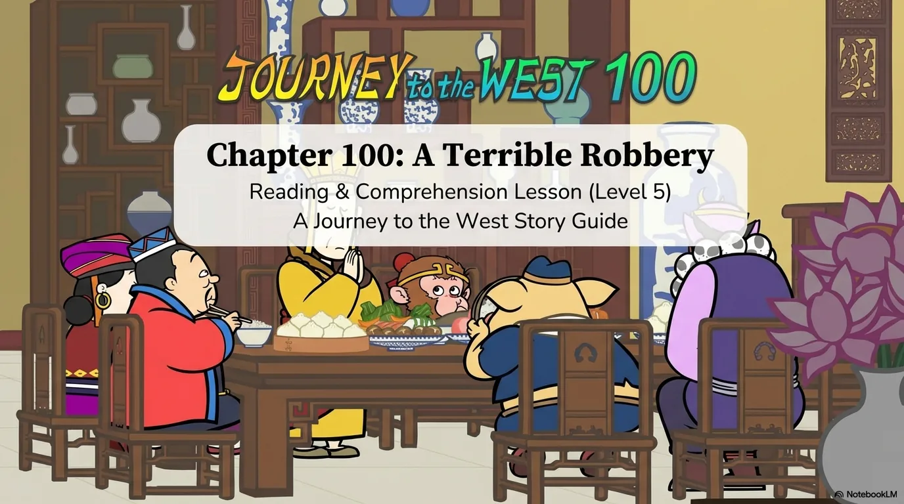

- 来源：`ppt/media/image1.png`（relationship `rId2`）
- 尺寸：1376×768
- 源 SHA-256：`9af4f37cfa329c889df651420f644a3fcfd48d928b8218c47f4aa151429a62cd`
- 输出 SHA-256：`018a340de7ca30218f66543794d203000a9a6dad65fece12c008dd3bd2881afd`
- 分类：unknown ｜ OCR：blocked ｜ 审核：unreviewed

## Slide 002

- 来源：`ppt/media/image3.png`（relationship `rId2`）
- 尺寸：1376×768
- 源 SHA-256：`b9300078ef415000c3e34a58348bf5ea05146e16134b06c6b3052d12e5e29db8`
- 输出 SHA-256：`eb0ce3b7adafc5adfd314e6fa54f408441bbda402ddc3ff7ac03e22a8ace8d9d`
- 分类：unknown ｜ OCR：blocked ｜ 审核：unreviewed

## Slide 003

- 来源：`ppt/media/image4.png`（relationship `rId2`）
- 尺寸：1376×768
- 源 SHA-256：`a4108c44909fa970953e3a1f7b62d1688704638a9b4fa162e13ad19cd8d93f93`
- 输出 SHA-256：`71a746f9354dd26a5a7208c356361aec404a4864529af7282db2de196bece556`
- 分类：unknown ｜ OCR：blocked ｜ 审核：unreviewed

## Slide 004

- 来源：`ppt/media/image5.png`（relationship `rId2`）
- 尺寸：1376×768
- 源 SHA-256：`c43d197603298ad0eed03a8059e8769ab7cb354a39e71e6e9b6de039f358e8e5`
- 输出 SHA-256：`a2352705b5696535577cece86524094a705efda286a7588c27611440e17cb604`
- 分类：unknown ｜ OCR：blocked ｜ 审核：unreviewed

## Slide 005

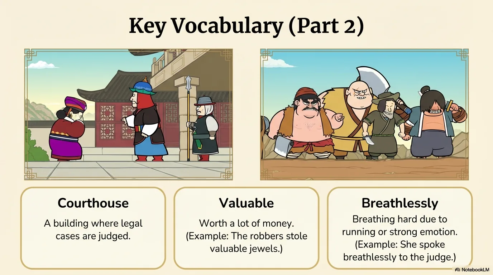

- 来源：`ppt/media/image6.png`（relationship `rId2`）
- 尺寸：1376×768
- 源 SHA-256：`5d3d2b7e858642e0209da2c6d334b3cab9f311515b261d28deb638b43b81c579`
- 输出 SHA-256：`a1f0b355ca1240c88085ce0ab7e5a7f717011197dab8f536d7b05ebc9c7bc673`
- 分类：unknown ｜ OCR：blocked ｜ 审核：unreviewed

## Slide 006

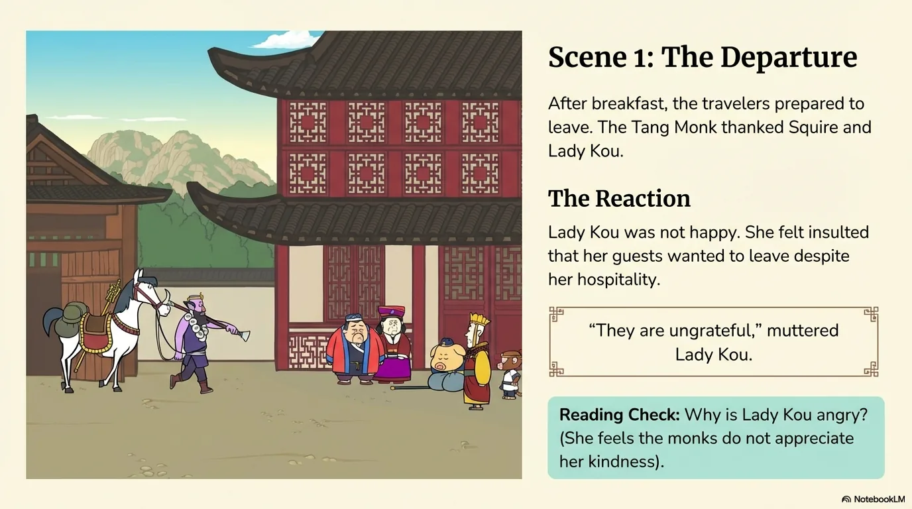

- 来源：`ppt/media/image7.png`（relationship `rId2`）
- 尺寸：1376×768
- 源 SHA-256：`0f7641043edce73ed011a1b9ab0a3a3732a75e04703151bd451503bb0a5a1a96`
- 输出 SHA-256：`42f50b78d9ac05bb1d3193ec688497af7cd42a6222e960e449162aa1b3cab393`
- 分类：unknown ｜ OCR：blocked ｜ 审核：unreviewed

## Slide 007

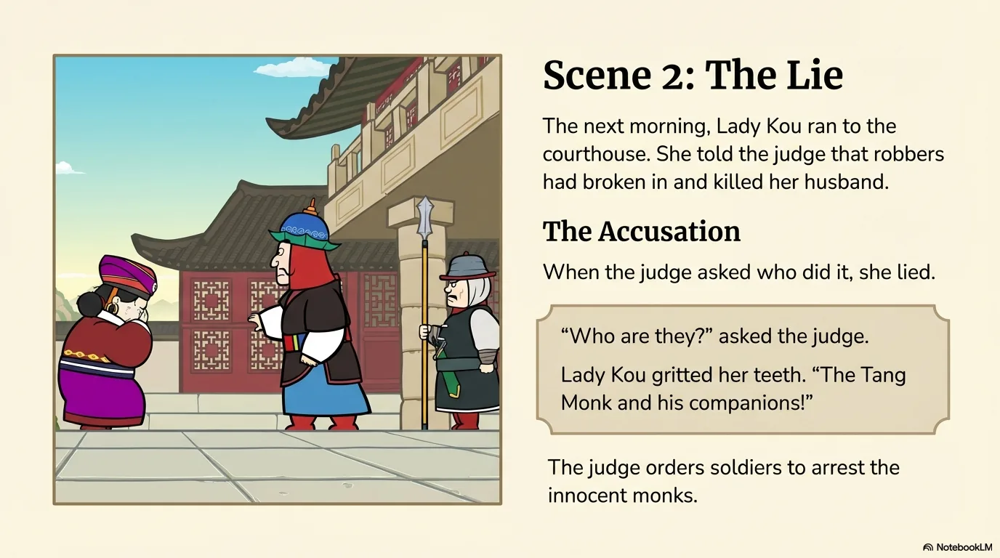

- 来源：`ppt/media/image8.png`（relationship `rId2`）
- 尺寸：1376×768
- 源 SHA-256：`ae642e946ed91171ddfd79bdd55949fd267263fd75e6baf9974dbabb051e6b65`
- 输出 SHA-256：`73062a4704e5dcd38ad1a91d47a4788b4fcc1b8014392484a3a03576d2d1ce23`
- 分类：unknown ｜ OCR：blocked ｜ 审核：unreviewed

## Slide 008

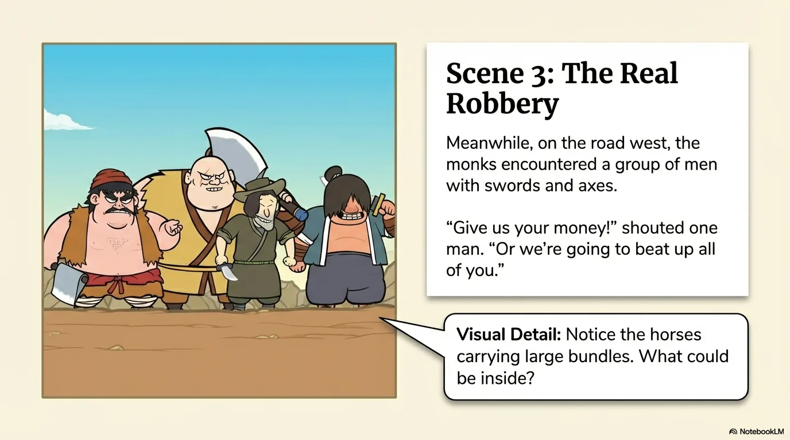

- 来源：`ppt/media/image9.png`（relationship `rId2`）
- 尺寸：1376×768
- 源 SHA-256：`5ffff3ab8a9cbd8caa6b627d77505a279ae76f3c06a80e239b95bda82f07b4b2`
- 输出 SHA-256：`9075f6cdaf93be19feadeff8f9413f47cc71cfb0bc9860373b21535864635fd0`
- 分类：unknown ｜ OCR：blocked ｜ 审核：unreviewed

## Slide 009

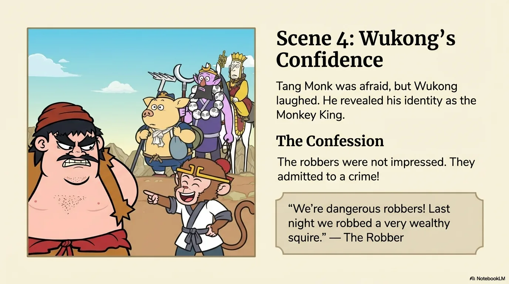

- 来源：`ppt/media/image10.png`（relationship `rId2`）
- 尺寸：1376×768
- 源 SHA-256：`6b7070654ef314e2ee2a1c90f0150b9950ddc97fd0e30e3b83b7c3b641efbe69`
- 输出 SHA-256：`1f3df631888e342cbc5274c93c60aa83f1ffa06a2f94dc629c2b059620aa2c7a`
- 分类：unknown ｜ OCR：blocked ｜ 审核：unreviewed

## Slide 010

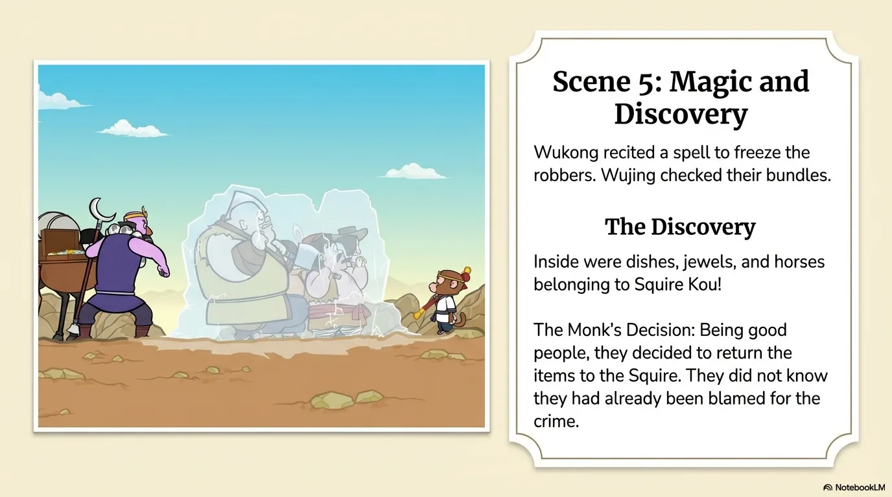

- 来源：`ppt/media/image11.png`（relationship `rId2`）
- 尺寸：1376×768
- 源 SHA-256：`8dbc82f7c6e3726619903b819caa8874bae823a3bca4fcd4b1d6f6c9ee04e964`
- 输出 SHA-256：`3e930eb3039c940cbe4fb5a9143c29de505bd22e67af4ca17411323636a3a0de`
- 分类：unknown ｜ OCR：blocked ｜ 审核：unreviewed

## Slide 011

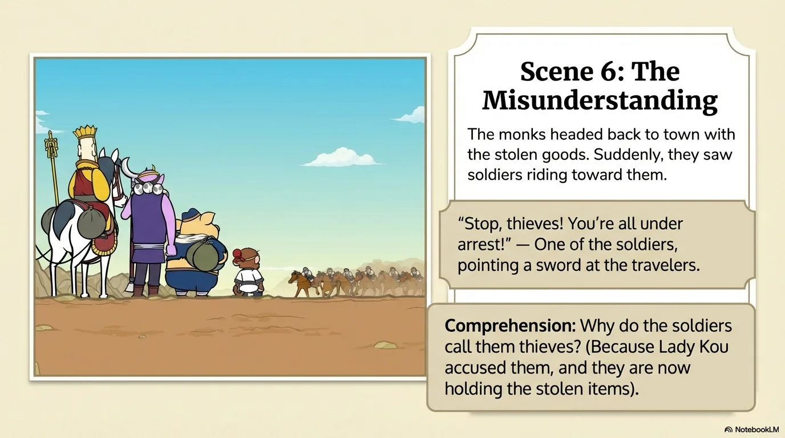

- 来源：`ppt/media/image12.png`（relationship `rId2`）
- 尺寸：1376×768
- 源 SHA-256：`d5066ac2736a6caa8d6215aa1d8970db2ade5a28ac23140983f938399b85e7d7`
- 输出 SHA-256：`0c81bad09e97aa51c5ab0267f5bff0f90fb7afc99c7a3317a78dd0c392ddfe1f`
- 分类：unknown ｜ OCR：blocked ｜ 审核：unreviewed

## Slide 012

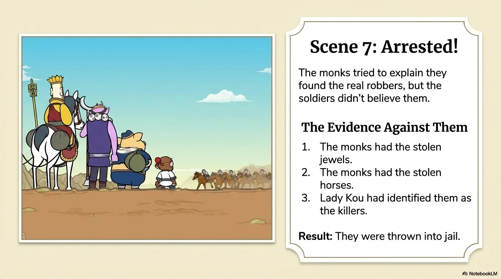

- 来源：`ppt/media/image13.png`（relationship `rId2`）
- 尺寸：1376×768
- 源 SHA-256：`25f0f0242d188f82609e9edf650d33b980a4e695ace5f820d955945df791f330`
- 输出 SHA-256：`97b4e7ba89c0cae53e7f810a2160db0d01b53ad9ead38f41b7b59c1ac8f9b021`
- 分类：unknown ｜ OCR：blocked ｜ 审核：unreviewed

## Slide 013

- 来源：`ppt/media/image14.png`（relationship `rId2`）
- 尺寸：1376×768
- 源 SHA-256：`da59a30b6ca63991cda8608d639f15b05d1b8f88888537a44d363753d4fd3d19`
- 输出 SHA-256：`ab69ddc0dd5679e122a5e91b8efdc45dc2173a76a9e5db518ab26e6e3e779a36`
- 分类：unknown ｜ OCR：blocked ｜ 审核：unreviewed

## Slide 014

- 来源：`ppt/media/image15.png`（relationship `rId2`）
- 尺寸：1376×768
- 源 SHA-256：`3727c7ea7b65744579f2162ecdb5e9eda3e25c42ff8a59c85fab4311f75794bf`
- 输出 SHA-256：`ba26c5e8fa04385db01c32e3793368d1a0ef0ed46b977b3a4c7676e12a3d209e`
- 分类：unknown ｜ OCR：blocked ｜ 审核：unreviewed

## Slide 015

- 来源：`ppt/media/image16.png`（relationship `rId2`）
- 尺寸：1376×768
- 源 SHA-256：`e07c48eeac34c0f5eccb1f8c54e855d717ac67330e537ac24db4af73a0e0bfaa`
- 输出 SHA-256：`c18d3d91f0e44b8e0693e7c5af2078114fb6784de4ee99557134c0b1204e961b`
- 分类：unknown ｜ OCR：blocked ｜ 审核：unreviewed

## Slide 016

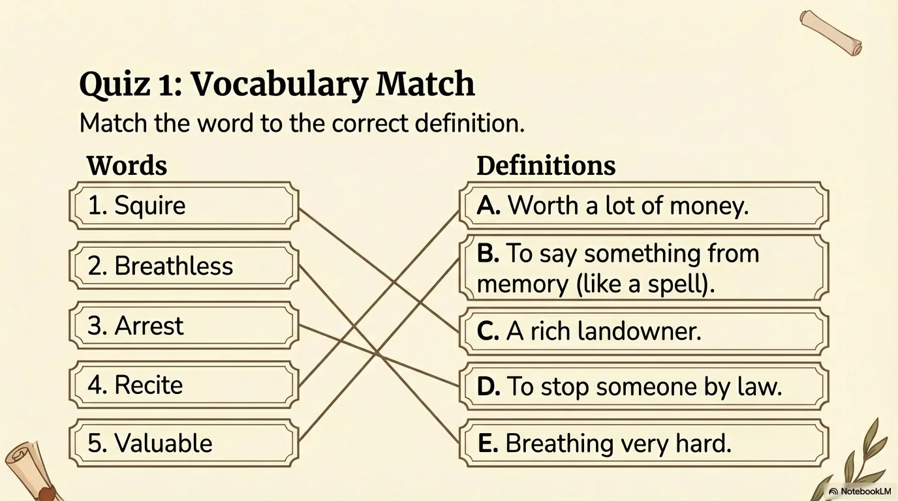

- 来源：`ppt/media/image17.png`（relationship `rId2`）
- 尺寸：1376×768
- 源 SHA-256：`12eeb2be9288590f7149ed28123c87ff844a8895911e9fb1194582602bc4b731`
- 输出 SHA-256：`cf75db4a91fc631f766a1d2f56f846e25f9851c3f85dc1dc8e64551ee4233372`
- 分类：unknown ｜ OCR：blocked ｜ 审核：unreviewed

## Slide 017

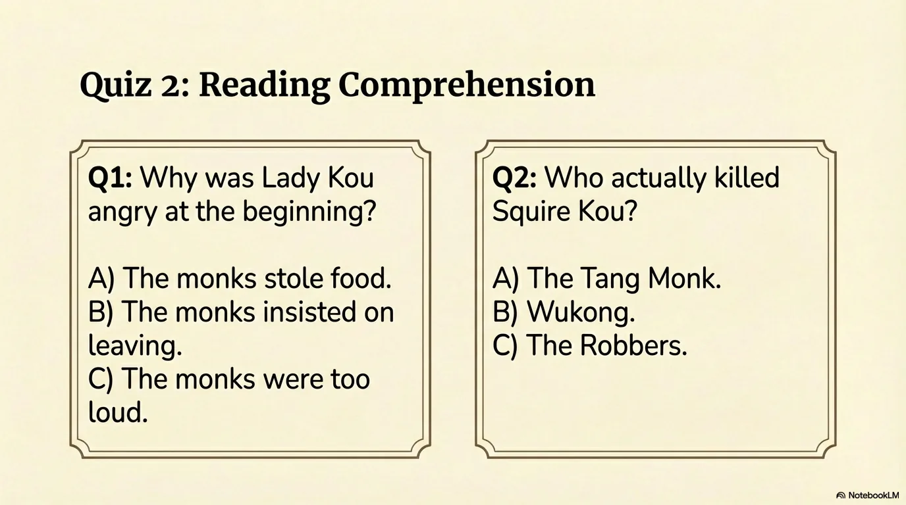

- 来源：`ppt/media/image18.png`（relationship `rId2`）
- 尺寸：1376×768
- 源 SHA-256：`f2228415cc08f4a23334bdf053f5eaaebd4a5a70a0b8d8a117d37e7fdfd454c2`
- 输出 SHA-256：`c7cc288bb577f1aa275b609e2fc82e4c45b233ed83b391382be97bbc4cb0df93`
- 分类：unknown ｜ OCR：blocked ｜ 审核：unreviewed

## Slide 018

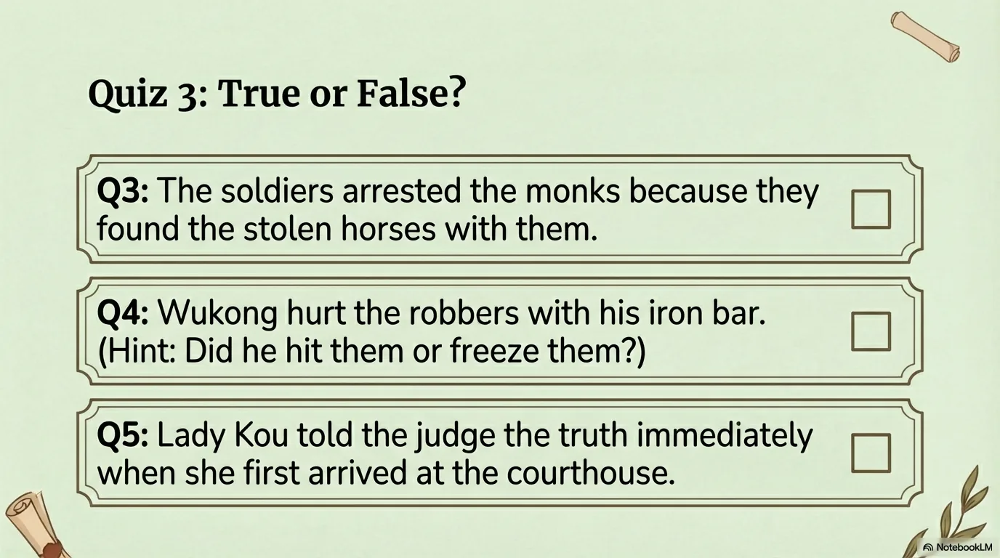

- 来源：`ppt/media/image19.png`（relationship `rId2`）
- 尺寸：1376×768
- 源 SHA-256：`1e16895bfcca3da82406b0111ffd820e055d3bd1b1bbb23aa6e6856814bdc500`
- 输出 SHA-256：`d43652c103b0be8e4be09af35dab10ab2915055f47736c54b463270bb93d1960`
- 分类：unknown ｜ OCR：blocked ｜ 审核：unreviewed

## Slide 019

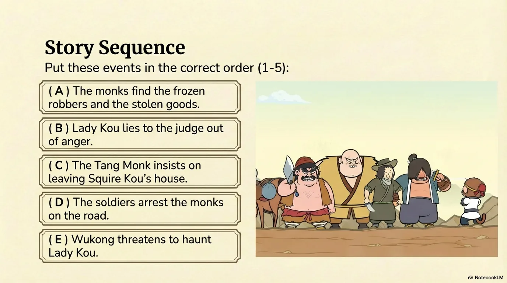

- 来源：`ppt/media/image20.png`（relationship `rId2`）
- 尺寸：1376×768
- 源 SHA-256：`8e3ae18ca7072cd52d31ccece9b2a7b018a4bb1c654a0451f249719f4ae822a2`
- 输出 SHA-256：`702b581ce18a902b16e39f89ff6bebdb300118ebb1bfd9d0de84d3b852696c9d`
- 分类：unknown ｜ OCR：blocked ｜ 审核：unreviewed

## Slide 020

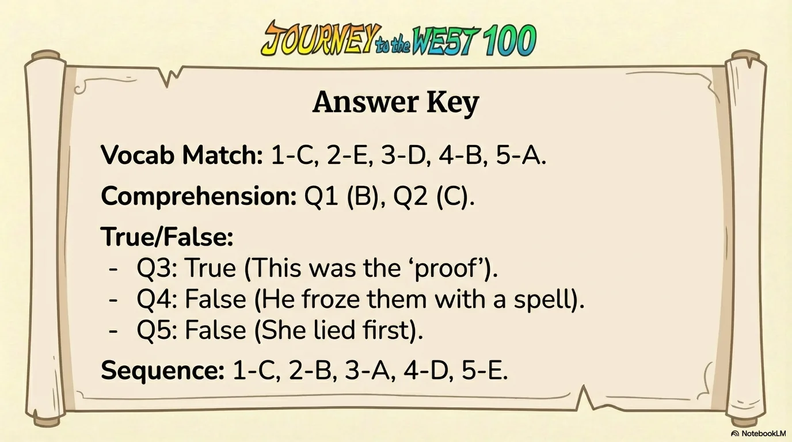

- 来源：`ppt/media/image21.png`（relationship `rId2`）
- 尺寸：1376×768
- 源 SHA-256：`9c9d14d77095fb88619532388f04f4e2445b1dae79d50f58e4643472385a37ed`
- 输出 SHA-256：`616e04924fa9c4ec6454c943cab2bd906365c1bdf6fa6a9a4d36c2e91cc36717`
- 分类：unknown ｜ OCR：blocked ｜ 审核：unreviewed
