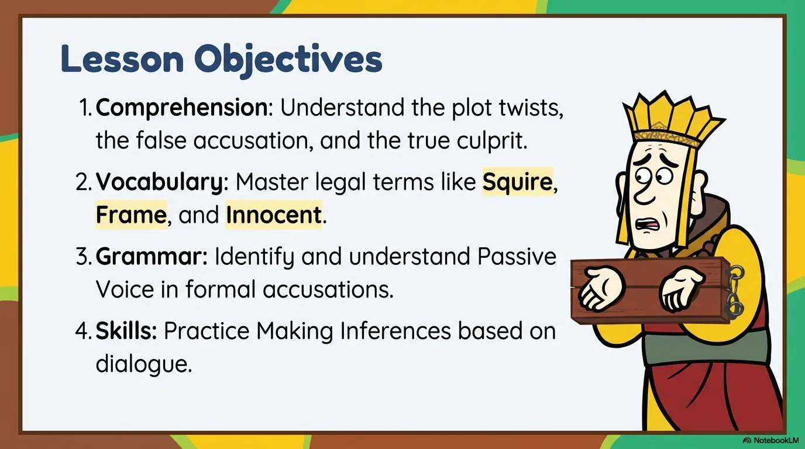
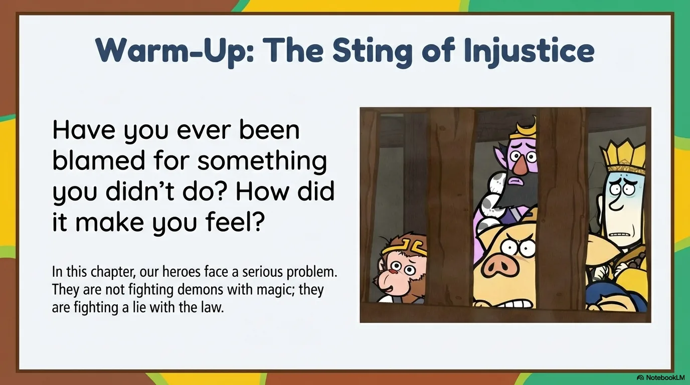
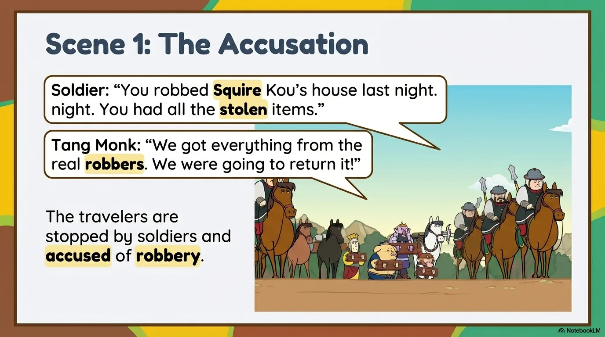
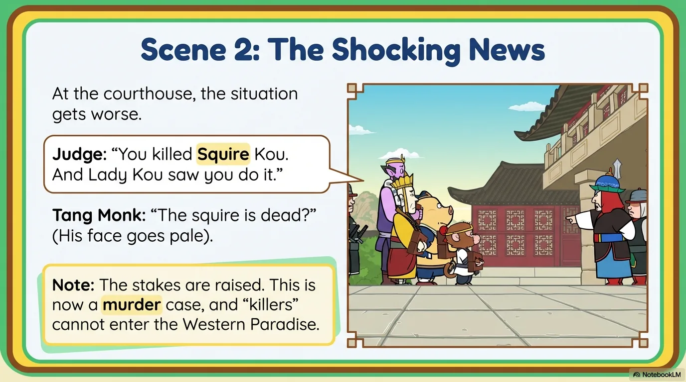
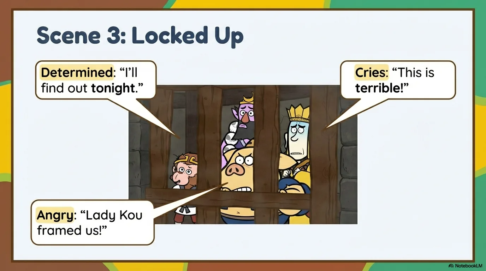
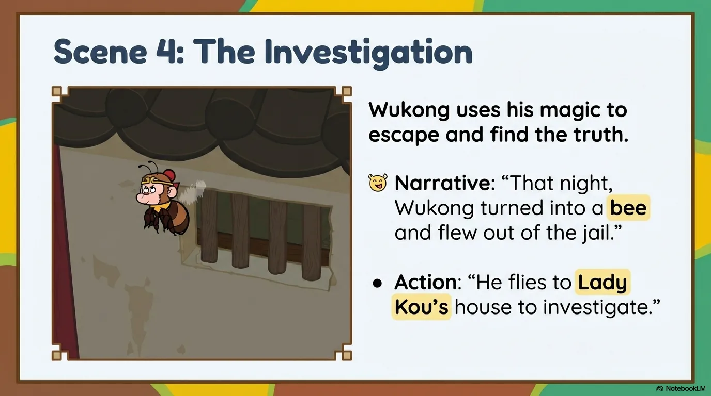
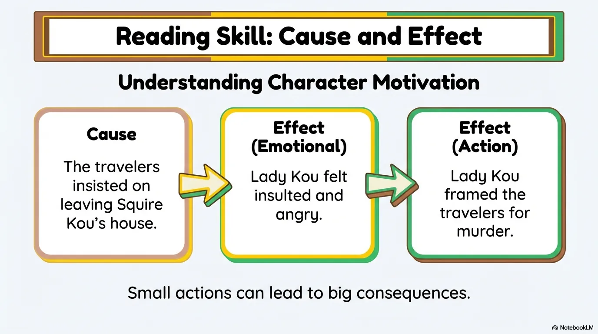
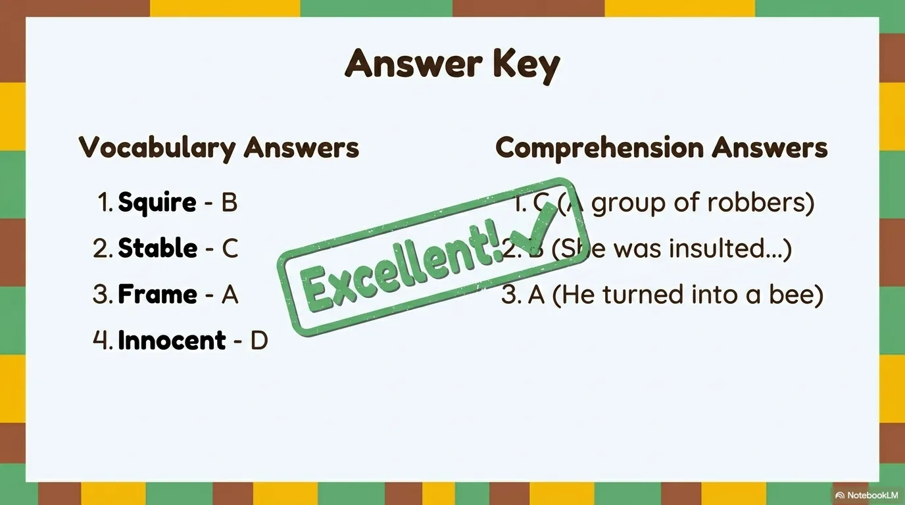

# 豆豆龙英语 · 第 101 集课件（EP101 草稿）

- 来源：`101_Journey to the West 101_Arrested!pptx.pptx`（主课件，20 页）
- OCR：`blocked`（no local OCR provider importable (pytesseract missing): No module named 'pytesseract'）
- 分类：待人工审核（unknown）
- 审核状态：`unreviewed`

## Slide 001

- 来源：`ppt/media/image1.png`（relationship `rId2`）
- 尺寸：1376×768
- 源 SHA-256：`30cee101b238f5fc87e7d69eb195d4b7dd508ec54d7ee181021d23bd644a07b2`
- 输出 SHA-256：`993d8d05b8bfdaad100cc95cb157134bd6ecaa0e277e033c7eb66b2ebfb166a1`
- 分类：unknown ｜ OCR：blocked ｜ 审核：unreviewed

## Slide 002

- 来源：`ppt/media/image3.png`（relationship `rId2`）
- 尺寸：1376×768
- 源 SHA-256：`5fee656793bd6f5130e862168cef1fed499e3451616b259aa09baca404f174d4`
- 输出 SHA-256：`15947140788092aa8c49660a597ba6424d87f13c1fb29d2baa7eb086e7d55034`
- 分类：unknown ｜ OCR：blocked ｜ 审核：unreviewed

## Slide 003

- 来源：`ppt/media/image4.png`（relationship `rId2`）
- 尺寸：1376×768
- 源 SHA-256：`1d6fe2a8ccf40d8a66d15e0d6f280479d5e649147903d0fe017e58dc69e0c93e`
- 输出 SHA-256：`bd9bb39cc502697e42eec0a083e891144e98d20dd928d63c12dd476028c2aba0`
- 分类：unknown ｜ OCR：blocked ｜ 审核：unreviewed

## Slide 004

- 来源：`ppt/media/image5.png`（relationship `rId2`）
- 尺寸：1376×768
- 源 SHA-256：`7bf478540076c0c874734036dc1f56604c4e3b118d300fd0111ddd8792935011`
- 输出 SHA-256：`60d12c985f69865058c4235383e0767cbaf0477b0723bf8a4e638e7aadc6229b`
- 分类：unknown ｜ OCR：blocked ｜ 审核：unreviewed

## Slide 005

- 来源：`ppt/media/image6.png`（relationship `rId2`）
- 尺寸：1376×768
- 源 SHA-256：`d336593b395deff8dfbbf53ae313bbfa8cfa892e3186c9d875b61d6d8a930f57`
- 输出 SHA-256：`f38ddb0aa6a665712980ba78fd8bb95e193feac5f466aebf945f1293891030a3`
- 分类：unknown ｜ OCR：blocked ｜ 审核：unreviewed

## Slide 006

- 来源：`ppt/media/image7.png`（relationship `rId2`）
- 尺寸：1376×768
- 源 SHA-256：`a9bcbff68005dfabde9950262ccc7591923ecc5356d17e90e81edcacdaeb2353`
- 输出 SHA-256：`55af73b032a92505c4e46226f01f3ed685cf9064ce03da84c329158e00676f08`
- 分类：unknown ｜ OCR：blocked ｜ 审核：unreviewed

## Slide 007

- 来源：`ppt/media/image8.png`（relationship `rId2`）
- 尺寸：1376×768
- 源 SHA-256：`2e586b46d7749bb286c4017b933f6dc49ca6f08bee2a6eb9f5a6fb8fdd20477e`
- 输出 SHA-256：`2b7eca419a62c28ae6fff1bb8ebd4c599271f600cec342fc712aafb8ce5f2a2c`
- 分类：unknown ｜ OCR：blocked ｜ 审核：unreviewed

## Slide 008

- 来源：`ppt/media/image9.png`（relationship `rId2`）
- 尺寸：1376×768
- 源 SHA-256：`8d9d5122a4a99982d959e27b7f45ea94f65a39293ab4c6829b95706d46cab93e`
- 输出 SHA-256：`5027f561964f7a0c39b98af93175b3ed83d541b190bd2e6f23935b644e65d029`
- 分类：unknown ｜ OCR：blocked ｜ 审核：unreviewed

## Slide 009

- 来源：`ppt/media/image10.png`（relationship `rId2`）
- 尺寸：1376×768
- 源 SHA-256：`c5cedea6b0925bf3463e2372cc071c35d8ac7312836843c80a7c98f85d38b790`
- 输出 SHA-256：`cd10a26964460feadb14cb2e91d2f0f4864d4889c6414c0c97b167841d1f83ab`
- 分类：unknown ｜ OCR：blocked ｜ 审核：unreviewed

## Slide 010

- 来源：`ppt/media/image11.png`（relationship `rId2`）
- 尺寸：1376×768
- 源 SHA-256：`e67d218a3d844f918789ee1eaf7fb6a8ad60b1ac640b6e799d8f7b0670a5e6b1`
- 输出 SHA-256：`6c0c434e240ef588262cd4f671bd9f6d39572249aa02874ad3fb53c3cfbcfc79`
- 分类：unknown ｜ OCR：blocked ｜ 审核：unreviewed

## Slide 011

- 来源：`ppt/media/image12.png`（relationship `rId2`）
- 尺寸：1376×768
- 源 SHA-256：`9a4fdca14833953e3b18431b444046c6cd94d81562e86eb127ef2ce0cf3a6c92`
- 输出 SHA-256：`caa4a0acf9c0f40236dff7ac4cec38547f42dc1a8dd8e8b569bb8379d80e56cc`
- 分类：unknown ｜ OCR：blocked ｜ 审核：unreviewed

## Slide 012

- 来源：`ppt/media/image13.png`（relationship `rId2`）
- 尺寸：1376×768
- 源 SHA-256：`c27b0008de2ac52fab5491d13b8e4f94786bea42d428b05ea5cd834fa0b4751b`
- 输出 SHA-256：`dc4d5ea0799c45d273342da673a2104788f0efc32c615ee9bfb8109c51a966a9`
- 分类：unknown ｜ OCR：blocked ｜ 审核：unreviewed

## Slide 013

- 来源：`ppt/media/image14.png`（relationship `rId2`）
- 尺寸：1376×768
- 源 SHA-256：`2cb1902101b1ca97531dce49a43a9d88d77e759494cab6c4121dc36d2d8cdc14`
- 输出 SHA-256：`1b35e0010f6c434ec28b892dfcff8539c5e17f65990347cf8cf3e9b692000d11`
- 分类：unknown ｜ OCR：blocked ｜ 审核：unreviewed

## Slide 014

- 来源：`ppt/media/image15.png`（relationship `rId2`）
- 尺寸：1376×768
- 源 SHA-256：`a03ce6c5c15e828bf8b75cb14b13d4e750c75a5b0a699606b6bc6f855661ca3c`
- 输出 SHA-256：`e62cdd24474e6f2caa8f79ac3908f1991bfc0981f9eab452d42d68fac56e4569`
- 分类：unknown ｜ OCR：blocked ｜ 审核：unreviewed

## Slide 015

- 来源：`ppt/media/image16.png`（relationship `rId2`）
- 尺寸：1376×768
- 源 SHA-256：`886e4d2d934fe66a5c636e272bd2c5acc873bfd7651b53dfd3c67eb19e809a93`
- 输出 SHA-256：`f415605385a073197a9cb7917b9099d043b7961740788a64d6488d8b39030477`
- 分类：unknown ｜ OCR：blocked ｜ 审核：unreviewed

## Slide 016

- 来源：`ppt/media/image17.png`（relationship `rId2`）
- 尺寸：1376×768
- 源 SHA-256：`7445dd1233649ac948a7c3ffeca91be12f37bff14d89a93a1211be166f64a5e9`
- 输出 SHA-256：`0274bd55ea43fbdc28dd3bd01616e1a04a9a5cf8b76b82658511a3b371aa4dc3`
- 分类：unknown ｜ OCR：blocked ｜ 审核：unreviewed

## Slide 017

- 来源：`ppt/media/image18.png`（relationship `rId2`）
- 尺寸：1376×768
- 源 SHA-256：`d920bbd1012f8c6220beb42dc3507143fe897e81b99eb2bb695ed8d4e16d17d8`
- 输出 SHA-256：`006ffcd1b609c94dbb04a2706a381673dbb2d23de5fac196c99394519b58cf77`
- 分类：unknown ｜ OCR：blocked ｜ 审核：unreviewed

## Slide 018

- 来源：`ppt/media/image19.png`（relationship `rId2`）
- 尺寸：1376×768
- 源 SHA-256：`bcd82891bb97ccb843923ae4a339c0ea75068b2cc7da013aefffb055546e94e8`
- 输出 SHA-256：`ad08c589e71d2658a243026b6315233730beae1076930ee352d1286166dcbb51`
- 分类：unknown ｜ OCR：blocked ｜ 审核：unreviewed

## Slide 019

- 来源：`ppt/media/image20.png`（relationship `rId2`）
- 尺寸：1376×768
- 源 SHA-256：`a09c23f42e3f7c78cfb712c2aadce96e9684d4a6c0f6a484ef6215be482dabe9`
- 输出 SHA-256：`46f122a15199b78e2ab2b6cc5e12bbe4dbd8d44b94dcae80889e659dcf82fe6f`
- 分类：unknown ｜ OCR：blocked ｜ 审核：unreviewed

## Slide 020

- 来源：`ppt/media/image21.png`（relationship `rId2`）
- 尺寸：1376×768
- 源 SHA-256：`e4b8dce25b72c8dfa469e674632179cfd4d22b4f5f088367f1e20f5d0043307f`
- 输出 SHA-256：`de0fa9ccace7510d39772ece62c383a9c0c3041ad6341cf9f1f2bf34fa2cb6ed`
- 分类：unknown ｜ OCR：blocked ｜ 审核：unreviewed
