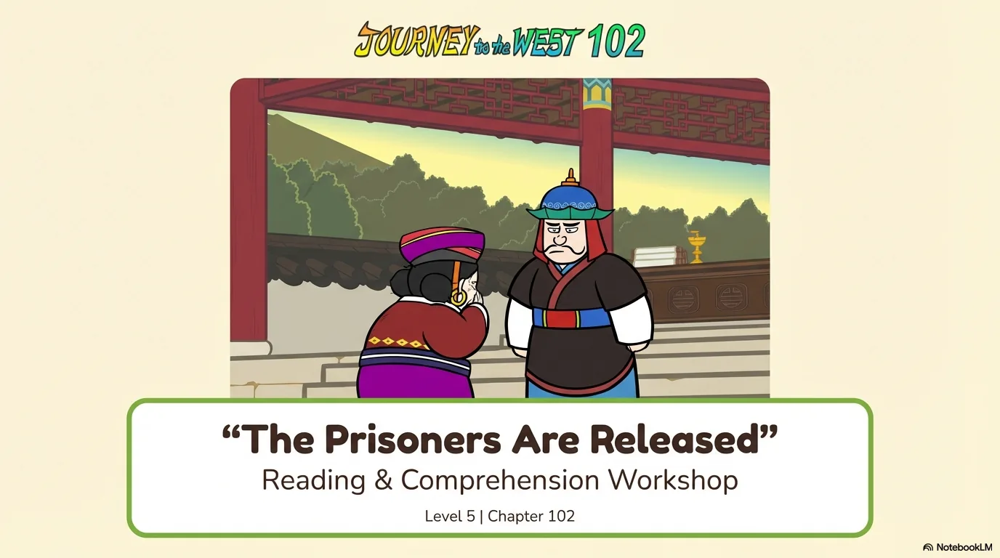
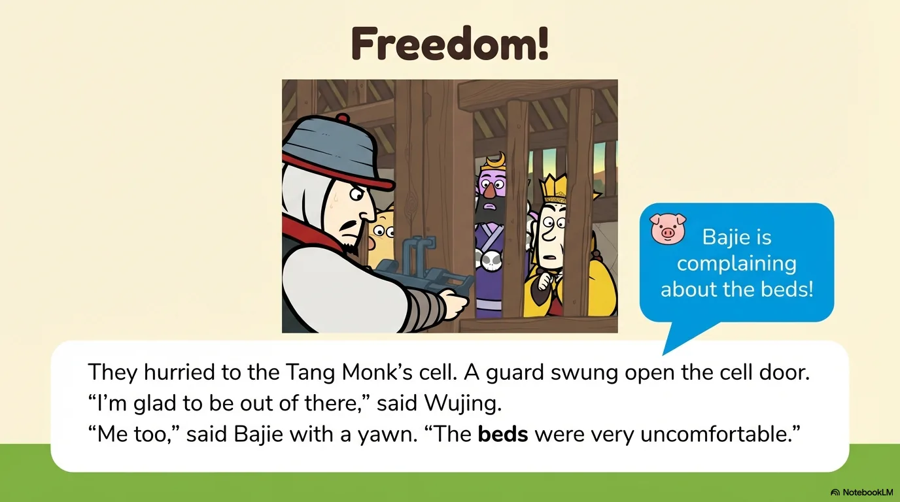
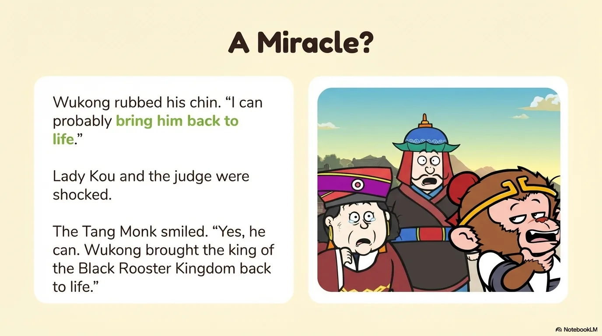
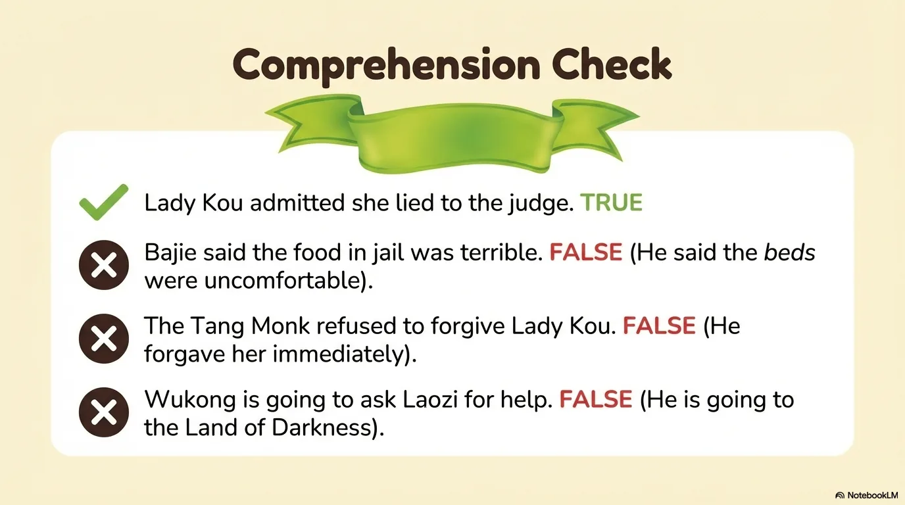
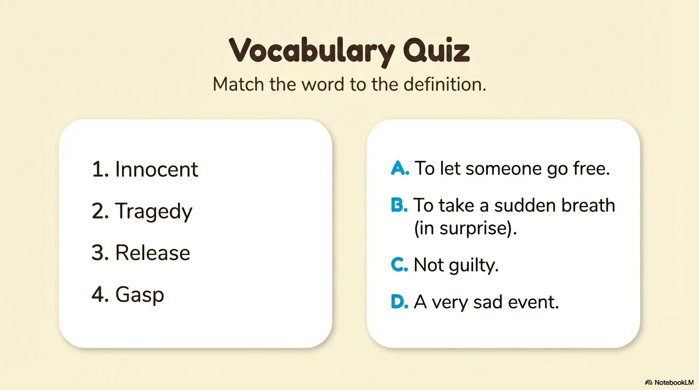
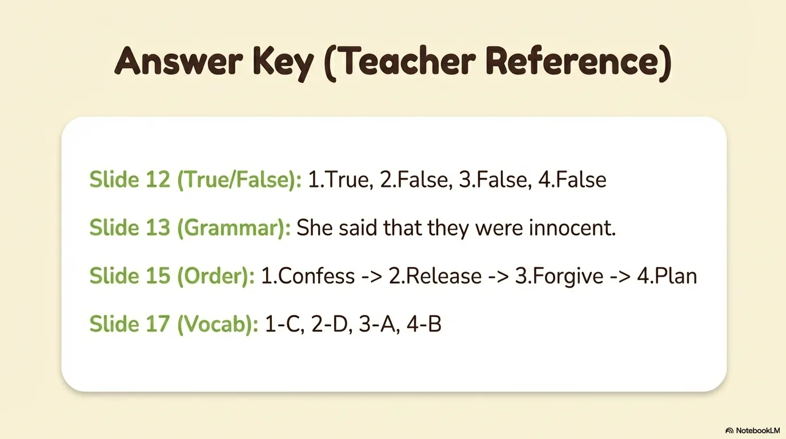
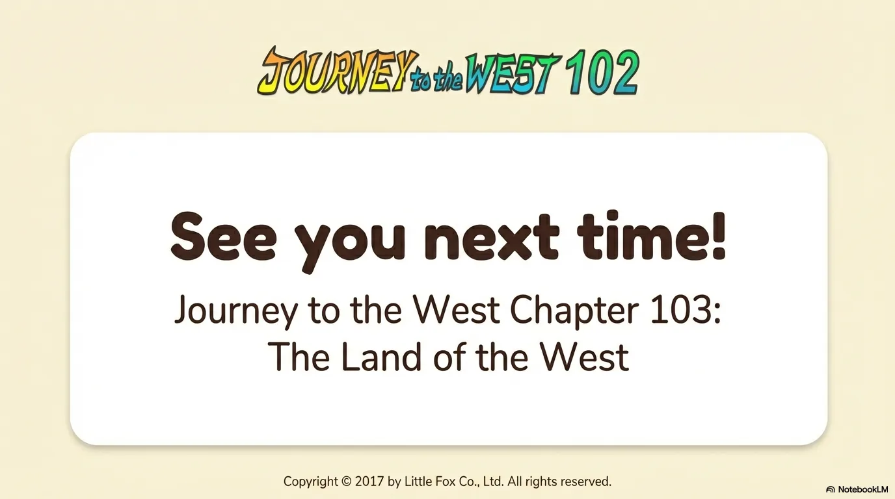

# 豆豆龙英语 · 第 102 集课件（EP102 草稿）

- 来源：`102_Journey to the West 102_The Prisoners Are Released.pptx`（主课件，20 页）
- OCR：`blocked`（no local OCR provider importable (pytesseract missing): No module named 'pytesseract'）
- 分类：待人工审核（unknown）
- 审核状态：`unreviewed`

## Slide 001

- 来源：`ppt/media/image1.png`（relationship `rId2`）
- 尺寸：1376×768
- 源 SHA-256：`0eea02997ba772be627257998dae3e09b0189ebdc10e84d18f20e972f82cc0f0`
- 输出 SHA-256：`daf5eb3d1f75ea5ac9e131ad25434acc5bf803a74aee0db06f823c568b043400`
- 分类：unknown ｜ OCR：blocked ｜ 审核：unreviewed

## Slide 002

- 来源：`ppt/media/image3.png`（relationship `rId2`）
- 尺寸：1376×768
- 源 SHA-256：`0cb5fdad84e69c9999ef9ad3fb9c4e2e2ad1007e19562ad3140bfb071b4b2e1c`
- 输出 SHA-256：`b2d262bcfd52a2faa9b8224d0341fd4bedc5f4cef345b7344a81c4e43307525d`
- 分类：unknown ｜ OCR：blocked ｜ 审核：unreviewed

## Slide 003

- 来源：`ppt/media/image4.png`（relationship `rId2`）
- 尺寸：1376×768
- 源 SHA-256：`47d6c8d5b49c578227b72a03c0ea76a12d174da23a1f7ee59119f29068fadae5`
- 输出 SHA-256：`766f74330303c2579a1e20f38b2a78394e992e0a5e2ac2591680e2bf0b4a3d61`
- 分类：unknown ｜ OCR：blocked ｜ 审核：unreviewed

## Slide 004

- 来源：`ppt/media/image5.png`（relationship `rId2`）
- 尺寸：1376×768
- 源 SHA-256：`5788fc4e8f2d1e1d5935c5e42f9e27c4d37acbdee20842f807749ae9ab527028`
- 输出 SHA-256：`92b7742eb3b184020782aa2b821306968c8e9108b66622a88d87a3cef5def244`
- 分类：unknown ｜ OCR：blocked ｜ 审核：unreviewed

## Slide 005

- 来源：`ppt/media/image6.png`（relationship `rId2`）
- 尺寸：1376×768
- 源 SHA-256：`6004508281545380ec0b3beaffb1abf8487b8f8881565f76b14f3a8a6cde3f46`
- 输出 SHA-256：`faaa54e91c73fa5a9ca7e88c76eaa12d4405d746d4f47603197ade6dc4122953`
- 分类：unknown ｜ OCR：blocked ｜ 审核：unreviewed

## Slide 006

- 来源：`ppt/media/image7.png`（relationship `rId2`）
- 尺寸：1376×768
- 源 SHA-256：`f2879a98a0907acf55da9a5623d67aa1d5eab0f1de50594af56ad05bcd3913ff`
- 输出 SHA-256：`2f39931aa59429f3428f948bf65e13693db6acd41f1f932097bbd3c87dfdeef7`
- 分类：unknown ｜ OCR：blocked ｜ 审核：unreviewed

## Slide 007

- 来源：`ppt/media/image8.png`（relationship `rId2`）
- 尺寸：1376×768
- 源 SHA-256：`8058606a22601a4058aaca6c351ddfcdae5c9fcb5d4ffca59726ed7991f3ff83`
- 输出 SHA-256：`f1deb63325f63c3d3651548b4d8b55d41695efbb3906e95e5221e6e0b961413e`
- 分类：unknown ｜ OCR：blocked ｜ 审核：unreviewed

## Slide 008

- 来源：`ppt/media/image9.png`（relationship `rId2`）
- 尺寸：1376×768
- 源 SHA-256：`5d4c312251e57340c8335945a5ca04764abc6a6fca7c9f962aa7733bf51c0848`
- 输出 SHA-256：`eb2d172c53df71c447399bf8d88fb9711187844294364ed63f3fabf7e8b5cdb4`
- 分类：unknown ｜ OCR：blocked ｜ 审核：unreviewed

## Slide 009

- 来源：`ppt/media/image10.png`（relationship `rId2`）
- 尺寸：1376×768
- 源 SHA-256：`b720f5cea38a75d42870651988d76cda37a594eb4074ebee5f0beb5a63403774`
- 输出 SHA-256：`48a94f753ae97215f8784d6076847cd854dddf7b46999a23901536b4c65f0d15`
- 分类：unknown ｜ OCR：blocked ｜ 审核：unreviewed

## Slide 010

- 来源：`ppt/media/image11.png`（relationship `rId2`）
- 尺寸：1376×768
- 源 SHA-256：`5ee2704bb170b76be383c5633b4679dcf42e8c5d13cdbe951b748e66d9ff1000`
- 输出 SHA-256：`d2500703d28a2fee3a32e14a30384849c836e18a5c410546b838960547b93591`
- 分类：unknown ｜ OCR：blocked ｜ 审核：unreviewed

## Slide 011

- 来源：`ppt/media/image12.png`（relationship `rId2`）
- 尺寸：1376×768
- 源 SHA-256：`0cbe4990ad49855369abeaad55c18096a8b8cb405b3fc9c08ab95e448e03d696`
- 输出 SHA-256：`90f4f82ba358202a7a24d6743f01a109b436a9cbd2b371c21372b31417b2986c`
- 分类：unknown ｜ OCR：blocked ｜ 审核：unreviewed

## Slide 012

- 来源：`ppt/media/image13.png`（relationship `rId2`）
- 尺寸：1376×768
- 源 SHA-256：`a7f32c02ebdbb26751842ebc561b0343dda051e36077721ae0fe60a46b9595c3`
- 输出 SHA-256：`dcfded57a4db03672b47cb5e75f47d41b978fc06c027fd72ac706a92ef329b39`
- 分类：unknown ｜ OCR：blocked ｜ 审核：unreviewed

## Slide 013

- 来源：`ppt/media/image14.png`（relationship `rId2`）
- 尺寸：1376×768
- 源 SHA-256：`e3d65ed4ca6f4e95c429ce746d9347c2c56c5bbc0fc0517894a593997838ef8d`
- 输出 SHA-256：`a0c05bd7125586e3048a717068db3c91ede1938f091bc48af1ad644e86c2d2f6`
- 分类：unknown ｜ OCR：blocked ｜ 审核：unreviewed

## Slide 014

- 来源：`ppt/media/image15.png`（relationship `rId2`）
- 尺寸：1376×768
- 源 SHA-256：`70dced9b62da0b42405c531d2de0ef3bf0eddb8af1c22b68f32309ed3c0ad083`
- 输出 SHA-256：`5e32af8bb02ad8aad4cad7c7e31d19739b4e12eb8dda94bd3b84b7af588bfa8c`
- 分类：unknown ｜ OCR：blocked ｜ 审核：unreviewed

## Slide 015

- 来源：`ppt/media/image16.png`（relationship `rId2`）
- 尺寸：1376×768
- 源 SHA-256：`ece4339065de11b813ea9044e7f699880ae09c1e78dde8686b07e363e5015c74`
- 输出 SHA-256：`f025735acfe24e42f82ebb283a2380509875fc9bf705491de8e5521789aaf4fb`
- 分类：unknown ｜ OCR：blocked ｜ 审核：unreviewed

## Slide 016

- 来源：`ppt/media/image17.png`（relationship `rId2`）
- 尺寸：1376×768
- 源 SHA-256：`b814f280a333fdc0c467a5715ce302129890b0eec148218ac51081ef40de1944`
- 输出 SHA-256：`dea69ec12796a3affdfb438d2ee5229094132cfbe944316909cd5459fc2f3d08`
- 分类：unknown ｜ OCR：blocked ｜ 审核：unreviewed

## Slide 017

- 来源：`ppt/media/image18.png`（relationship `rId2`）
- 尺寸：1376×768
- 源 SHA-256：`acf64ca257d4353af952be676e853201ac6ecdff27098c3d20bf3247268e60a6`
- 输出 SHA-256：`2b40f15e37ecce61e833a1c29042494e51c26337a178612804b175f8cabf7e32`
- 分类：unknown ｜ OCR：blocked ｜ 审核：unreviewed

## Slide 018

- 来源：`ppt/media/image19.png`（relationship `rId2`）
- 尺寸：1376×768
- 源 SHA-256：`d9c256ce3551bc0e21c7dcfa68ee7637783a6da3ee2152cc773c51a982939748`
- 输出 SHA-256：`d07583ab87e4767c93ae8adfcbdf785435673faaacaa9691148c148f4b87c14a`
- 分类：unknown ｜ OCR：blocked ｜ 审核：unreviewed

## Slide 019

- 来源：`ppt/media/image20.png`（relationship `rId2`）
- 尺寸：1376×768
- 源 SHA-256：`8c6a7e477aaa77940e0bd947e001e88998fbfee3597aa670d4e4ff3bcee9a4f4`
- 输出 SHA-256：`4da287a06a06f7e6df783872c12f48431b485109bffa3a4c69cdd323794beaa7`
- 分类：unknown ｜ OCR：blocked ｜ 审核：unreviewed

## Slide 020

- 来源：`ppt/media/image21.png`（relationship `rId2`）
- 尺寸：1376×768
- 源 SHA-256：`ba28310b7d9c50664eab4142187d57500f1fca1ccbed4b5cd5ee5f9b76fac271`
- 输出 SHA-256：`3cc4b901841229e908d18211952aa7b34c36bb7f1455f3910f0b984350d7e2cf`
- 分类：unknown ｜ OCR：blocked ｜ 审核：unreviewed
