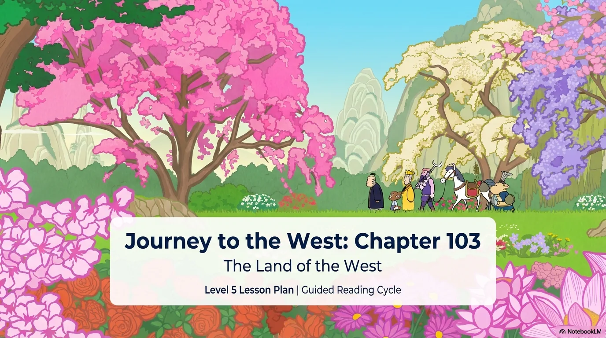
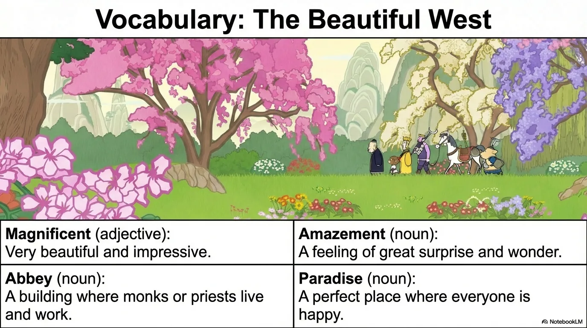
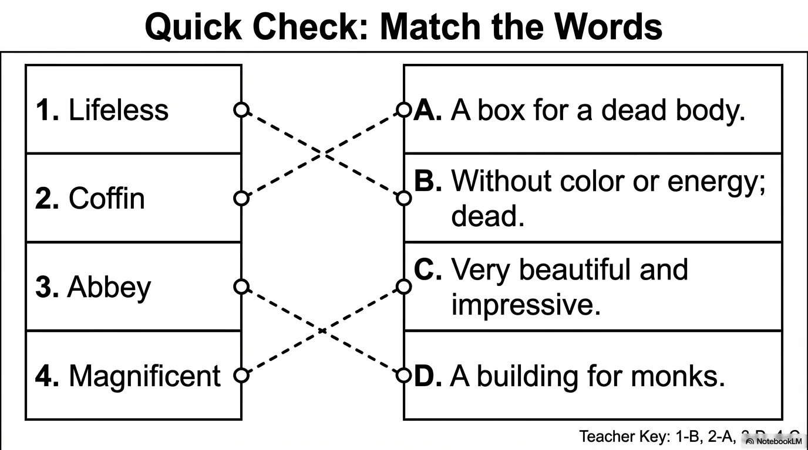
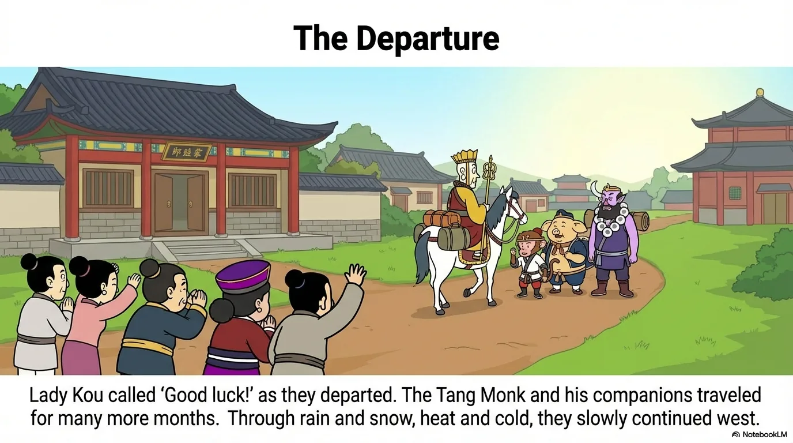
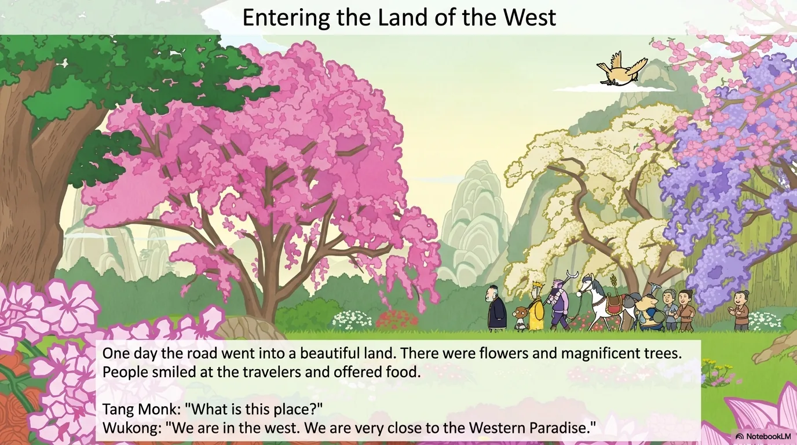
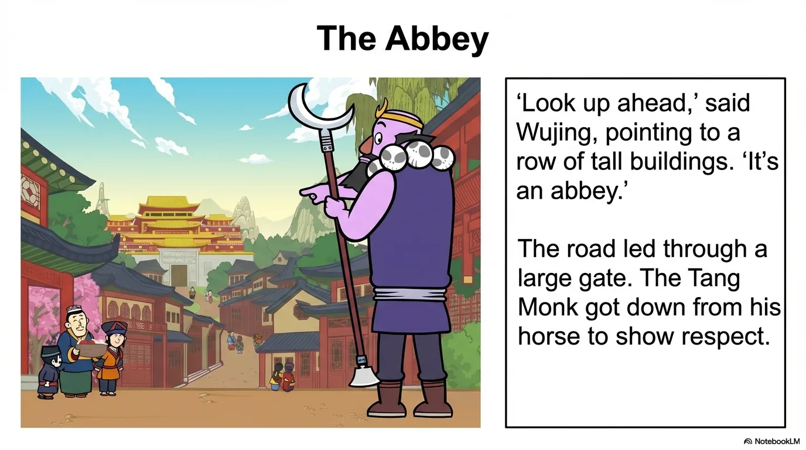
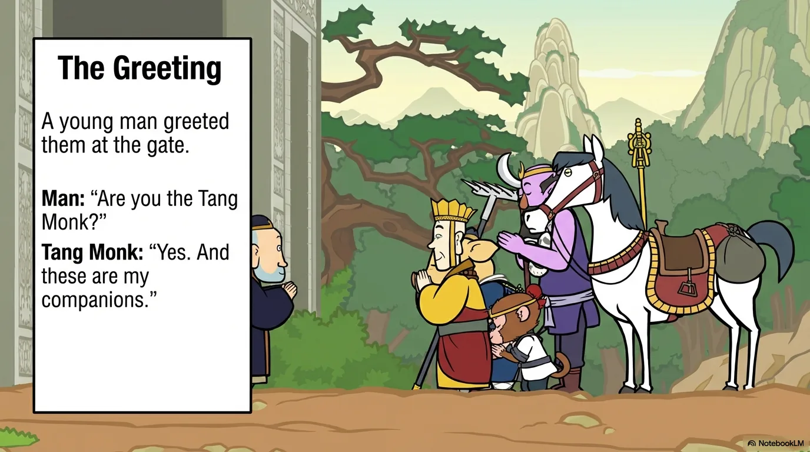
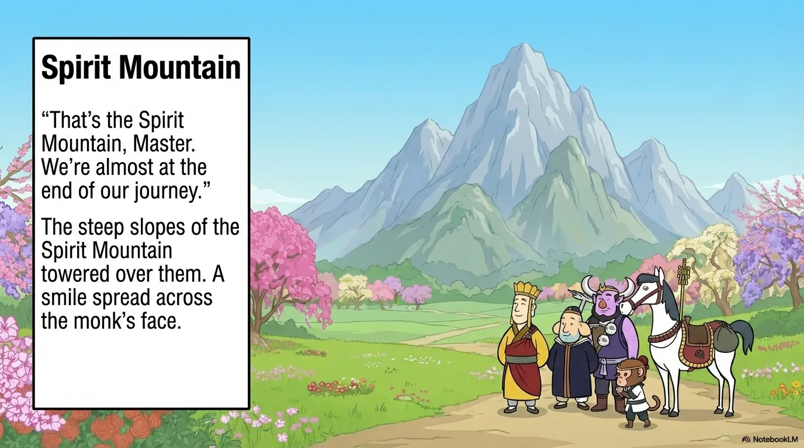
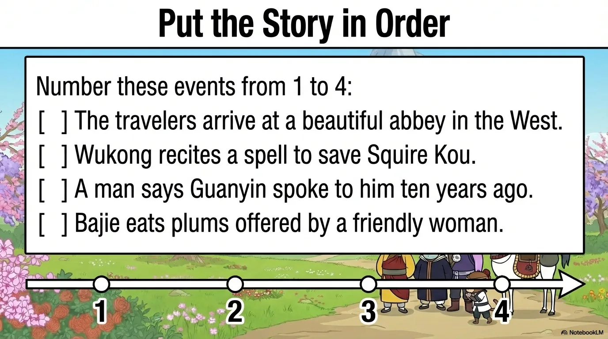

# 豆豆龙英语 · 第 103 集课件（EP103 草稿）

- 来源：`103_Journey to the West 103_The Land of the West.pptx`（主课件，20 页）
- OCR：`blocked`（no local OCR provider importable (pytesseract missing): No module named 'pytesseract'）
- 分类：待人工审核（unknown）
- 审核状态：`unreviewed`

## Slide 001

- 来源：`ppt/media/image1.png`（relationship `rId2`）
- 尺寸：1376×768
- 源 SHA-256：`06f602f158eee101348a86575997760cdc1584019ef43b9b4f7218c2e26c6934`
- 输出 SHA-256：`980924a1130a168bdc37a2d4bf91acd8f82b3d42313bd8e56073b60e3253613e`
- 分类：unknown ｜ OCR：blocked ｜ 审核：unreviewed

## Slide 002

- 来源：`ppt/media/image3.png`（relationship `rId2`）
- 尺寸：1376×768
- 源 SHA-256：`9473dd67e69921cda4a3793a9c8b63639ab8148594481664a9e6549bfa07ec4e`
- 输出 SHA-256：`d283bc5b230046c481b1392595796840cdecfb5ba506da8c5cc6cec66c4cc4d8`
- 分类：unknown ｜ OCR：blocked ｜ 审核：unreviewed

## Slide 003

- 来源：`ppt/media/image4.png`（relationship `rId2`）
- 尺寸：1376×768
- 源 SHA-256：`386ef10574a556dd10fb99b1e51da683462c46d29f165c93ad68f614b8ab41a6`
- 输出 SHA-256：`707b3e5f69375d4dafe088f33f08c5632e0915e95e6a61ae062847b40dd736e9`
- 分类：unknown ｜ OCR：blocked ｜ 审核：unreviewed

## Slide 004

- 来源：`ppt/media/image5.png`（relationship `rId2`）
- 尺寸：1376×768
- 源 SHA-256：`30e2aa87865cce8bc3e2a5ea648077e2e5cfb1866b76a0230471fc79506a7cf7`
- 输出 SHA-256：`66930232dca1e1362cb069e2f535fa630269ba296873a55c0158f1255ca14fd4`
- 分类：unknown ｜ OCR：blocked ｜ 审核：unreviewed

## Slide 005

- 来源：`ppt/media/image6.png`（relationship `rId2`）
- 尺寸：1376×768
- 源 SHA-256：`e9dae2e992554db6af5b83031ac17e0fd762fdaecc79c26ea9e77c7edd51fd78`
- 输出 SHA-256：`de67a8cf022e34bb3d37518780bfadf847a296c943bad2660e46e02c44af4115`
- 分类：unknown ｜ OCR：blocked ｜ 审核：unreviewed

## Slide 006

- 来源：`ppt/media/image7.png`（relationship `rId2`）
- 尺寸：1376×768
- 源 SHA-256：`ea7bd987841f43ef34d426269802d47afdf726b80682ca529ad09ec19c10554d`
- 输出 SHA-256：`272ade8d0051d251e1f6a387a1709a630a44f28f983414dafbed8bb2f8214443`
- 分类：unknown ｜ OCR：blocked ｜ 审核：unreviewed

## Slide 007

- 来源：`ppt/media/image8.png`（relationship `rId2`）
- 尺寸：1376×768
- 源 SHA-256：`797c8d9aa5b26b35e969812d4ab0e07ea43d543f222d6ddc440268613fa9132f`
- 输出 SHA-256：`e297f006c72613937693aba05f72acfc85173fd4792f6c71913b408e176de0c0`
- 分类：unknown ｜ OCR：blocked ｜ 审核：unreviewed

## Slide 008

- 来源：`ppt/media/image9.png`（relationship `rId2`）
- 尺寸：1376×768
- 源 SHA-256：`f9f68daaa0f9fe2d222450cb189247a5aca4389772710479cd1401dc254b33b4`
- 输出 SHA-256：`5503e6134c850d90f02fe29d473ed411e3d1766301d769651cdaaadc4a7de7e8`
- 分类：unknown ｜ OCR：blocked ｜ 审核：unreviewed

## Slide 009

- 来源：`ppt/media/image10.png`（relationship `rId2`）
- 尺寸：1376×768
- 源 SHA-256：`17d112aa252daf6c360460699f58fe591131367cc52f586b6b48a282ced1031c`
- 输出 SHA-256：`34b77526fea64730ae9aa2019080090caf35b29e0573c11e13504db69da627ff`
- 分类：unknown ｜ OCR：blocked ｜ 审核：unreviewed

## Slide 010

- 来源：`ppt/media/image11.png`（relationship `rId2`）
- 尺寸：1376×768
- 源 SHA-256：`1d11b1a327e8da0b901addf84eec11d077975c47d0787eb4f9adae986ba286f4`
- 输出 SHA-256：`f8e09ac8b37313706a5ec0a834c0d71f94ead3835d52c5eb921914cb30ab1371`
- 分类：unknown ｜ OCR：blocked ｜ 审核：unreviewed

## Slide 011

- 来源：`ppt/media/image12.png`（relationship `rId2`）
- 尺寸：1376×768
- 源 SHA-256：`624509471a8c7fcd36509623e2da98cd096d4de824974d4a7bc44cf033f61a03`
- 输出 SHA-256：`0e680e2f271c20e55578efc33d4b9842b2291fadbc30eca5a3a6fc858c0e5a87`
- 分类：unknown ｜ OCR：blocked ｜ 审核：unreviewed

## Slide 012

- 来源：`ppt/media/image13.png`（relationship `rId2`）
- 尺寸：1376×768
- 源 SHA-256：`0512a849b2f61516f238d10a72bdd32574b8543cf326756b962bddd4effc2a46`
- 输出 SHA-256：`2e8675cd3a0813cbcdd7561e77ec39b5707861ebd177fe55a93ecae373f7b0b8`
- 分类：unknown ｜ OCR：blocked ｜ 审核：unreviewed

## Slide 013

- 来源：`ppt/media/image14.png`（relationship `rId2`）
- 尺寸：1376×768
- 源 SHA-256：`b8b96199ac599ded1d4bcf758d0afa08c5b7ef22b13be2925c710fdf19f0170d`
- 输出 SHA-256：`1c17513300de550b87243bcd50cd104f380663fdecd1895dac15013042f6b5e3`
- 分类：unknown ｜ OCR：blocked ｜ 审核：unreviewed

## Slide 014

- 来源：`ppt/media/image15.png`（relationship `rId2`）
- 尺寸：1376×768
- 源 SHA-256：`fb32f74998f8181ddd5c7776115a04e5e64972d59c58d012a28a7f2fe2eba044`
- 输出 SHA-256：`10c37458d0ad763065ef6c156f41fa7fc2ad412bf68521e0399fb7723c5f74e9`
- 分类：unknown ｜ OCR：blocked ｜ 审核：unreviewed

## Slide 015

- 来源：`ppt/media/image16.png`（relationship `rId2`）
- 尺寸：1376×768
- 源 SHA-256：`b6e7f69ffde1216db534b268480a9d8083490739b23eed17510d496fb50965bf`
- 输出 SHA-256：`54b0f019080e56942e5469c3941412da57fae0ae3225ff780a76e9a11830f7ee`
- 分类：unknown ｜ OCR：blocked ｜ 审核：unreviewed

## Slide 016

- 来源：`ppt/media/image17.png`（relationship `rId2`）
- 尺寸：1376×768
- 源 SHA-256：`781b7848f892330ac1cc3d7dd4d245e720c8f3c6412494e02a8e438f9aa7d19d`
- 输出 SHA-256：`0dc27f9440115629d737f4d91f21cb115ef777a17d2cc4440d07a2345b1e9ae5`
- 分类：unknown ｜ OCR：blocked ｜ 审核：unreviewed

## Slide 017

- 来源：`ppt/media/image18.png`（relationship `rId2`）
- 尺寸：1376×768
- 源 SHA-256：`ae0b234b886aae61b38ec131fde5f4216bc5095c56fd1ebddc4cd2dc80aad19b`
- 输出 SHA-256：`6fda25f4a7b32d4e6bb2714b6c3b2e7a280dbfd9338727359b3f2d30ee853125`
- 分类：unknown ｜ OCR：blocked ｜ 审核：unreviewed

## Slide 018

- 来源：`ppt/media/image19.png`（relationship `rId2`）
- 尺寸：1376×768
- 源 SHA-256：`57a98af582a94eb51c3551e76383b5594bad37791fd24e67e840204a90619ef9`
- 输出 SHA-256：`d1251ccfecee03544fd6fd8309e9adda1e1c178c99b28101a259a537b5794cd2`
- 分类：unknown ｜ OCR：blocked ｜ 审核：unreviewed

## Slide 019

- 来源：`ppt/media/image20.png`（relationship `rId2`）
- 尺寸：1376×768
- 源 SHA-256：`e8febef5e1650adaa6c1d7551aea2f7864d01a72431e9cb03cb87e03779ffc6a`
- 输出 SHA-256：`96a1ea037d0a6bf8994fabaee1d6391cfe84f3d463c228cc1e6c9e0a988f818a`
- 分类：unknown ｜ OCR：blocked ｜ 审核：unreviewed

## Slide 020

- 来源：`ppt/media/image21.png`（relationship `rId2`）
- 尺寸：1376×768
- 源 SHA-256：`08a122fb643aedf07eb49cccd1ca759b3899697a339e6f17dc424b3bd9f05319`
- 输出 SHA-256：`452d72fa091f5d077c393d2f926a4706b203e57e6c57fc1c9e0e27bdd33b3720`
- 分类：unknown ｜ OCR：blocked ｜ 审核：unreviewed
