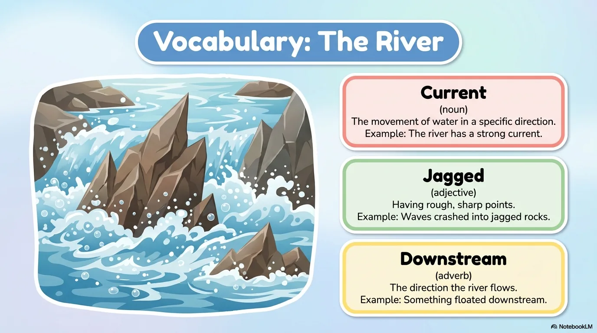
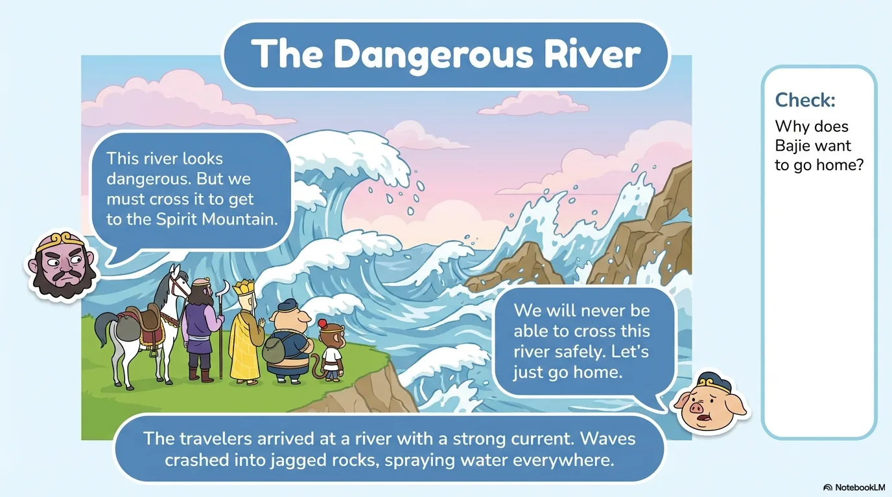
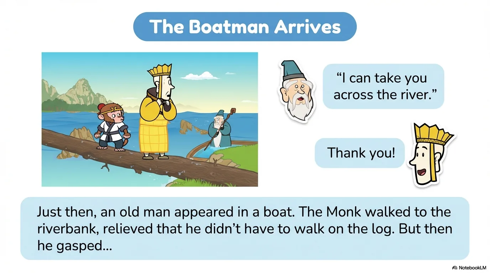
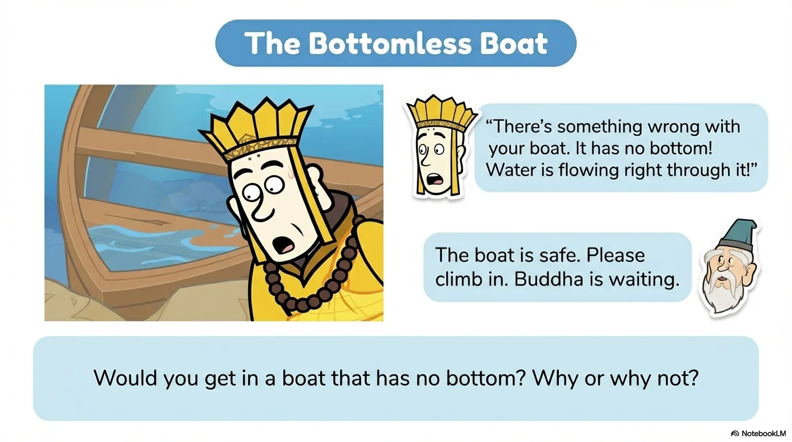

# 豆豆龙英语 · 第 104 集课件（EP104 草稿）

- 来源：`104_Journey to the West 104_The Tang Monk and the River.pptx`（主课件，20 页）
- OCR：`blocked`（no local OCR provider importable (pytesseract missing): No module named 'pytesseract'）
- 分类：待人工审核（unknown）
- 审核状态：`unreviewed`

## Slide 001

- 来源：`ppt/media/image1.png`（relationship `rId2`）
- 尺寸：1376×768
- 源 SHA-256：`88dee0323fb80aee799cb6af4acf016dd8358ed1d6b55c9478a5cde799d9c912`
- 输出 SHA-256：`a212946e54348dd6c944b05d6a605f6bce90a5a13f5b260f76614db081c277a9`
- 分类：unknown ｜ OCR：blocked ｜ 审核：unreviewed

## Slide 002

- 来源：`ppt/media/image3.png`（relationship `rId2`）
- 尺寸：1376×768
- 源 SHA-256：`7e259d4d5b3ccb8b0a5506814718f8a0e3b5aafb3e7fadfda07812e8e06712f1`
- 输出 SHA-256：`185cc79647d9b313abf575103331f136c964c25d9403509d6c9ba0e047d0cbe3`
- 分类：unknown ｜ OCR：blocked ｜ 审核：unreviewed

## Slide 003

- 来源：`ppt/media/image4.png`（relationship `rId2`）
- 尺寸：1376×768
- 源 SHA-256：`aa70d04556dd57aa479ad587be44d7d44c8dd8ce9c6c9aa5b8a934f770cf55bb`
- 输出 SHA-256：`af2844ed4a75cf3d11a3e9553d3345a9b14e65907985b21486f8f98d485ccee1`
- 分类：unknown ｜ OCR：blocked ｜ 审核：unreviewed

## Slide 004

- 来源：`ppt/media/image5.png`（relationship `rId2`）
- 尺寸：1376×768
- 源 SHA-256：`2712dba6297e78e0af0c19c4721cbeb7126fe91e38b519be5894041f7a6411d5`
- 输出 SHA-256：`3f6145849e663d1b25ae2c5ad0e2cd5c15103f829bcdad6eccafb355e734ed10`
- 分类：unknown ｜ OCR：blocked ｜ 审核：unreviewed

## Slide 005

- 来源：`ppt/media/image6.png`（relationship `rId2`）
- 尺寸：1376×768
- 源 SHA-256：`15a8c097e1691ef34f82b78a6840c903cfb160c45dc5c828fd4baca9d7c064f7`
- 输出 SHA-256：`4d69575998bb3f69233deef031234530868f0369dcd383945c9237328b071352`
- 分类：unknown ｜ OCR：blocked ｜ 审核：unreviewed

## Slide 006

- 来源：`ppt/media/image7.png`（relationship `rId2`）
- 尺寸：1376×768
- 源 SHA-256：`ed735644df5a1fde67785c574e3b873f638746f907dc5a3b1d59b31663e36276`
- 输出 SHA-256：`47ad6670ff38a16ec5fac27acfeb26ed159b58258d2455560549993b739143f7`
- 分类：unknown ｜ OCR：blocked ｜ 审核：unreviewed

## Slide 007

- 来源：`ppt/media/image8.png`（relationship `rId2`）
- 尺寸：1376×768
- 源 SHA-256：`bde7f558ac0a221ee8880f2365046fe8640ce82c389e9bc4f196219b771a3af3`
- 输出 SHA-256：`8f3a06ca514312cc1362b11697a9997931b8c7ed5c415f29b28da44484162aaa`
- 分类：unknown ｜ OCR：blocked ｜ 审核：unreviewed

## Slide 008

- 来源：`ppt/media/image9.png`（relationship `rId2`）
- 尺寸：1376×768
- 源 SHA-256：`1823c6a41ea73b41d48dd8a07838589b4bfd5bdf0a2bdfe545cc60baa048e61b`
- 输出 SHA-256：`bc236fb84b67916f1625e2ec38bbd06724fa7911d1d4d7c664c90a7b52a01da4`
- 分类：unknown ｜ OCR：blocked ｜ 审核：unreviewed

## Slide 009

- 来源：`ppt/media/image10.png`（relationship `rId2`）
- 尺寸：1376×768
- 源 SHA-256：`6a19f4551ee76d03548e89d3fbe0c319a2fc71290b98c3c6ade242026f0dde69`
- 输出 SHA-256：`04e914278bb295b061e49f99aeb5b834277590fac08424f2c9381bb1edeb9f65`
- 分类：unknown ｜ OCR：blocked ｜ 审核：unreviewed

## Slide 010

- 来源：`ppt/media/image11.png`（relationship `rId2`）
- 尺寸：1376×768
- 源 SHA-256：`8419ad3db2c68ffc7fa55fb1bae2d579f373f39767e5b09ccbfc629e392d19e3`
- 输出 SHA-256：`c37c4138f43414ba7724ab1531b47aa0b5c8194814fac752718187d60e002839`
- 分类：unknown ｜ OCR：blocked ｜ 审核：unreviewed

## Slide 011

- 来源：`ppt/media/image12.png`（relationship `rId2`）
- 尺寸：1376×768
- 源 SHA-256：`e8d92c0d3fa898414fb4527005651651ebddc32d5e33ff11e6771ed43d3695e7`
- 输出 SHA-256：`641f511ddffc83e1253e4a38e696a9b2d95edafb9eea1626503157fb0f996696`
- 分类：unknown ｜ OCR：blocked ｜ 审核：unreviewed

## Slide 012

- 来源：`ppt/media/image13.png`（relationship `rId2`）
- 尺寸：1376×768
- 源 SHA-256：`05736890cae18804428b4a00c7bf12a692475e0b9c336668d41aaf666f0b91cc`
- 输出 SHA-256：`cf813f189ae2ddeecebdd1ca9ebab966bf0efbda9e90fc9382520396bbbd304a`
- 分类：unknown ｜ OCR：blocked ｜ 审核：unreviewed

## Slide 013

- 来源：`ppt/media/image14.png`（relationship `rId2`）
- 尺寸：1376×768
- 源 SHA-256：`8a38860f0bf8c17d7a7f06a178a426a8083e22ee948993bb157316cfe29f6bfc`
- 输出 SHA-256：`04e251a416ba610628f8cad2807295b718ae2faac00d2bd6c5bbc9b7a1f14fb8`
- 分类：unknown ｜ OCR：blocked ｜ 审核：unreviewed

## Slide 014

- 来源：`ppt/media/image15.png`（relationship `rId2`）
- 尺寸：1376×768
- 源 SHA-256：`39eacfefdfd07ac6fd4ab74e81ee2e4cec5703afca6203f1d7dd3ee3a21b8daf`
- 输出 SHA-256：`4a864aaf7d42b6e2e614a55b05f143fb04232d2c41e38ad8e50137802ac72b48`
- 分类：unknown ｜ OCR：blocked ｜ 审核：unreviewed

## Slide 015

- 来源：`ppt/media/image16.png`（relationship `rId2`）
- 尺寸：1376×768
- 源 SHA-256：`0706e42d7fb426ce22a7b4e42b01ca23ffdce331b52d6b81fa0e3e442f969465`
- 输出 SHA-256：`0f0979422be4d7acfff443df525997d7f351baa497801268fbee06a49ead17b0`
- 分类：unknown ｜ OCR：blocked ｜ 审核：unreviewed

## Slide 016

- 来源：`ppt/media/image17.png`（relationship `rId2`）
- 尺寸：1376×768
- 源 SHA-256：`a460e265e53e2ccbb7b50c6186ba5491fbe4aa2e081c5e5c018d609edba57af9`
- 输出 SHA-256：`21609db2251cde4eeff1537fd9a60130cf2ea6f3c31982129a56f7153a992488`
- 分类：unknown ｜ OCR：blocked ｜ 审核：unreviewed

## Slide 017

- 来源：`ppt/media/image18.png`（relationship `rId2`）
- 尺寸：1376×768
- 源 SHA-256：`3b91e2ecb70e243bd462d6e47b77376e20a8a12a694b7ddb6e20d66953422e33`
- 输出 SHA-256：`a11af44d60d10491e8ddd9b572bbee75fb42040dfb0b723651f29a02d4ddce4b`
- 分类：unknown ｜ OCR：blocked ｜ 审核：unreviewed

## Slide 018

- 来源：`ppt/media/image19.png`（relationship `rId2`）
- 尺寸：1376×768
- 源 SHA-256：`d7109cf1788ec2fec57b96a4f0c3071b66d5d43bde10e48fa1ae708fc64a9853`
- 输出 SHA-256：`ebc986e78cfc7072613406d542b9e7fc7381789ee55f2be61f15e19f675a390e`
- 分类：unknown ｜ OCR：blocked ｜ 审核：unreviewed

## Slide 019

- 来源：`ppt/media/image20.png`（relationship `rId2`）
- 尺寸：1376×768
- 源 SHA-256：`7fa3ac21fc608b2599453f197d74c50bdb061d880faa6e6fd08afd3fa95c8e60`
- 输出 SHA-256：`54e48e649d461c18cd99e4c1e7b0f0feed626070f1ca755fa37423556b996a30`
- 分类：unknown ｜ OCR：blocked ｜ 审核：unreviewed

## Slide 020

- 来源：`ppt/media/image21.png`（relationship `rId2`）
- 尺寸：1376×768
- 源 SHA-256：`bfd2ff2cb92a926c8b289fbdc2dd89326f24a12ebeb618352472c11f7b0cfcee`
- 输出 SHA-256：`e292592352e3948de35e32f9ff82204a1f15ff909d9732bcfc8dac622f5c40b0`
- 分类：unknown ｜ OCR：blocked ｜ 审核：unreviewed
